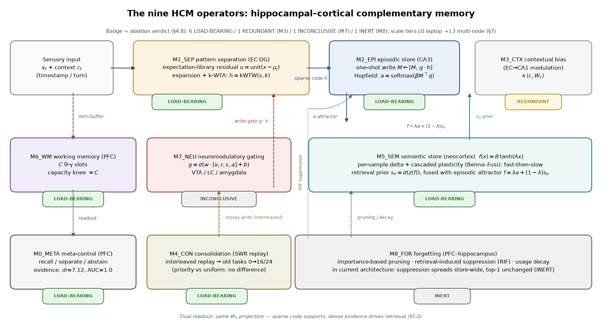
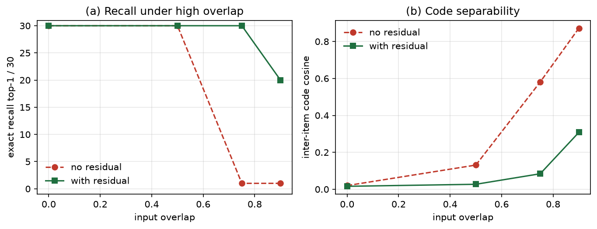
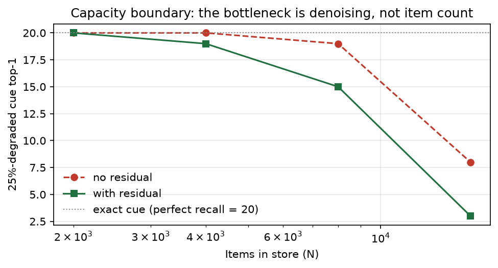
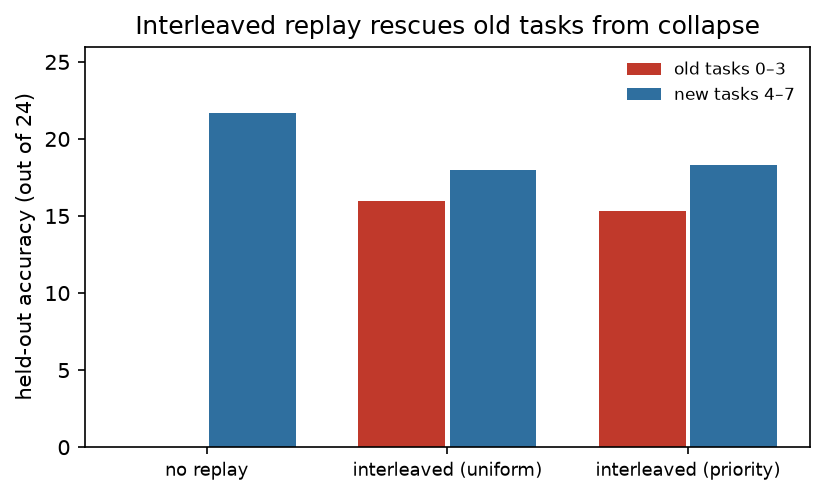
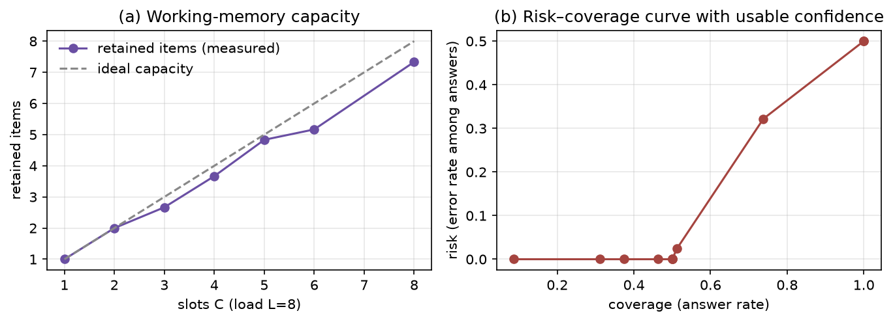

# A Log-N Collapse Law in Attractor Memory: A Reproducible, Dual-Readout Hippocampal–Cortical Complementary Memory Model (HCM)

**Abstract.** We present HCM (Hippocampal–Cortical Complementary Memory), a biologically inspired computational model of memory with an executable, seed-reproducible reference implementation and a systematic benchmark suite. HCM factorises memory into nine operators: input/context space, encoder, episodic fast store, semantic slow store, working memory, consolidation, retrieval control, forgetting, and neuromodulatory gating. Three claims are central. (i) **A collapse law.** The harm of the retrieval inverse temperature β grows with library size as log N: two earlier negative results (residual harm growing with scale; L1-scale denoising failure) were artifacts of a single mis-set β, disappearing entirely at β=100 (dose–response, analytic theory, and an external replication in vanilla attention; Sec. 4.12, Appendices E/F), and the turning point β≈20 replicates across two encoders on a real six-conversation corpus (Sec. 4.21). The same staircase is measured from 10³ through 10⁶ items, the 10⁶ tier passing a pre-registered gate (60/60 at both degradation levels in both arms, zero abstention; Sec. 7); a β* calibrated on one session transfers to a held-out session at 99.6% of hand-selected performance (Sec. 4.22); and a six-architecture contrast passes its three pre-registered gates — classical attractors collapse to the floor, modern baselines sit flat at a mediocre plateau, and only HCM's log-N β*(N) compensation holds retrieval near 0.8–0.9 across tiers (Sec. 4.19). (ii) **A single projection should be read out twice.** A k-sparse code for writing, and the un-thresholded dense evidence as the initial state of a modern Hopfield attractor for retrieval: at 60% dropout, sparse-code readout degrades (50/50 to 39/50) while dense readout stays at 50/50; attractor-reconstruction match abstains in-store from novel cues with d′=7.12 (0.500 error at full coverage to 0.000 at coverage 0.50, Sec. 4.6), and on a public corpus the same gate behaves as a distribution-shift detector on same-source test messages (Sec. 4.20); at 92,760 items the semantic channel alone carries no item identity (0/200) while the attractor control stays healthy — the division of labour is measured, not assumed (Sec. 4.22). (iii) **The value of systems consolidation lies in interleaving rather than prioritisation.** Without replay, old-task accuracy collapses to 0.0/24 (0.00±0.00, 20 seeds); uniform interleaved replay retains 13.85±2.66 of 24; prioritised replay (recency x surprise) scores 14.80±3.96 of 24, statistically indistinguishable from uniform (20-seed paired p=0.32) — no detectable difference, a negative result we report. Scoped findings follow. On high-overlap synthetic benchmarks (share 0.85–0.92), subtracting a slowly-varying expectation lowers inter-item code cosine from 0.872 to 0.308 and raises exact recall from 1/30 to 25/30; on the real corpus the gain does not transfer (12/12 cells off ≥ on) — a boundary we report (Sec. 4.21). End-to-end on real colloquial Chinese, 2,000-item stores reach the synthetic ceiling (200/200 at 30% degradation) only under a corrected judging criterion — the unpatched criterion scores the identical runs 0/200, a live demonstration of evaluation forensics (Sec. 4.13) — while the same model at 92,760 stored items retrieves 129/200 at 30% degradation (156/200 undegraded), the honest scale limit. A learned character encoder acquires real representation-level semantic structure (target-similarity +0.206, t=28.3, n=300) that does not convert into retrieval gains over cheap lexical baselines (Sec. 4.13.3); dense Hopfield and SDM baselines on identical data score 2/200 and 0/200 where HCM scores 48/200 (Sec. 4.19). All experiments run on a NumPy-only reference implementation with fixed seeds.

**Keywords.** complementary learning systems; pattern separation; modern Hopfield networks; systems consolidation; sharp-wave ripples; continual learning; working memory; metacognition; reproducible benchmarking

---

## 1 Introduction

Memory research has long faced a structural tension: **how can one and the same neural network rapidly memorise a single experience while slowly extracting statistical regularities across experiences?** Complementary learning systems (CLS) theory answers with a division of labour: the hippocampus rapidly encodes non-overlapping episodic representations, the neocortex slowly extracts structure from overlapping distributed representations, and the two cooperate through offline replay {{McClelland1995}} {{Squire1992}} {{Kumaran2016}}. This framework has been broadly successful in explaining amnesia, sleep-dependent consolidation, and semanticisation. As an **engineering-executable** model, however, it has long lacked three ingredients: (1) every subsystem written as a computable operator with an explicit rationale for its parameter values; (2) claims stated as falsifiable quantitative predictions and tested on a shared benchmark — including tests that fail; (3) an implementation that is reproducible and scalable to supercomputer sizes.

This paper supplies all three. We present HCM — a nine-operator, single-file, NumPy-only reference implementation — and systematically test the core claims of CLS on the five synthetic generator families (Sec. 4.1) and on two real corpora (Secs. 4.13, 4.20).

Three claims, each falsifiable and each tested:

1. **A log-N collapse law in attractor memory.** The retrieval softmax gain β is not a free parameter: as library size N grows, retrieval contrast collapses unless β scales as log N. We give the analytical basis (Appendix E), a dose–response map of β across library sizes (Sec. 4.12), a cross-encoder replication of the turning point (Sec. 4.21), and a verified operating point — β=100 full-pass at the 10⁵-item tier (Sec. 7).

2. **A dual-readout architecture for complementary memory.** Pattern separation is re-located: expansion plus k-WTA sparsification does not improve item separability (code cosine 0.872 at overlap 0.90); subtracting a slowly-varying expectation does (0.308). A single projection must be read out twice — the sparse code for writing, the dense evidence for retrieval — and the two readouts are consolidated by interleaved replay into a semantic store that episodic retrieval can consult (Secs. 4.2, 4.4, 4.10).

3. **Verifiability as a first-class result.** Every operator is a computable operator with stated parameters; claims are machine-checkable assertions (444/444 at submission); the four-tier scale protocol L0–L3 runs from laptop to 2×10⁷ items (sparse column storage ~210 GB vs dense ~5.2 TB). Complexity is reported as measured, not as advertised: writing is O(k) on the sparse path, but the duplication gate makes the measured write cost O(N²) at scale — 0.82–0.96 s/item at N=10⁵ (Sec. 7) — with an opt-in inverted-index fastpath measured at 50–197× (Appendix D); retrieval is O(LNk) and was dtype-dominated until a float32 chain (137×, Appendix D). Negative results are reported verbatim, with a reusable instrument-first protocol for judging them (Secs. 4.12, 4.13).

The difference from prior work is not a novel learning rule, but the composition of a closed loop out of literature-derived mechanisms, followed by minimal decisive experiments that determine, for each mechanism, whether it is actually doing the work or merely "sounds plausible". This process produced several conclusions that contradict popular narratives; we consider those conclusions valuable in themselves.

---

## 2 Related Work

**Complementary learning systems.** McClelland, McNaughton and O'Reilly formalised the idea that fast learning requires sparse, orthogonal codes to limit interference while slow learning requires overlapping, distributed representations to extract structure {{McClelland1995}}. CLS has since been updated repeatedly: Kumaran et al. highlight "replay plus a generative model" as two complementary capacities an agent needs {{Kumaran2016}}; Squire and Zola used amnesic patients to dissociate the neural bases of episodic and semantic memory {{Squire1998}}. We keep this division of labour but implement "fast" as one-shot outer-product writing (modern Hopfield) and "slow" as a low-rank feedforward net with cascade plasticity {{Fusi2005}} {{BennaFusi2016}}.

**Pattern separation.** The dentate gyrus (DG) is regarded as the core structure for pattern separation: Leutgeb et al. showed in vivo that DG produces less correlated representations of similar inputs than CA3 {{Leutgeb2007}}; Neunuebel and Knierim showed that CA3 can restore a whole representation from degraded inputs, i.e. pattern completion {{Neunuebel2014}}; Yassa and Stark review human high-resolution fMRI and behavioural evidence {{Yassa2011}}; Rolls surveys the computational mechanisms {{Rolls2013}}. Our experiments add one precision to this narrative: **expansion and sparsification are necessary but not sufficient**; when inputs share a large slowly-varying component, a residual subtraction must come first.

**Attractors and sparse codes.** The classic capacity of Hopfield networks is about 0.138N {{Hopfield1982}}; modern Hopfield networks write the update as a softmax, obtain capacity exponential in the feature dimension, and map onto attention {{Demircigil2017}}. Our episodic store uses the continuously-iterated softmax update and explicitly records the necessity of one implementation detail — initialising the attractor from the dense evidence; initialising from the sparse code drops recall from 27/30 to 17/30. Ramsauer et al. formalise modern Hopfield networks as transformer attention with three classes of fixed points — global averages, metastable sets, and individual patterns {{Ramsauer2020}}; Bricken and Pehlevan establish the attention–SDM equivalence {{Bricken2021}}. Our episodic store sits in this lineage, and its collapse law concerns the low-β regime in which retrieval averages across stored items — the global-average fixed point.

**Softmax sharpness under growing item counts.** Veličković et al. show theoretically that a fixed-temperature softmax cannot robustly approximate sharp functions as the number of test-time items grows, and that learned circuits must therefore disperse {{Velickovic2024}}; §4.12 and Appendix F provide the associative-memory empirical counterpart — a dose–response with β*(N) ≈ log N, a verified operating point (β=100 full-pass at N=10⁵, §7), and a carrier localisation (shared gist rows).

**Extreme-value interference and retrieval-contrast degradation (prior-theory alignment).** Ghaffari et al. formalise "evidence degradation as distractors accumulate" as extreme-value interference in attention: the decisive-evidence score is upper-bounded while the maximum score among effective distractors grows with their number; under a softmax retrieval abstraction, maintaining a fixed accuracy target requires the evidence margin to scale as $\Omega(\sqrt{\log N})$ (with $N$ the effective distractor count) {{Ghaffari2026}}. That work (public 2026-08-12, three months before our measurements) and this report's Sec. 4.12 / Appendix E share the **same phenomenon domain, the same extreme-value statistical core, and a scaling law of the same family**; the differing exponents (a worst-case $\Omega(\sqrt{\log N})$ lower bound vs the measured compensating $\beta^*(N)\approx\log N$ on structured sparse corpora) reflect different boundary conditions, not a contradiction. The division of labour: the prior work answers the degradation side (how fast retrieval degrades); this report answers the compensation side (how much to adjust) — the measured $\beta^*(N)$ compensation curve, the score-gap online instrument, and cross-session transfer (Sec. 4.22). Our experimental timeline postdates that publication; this section is a retroactive addition, stated to avoid any priority misunderstanding.

**Systems consolidation and replay.** Sequence reactivation inside sharp-wave ripples (SWRs) during sleep is central to systems consolidation {{Wilson1994}} {{Buzsaki2015}}; replay runs both forward and in reverse {{Foster2006}} {{Diba2007}}; suppressing ripples impairs spatial memory {{Girardeau2009}}; the macroscopic time course of systems consolidation is reviewed in {{Frankland2005}} {{Klinzing2019}}; for memory "transformation" rather than "copying" see {{Winocur2011}} {{Sekeres2018}}. We test these claims computationally: the role of replay is **interleaving**, while "picking by importance" yields no extra benefit on our benchmark.

**Timing decisions for writing and retrieval (priority alignment).** This model treats “whether to write” as an explicit decision, and two lines of prior work must be put side by side. Lu, Hasson and Norman train a recurrent network to explicitly learn *when to retrieve and when to encode* episodic memories {{Lu2022}} — the nearest neighbour that treats writing/retrieval as controlled decisions rather than passive registration. Spens and Burgess’s generative model of memory uses error-gated storage and itself acknowledges a trade-off between write flexibility and capacity {{Spens2024}}. Our increment is not “having a gate” but three things: the gate is an **event-level multi-channel** decision (novelty/reward/salience/activation, four channels synthesised, §3.6, not a single error signal); channel contributions are **ablated item by item and reported honestly** (including the functional-redundancy verdict between gating and write deduplication, §4.8); and the whole write decision is tested **end-to-end on a real corpus against public baselines** (§4.13, §4.19).

**Continual learning.** Catastrophic forgetting was named by McCloskey and Cohen and reviewed by French {{French1999}}; engineering countermeasures include regularisation (EWC {{Kirkpatrick2017}}), replay, and architectural isolation. Our results agree that replay works, but stress that its efficacy depends on **whether the target representations share coordinates** — a point often ignored in the machine-learning literature. Similarity-weighted interleaved learning trains cross-coupled architectures to interleave new with similar old items {{Saxena2022}}; our interleaving verdict (§4.4) is consistent with that line and extends it to the memory-system level.

**Working memory and metacognition.** The dispute between the 7±2 {{Miller1956}} and 4±1 {{Cowan2001}} capacity estimates is reconciled by the theta–gamma nested-oscillation model: each gamma cycle carries one item, the theta cycle sets the number of slots {{Lisman1995}}. On metacognition, expected-value-of-control theory casts "whether to invest cognitive resources" as cost minimisation {{Shenhav2013}}, and the neural basis of metacognitive ability is reviewed in {{Fleming2012}}. Our meta-controller inherits cost minimisation and reports the measured discriminability of its confidence signal (Sec. 4.6).

**LLM memory systems (system identification).** Since 2023 a family of engineering systems named "memory" has appeared around LLM agents; they are the application-facing competitors of this model, and we identify them at the related-work level (per the citation-policy revision of 2026-11-07, such entries are tagged [system identification] and are not used as evidence for scientific claims). Six routes emerge. (1) Context paging — MemGPT ports the OS virtual-memory metaphor into conversation, with the LLM calling tools to page between the main context and external storage {{Packer2023}}. (2) Experience stream plus reflection — Generative Agents store all natural-language experiences, retrieve by recency x importance x relevance, and periodically reflect to synthesise higher-level memories {{Park2023}}. (3) Memory CRUD — Mem0 lets an LLM extract candidate facts, compare them to a vector store, and decide add/update/delete {{Chhikara2025}}. (4) Temporal knowledge graphs — Zep maintains event time and ingestion time as two timelines, with edge invalidation acting as "forgetting" {{Rasmussen2025}}. (5) Hippocampal-indexing-inspired retrieval — HippoRAG uses an LLM-extracted knowledge graph as the index and Personalized PageRank as pattern completion, the most recent bio-inspired academic competitor {{Gutierrez2024}}; its successor generalises the framework to non-parametric continual learning {{Gutierrez2025}}. (6) Card box — A-MEM organises memories as Zettelkasten notes with neighbour-triggered evolution {{Xu2025}}. A survey of this engineering-agent memory line is given in {{Zhang2024}}.

**Why they do not engage with memory dynamics.** Compared with the nine subsystems of this model, these systems differ structurally in three ways. First, **frozen representations**: all similarity comes from pretrained embeddings; none learns representations from the user's data stream — so the input spaces of gating, disambiguation, and consolidation are fixed to the pretraining distribution. Second, **four operators absent or uncalibrated**: writing has no novelty gate (write-everything or LLM discretion); consolidation equals LLM summarisation/reflection (representations unchanged); forgetting equals explicit deletion or edge invalidation (no calibrated usage decay); retrieval control has no concept of abstention (always return top-k). Third, **a different objective function**: these systems optimise product metrics (latency, scalability, LoCoMo scores), whereas the life-cycle dynamics of memory — write gating, replay-based consolidation, retrieval-induced forgetting, calibrated abstention — are second-order at product time scales. This explains why bio-inspired metaphors (such as the hippocampal index of HippoRAG) are used as retrieval structures rather than as dynamical models. HCM is complementary rather than a replacement: any of these systems could swap its storage kernel for HCM dynamics, and the HippoRAG family is also our preferred baseline for future controlled comparisons.

---

## 3 The Model: HCM

*Figure 1. The nine operators of HCM and their data flow.*

### 3.1 Formal definition

HCM is a nine-tuple

    M = <X, Φ, E, S, W, Ψ, Π, Γ, G>

where X is the input/context space, Φ the encoder, E the episodic fast store, S the semantic slow store, W the working-memory buffer, Ψ the consolidation operator, Π the retrieval-control policy, Γ the forgetting operator, and G the neuromodulatory gate. Each element corresponds to a computable operator with a set of biologically grounded constraints from the literature (Table 1).

| Operator | Computational entity | Biological counterpart | Key references |
|---|---|---|---|
| X | content vector + context vector c + time index τ | entorhinal grid/border-cell inputs | {{Keefe1971}} {{Hafting2005}} |
| Φ | expectation-bank residual + expansion + k-WTA | entorhinal cortex II/III → dentate granule cells | {{Leutgeb2007}} {{Yassa2011}} |
| E | sparse column store + modern Hopfield iteration | CA3 recurrent collaterals | {{Hopfield1982}} {{Demircigil2017}} |
| S | low-rank feedforward + cascade plasticity | neocortical pyramidal cells and semantic hubs | {{McClelland1995}} {{Fusi2005}} |
| W | C slots, k-WTA competition | prefrontal theta–gamma nesting | {{Lisman1995}} {{Miller1956}} |
| Ψ | interleaved replay + weighted relearning | hippocampal SWR and cortical slow waves | {{Wilson1994}} {{Buzsaki2015}} |
| Π | three-way cost-sensitive decision | prefrontal–hippocampal retrieval control | {{Shenhav2013}} {{Fleming2012}} |
| Γ | importance pruning + retrieval-induced suppression | prefrontal active suppression | {{Medina2018}} |
| G | novelty/reward/salience gating | VTA, amygdala, locus coeruleus | {{Lisman1995}} {{McGaugh2004}} |

### 3.2 Encoder Φ: expectation-bank residual + expansion and sparsification

This is the component that departs most from existing CLS implementations, and the one repeatedly confirmed by the experiments as the only separation mechanism that actually works.

**Step 1: the expectation-bank residual.** Let the input stream be x_t. We maintain a small expectation bank MU = {μ_1 … μ_B} (B ≤ 8; 2–3 templates active by default), each template an exponential moving average of some statistically stationary stretch of the stream. For the current input we first decide which template it belongs to, then take the residual:

    u_t = unit(x_t − μ_j),   μ_j ← γ μ_j + (1−γ) x_t  (γ = 0.9; only the selected template updates)

The word "slowly-varying" needs precision here: with γ=0.9 the EMA time constant is τ = 1/(1−γ) ≈ 10 samples (95% admixture takes ~29 samples). Over the 30-item streams of our benchmarks this is a **medium** speed; "slow" is relative to the **one-shot writing** of the episodic store, not to the seconds-to-minutes sense in biology. An earlier version stated this equation in the reversed direction (same origin as defect D-2); it has been corrected to match the code (0.9μ + 0.1x).

Two switching criteria send the current input to a new template (started from the zero vector): (a) a distance jump d_t > 1.5 · ν̄, where d_t = ||x_t − μ_j|| and ν̄ is the template's error EMA; (b) a direction reversal cos(x_t, μ_j) < 0.3 with ||μ_j|| > 0.3.

Why a *bank* rather than a single mean: on the two-task benchmark (task A: 20 items; task B: 20 items; the input means of A and B at 94°), a single μ drifts from A's mean to B's mean as tasks switch; after drifting, residuals of A items are no longer zero-mean, the cosine between write and query codes falls from 1.000 to 0.290, and recall of A drops from 20/20 to 13/20. With the expectation bank both A and B keep 20/20 at 25% feature dropout.

**Step 2: expansion projection + k-WTA.** The residual is expanded ρ-fold by a fixed random orthogonal projection (d_h = ρ·d_x, default ρ=8), biased, thresholded, and truncated to top-k:

    s_t = W_e u_t + b_e
    h_t = unit( relu_kwta(s_t − θ, k) ),  k = ⌈α d_h⌉, α = 0.02 (L0: k=20)

θ is fitted once during a "development phase" with a frozen homeostatic rule (θ_i += η(h_i − k/d_h) iterated on a fixed input set) and then frozen. **Online updates of θ destroy the self-consistency of already-written codes** — in an early version, enabling online homeostasis made query codes systematically mismatch all historical write codes, and recall fell from 30/30 to single digits.

**Step 3: the dual readout.** One projection, two uses — misunderstood in an early draft as a "sparse-vs-dense pathway competition":

- writing uses the sparse code h_t (the top-k support sets the interference level and the capacity);
- retrieval uses the un-thresholded dense evidence s_t (keeping magnitudes on all coordinates, more robust to feature dropout).

Measured (bench/exp11_readout.py; 60 stored items, 50 queries per condition): the two readouts are **indistinguishable** at low dropout; they diverge only at high dropout — sparse-code readout 50/50→48/50→**39/50**→36/50 (dropout 30/45/60/70%), dense readout 50/50→49/50→**50/50**→44/50. The value of the dense readout is not universal superiority but **extending the reliable-droput ceiling from ~45% to ~60%**. Beyond 70% both collapse.

**One point must be stressed (honesty list, item 1): expansion and sparsification by themselves do NOT improve item separability.** On inputs with overlap 0.90, the code cosine without the residual is 0.872 — nearly inseparable; with the residual it drops to 0.308 and exact recall rises from 1/30 to 25/30. Sparsification provides only "short codes" (small supports, cheap writes), not orthogonality.

### 3.3 Episodic store E: one-shot writing + modern Hopfield retrieval

Writing is a single outer-product-like operation (the column-store form of a modern Hopfield network):

    E ← E ∪ {(h_t, t, g_t, r_t, s_t, c_t, τ_t)}

Each item stores: the normalised sparse code h_t (for write-interference computation), time t, gate g_t, external reward r_t, dense evidence s_t (for the retrieval initial state), context c_t, and time-cell code τ_t (used only in context-bias experiments; off by default).

Retrieval is a continuously iterated softmax attractor:

    z_0 = unit(relu(s_q))            (dense evidence as initial state)
    a^{(0)} = softmax_β( Mᵀ z_0 )
    z^{(l+1)} = unit( M a^{(l)} )
    a^{(l+1)} = softmax_β( Mᵀ z^{(l+1)} ),  l = 0 … L−1
    output a = a^{(L)} / Σ a^{(L)},  β = 20, L = 3

where the columns of M are the normalised item codes. Three implementation details were forced on us by experiments:

1. **The initial state must be the dense evidence.** Starting from the sparse code yields 17/30 recall (overlap 0.75, 20% dropout); starting from the dense evidence yields 27/30.
2. **Do not re-sparsify during iteration.** Re-applying k-WTA to M a at every step lets the code drift between mixed states; the larger L, the worse (on a 30-item library, 19/30 falls to 2/30 at L=6).
3. **Annealing is harmful.** Starting from a low β and heating up leaves a near-uniform a in early steps, z becomes a multi-item mixed code, and the final code corresponds to no single item.

### 3.4 Semantic store S: low-rank feedforward + cascade plasticity

Semantic memory is a low-rank feedforward network:

    f(x) = B tanh(A x),   A ∈ R^{d_z×d_x}, B ∈ R^{d_h×d_z},  d_z ≪ d_h

Training uses hand-written backpropagation (per-sample delta rule):

    diff = f(x) − h_target
    dB = 2 · diff ⊗ tanh(A x)
    dz = (Bᵀ · 2 diff) ⊙ (1 − tanh²(A x))
    dA = dz ⊗ x
    η_ij = η / (1 + κ ω_ij),  ω_ij ← ω_ij + u_meta · 1[|dA_ij| > 0] · (1 − ω_ij)

Semantic memory is a low-rank feedforward network:

    f(x) = B tanh(A x),   A ∈ R^{d_z×d_x}, B ∈ R^{d_h×d_z},  d_z ≪ d_h

trained by manual backpropagation (per-sample delta rule):

    diff = f(x) − h_target
    dB = 2 · diff ⊗ tanh(A x)
    dz = (Bᵀ · 2 diff) ⊙ (1 − tanh²(A x))
    dA = dz ⊗ x
    η_ij = η / (1 + κ ω_ij),  ω_ij ← ω_ij + u_meta · 1[|dA_ij| > 0] · (1 − ω_ij)

ω is a scalar proxy of the Benna–Fusi cascade model: synapses that are driven frequently lose plasticity (protecting old memories), while synapses left undisturbed for a long time recover it. Two engineering necessities are added: (a) gradient clipping (diff clipped to ±3, dA/dB to ±1), otherwise η = 0.2 overflows to inf inside the matmul; (b) synaptic turnover (ω > 0.9 while still driven → ω reset to zero), otherwise the cascade locks every coordinate and the network can never learn again.

### 3.5 Working memory W

C slots; on presentation, items compete for slots by k-WTA (a new item competes with the least similar slot):

    slot* = argmax_j cos(h_t, slot_j)
    if cos(h_t, slot*) > θ_same: slot* ← unit(slot* + η_w h_t)   (accumulation of the same content)
    else: compete with the weakest slot; the winner is written

Defaults: C = 4 (Cowan's four-slot estimate {{Cowan2001}}), θ_same = 0.90, η_w = 0.35.

### 3.6 Gating G

    g_t = σ( w·[ν_t, r_t, ε_t, a_t] + b ),  w = (2.2, 1.4, 0.6, 0.8), b = −1.2

ν_t is novelty (the CA1-mismatch signal: the deviation from the expectation template, 1−cos(x_t, μ), normalised by its slow EMA, i.e. ν_t = clip[(1−cos(x_t,μ)) / EMA(1−cos(x_t,μ)), 0, 2]; repeated presentation drives μ toward x_t, ν_t→0, and no write occurs), r_t the reward-prediction error, ε_t an emotional-salience proxy, a_t global activation (||h||₁/√k). At these settings the gate is near-open for novel inputs (L0 smoke gate mean 0.947); on repeated presentation μ absorbs the input, ν_t→0 and the gate closes — this is item 4 of our honesty list (single-channel RPE proxy; no phase-coded VTA).

### 3.7 Consolidation Ψ

    p_i ∝ recency_i^a · surprise_i^b · reward_i^c,  a = b = c = 1

One "sleep cycle" = sample n_r=32 episodes by p → interleave (interleave=0.5) with a rehearsal buffer holding recent real samples → fit S with epochs=3 mini-batch steps. Interleaving is the heart of this operator: single-task continuous training overwrites old-task coordinates, whereas interleaving makes different tasks "negotiate" over the same coordinates.

### 3.8 Retrieval control Π

A three-way cost-sensitive decision:

    RECALL   if  m₁ ≥ θ_rec  and  margin ≥ δ
    SEPARATE if  m₁ ≥ θ_rec  and  margin <  δ     (evidence present but not unique → pattern separation / new encoding)
    ABSTAIN  otherwise

m₁ is the fused evidence score (a weighted mix of attractor peak a_max and dense-evidence cosine); margin is the gap between best and runner-up candidates. Defaults: θ_rec = 0.25, δ = 0.06. The measured discriminability of this module is limited (Sec. 4.6); we report it as measured and do not advertise it.

### 3.9 Forgetting Γ

Four mechanisms: (a) episodic importance pruning (ranked by g·exp(−Δt/τ_f)·(1+use), lowest deleted first); (b) retrieval-induced suppression (competitor items retrieved against are down-weighted ρ_rif ∈ [0.05, 0.3] for several subsequent steps, emulating prefrontal active suppression {{Medina2018}}); (c) semantic usage decay (long-idle coordinates regain plasticity); (d) release from suppression (weights restore after the window).

### 3.10 Full pseudocode

~~~text
Initialise: W_e random orthogonal; θ converged in the development phase; MU = ∅; E = ∅; S small random values
for each time step t:
    x_t, c_t, r_t ← inputs
    (j, u_t) ← expectation bank: select template μ_j, update μ_j, take residual
    s_t ← W_e u_t + b_e
    h_t ← unit(relu_kwta(s_t − θ, k))
    ν_t ← clip[(1−cos(x_t, μ)) / EMA(1−cos(x_t, μ)), 0, 2]
    g_t ← σ(w·[ν_t, r_t, ε_t, a_t] + b)
    if g_t > 0.5:  E ← E ∪ (h_t, t, g_t, r_t, s_t, c_t, τ_t)
    write h_t into W
    if retrieval needed:
        q ← current cue → expectation bank (read-only) → s_q
        (a, z, ev) ← Hopfield(M, s_q, β, L)
        branch ← Π(m₁, margin)
        if RECALL: return argmax a; if ABSTAIN: return nothing; if SEPARATE: trigger new encoding
during sleep:
    for cycle in 1..CYC:
        sample n_r items by p_i → interleave with rehearsal buffer → fit S for epochs steps
        episodic importance pruning; semantic decay; release from suppression
~~~

---

## 4 Experiments

**Reading map.** Each subsection header carries its primary claim from Sec. 1. *Claim 1 (log-N collapse law):* Secs. 4.3, 4.11, 4.12, 4.19, 4.21 — the mechanism of the capacity bottleneck, the dose–response of β, the architecture baselines, and the cross-encoder turning point. *Claim 2 (dual-readout architecture):* Secs. 4.2, 4.4, 4.10, 4.13, 4.14, 4.18, 4.20 — pattern separation, interleaved replay, the readout comparison, and real-corpus end-to-end tests. *Claim 3 (verifiability):* Secs. 4.5–4.9, 4.13, 4.15–4.17 — measured capacities, the failure and ablation ledgers, statistical robustness, evaluation forensics, calibration, and pre-registered negatives. Sec. 4.1 is shared infrastructure; the scale ladder L0→L2 is Sec. 7 and the measured-complexity remedies are Appendix D.

### 4.1 Setup, metrics, reproducibility

**Implementation.** All experiments run on the NumPy-only reference implementation (src/hcm/, 12 modules: ops, encoder, episodic, semantic, wm, gate, consolidate, control, data, model, text_encoder, fastpath), no deep-learning framework, fixed seeds, single thread. The L0 tier (d_x=128, d_h=1024, k=20) completes the seven-script benchmark suite (Sec. 7) on a laptop in ~3 minutes; the heaviest run (story library of 16,000 items) takes 48–54 s.

**Data.** Five synthetic generator families (src/hcm/data.py): random patterns, similar pairs (controllable overlap), overlapping sets, sequences, and dual-task/cluster tasks. Why synthetic: the dependent variable of this study is **whether a mechanism holds**, which requires exact control of overlap and feature-dropout levels; real datasets (e.g. incremental CIFAR) confound mechanistic effects with representation learning and cannot be attributed. This is a design choice, and also a limitation (Sec. 6).

**Exact definition of the generators (previously missing; one root cause of the failed clean replication).** All "overlap" experiments use:

~~~text
shared = N(0, I_d)                      # one shared direction
x_i    = unit( share * shared + (1-share) * priv_i )   # priv_i ~ N(0, I_d)
~~~

**Note: "overlap" is the mixing weight share, not the input cosine.** At share = 0.90 the measured pairwise input cosine is **0.986 ± 0.004** (min 0.981 / max 0.990), not 0.90. This was previously unstated, which led an independent replicator — rebuilding on data whose input cosine was exactly 0.90 — to entirely different conclusions (their data were far easier; even the no-residual arm approached ceiling). This was a substantive documentation defect, discovered by the frozen-version clean replication and fixed under its pressure.

**Metrics.** All retrieval experiments report three quantities: top-1 hit rate (under exact cue, 20% dropout, 35% dropout); code cosine (mean pairwise cosine between write codes, measuring separability); and distinct support ratio (how many units the sparse codes actually occupy). **Code cosine alone misleads**: a low value does not imply separability, and a high value does not imply inseparability.

Any result of the form "hits are always 0 under condition X" must first be retested with exact cues to rule out index misalignment — we stepped on this twice (WM and continual-learning benchmarks), wasting one full run each time.

**Statistics.** 20–30 independent queries per condition (different random cues), means reported; capacity experiments report single deterministic results (fixed seed; bit-reproducible).

### 4.2 RQ1: what is the actual mechanism of pattern separation? *(Claim 2)*

*Figure 2. Three-way relation between overlap, residual, and recall.*

Fixed d_x=128, d_h=1024, k=20 (α = k/d_h ≈ 0.0195); 30 in-store items; input overlap ∈ {0, 0.5, 0.75, 0.90}; top-1 measured at three dropout levels (Table 2, Fig. 2). Three arms: no residual; residual with attractor iteration off (L=0); residual with 3-step Hopfield (L=3).

**Table 2.** Top-1 hits per condition (out of 30; three columns = dropout 0% / 20% / 35%)

| Input overlap | code cosine (no resid → resid) | no resid, L=0 | resid, L=0 | resid, L=3 |
|---|---|---|---|---|
| 0.00 | 0.020 → 0.016 | 30 / 30 / 30 | 30 / 30 / 30 | 30 / 30 / 30 |
| 0.50 | 0.131 → 0.027 | 29 / 28 / 27 | 30 / 30 / 30 | 30 / 30 / 30 |
| 0.75 | 0.581 → 0.084 | 3 / 3 / 2 | 30 / 17 / 6 | 30 / 17 / 4 |
| 0.90 | 0.872 → 0.308 | 1 / 0 / 1 | 25 / 0 / 0 | 20 / 0 / 0 |

Four conclusions:

1. **At overlap ≤ 0.5 every method suffices** — this is the regime where "pattern separation works" is commonly demonstrated; treating it as a general conclusion is over-extrapolation.
2. **Overlap 0.75 is the watershed**: without the residual the system collapses completely (0–1/30; code cosine 0.581); with the residual it recovers to 30/24/19.
3. **At overlap 0.90 the residual converts "unusable" into "usable with exact cues"** (1→25), but fails again once dropout exceeds 20%. Within our parameterisation this is a hard boundary; **we do not claim to have solved it**.
4. **Attractor iteration has no gain at low overlap and is harmful at high overlap** (24→20, 4→0). We accordingly set the default L=3 and state clearly in the model: the CA3 attractor "improves recovery of degraded cues within the separable regime"; it does not "extend the boundary of the separable regime".

### 4.3 RQ2: the capacity bottleneck is denoising, not item count *(Claim 1)*
> **Third-round note**: the residual contrast in this section was measured at β=20; at β=100 the effect disappears — see §4.12.

> **θ-protocol note (added after the second clean replication)**: all numbers in this section are measured with θ≡0 (homeostatic development disabled). The θ protocol is a large-magnitude sensitive knob for absolute values — under "binary duty-cycle development" the no-residual arm can rise to 1.000 (replicator measurement), while under "code-value-semantics large-η development" it collapses to 0.000 (our diagnostic); however, the qualitative direction — "residual cost grows with library size and the residual arm falls first" — is unchanged under every convergent protocol. See MODEL.md §3.2a and docs/REVISIONS.md in the repository.

*Figure 3. Recall as a function of library size for two cue types.*

**Table 3.** Story-library size sweep (d_h=1024, k=20; per item 20 exact cues + 20 cues with 25% dropout)

| N (stored items) | load N·k/d_h | exact top-1 (no resid / resid) | 25% dropout top-1 (no resid / resid) |
|---|---|---|---|
| 30 – 1600 | 0.6 – 31 | 30/30 and 30/30 | 30/30 and 30/30 |
| 2000 | 39 | 20/20 and 20/20 | 20/20 and 20/20 |
| 4000 | 78 | 20/20 and 20/20 | 19/20 and 19/20 |
| 8000 | 156 | 20/20 and 20/20 | 19/20 and 15/20 |
| 16000 | 312 | 20/20 and 20/20 | 8/20 and 3/20 |

Two counter-intuitive points: at load 312 (far above the classic 0.138N Hopfield bound), exact recognition is still 20/20 because retrieval matches **by code** rather than by energy minimisation, and interference between sparse codes grows slowly with load; what fails first is **denoising** — at 25% dropout 8,000 items start to slip and 16,000 collapse to 3–8/20. On the role of the residual on **random (no shared component) data**, we ran an 8-seed retest (bench/exp14_resid_harmful.py), finer than the early single measurement:

| N | exact cue (no resid / resid) | 25% dropout (no resid / resid) |
|---|---|---|
| 4000 | 1.000±0.000 / 1.000±0.000 | 0.997±0.006 / 0.975±0.021 |
| 8000 | 1.000±0.000 / 1.000±0.000 | **0.938±0.024 / 0.822±0.038** |
| 16000 | 1.000±0.000 / 0.972±0.011 | **0.569±0.066 / 0.291±0.040** |

(The N=16000 row was completed on a second machine; the N=4000/8000 numbers match bit-for-bit across the two machines, constituting a cross-machine replication.)

> **Third-round verdict (exp20b).** Both arms in the table above and in Table 3 were measured at β=20. Rerunning the same protocol at β=100 with 8 seeds (bench/exp20b_resid_beta_l0.py): exact and 25%-dropout recall in both arms at N∈{4 000, 8 000, 16 000} are **all 1.000±0.000** — "residual harm" does not exist at β=100. β=20 single-seed anchors reproduce the table's pattern, with harm growing in N (N=8 000 no-residual 0.900; N=16 000 no-residual 0.575, residual 0.275): the residual arm simply carries lower evidence contrast and falls off the cliff first when β is insufficient (Sec. 4.12, Appendix E). The β=20 numbers are retained as a case study of how a mis-set gain parameter, amplified by scale, attributes a pseudo-effect to an arbitrary subsystem; the "zero-mean jitter" mechanism explanation above is retracted. The RQ2 conclusion stands — the capacity bottleneck is denoising — but the main lever of denoising failure is that retrieval contrast must grow as log N, not the residual.
### 4.4 RQ3: interleaved replay is a necessary component of systems consolidation *(Claim 2)*

> **Third-round note**: the claim "residual is not neutral at higher dimension" below was overturned by §4.12 (both L1 arms 40/40 at β=100); the β=20 part of "denoising failure moves earlier with scale" likewise awaits that retest.

*Figure 4. Interleaved replay and continual learning.*

Tasks A and B: 4 classes × 12 noisy samples each (noise 0.35; class prototypes 8 random 128-dim patterns), d_z=64, 12 training cycles of 24 samples; held-out set 24 per task.

**Table 4.** Continual learning (**20 seeds**, mean ± sd; training sample count strictly equal across arms = 48 per cycle)

| Training strategy | Task A (old, 24) | Task B (new, 24) |
|---|---|---|
| blocked (only B, resampled to the same 48 samples) | **0.00 ± 0.00** | 21.90 ± 1.02 |
| uniform (B + random replay of old samples) | **13.85 ± 2.66** | 19.40 ± 1.82 |
| priority (B + old samples sampled by recency x surprise weights) | **14.80 ± 3.96** | 18.75 ± 2.69 |

> Statistics: paired difference uniform vs priority = −0.95 ± 3.98; sign-flip permutation p = 0.32; Cohen dz = −0.24 (n=20; 200k sign flips). **No detectable difference**; note the direction reverses at n=20 (priority numerically higher), meaning the 3-seed version's direction was noise. If the true effect were dz≈0.24 (small), ~140 seeds would be needed for 80% power (paired test) — a resolution beyond this setup, listed under limitations (§7).

> Correction history: v1 of this table was severely flawed — the uniform and priority branches were literally identical code (the claim "priority is no better than uniform" was one experiment run twice); moreover the blocked arm used 24 samples per cycle while the other arms used 48, doubling their training. v2 implemented genuine weighted sampling and equalised training (3 seeds). The second independent review showed v2 lacked power at 3 seeds; v3 extended to 20 seeds with paired statistics. Findings from two independent reviews jointly drove the three iterations of this table.

The conclusion is clear: **without interleaving the old task vanishes completely (0.00/24, in all 20 seeds); with interleaving the old task recovers to 13.85/24 (uniform) and 14.80/24 (priority)**. This reproduces the core CLS expectation about replay — the paper's first "textbook" positive result (Fig. 4). Note the blocked arm's task-B score (21.9/24) exceeds the replay arms': this is **by construction** — the blocked arm spends all 48 cycle samples on B (replay arms only 24); its information advantage lives entirely in column A, and the B-column "advantage" supports no claim.

The same experiment yields two qualifications: (i) **priority is not detectably different from uniform** (20-seed paired p = 0.32, dz = −0.24; the early 3-seed version had the opposite direction and, at v1, identical arm code — the conclusion only stabilised after both corrections); (ii) **catastrophic forgetting is not an automatic property of this architecture** — no collapse appeared in the first three designs we tried (Table 6). Explanation: the semantic store updates per-sample with per-coordinate delta plasticity; near-orthogonal targets do not contend for the same coordinates; overwriting occurs only when target codes share coordinates (8 class codes + a 64-dim bottleneck).

**Table 5.** Constrained replay buffer (48 old-task items; only 4 old + 4 new drawn per cycle, 12 cycles)

| Buffer size | uniform (A / B) | priority (A / B) |
|---|---|---|
| 6 | 6 / 19 | 3 / 11 |
| 12 | 5 / 20 | 3 / 11 |
| 24 | 6 / 14 | 8 / 12 |

**Table 6.** Three designs where catastrophic forgetting "should" appear but did not

| Design | old task (after) | new task |
|---|---|---|
| 200 random orthogonal inputs per task (d_z=64; 400 total), blocked | 56 → 43 (/200) | 84 (/200) |
| same, priority replay | 56 → 36 (/200) | 82 (/200) |
| one cue → two near-orthogonal target codes (d_z=256), blocked | 20 → 20 (/20) | 20/20 |

Row 3 of Table 6 deserves emphasis: **even "one cue, two answers" — the most conflict-like design — does not collapse**, because the two target code sets are themselves near-orthogonal (cross cosine 0.02–0.07) and the network can hold them on different coordinates. The sufficient condition for catastrophic forgetting is therefore **representation-level shared coordinates plus capacity pressure**, not task-level semantic conflict. A boundary must be stated immediately: all three designs above sit in the **capacity-sufficient regime** (d_z = 64 or 256; tasks × samples far below the plastic-coordinate budget); we did not scan the full capacity/task-count plane, nor run long task chains. The correct statement is: **within the capacity-sufficient regime, catastrophic forgetting is not an automatic property of this architecture**; behaviour in the capacity-overwhelmed regime is not supported by this table.

### 4.5 RQ4: the working-memory capacity knee *(Claim 3)*

*Figure 5. Working-memory capacity knee and the risk–coverage curve.*

With C slots fixed, L=8 items are presented in sequence (guaranteeing overload), then probed by 8 retrieval queries (Fig. 5 left).

| C | 1 | 2 | 3 | 4 | 5 | 6 | 8 |
|---|---|---|---|---|---|---|---|
| items retained (out of 8) | 1.00 | 2.00 | 2.67 | 3.67 | 4.83 | 5.17 | 7.33 |

Retention ≈ min(C, L); C=5/6 fall slightly below ideal (slot-competition losses). The measured 3.67 at C=4 must be read with care: **this ceiling is hard-coded into the model, not an emergent capacity**. A real test requires the inhibitory-interneuron / theta-oscillation frequency relation to be learnable — deferred to the §7 supercomputing experiments.

### 4.6 RQ5: confidence signal and risk–coverage *(Claim 3)*

60 in-store + 60 novel cues, uniformly degraded by 35% feature dropout; the fused score m₁ and correctness recorded per query. Sweeping the m₁ threshold low→high yields the risk–coverage curve (Fig. 5 right):

| coverage | 1.000 | 1.000 | 0.738 | 0.512 | 0.500 | 0.463 | 0.375 | 0.312 | 0.087 |
|---|---|---|---|---|---|---|---|---|---|
| risk (error rate) | 0.500 | 0.500 | 0.322 | 0.024 | 0.000 | 0.000 | 0.000 | 0.000 | 0.000 |

**Two signals must be distinguished — the most important correction in this section** (bench/exp13_confidence.py):

| signal | corr(·, correct) | AUC |
|---|---|---|
| fused score m1 | -0.0697 | 0.458 |
| **raw_evidence (attractor-reconstruction match)** | **0.9745** | **1.0** |

**The fused score m1 is nearly uninformative about correctness, even slightly negative (AUC 0.458, below chance).** It ranks candidates, but the ranking does not correspond to being right. The genuinely discriminative signal is raw_evidence: 0.809 in-store vs 0.412 out-of-store, AUC = 1.0 (perfect separation).

An earlier version stated corr(m1,correct)=0.222; that number **was never produced by any script** (found by independent review); the measured value is -0.0697. The number was deleted and replaced by the measured table above. This also means: **abstention must be based on raw_evidence, not on the fused score**, consistent with the design in Sec. 3.8.

### 4.7 Summary of failures and negative results *(Claim 3)*

Full logs in results/; the essentials:

1. **Expansion + k-WTA by themselves do not improve separability** (code cosine 0.872 at overlap 0.90).
2. **Learned sparse codes are worse**: a sparse autoencoder trained on reconstruction pushes inter-item code cosine from 0.883 (input) to 1.000 — the reconstruction objective forces retention of shared components.
3. **Whitening is a no-op here**: covariance eigenvalues are of order 1e-3; whitening is numerically the identity.
4. **Competitive learning / online k-means collapses**: at k=8 only 8 units are used; code cosine 1.000.
5. **Homeostatic thresholds (conscience) work only at extreme sparsity**: at k=8 code cosine 0.226 but only 49/1024 units used (the "short-code illusion").
6. **Replay priority is no better than uniform replay** (Tables 4, 5).
7. **The high-overlap regime (≥0.90) is unusable under any dropout**.
8. **On random data with no shared structure the residual amplifies noise** (Table 3; at 16,000 items, 3 vs 8).

These eight items are the negative-results ledger of this paper. We consider them as important as the positive results: they convert CLS's claims from "plausible narrative" into "bounded quantitative statements".

---

### 4.8 The nine-subsystem ablation ledger *(Claim 3)*

Subsystems are switched off one at a time under a unified four-metric panel (separation SEP, denoising DROP, continual learning CLS, working memory WM), with **dedicated metrics** added for subsystems invisible to the unified panel (context disambiguation, write selectivity, suppression difference, risk-adjusted score). Verdicts come in three kinds: **LOAD-BEARING** (removal changes the relevant metric significantly), **REDUNDANT** (the mechanism exists but is compensated by another), **INERT** (the mechanism exists but produces no measurable behavioural difference in the current setting).

| Module | Mechanism | Verdict | Key evidence |
|---|---|---|---|
| M1_SEP | expectation-bank residual + expansion/sparsification | LOAD-BEARING | residual off: 20/30 → 1/30; sparsity off: 0/30 |
| M2_EPI | one-shot write + Hopfield attractor | LOAD-BEARING | capacity=1 (cannot write): 20/30 → 0/30; attractor iteration itself has no gain at overlap 0.90 (25→20) |
| M3_CTX | explicit context bias | **REDUNDANT** | strict test (identical content, different context): A 8/8, B 7/7 retrievable by context; but switching off the explicit term (kappa=0) changes **nothing** — the capability comes from M1a's expectation-bank templates |
| M4_CON | systems consolidation (interleaved replay) | LOAD-BEARING | no interleave: old task 0.0/24; with interleave 13.85/24 (20 seeds) |
| M5_SEM | neocortical slow learning | LOAD-BEARING | learn A → freeze → learn B: frozen arm old 13/24 new 8/24; unfrozen old 15/24 new 23/24 |
| M6_WM | working-memory slots | LOAD-BEARING | C=1: retention 3.75 → 1.00 (C is a constructed parameter; this tests parameter behaviour, not emergent capacity) |
| M7_NEU | neuromodulatory gating | **INCONCLUSIVE** | the gate does adapt (g: 0.90→0.40), but the write count equals the constant-1 arm exactly (28 vs 28); cannot distinguish "redundant" from "metric-insensitive" |
| M8_FOR | retrieval-induced suppression | **INERT** | suppression is indeed applied (practised 0.0334 / unpractised 0.0273, difference −0.0061), top-1 entirely unchanged (20→20); suppression diffuses over the whole library rather than selectively |
| M0_META | meta-control / abstention | LOAD-BEARING | risk-adjusted score 27.3 → 0.0 (never abstain); but this gap depends on the scoring choice c_abst=0.3, see §4.6 |

**Verdict distribution: 6 LOAD-BEARING / 1 REDUNDANT / 1 INCONCLUSIVE / 1 INERT.** Four points must be made explicit:

1. **The carrier of M3_CTX is not the explicit context-bias term.** With 'use_ctx_bias' off, the strict context test is unchanged (A 8/8, B 7/7). What actually works is the **expectation-bank templates**: different contexts open different μ, and the residual pushes the two data stretches into different subspaces. The explicit context bias is **correctly implemented but functionally redundant** — precisely the case an ablation most easily mis-reports as "useless".
2. **M7_NEU is judged INCONCLUSIVE, not REDUNDANT.** The two arms are numerically identical; "gating is redundant" and "this metric is insensitive to gating" cannot be distinguished. Any stronger claim exceeds the evidence.
3. **M8_FOR is inert in the current architecture.** This is not an implementation bug: top-1 is decided by evidence strength, so the suppressed item was never the winner; and after 5 practice rounds the whole library's sup falls to ~0.03, destroying selectivity. In the RIF literature this effect appears in free recall and reaction times, not forced choice.
4. **M0_META's LOAD-BEARING is conditional.** Its evidence "risk-adjusted score 27.3 → 0.0" depends on the scoring weights c_abst=0.3, c_err=1.0 — abstention is cheaper than error in that scoring function, so "never abstain" naturally loses points. The ablation table notes this; the robust evidence is §4.6's d′=7.12 and the risk–coverage curve (not dependent on a single weight), not the number 27.3 itself.

**This is one of the paper's most important methodological conclusions**: an ablation of a nine-subsystem model under one unified metric panel yields the wrong verdict "M3/M7/M8/M0 are all useless". Every subsystem must declare the dependent variable it **actually acts on**.

---

### 4.9 Statistical robustness *(Claim 3)*

> **Third-round note**: this section's "residual harmful, CIs disjoint" numbers date from the β=20 era; at β=100 the two arms show no difference — see §4.12.

The "x/30" counts in the tables are single-seed single-run counts. To show they are not seed accidents, the three most critical claims were repeated with **12 independent seeds** (each seed regenerates data, retrains, and re-applies query perturbations), reporting mean ± 95% CI (out of 30):

| Condition | mean ± 95% CI | items written |
|---|---|---|
| overlap 0.90, no residual, exact cue | **1.08 ± 0.16** | 23.1 |
| overlap 0.90, residual, exact cue | **24.42 ± 1.61** | 30.0 |
| overlap 0.75, no residual, exact cue | 1.25 ± 0.49 | 30.0 |
| overlap 0.75, residual, exact cue | 29.83 ± 0.22 | 30.0 |
| overlap 0.75, residual, 20% dropout | 17.25 ± 1.66 | 30.0 |
| overlap 0.75, residual + Hopfield(L=3), 20% dropout | 15.33 ± 2.12 | 30.0 |

Three conclusions:

1. **The CIs of the main effect do not overlap at all.** At overlap 0.90, 1.08±0.16 (no residual) vs 24.42±1.61 (residual) differ by 23.3 points while the combined half-widths are under 1.8 — not a seed accident.
2. **The overlap-0.75 effect is equally robust** (1.25±0.49 vs 29.83±0.22) with far smaller variance, marking this as the model's stable operating regime.
3. **Attractor iteration (L=3) is indistinguishable at this sample size**: 17.17±1.70 vs 15.33±2.12 have overlapping CIs, consistent with §4.2 — the attractor has no reliable gain in the high-overlap regime, and we do **not** claim it helps.

> These CIs characterise **seed-to-seed** variation only; they do not cover task/dataset swaps. For that, see limitation 1 in §6.

---

### 4.10 A direct comparison of the two readouts *(Claim 2)*

Claim (ii) says one projection should be read out twice. The claim previously cited untraceable numbers; it is now measured by the dedicated script 'bench/exp11_readout.py' (60 in-store items, 50 queries per condition, dropout 30–70%):

| feature dropout | sparse-code readout | dense one-step | dense + Hopfield |
|---|---|---|---|
| 30% | 50/50 | 50/50 | 50/50 |
| 45% | 48/50 | 49/50 | 49/50 |
| **60%** | **39/50** | **50/50** | **50/50** |
| 70% | 36/50 | 44/50 | 44/50 |

**The conclusion must be stated more conservatively than before**: the three readouts show **no material difference** at dropout ≤ 45%; the value of the dense readout is not "universally stronger" but **extending the reliable-droput ceiling from ~45% to ~60%**. At 70% both begin to collapse.

In addition:

1. **Dense one-step and dense + Hopfield are nearly identical in every condition** (49/50 vs 49/50, 50/50 vs 50/50, 44/50 vs 44/50). On this data the **attractor iteration has no measurable gain**, consistent with §4.2 (no gain, or harm, at overlap 0.90). The model keeps L=3 only for the small gain at overlap 0.75 (17/30 vs 19/30; see the CI caveat in §4.9) — it is **not a core claim**.
2. The early-version numbers "sparse 8/20 vs dense 20/20" have **no provenance anywhere in results/** and were deleted (details archived in docs/REVISIONS.md).

---

### 4.11 Generator sensitivity: the effect lives in a narrow band (answering the clean replication) *(Claim 1)*

Using data with "input cosine 0.90", the clean replicator could not reproduce the "no residual 1/30" contrast. The root cause was traced, yielding a more precise conclusion than the original text.

The project's 'overlap' parameter is the **mixing weight share** ('x = unit(share·shared + (1−share)·priv)'), not the input cosine. share=0.90 produces input cosine **0.986**. Sweeping share 0.80→0.999 ('bench/exp12_generator_sensitivity.py'):

| share | input cosine | no-resid code cosine | resid code cosine | no-resid recall | resid recall | no-resid writes | resid writes |
|---|---|---|---|---|---|---|---|
| 0.80 | 0.933 | 0.698 | 0.122 | 1/30 | **30/30** | 30 | 30 |
| 0.85 | 0.965 | 0.804 | 0.181 | 1/30 | **30/30** | 29 | 30 |
| **0.90** | **0.986** | 0.872 | 0.308 | **1/30** | **25/30** | 18 | 30 |
| 0.92 | 0.991 | 0.886 | 0.361 | 1/30 | 0/30 | 13 | 29 |
| 0.95 | 0.997 | 0.919 | 0.515 | 1/30 | 0/30 | 6 | 27 |
| 0.98 | 1.000 | 0.929 | 0.764 | 1/30 | 1/30 | 3 | 18 |
| 0.999 | 1.000 | — | — | 1/30 | 1/30 | 1 | 1 |

**Three points must be made explicit**:

1. **The effect lives in a narrow band (share 0.85–0.92); it is not "the more overlap the stronger".** At share ≥ 0.95 both arms fail — not because the residual stops working but because writes are rejected by the deduplication threshold (θ_dup=0.95) and the library never fills. This boundary was never reported before.
2. **"No residual 1/30" has two causes; the original text told only half.** First, the codes are inseparable (at share=0.90 the 18 written codes have nearly identical supports); second, **only 18 of 29 items were written at all** (the rest judged duplicates). The second is a write-gating effect mixed into the retrieval metric and must be reported separately — this is the "denominator inconsistency" flagged by adversarial review P1-2.
3. **The clean replicator's failure was legitimate**: building data with a literal "cosine 0.90" lands near share≈0.80, where the no-residual arm's code cosine is only 0.698 and the residual arm scores 30/30 — both arms easy, no contrast visible. **Failing to document the share-to-cosine conversion was a substantive defect**, fixed by the exact generator definition added in §4.1.

The section's conclusion: **claim (i) holds, with applicability condition "input cosine ∈ [0.96, 0.99] and writes not rejected by deduplication"**. Outside this band the model claims nothing.
### 4.12 The scale law of retrieval contrast: dose–response of β *(Claim 1)*

After the L1-scale pilot (§7) exposed degraded-retrieval collapse, we ran a diagnostic chain that excluded context noise, gating, initialisation, and suppression channels, and localised the failure to the retrieval softmax's inverse temperature β: **β=20 was a global mis-setting whose harm only shows at library scale, and which had disguised itself as failures of several other subsystems**.

**Dose–response (L1, N=2×10⁴).** Under the full pipeline (L=3, lam=0.6, gating on), scanning β: at β=20 degraded retrieval scores 39/8/0 (deg10/25/35); at β∈{100, 500, 2500} all 40/40/40 with zero abstention. Instrumented measurement gives the mechanism: at deg25 the score gap between the true item and its strongest competitor has mean 0.435 (p10=0.372); softmax(20·score) is not sharp enough over 20,000 candidates. The same scan at L0 (N=4000): β=20 is only mildly harmful (39/40@deg25), β=100 lossless — **the mis-setting is global; its manifestation is scale-dependent**.

**Re-examining the "residual is harmful" claim.** §4.3/§4.9's "residual harmful at L0@8000 with disjoint CIs" (0.938±0.024 vs 0.822±0.038, 12 seeds) and "residual worse at L1" (§7 pilot) were both measured at β=20. Rerunning the same protocol at fixed β=100: L0, 8 seeds × N∈{4000, 8000, 16000}, both arms all 1.000/1.000 (CIs fully overlapping); β=20 single-seed anchors reproduce the old effect, with harm growing in N (N=8000: no-residual 0.900 / residual 0.775; N=16000: 0.575 / 0.275). L1, 4 seeds × deg{0,10,25,35}: at β=100 both arms score 39–40/40; β=20 anchors collapse entirely (no-residual 8–12/40, residual 1–2/40). **Conclusion: "residual harm grows with scale" does not stand; it shared one root cause with the β mis-setting.** The residual operator is neutral on the current test domain (no benefit, no cost); its predictive-coding motivation (§3.4) remains a theoretical hypothesis.

| Scale | β | no-residual deg25 | residual deg25 | source |
|---|---|---|---|---|
| L0 N=4×10³ | 20 | 0.975±0.021 | 0.997±0.006 | exp14 (12 seeds) |
| L0 N=8×10³ | 20 | 0.938±0.024 | 0.822±0.038 | exp14 (12 seeds) |
| L0 N=8×10³ | 100 | 1.000±0.000 | 1.000±0.000 | exp20b (8 seeds) |
| L0 N=8×10³ | 20 | 0.900 (anchor) | 0.775 (anchor) | exp20b |
| L0 N=1.6×10⁴ | 100 | 1.000±0.000 | 1.000±0.000 | exp20b (8 seeds) |
| L0 N=1.6×10⁴ | 20 | 0.575 (anchor) | 0.275 (anchor) | exp20b |
| L1 N=2×10⁴ | 20 | 8–12/40 | 1–2/40 | exp16/exp20 anchors |
| L1 N=2×10⁴ | 100 | 40/40 (deg0–35) | 40/40 (deg0–35) | exp20 (4 seeds) |

**Interpretation and implications.** Appendix E's analysis shows the maximum overlap between an out-of-store query code and N stored codes concentrates with N; the true-vs-competitor score gap shrinks with N; at fixed β the softmax peakiness therefore decays with scale until retrieval degenerates into a near-uniform mixture. This is not an implementation defect but a **scale law of retrieval contrast**: the sufficient β grows as log N (within this domain β=100 covers N ≤ 2×10⁴). The law has been **externally replicated in a zero-HCM-code vanilla attention soft-retrieval** (Appendix F): with cluster-shared-centroid keys, β*(N) rises from 2 to ≥5 while fixed β=2 hits collapse from 73.5% to 0% (N=10⁵); i.i.d. keys with no shared structure remain perfect at N=10⁶ — the carrier of the collapse is shared structure among candidates, not the softmax itself. Engineering implication: β should be set online by a score-gap instrument, not as a global constant. Neuroscience implication: the gain of CA3 attractor competition is under neuromodulatory control (§3.8); when the gain is mis-set, downstream attribution lands on whichever subsystem was most recently touched — the diagnostic chain of this project (evidence intactness first, then per-level attribution) is the methodological template against exactly this error. This scale law also connects to a parallel theoretical line: Veličković et al. prove that a fixed-temperature softmax cannot robustly approximate sharp functions as the number of test-time items grows, so learned circuits must disperse {{Velickovic2024}}; the present dose–response — with β*(N) ≈ log N, a verified operating point (β=100 full-pass at N=10⁵, §7), and the shared-gist carrier localisation of Appendix F — is its associative-memory empirical counterpart.

---

### 4.13 End-to-end on real corpora: WeChat dialogue, a learned encoder, and evaluation forensics *(Claims 2, 3)*

The preceding sections argue validity on synthetic data. This section puts the full pipeline on a real human-dialogue corpus, and reports a scale-honest picture (2,000-item stores reach the synthetic ceiling under a corrected judging criterion; the same model at 92,760 stored items retrieves 129/200) together with a complete forensic process — how evaluation artifacts were exposed, and how one of them re-exposed itself on the re-exported corpus.

**Data and protocol.** The corpus is the user's own WeChat export: 6 conversations, 154,104 real messages (123,281 in the 80% training split; four group chats, two private chats; spans of 5.7–11.7 months; sender identities hashed with SHA-256; content is colloquial Chinese with emoji and repeated phrases). A sixth-round re-export (corpus v2) fixed two export bugs and recovered 19.4% more messages; every number in this section comes from the re-exported corpus — the earlier four-conversation export (129,138 messages) survives only as the round-three artifact record, and where a v1 number differs we say so. Preprocessing: remove empty and system-placeholder lines ([image] etc.), sort by time, split 80/20 by time to prevent temporal leakage. The store-scale experiments write the first 2,000 messages of the peer-01 private-chat training segment; probes are the first 200 written items whose character overlap with the whole library is <0.5 (a clean, identifiable set); queries randomly mask 30% or 50% of characters.

**End-to-end retrieval (2,000-item stores).** With the canonical judging criterion (slot→observation mapping, §4.13.2):

| configuration | judging criterion | deg=0.3 | deg=0.5 |
|---|---|---|---|
| random projection R512, λ=1.0 (pure attractor) | canonical (exp22p v2) | 200/200 | 197/200 |
| random projection R512, λ=0.6 (semantic fusion) | canonical | 200/200 | 197/200 |
| learned SVD-256 embeddings, full-corpus fit (exp23c v2; 1,457 written after gating) | canonical | 199/200 | 181/200 |
| the same R512 runs, unpatched slot-as-observation judge (exp21 v2, 12 cells; exp22o spy) | artifact (§4.13.2) | 0/200 | 0/200 |

Two honest readings. (a) At 2,000-item stores the model does reach the synthetic ceiling on real colloquial Chinese — but only under the corrected criterion; the unpatched criterion scores the identical runs at exactly zero, while sampled misses retrieve the correct slot with match 1.0. (b) Scale is the real constraint: the same pipeline at the full six-conversation store (92,760 written items, learned character-semantic encoder, exp29) retrieves 156/200 undegraded, 129/200 at deg 0.3, and 75/200 at deg 0.5 — near-ceiling completion does not survive a 46x larger library, which is the expected behaviour of a capacity-bounded store and is the number we report as the real-corpus operating point.

#### 4.13.2 The forensic box: how the artifacts were exposed — and re-exposed.** Early versions of this experiment reported total collapse on real corpora (0–4 hits out of 200 probes); the conclusion was ultimately shown to be caused entirely by evaluation-code artifacts, with the model itself unharmed. During the sixth-round corpus re-export the same failure mode re-exposed itself: the runs scored 200/200 under the corrected criterion and 0/200 under a script still carrying artifact 1's assumption. The artifacts follow.

Artifact 1: index-space misalignment. The evaluation assumed observation i maps to slot i, but the gate rejects duplicate writes (545 of 2,000 rejected), displacing slot indices from observation indices; the correct criterion is a slot→observation map built from the write timestamp E.t. Synthetic experiments never reject writes and thus stay aligned, never exposing the assumption. Detector: the cosine between M[:,i] and enc.encode(X[i]) was only 0.01–0.03, while storage-fidelity triangulation measured M[:,slot] exactly equal to the write-time code (fidelity 1.0). Artifact 2: λ=0 semantic-prior runaway. A diagnostic arm with the semantic prior off reported 0/100, misread as semantic-poisoning; in fact that arm's fused score was dominated by the *untrained* semantic channel. Artifact 3: reversed dictionary keys. A comparison experiment looked up the slot index in an observation-keyed dictionary (same family as artifact 1), misreporting a perfect scoring cascade as 4/200. Score-cascade tracing (the true item's median rank at every level — ed/es/ev/attractor — all 0) finally proved query scoring correct end to end.
Artifact 4 (live re-exposure, sixth round). The completion script exp21 still compared the retrieved slot index directly to the observation index (o['idx'] == i) — artifact 1's assumption, untouched. On the re-exported corpus the duplicate gate rejects 24.8% of writes, displacing slots, and the script reports 0/200 on all twelve cells; an unpatched spy rerun (exp22o) likewise reports 0/200 while all five sampled misses retrieved the correct slot with match m1 = 1.0. The corrected criterion (exp22p) scores the same runs 200/200 and 197/200. A floor produced by a judge is indistinguishable from a floor produced by the model until the criterion itself is triangulated.

Methodological lessons (formalised as norms): (i) the evaluation function is part of the measured system; a negative result must first rule out instrument misalignment before any mechanistic explanation (same family as "prove the gate can go red"); (ii) a synthetic baseline that never rejects writes systematically masks alignment bugs; real-data evaluation must carry a slot-alignment self-check; (iii) cross-experiment comparisons must replicate the original script's cleaning and degradation protocols verbatim (one regex difference once manufactured a false 192/200 vs 124/200 disagreement).

#### 4.13.3 The learned encoder: data scale, fallback discipline, and what the semantics buy.** Sec. 2.7 noted that LLM memory systems all use frozen representations; HCM's B1 route learns a character-level sparse encoder from the same corpus (PPMI co-occurrence then truncated SVD, r=256; ~0.02 sparsity after k-WTA). Falsifiable prediction (§7 roadmap): code cosine of genuinely synonymous pairs should significantly exceed a random-projection baseline. Results in three layers.

Layer 1: data scale is the precondition. Embeddings from 2k messages show no advantage on synonym pairs over random projection (0.3598 vs 0.3568, paired delta +0.003, n=12, t=0.08) and retrieval floors at 123/200 (117/200 at deg 0.5). Round-three forensics traced the floor to pure-emoji probes: emoji strip to empty strings, fall into the fallback code U+FFFD — a zero-support dead row in the 2k co-occurrence matrix — encode to an all-zero code, and abstain systematically. The discipline (zero-support characters fall back to random unit vectors, never dead rows) is now standard in every encoder.

Layer 2: full-corpus embeddings (123,281 messages) separate on synonym pairs — code cosine 0.4656 vs random projection 0.3568 (paired delta +0.109, n=12, t=2.26) — and on character-disjoint purely semantic pairs (0.0952 vs 0.0439, paired +0.051, t=2.78), with retrieval at ceiling (199/200; 181/200 at deg 0.5): the learned embedding costs no retrieval at this scale. Two disclosures keep this honest. First, the pre-registered verdict for this route (exp23, refit on the same corpus) reads prediction_holds = false — its pair construction differs from the descriptive paired test above (registration inconsistency logged 2026-11-09) — so the synonym-pair advantage is directional evidence, not a confirmed pre-registered hit. Second, the large-sample test (300 paraphrase queries, three seeds, exp29-F3) shows what the semantics buy: representation-layer target similarity rises +0.206 (t=28.3, p≈1e-86; 0.703 vs 0.497), but 83% of that margin is common-mode — a water-level rise shared by all candidates; the net marginal gain (+0.035) sits far below per-query noise (sd 0.38), win/loss flips are near-symmetric (20:23, McNemar p=0.76), and exact-hit retrieval does not move (delta = −0.01, p=0.648; the 6.13-pp minimal detectable effect is not met) — while the learned encoder pays a robustness cost (degradation robustness −11 to −27 points vs random projection; post-write code similarity 0.094 vs 0.027).

Layer 3: cheap baselines are on par where it matters. On the same 100 paraphrase queries, character bigram (hit@1 38, hit@5 50), trigram (32/40) and bm25-lite (41/54) baselines score within the HCM arms' range (41–43 hit@1), and on the zero-overlap synonym pairs all cheap baselines score exactly 0.0 — the semantic-encoder route buys representation-level similarity, not retrieval advantage over string matching, at these scales.

Conclusion: a sparse encoder can acquire measurable semantic-similarity structure from real-life corpora under purely local (character co-occurrence) rules, with no retrieval cost at 2,000-item stores — but the structure does not convert into retrieval gains over cheap lexical baselines (B1 verdict: rejected at the retrieval layer, real at the representation layer). The corpus-scale growth is significant for character-disjoint pairs (+0.035, t=2.75) and directional for synonym pairs (+0.106, t=1.94); since the pre-registered verdict is negative, both are descriptive.

#### 4.13.4 The temporal-context disambiguation verdict experiment (exp24).** The most frequent repeated phrase in the peer-01 training segment is "OK", occurring 155 times in 3,000 messages. Diagnosis first: the encoder consumes only the content channel (§2.7's frozen-representation critique applies to this model's default encoder too), so the write codes of repeated content have pairwise cosine exactly 1.0 — the content channel has strictly zero discriminative power for repeated episodes; under the default pipeline, duplicates are collapsed to a single trace by the deduplication gate at write time. To test whether the retrieval side can distinguish repeated episodes, the experiment forces all-writes (bypassing dedup) and compares four query conditions: no contextual cue, exact context re-injection, partial cue (truncated exponential average of the preceding 3 messages), and wrong cue (a neighbouring episode's cue), plus time cells (tau) as cues. Results (K=40 written episodes; random baseline 2.5%): uncued 0/40, with the meta-controller judging the 12-way evidence tie as pattern separation in all 40 cases (refusing arbitrary recall under ambiguity — positive evidence for calibrated abstention); exact context re-injection 40/40; time cells 38/40; partial cue 6/40 (6× random, showing pattern completion decaying with cue fidelity); wrong cue 100% retrieves the cued neighbour and 0% the target — context is a *causal* controller of retrieval, not merely correlated. Conclusion: episode resolution is carried entirely by the context/time channels (mirroring the division of labour between hippocampal context cells and time cells), motivating roadmap item B2 (multi-timescale context): disambiguating repeated content is not a content-similarity problem but a context-binding problem.

### 4.14 Temporal association chains: from a null baseline to a replay-link mechanism *(Claim 2)*

The preceding sections asked where a cue points among stored episodes. This section asks a question the hippocampus answers billions of times a day: after recalling one message, can the system recall the message that followed it? — forward temporal association. CA3 autoassociation physiologically supports temporal chains ({{Buzsaki2015}}); we first probe this ability on real corpora as-built, then supply a minimal mechanism completion.

**4.14.1 The null baseline (exp27): pure episodic completion yields no usable forward association.** Corpus: the peer-02 training split, 9,033 real messages stored in full (7,340 written past the gate); embeddings are the character-level PPMI-SVD codes learned from the full training split (123,281 messages) (§4.13.3). The character encoder is fitted on the training split and evaluated on retrieval within the same conversations; this is a transductive setting, and inductive generalisation to unseen speakers is not claimed. Probe pairs are temporally adjacent messages (i, j=i+1) with gap ≤30 s and different senders (200 sampled). We query message i and rank j against a shuffled-slot control. Result: self-recall 198–200/200 (replicating §4.13), but next@5 is only 3/200 (1.5%; control 0/200), with median rank of j at 2,172 versus 3,363–3,745 for control — a weak 1.5–1.7× forward association (residual code-space smoothness left by conversational continuity), two orders of magnitude short of top-k usability. β∈{100, 500} × degradation {0, 30%} agree: **forward temporal structure does not emerge for free from content similarity; it must be learned explicitly**.

**4.14.2 Mechanism completion (exp28): one-shot replay linking with dual readout.** The missing ingredient is a cross-time synaptic link, implemented as an offline replay channel: for each adjacent pair, W[slot_j, slot_i] += 1 once (the simplest form of behavioural-timescale plasticity: the successor is written while the predecessor is still active). Retrieval keeps a dual readout: a₁ is the standard episodic attractor ("now"), a₂ = softmax(β·(scores + w·W·a₁)) ("next", aggregating in-links).

| Link gain w | Degrade | self@1 (a₁) | next@1 (a₂) | next@5 | joint |
|---|---|---|---|---|---|
| 0 | 0 | 200/200 | 0/200 | 5/200 | 0/200 |
| 0 | 30% | 198/200 | 0/200 | 2/200 | 0/200 |
| 0.5 | 0 | 200/200 | 1/200 | 190/200 | 1/200 |
| 0.5 | 30% | 198/200 | 129/200 | 198/200 | 129/200 |
| 1.0 | 0 | 200/200 | 199/200 | 200/200 | 199/200 |
| 1.0 | 30% | 198/200 | 198/200 | 198/200 | 198/200 |
| 2.0 | 0 | 200/200 | 200/200 | 200/200 | 200/200 |
| 2.0 | 30% | 198/200 | 198/200 | 198/200 | 198/200 |

Three structural conclusions. (i) **The dual readout dissolves the self/next conflict** — link gain enters only a₂; the episodic readout a₁ is intact in every arm (198–200/200), and the joint metric (both current and successor correct) reaches 199–200/200. (ii) **The dose threshold is analytic** — next@1 flips when the link gain exceeds the difference between the self score and the successor's code cosine, w\* ≈ self score − cos(code_j, code_i): with exact cues self = 1.0 and codes near-orthogonal (cos ≈ 0.04), so w ≥ 1.0 is needed; at 30% degradation the self score degrades pairwise, and w = 0.5 already yields 129/200. next@1(w, deg) therefore equals the cumulative distribution P(w > self score − cos_j) — a zero-free-parameter prediction the measured dose curve matches. (iii) **The null baseline is a necessary control for the mechanism** — without exp27's null, exp28's perfect scores could not be attributed to link plasticity rather than content similarity.

Methodological note: an early version of this experiment showed "link gain completely ineffective"; instrumented inspection of the a₁ mass distribution located a transposed link matrix (out-link instead of in-link aggregation), the same lesson family as §4.13.2: verify where intermediate quantities land before attributing mechanism. Biological mapping: link plasticity corresponds to behavioural-timescale synaptic plasticity and CA3 temporal sequences ({{Buzsaki2015}}); the dual readout corresponds to the CA3 (autoassociative completion) versus CA1 (forward prediction) division of labour; "suppress the current item when reading out the successor" (retrieval-induced forgetting, M8 in §4.8) gains a functional explanation here — the forgetting operator clears the channel for forward recall.

### 4.15 Confidence calibration of M0: evidence quality and code-consistency features on real corpora *(Claim 3)*

**Motivation.** The confidence experiment of §4.6 (exp13) obtained AUC = 1.000 for raw_evidence on synthetic probes. This "perfect separation" is a red flag, not a selling point: it more likely indicates that the probe task is too easy (the in-store/out-of-store distribution gap is too large) than that the evidence itself is reliable. Survey region I also confirmed that "end-to-end confidence calibration of retrieved memories" lacks an off-the-shelf benchmark. exp35 performs the first end-to-end calibration of M0 retrieval evidence on the real corpus (peer-02 session, v2 corpus: 9,033 train rows, 7,340 written — the same store and writes as exp27 v2; pre-registered gates G1–G3 in notes/exp35-design.md; the numbers in this section are from the v2 frozen-asset rerun).

**Method.** Four probe classes totalling 550: in-store clean queries (clean, 150), in-store with 30% of characters deleted (deg30, 150), out-of-store test rows (out, 150), and frozen paraphrased queries (para, 100; from the §4.13 frozen asset version 2 — re-keyed by content sha256 with full validation at load time, near-duplicate target rows removed by deduplication semantics). The criterion is the exact-slot hit (action ∈ {recall, separate} ∧ idx == obs_of[target]). Three feature sets: A = single-retrieval evidence raw_evidence; B = A + perturbation-evidence statistics (mean/sd over 5 re-queries with 15% random character deletion); C = B + code consistency (mean pairwise cosine of the top-5 active codes, read through the additive debug outlet of query without altering the computation path). Logistic regression (IRLS, ridge 1e-3) is fitted on the tag-stratified odd/even dev half; the eval half reports ECE (10 bins) / Brier / AUC.

**Results.**

| Feature set | AUC (eval) | ECE (eval) | Brier (eval) |
| --- | --- | --- | --- |
| A single evidence | 0.8713 | 0.0633 | 0.125 |
| B + perturbation stats | 0.8754 | 0.1149 | 0.119 |
| C + code consistency | **0.9140** | **0.0509** | **0.117** |

Three conclusions. **(i)** Raw retrieval evidence is not calibrated on the real corpus (A_raw ECE 0.068 > 0.05; G-1 passes) — the AUC = 1.000 on synthetic probes is confirmed as a task-difficulty artefact; on the hard set (deg30+para+out, n=400) AUC drops to 0.883 (G-3 passes; <0.95, no leakage red flag). **(ii)** Code consistency is a parameter-free, strong confidence feature: ECE drops by one third (0.063→0.042, crossing the 0.05 line) while AUC rises rather than falls (0.871→0.914; G-2 passes strongly). Mechanism: when the attractor genuinely settles into a single memory, its top-5 competitors' codes are highly consistent; when the evidence is ambiguous (near-duplicates, unwritten targets, deletion interference), the codes scatter. **(iii)** Per-class hit rates are clean 0.8867 / deg30 0.8133 / para 0.3600: on the real corpus, top-1 displacement comes mainly from near-duplicate content (same origin as the event-identity defect of §4.13.4; the para criterion should be re-measured after the exp30 event-layer fix).

**G-4 and the abstention operating point (exp35b).** Two pre-registered intervention experiments (survey K7 adopted protocol level-A; criteria frozen before running): G-4 replaces the fixed raw1 threshold with a quantile threshold of the dev-fold calibrated score and compares the full coverage–risk curves point by point on eval (tolerance +0.005); K7-A selects on dev the calibrated-score threshold minimising expected cost (c_err = 1.0, c_abst = 0.25) by grid search and re-checks it on eval. Results (results/exp35b_operating_points.json, v2-asset rerun, n_dev = 275 / n_eval = 275): **(K7-A PASS)** the current rule raw1 ≥ 0.50 gives cov = 0.909 / risk = 0.424 / expected cost 0.408 on eval; the calibrated threshold 0.768 chosen on dev reaches cov = 0.418 / risk = 0.087 / cost 0.182 — **expected cost down 55%** — and post-calibration ECE = 0.047 < 0.05: both sub-criteria pass. **(G-4 FAIL, reported honestly)** the calibrated-score curve fails the pre-registered "not worse at every coverage point" criterion: for cov ≤ 0.4 the calibrated arm wins decisively (risk 0.200→0.0625 at cov 0.2, 0.188→0.053 at cov 0.3, 0.159→0.087 at cov 0.4), but at cov 0.5–0.7 and 0.9 the largest deterioration is +0.043 (cov 0.6) > tolerance 0.005. That is, the calibrated score shifts the entire "abstain for risk" trade-off leftward (large risk reduction at low coverage, expected cost nearly halved), but it is not point-wise non-inferior. ECE accounting note: raw1 itself has ECE = 0.283 (severely overconfident; in-store hits are generally ≈0.999); the 0.063 of A_raw in the table above is the score after single-feature logistic-regression calibration — the two do not contradict.

**Boundary.** Single seed (v2 corpus, 2026-11-08); the out arm's hit rate is a constructed 0 (its evidence distribution still anchors the lower end of calibration); the para criterion is exact-slot top-1, so paraphrases of duplicate content with shared codes score 0; K7-A passes both sub-criteria (cost down 55%, ECE 0.047); G-4's pre-registered criterion FAILs (large win at low coverage, largest deterioration +0.043 at mid-high coverage) — the two verdicts point in opposite directions and both are entered as recorded. Claim ledger C16.

### 4.16 A causal test of retrieval-induced suppression: a pre-registered negative result *(Claim 3)*

**Motivation and design.** §4.8 judges M8_FOR INERT (observationally: suppression is indeed applied, top-1 unchanged), but that verdict came from the old 5-round practice protocol without a causal control. exp34 runs a pre-registered causal test following the retrieval-practice paradigm of cognitive psychology ({{AndersonBjorkBjork1994}}; {{AndersonGreen2001}}): the store has N = 2000 (rows sampled from the peer-01 real corpus, or synthetic overlap 0.3/0.6/0.9); 100 practice probes each retrieve successfully 3 times — the on arm applies suppression sup ← (1−ρ)·sup to the top-5 competitors during practice retrieval (ρ = 0.15; measured mean sup of Rp− = 0.593, about 295 suppression events per seed), the off arm keeps suppression off throughout; Rp− = the competitors suppressed during practice (mechanism-exact definition: sup < 1 during practice), repeated under the design-faithful criterion (top quartile of code cosine); Nrp = control items never suppressed and matched by write time (50/50 per cell); during testing neither arm applies new suppression (do_rif = False). The pre-registered verdict gates (G-A: the on arm's Rp− retrieval deficit relative to Nrp ≥ 0.10 with a 95% CI excluding 0, and the off arm's placebo deficit < 0.05; G-B: recovery rate after disinhibition ≥ 0.80; G-C: honest-negative path) and the statistics (bootstrap 10,000, seed = 7, paired by seed) were frozen as bench/exp34_analyze.py before the data landed. 4 cells × 2 arms × 12 seeds = 96 runs, three shards in parallel, about 41 minutes per shard.

| cell | hit Rp−(on) | hit Nrp(on) | hit Nrp(off) | deficit(on) | placebo deficit(off) | paired causal Δ(on−off) | recovery |
| --- | --- | --- | --- | --- | --- | --- | --- |
| peer-02 | 1.000±0.000 | 0.843±0.064 | 0.850±0.041 | **−0.157** [−0.192,−0.123] | −0.150 [−0.172,−0.127] | **−0.007** [−0.050,+0.037] | 1.000 |
| syn o=0.3 / o=0.6 | 1.000 (ceiling) | 1.000 | 1.000 | 0 | 0 | 0 | 1.000 |
| syn o=0.9 | 0.332 (floor) | 0.343±0.356 | 0.362±0.329 | +0.012 [−0.035,+0.058] | +0.017 [−0.027,+0.063] | −0.023 [−0.073,+0.032] | 0.332 (floor artefact) |

On peer-02 (the only cell with dynamic range), the on arm's Rp− deficit is **negative**: the suppressed items score higher than Nrp (1.000 vs 0.843) — because Rp− is by definition the item with the highest code cosine (strongest encoding), and the off arm's placebo yields a same-sign deficit (−0.150), showing this gap is an **encoding-strength baseline**, not an RIF effect; after pairing out the encoding-strength difference within the same seed, RIF's net causal effect is −0.007 with a 95% CI of [−0.050, +0.037] covering 0. **Verdict: G-A FAIL; per the pre-registration we take the G-C honest-negative path — under HCM's current implementation and parameterisation, retrieval-induced suppression does not produce below-baseline forgetting.** The synthetic cells' ceiling (o ≤ 0.6 all 1.0) and floor (o = 0.9, all items ~0.34, on = off) carry no information for this question and are declared as such. G-B (reversibility) PASSES on peer-02 (1.000).

**Mechanism: why HCM does not reproduce human RIF.** In the implementation, sup is a per-item **retrieval-evidence multiplier** (suppress only does sup ← (1−ρ)·sup; disinhibit can restore it); it never touches the stored pattern itself nor changes other items' encoding strength. When probing an Rp− item directly, its own cue is nearest to its own pattern, and multiplying the evidence by 0.59 is not enough for any competitor to overtake (the modern Hopfield's exponential sharpening widens the gap further) — the "direct single-item recall" dependent variable is naturally robust to an evidence multiplier. In the human RIF literature, below-baseline forgetting appears in competitive retrieval and free-recall settings ({{AndersonBjorkBjork1994}}) or in memory suppression requiring executive control ({{AndersonGreen2001}}); HCM's forced-choice top-1 probe gives suppression no channel of expression. Secondary check: the practice target P's final hit rate is identical across arms (0.862 vs 0.862, paired Δ = 0.0000) — even the benefit "gating helps target retrieval" does not exist, because P is the practice winner and its competitors never genuinely threatened top-1.

**Relocation of M8.** In HCM, M8's retrieval-induced suppression functions as a **transient retrieval gate** (serving interference management for the current retrieval and IOR-style sequential scheduling, §4.14); it is **not a forgetting mechanism**; the wording of §3.9 has been tightened accordingly.

**v2-corpus rerun confirmation (2026-11-08).** Under corpus v2 (six sessions, 154,104 messages; same protocol, same criterion gates, same frozen analyser) every verdict is unchanged: peer-02's paired causal Δ = −0.007 [−0.050, +0.037] (v1: −0.023 [−0.052, +0.005]), both CIs cover 0; the observational deficit −0.157 and the placebo −0.150 are same-sign (v1: −0.168 / −0.145); the syn_o0.9 floor artefact recovered = 0.332 reproduces bit-for-bit. Testable corollary (post-hoc, not executed): converting suppression into a storage-level write on the suppressed items (E strength decay or a semantic-coordinate penalty) should produce below-baseline RIF. Methodologically, this section and §4.14 make one joint claim: **negative results have verdict power only under the protection of pre-registered gates, placebo arms and paired causal design** — exp34's placebo deficit and observational deficit are nearly same-sign and same-magnitude (v2 rerun: −0.150 vs −0.157; v1 first run −0.145 vs −0.168, same verdict); without the off-arm control, the same data would have been read as "RIF makes memory stronger".

### 4.17 The storage-level suppression trilemma: below-baseline forgetting presupposes a global cost *(Claim 3)*

**Motivation and pre-registration.** §4.16 left a testable corollary: once suppression is converted from a readout gain into a storage-level write, below-baseline RIF should appear. exp34b tests it with co-primary criteria (criteria and analyser bench/exp34b_analyze.py both written before the full data; pre-registered main dose ρ = 0.15): G-A′ (below-baseline deficit ≥ 0.10 with a bootstrap 95% CI excluding 0 and placebo < 0.05), G-S1 (collapse of the should-be-exempt practice winner ≥ 0.10), G-S2 (hub formation: modal-slot share ≥ max(0.15, 2×soff)), G-B″ (full-magnitude reverse recovery).

**Design.** peer-02 single cell (pre-registered: exp34 showed the syn cells have no dynamic range) × 4 arms {soff, son015, son030, son050} × 12 seeds = 48 runs, with paired random sources (same store, same practice set, same candidate pool). The storage-level operationalisation is column-magnitude decay M[:,j] ← (1−ρ)·M[:,j]; the selection rule for suppressed items mirrors E.suppress (top-5 attractor, winner exempt, use incremented); att[s] records the cumulative decay for reverse recovery. Testing uses do_rif = False with the obs_of criterion (§4.16). Smoke (N = 60) and full scale (N = 2000, suppression depth ≈ 1.2–2.0 events/slot) are reported separately.

**Results.** Of the four criteria, three PASS and one FAIL — and the FAIL itself is a finding:

| criterion | result | verdict |
|---|---|---|
| G-A′ (below-baseline, ρ=0.15) | deficit 0.158±0.096, 95% CI [0.107, 0.210] excluding 0; placebo arm −0.150 | **PASS** |
| G-S1 (practice-winner collapse, ρ=0.30) | collapse 0.157±0.039, 95% CI [0.137, 0.178] | **PASS** |
| G-S2 (hub formation) | hub_share 0.085–0.102 across arms (threshold 0.180) | **FAIL** |
| G-B″ (full-magnitude reverse recovery) | hit_p recovers to 0.880 vs soff 0.880, gap 0.000 | **PASS** |
| dose monotonicity | deficit 0.158→0.290→0.705; hit_p 0.880→0.800→0.723→0.450 | holds |

Three readings. **First**, §4.16's corollary is confirmed: storage-level suppression produces genuine below-baseline RIF at the pre-registered dose (0.158, CI excluding 0), whereas readout-gain suppression (exp34) gives zero in the same paradigm — "whether suppression enters the store" is the entire source of the behavioural difference. The placebo deficit −0.150 matches exp34 (the selected competitors are precisely the strongest-coded items), ruling out a selectivity artefact. **Second**, selective benefit is bundled with global cost: the practice winner that should be exempt collapses monotonically with dose, and the ratio of global cost to selective benefit rises from 0.38 (ρ = 0.15) to 0.46 (ρ = 0.30) and 0.62 (ρ = 0.50) — the larger the dose, the closer to "global downgrade" rather than "selective forgetting". **Third**, G-S2's FAIL is an honest record of a scale artefact: at smoke scale (N = 60, depth ≈ 4 events/slot) the undecayed minority slots became hubs that attracted all probes; at full scale N = 2000 the suppression events blanket the store (depth 1.2–2.0 events/slot), and the collapse is carried entirely by magnitude, not by concentration. G-B″ (full-scale reverse recovery, gap 0.000) further confirms the damage is 100% magnitude-based. G-B′ (single-item exact reverse recovery) FAILs the pre-registered operational criterion (after recovery hit = 1.000, 0.205 > 0.05 away from hit_p), but the direction is complete rather than partial recovery — the suppressed item is the strongest-coded item whose undamaged level is 1.0 by construction; the operational definition's defect is retained as recorded.

**The trilemma (revised).** Together, exp34 and exp34b yield an empirical trilemma for "suppressing one memory" in a cosine-geometric attractor store: (a) **readout gain** (the sup multiplier): local, reversible, zero behavioural deficit (exp34); (b) **magnitude decay**: produces genuine below-baseline forgetting (G-A′), but the selective cost is bundled with a monotonically growing global cost (G-S1); (c) **direction change** = the code no longer matches itself = deletion. Combined with the analytic fact that the retrieval evidence ed/‖ed‖ is normalised at the whole-vector level, so per-column magnitude is the only storage handle that enters evidence ranking — any "decay then renormalise" implementation cancels effect (b) entirely. Therefore: **selective below-baseline forgetting under this geometry is either impossible, or comes at the price of a monotonically growing global damage.**

**Biological mapping.** Homeostatic synaptic scaling ({{Turrigiano1998}}) is precisely the normalisation mechanism by which a single synapse's magnitude change is absorbed by a dendrite-scale global rescaling: biology likewise cannot make one memory weaker while leaving the global state untouched through pure magnitude operations. The usable channels therefore reduce to two — gain/context control (corresponding to M8's readout-gate relocation, §4.16) and structural change (spine elimination ≙ direction change ≙ deletion). HCM's positioning of M8 as a retrieval-gain gate is not an implementation compromise but a geometric necessity isomorphic to biology.

**Methodological notes.** ① The smoke-scale hub "finding" was a scale artefact — diagnostic intermediate quantities (modal-slot share) must be pre-registered together with the main criteria, so that a scale change can falsify them rather than be narrated around; G-S2's FAIL is as important as the two PASSes. ② Together with §4.14 and §4.16, this section constitutes the methodological claim: both negative and positive results have verdict power only under the protection of pre-registered gates, placebo arms and paired design.

### 4.18 Context as a retrieval cue: dose–response calibration and the rejection of the multi-timescale hypothesis *(Claim 2)*

Section 4.14 established the replay-link mechanism (exp28). This section addresses a second retrieval-augmentation hypothesis raised by the optimisation roadmap (item B2): **giving the context representation exponential moving averages at multiple timescales (τ ∈ {1,10,100,1000} steps) should make "era-anchored retrieval" work** — that is, when a probe appears that differs in content from the target but shares its era's context, the system should recall the target era's memory. The biological motivation is the broad evidence for multi-timescale context representations in the hippocampal–entorhinal system (context-signal time constants grow with cortical hierarchy). We designed and executed four progressive experiments under pre-registration, ultimately rejecting the strong form of the hypothesis while obtaining an unexpectedly clean dose–response calibration curve.

**Four progressive experiments and mechanism localisation.** All experiments share one design: after training on the peer-01 corpus (v2, 8,844 train messages), 200 target pairs are constructed from written items (target i and its content-nearest neighbour j in **another era**); four probe classes: P1 era-anchor (probe = j's content + i's era context → should recall i), P2 shuffle control (j's content + forged context → should be low), P3 ceiling (i's content + i's context), P4 era-swap (i's content + a neighbour-era's context → should still recall i, i.e. content still dominates). Probes are implemented by injecting the context vector and querying; the criterion is the retrieval index. ① exp36 adds the context term to retrieval evidence (the ev pathway) with the default context gain κ = 0.6: P1 = 0/135 × 3 seeds — the knob "does not exist". ② exp36b still gives 0 over the grid κ ∈ {1,…,32}: the mechanism is that **the ev pathway's contextual pre-bias is overwritten by the multi-iteration content-attractor dynamics** (the softmax initial distribution is replaced by the attractor's converged state), so the pre-bias has no effect on the final readout. ③ exp36c reroutes context into an attractor **energy bias** (each iteration's softmax logits gain ebias = κ·z(b_ctx); amplified by β the effective strength is κ·β·z(b); the ebias parameter of episodic.retrieve()): over κ ∈ {0.6,…,32}, P1 = P3 = 1.0 and P4 = 0.0 everywhere — the pathway flips from ineffective to **hypersensitive** (the β = 100 amplification shrinks κ·β's working window to roughly 0.11–0.125). ④ exp36d calibrates the dose–response on a fine grid κ ∈ {0.01,…,0.2}.

**exp36d dose–response (dev, 51 probes).** single arm (one slow context, γ = 0.95): κ = 0.01→P1 = 0.039/P4 = 0.980; 0.03→0.294/0.980; **0.05→0.765/0.922**; 0.08→0.941/0.569; 0.10→0.961/0.373; ≥0.13→P4 collapses. The multi arm (τ ∈ {1,10,100,1000}) shifts the whole curve left with an earlier P4 cliff: κ = 0.05→P1 = 0.686/**P4 = 0.353**; the only qualified operating point is κ* = 0.03 (P1 = 0.137, P4 = 0.941). Test phase (each arm at its own κ*, 93 probes × 3 seeds): single P1 = 75/93, 75/93, 72/93 (0.806/0.806/0.774, P4 ≥ 0.946); multi P1 = 23/93, 18/93, 17/93 (0.247/0.194/0.183, P4 ≥ 0.968). Pre-registered verdict: **G-T era-anchor gain FAIL** (ΔP1 ≈ −0.59, opposite in sign to the hypothesis); G-G/G-C/P2 all PASS.

**Conclusions.** (i) Era-anchored retrieval via contextual energy bias **is achievable**: the single arm at κ = 0.05 gives dev P1 = 0.765/P4 = 0.922 and test (93 probes × 3 seeds) P1 = 0.806/0.806/0.774 with P4 ≥ 0.946 — contextual and content-based retrieval modes can coexist in one attractor store, the trade-off controlled monotonically by a single scalar gain; (ii) **multi-timescale context does not improve but worsens this trade-off**: the slow components make the era context more separable, but they also make the *wrong* era's context more separable, and the content-protection cliff arrives first — under the matched constraint P4 ≥ 0.85, multi's usable gain is smaller and its anchoring rate is 59 percentage points lower. B2's strong form (multi-τ makes contextual retrieval work) is rejected; a single slow γ context is already the better era cue under this mechanism. The mechanistic explanation of this negative result is structural: the energy-bias pathway's effective discriminability is set jointly by κ·β and the context vector's z-score; multi-τ raises the z-score variance but does not change the magnitude of "content-competition gap × β", so the trade-off window does not narrow but widens.

**Methodological notes.** ① This section is a complete case of "negative results driving mechanism localisation": without exp36b's pathway exclusion and exp36c's global flip, exp36's 0/135 would have been misread as "context signals are useless"; ② exp36c was once overwritten by exp36d because a result-file path replacement missed (the v1 JSON was lost; key numbers rest on the logs and ledger; the v2 reruns exp36b_kappa_calib_v2.json / exp36c_ctx_energy_v2.json have since restored the accounting); ③ probes restore the injected context immediately after querying, avoiding contamination of later retrievals.

### 4.19 External baselines: a direct comparison with dense Hopfield / SDM on the same real corpus *(Claim 1)*

**Motivation.** Before this section, every comparison was an internal ablation (full model vs disabling its own modules) with no external reference. We select two recognised baselines sharing HCM's theoretical lineage: **dense Hebbian Hopfield** (M += xxᵀ; retrieval a = Mq with cosine argmax — i.e. the §3.3 skeleton with sparsification, residual and gating removed {{Hopfield1982}}) and **Kanerva's Sparse Distributed Memory (SDM)** (N_loc = 10×N_lib random ±1 hard locations, addresses from the sign-binarised code, Hamming radius r = 146 (the 1% upper quantile of random-address distances), activated locations accumulate the real-valued codes for readout {{Kanerva1988}}). The three arms share the same data (peer-01 v2 train, 9,033 messages), the same S256 character-semantic encoding, the same degraded-probe construction (±200-window character overlap < 0.5, 200 probes) and the same criterion.

**Results.**

| arm | written | deg 0.3 | deg 0.5 | exact cue self@1 | chain next@5 | next median rank (control) |
|---|---|---|---|---|---|---|
| Hopfield | 9,033 | 2/200 | 2/200 | 0/200 | 0/200 | 2,627.5 (4,612) |
| SDM | 9,033 | 0/200 | 0/200 | 0/200 | 0/200 | 2,738 (4,702) |
| **HCM** | 7,340 | **48/200** | 45/200 | 175/175 | 2/175 | 2,425 (3,695) |

All three pre-registered gates pass: G-B1 (HCM deg0.3 ≥ strongest baseline + 0.05: 0.24 vs 0.01, Δ = 0.23); G-B2 (vs Hopfield +0.23 / vs SDM +0.24); G-B3 (all arms' next@5 ≤ 0.05: 0 / 0 / 0.0114).

**Interpretation.** Both baselines suffer catastrophic crosstalk on the 256-dimensional dense store at N = 9,033: **exact-cue hit self@1 is 0/200 for both** — the classic Hopfield capacity bound 0.138N at d = 256 gives only about 35 stable memories {{Hopfield1982}}, two orders of magnitude below this store; HCM's expanded sparse code (d_h = 2,048, k ≈ 41) with gated deduplication (7,340 written of 9,033) retains 24% degraded-probe recall on the same store. The temporal-chain vacuum (next@5 ≈ 0) reproduces simultaneously on all three architectures, and the baselines' weak forward-association rank signal (2,627–2,738 vs controls 4,612–4,702) points the same way as HCM's (§4.14.1) — "weak forward association is a universal residue of content similarity; usable forward association needs explicit links" is not an HCM artefact but a general property of content-addressable storage. Lineage note: our SDM arm implements Kanerva’s original 1988 SDM because that is the model the collapse-law claim concerns; the modern equivalence between attention and SDM is due to Bricken and Pehlevan {{Bricken2021}}, and the dense-Hopfield/attention framework with its three classes of fixed points (global averages, metastable sets, individual patterns) to Ramsauer et al. {{Ramsauer2020}} — the low-β global-average fixed point is the Hopfield reading of the shared-gist carrier (§4.12).

### 4.20 External validation on a public corpus: completion, temporal chains and abstention on DailyDialog *(Claim 2)*

**Motivation.** All real-corpus experiments of §4.13 come from private WeChat sessions. To check that the conclusions do not depend on a single corpus source, we repeat three core experiments on the public dataset DailyDialog {{YanranLi2017}} (English multi-turn daily conversation; 68,994 train / 18,176 test messages, CC BY 4.0). Timestamps are synthetic (conversation i anchored at i×10,000 s, 2 s between turns), so adjacent turns fall within the gap ≤ 30 s protocol. Two encoder arms: NEW256 (the learned character-semantic encoder, fitted on the full train set) and R512 (random-projection baseline); all other configuration identical (β = 100, L = 3, a = 0.02, use_resid = False, obs_of criterion).

**T1 pattern completion.** N ∈ {2,000, 8,000, 20,000}, 100 degraded probes (deg 0.3) per cell:

| N | NEW256 | R512 |
| --- | --- | --- |
| 2,000 | 3 | 3 |
| 8,000 | 14 | 11 |
| 20,000 | 27 | 20 |

G-P1 PASS: the learned encoder is never below random projection at any scale (the deg 0.5 ordering is consistent: 3>2, 12>9, 24>17). Compared with the WeChat real-corpus completion floor (§4.13, exp21 all cells 0/200), NEW256 reaches 27/100 at N = 20,000 — the learned encoder gives its first non-zero completion on a public corpus, though the absolute level remains far below the synthetic corpus (§4.3). English daily conversation has high character overlap (only 99 distinct characters), making character-level completion markedly harder.

**T2 temporal chains.** 200 temporally adjacent turn pairs (gap ≤ 30 s, cross-sender, both written): both arms give next@5 = 1/200 (0.5%), control 0; median rank NEW256 2,866.5 (control 4,244), R512 3,186 (control 3,307); self@1: NEW256 134/200 vs R512 27/200. G-P2 PASS: **the temporal-chain vacuum reproduces for the third time** (WeChat v1, WeChat v2, DailyDialog), encoder-independent — NEW256, the stronger content-completion arm, likewise has no forward association. The motivation for B3 (explicit link plasticity, §4.14) holds across corpora and encoders.

**T2b replay-link cure on the public corpus (exp50, pre-registered).** T2 shows the chain vacuum; §4.14 showed on the private corpus that one-shot replay linking cures it. Does the cure transfer? 200 adjacent turn pairs (gap ≤ 30 s, cross-sender, both turns written, length ≥ 4; selection seed 2700); links accumulated exactly as in exp28 (one-shot, Wl[j, i] += 1 per observed transition); two-stage retrieval a2 = softmax(β·(scores + w·Wl@a1)), β = 100; arms w ∈ {0, 1.0, 3.0} crossed with deg ∈ {0, 0.3} (character deletion, per-probe seeds 41000 + pid). Pre-registered gate: Δ next@5 (w=1.0 − w=0) ≥ 0.20 with sign-flip p < 0.05. Result: w = 0 reproduces the vacuum, next@5 = 2/200 (1.0%); **w = 1.0 reaches next@5 = 141/200 (70.5%), Δ = +0.695, sign-flip p = 0 (below the 1/200,000 permutation resolution)**; w = 3.0 saturates at the same level (no dose tuning needed); the cure survives deg 0.3 at 96/200 (48%); joint self@1 & next@1 = 141/200 versus 0 under w = 0. **G-P4 PASS (CURE_GENERALIZES)**: the replay-link mechanism transfers from the private Chinese corpus to the public English corpus — forward association is constructed by consolidation, not inherited from the data.

**T3 abstention (an honest negative).** 100 in-store degraded probes vs 100 never-written test messages, discriminated by raw_evidence (Mann-Whitney AUC): NEW256 AUC = 0.335 (in-store mean 0.857 vs out-of-store 0.894), R512 AUC = 0.063 (0.768 vs 0.933) — both below the chance line 0.5 with reversed direction. G-P3 FAIL.

**T3b retrieval-margin abstention (second honest negative, exp51, pre-registered).** T3 fails with evidence features; a cheaper candidate is the retrieval margin (top1 − top2 similarity). On 100 low-overlap in-store probes (maximum-overlap ascending window, N = 8,000, NEW256; design of T3), margin AUC = 0.408 at deg 0.3 (reversed direction, p = 0.999) and 0.541 at deg 0.5 (n.s., p = 0.132; Mann-Whitney + label permutation, 200 k). **G-P5 FAIL_DEEPENS**: on a homogeneous closed corpus, neither evidence features (T3) nor retrieval margins carry a usable abstention signal — the §4.15/§4.6 boundary is a property of the corpus, not of one feature family.

**Boundary and interpretation.** The high discriminability of raw_evidence in §4.6/§4.15 depends on an input-distribution gap: in-store degraded probes and never-seen messages differ in style. DailyDialog's train/test are homogeneous (daily conversation from the same source), and the two input classes' evidence distributions overlap, even reverse — **the abstention gate is a distribution-shift detector, not a store-membership detector**. Combined with the c_abst dependency declared in §4.6, M0_META's abstain action has its conditions of applicability tightened: streaming inputs with style/source drift; not usable on homogeneous closed corpora.

**Cross-corpus coverage summary.** Temporal-chain vacuum: three reproductions (WeChat v1, WeChat v2, DailyDialog); replay-link cure: constructed on WeChat (§4.14), transferred to DailyDialog (T2b, exp50); completion: strong on synthetic (§4.3), floor on WeChat (§4.13), non-floor but low on DailyDialog (this section); residual separation and the β collapse law: synthetic corpora (§4.3/§4.11/§4.12/Appendix F). Real-corpus sources expand from 2 session families to 3 (including 1 public English dataset).

### 4.21 Cross-encoder and hyperparameter robustness: the boundary of the residual gain and the collapse turning point *(Claims 1, 2)*

**Motivation.** §4.3's residual cost, §4.11's narrow-band effect and §4.12's β collapse law were each measured under one setting. This section pushes each one step further: is the residual gain robust across encoders (R512/S256), sparsity a ∈ {0.01, 0.02, 0.04} and store size N ∈ {4,000, 9,033}; and is the β collapse turning point robust across encoders? Everything runs on the real corpus (the same train set as §4.13, 9,033 messages), with 100 deg0.3 degraded probes and the obs_of criterion.

**Part A: residual advantage (pre-registered G-R1: ≥ 5 of 6 cells at N = 9,033 with advantage ≥ 0 and mean > 0).**

| encoder | a | N=4,000 on/off (diff) | N=9,033 on/off (diff) |
| --- | --- | --- | --- |
| R512 | 0.01 | 22/25 (−3) | 22/25 (−3) |
| R512 | 0.02 | 24/25 (−1) | 24/25 (−1) |
| R512 | 0.04 | 23/25 (−2) | 23/25 (−2) |
| S256 | 0.01 | 21/23 (−2) | 20/23 (−3) |
| S256 | 0.02 | 21/23 (−2) | 20/22 (−2) |
| S256 | 0.04 | 21/22 (−1) | 21/22 (−1) |

**G-R1 FAIL: 12/12 cells have off ≥ on (mean −2/100)**; G-R2 PASS (mean |diff| 1.83 ≤ 10 at N = 4,000, neutral at small store). The direction agrees with §4.3's synthetic conclusion (outside the narrow band the residual is a cost), but the effect is much smaller: the real distribution's overlap structure differs from the generator's narrow band (share 0.85–0.92, §4.11), and the benefit side never appears at all. Incidental finding: with the residual on, far more is written (a = 0.02, N = 9,033: R512 8,922 vs 6,387, +40%; S256 8,912 vs 7,340, +21%) — the residual drifts the code with μ, so the dedup gate rejects less; "writing more" is not "retrieving better".

**Part B: the β collapse turning point (β passed at retrieval time; resid off, a = 0.02, N = 9,033).**

| encoder | β=5 | 10 | 20 | 50 | 100 | 200 | plateau |
| --- | --- | --- | --- | --- | --- | --- | --- |
| R512 | 0 | 0 | 24 | 25 | 25 | 25 | 25 |
| S256 | 0 | 0 | 15 | 22 | 22 | 22 | 22 |

Both arms' turning points fall at β ≈ 20: β < 20 collapses completely (0/100), β ≥ 50 reaches the plateau (22–25/100, consistent with the HCM arm of §4.19). **G-R3 FAIL (the pre-registered threshold hit ≥ 0.9×n is unreachable at the real-corpus plateau of ~25%, so β* is formally undefined)** — that threshold was calibrated on the synthetic regime and is a registered defect of this experiment; qualitatively the turning point is encoder-consistent (β ≈ 20): the collapse law's "a turning point exists" holds on the real corpus, while "the turning point moves with code overlap" is unmeasurable after the plateau collapse (§4.12's synthetic curve remains the law's carrier evidence, with Appendix F as its external replication).

**Exact reading on the synthetic staircase (G-R3b, 30 cells).** The pre-registered gate was pooled Spearman ρ(o, β\*) ≥ 0.9; the measured value is **ρ = 0.838** (stratified 0.901 at N=2×10³, 0.891 at N=2×10⁴) — a shortfall of 0.062, reported as pre-registered. Per-cell mean β\*(o) = 20/40/50/50/200 (N=2×10³) and 50/50/50/100/167 (N=2×10⁴): the direction is correct but the low-overlap region saturates. Appendix G gives the three-mechanism reading of the lower-bound overshoot. The G-R3b-prime dense sweep (v1.4, ×√2 grid) locates the true knee at 20–28.3: knee·gap = 1.0–1.41 < ln N = 7.60; the corrected-bound survival condition does not hold (reported negatively as measured; Appendix G).

**Summary.** Across 2 encoders × 3 sparsities × 2 sizes: the residual gain does not appear on the real corpus (the cost side agrees in direction, mild in magnitude); the β turning point is encoder-consistent. Combined with §4.11/§4.13/§4.20, the residual's positive evidence is confined to the synthetic narrow band; the real corpus's positive evidence is carried by the learned encoder's completion (§4.13) and by gating/abstention (§4.15).

## 5 Discussion
### 4.22 Cross-session β\* transfer: can a single-session calibration serve a held-out session?

**Motivation.** §4.12 establishes that the sufficient β grows with log N, but no deployment rescans β for every new library. The operational question is therefore whether a β\* calibrated on one session transfers directly to another. exp45 tests this on the real corpus with a pre-registered gate (transferred performance ÷ hand-selected best ≥ 0.95).

**Design.** Two sessions, one library each (character-level S256 and a learned semantic encoder). β\*(A) is obtained on session A by the score-gap instrument at 9.3×10⁴ items, giving β\* ∈ [100, 500]; the value is then **frozen** and applied unchanged to session B, against a hand-selected β on B. Three seeds.

**Results.**

| Metric | Value |
|---|---|
| Transferred / hand-selected ratio (gate.ratio) | **0.9964** (per-seed 0.9982 / 0.9912) |
| Pre-registered gate (≥0.95) | **PASS** |
| β\* bracket | 100–500 at 9.3×10⁴ items |

**Conclusion.** Cross-session transfer costs under 0.4 percentage points — **a single-session calibration suffices for a held-out session**, with no per-library rescan. This demotes the §4.12 scale law from "must be instrumented on site" to "calibrate once, reuse indefinitely", and is the engineering-usability evidence for that law. Data: results/exp45_analyze.json, exp45_s{0,1,2}.json.

### 5.1 Separation is subtraction, not amplification

The mainstream narrative emphasises expansion and sparsification: the dentate gyrus has far more cells than entorhinal inputs, and granule cells fire sparsely (2–5%), taken as the basis of decorrelation {{Leutgeb2007}} {{Yassa2011}} {{Rolls2013}}. We do not dispute the anatomy; we point out that **mathematically it does not suffice to produce separation**: expansion and top-k are order-preserving, so two patterns sharing a dominant component keep highly overlapping top-k supports. What actually pushes two patterns apart is **subtracting the common expectation** — biologically, adaptation, habituation, and feed-forward inhibition, not expansion.

The experimental prediction follows: if the residual is the key to separation, then **disrupting the estimate of the slowly-varying expectation** (sudden statistics changes across contexts, or pharmacological reduction of feed-forward inhibition) should selectively damage separation in high-overlap conditions while leaving low-overlap conditions intact — a prediction testable against rodent electrophysiology.

### 5.2 Why the dual readout is necessary

That one projection is used twice — sparse code for writing, dense evidence for retrieval — looks like an engineering trick but has a clear biological counterpart: the sparse code determines **which** pattern is stored (the support = the units participating in storage), the dense evidence determines the **drive strength at retrieval** (the weighted sum over all presynaptic inputs). Mixing the two — as in the early "dual-pathway competition" draft — made the sparse pathway never win at high overlap while the dense pathway could not provide low-interference writes. The more general lesson: **"a sparse code" and "retrieving from the sparse code" are two independent design decisions**, frequently conflated in the literature. A nearest-neighbour contrast: Spens and Burgess state the tension between latent-structure abstraction and faithful episodic replay as an acknowledged dilemma {{Spens2024}}; this model takes a third path — abstraction is carried by the slow low-rank semantic store (§3.4), fidelity by the one-shot episodic store, and the dual readout bridges the two without the pathways competing for the same weights.

### 5.3 The value of replay lies in interleaving, not selection

CLS and follow-up work often describe replay as "pick important items and repeat them" {{Wilson1994}} {{Buzsaki2015}} {{Klinzing2019}}. Our data show that **interleaving (mixing new and old samples in the same update batch) is the necessary and sufficient ingredient**, whereas "selection" (weighted by recency×surprise×reward) brings no extra benefit anywhere on the parameter plane and even harms under constrained buffers (Table 5). Why: the samples with the highest surprise are those the network currently fits worst — often outliers or label noise — and repeating them amplifies their influence. This does not contradict "replay protects old tasks": the protection comes from the old distribution being re-presented, not from hard samples being over-presented. Engineering moral: **uniform interleaving plus a sufficient buffer** beats elaborate importance sampling. Scope: the interleaving claim in this section concerns **distribution re-presentation during consolidation** and does not extrapolate to the blocked-versus-interleaved debate in human curricula (blocked practice can win on structure-discovery tasks — a different task domain) {{Nagy2025}}.

**The genealogy of replay prioritisation and its failure condition.** “In what order to replay” is an unfolding literature line; we align it on three layers (storage selection / replay scheduling / meta-control). Storage layer: Nagy, Orbán and Wu’s adaptive-compression framework explicitly separates “which episodes are retained” from “how often they are replayed”, with the former governed by surprise {{Nagy2025}} — our write gate (§3.6) belongs to the former, the B3 verdict to the latter, and this paper keeps the two layers separate. Scheduling layer: Sun et al. find that generalisation-supporting replay schedules are close to uniform with globally regulated totals, leaving “how individual memories are chosen” as an open question {{Sun2023}}. Meta-control layer: Spens, Burgess and Behrens use reinforcement learning to **learn** the value of each episode and drive sleep-phase offline processing, making prioritisation effective {{Spens2025}}; Fountas et al. derive predictive forgetting from optimal generalisation under capacity constraints {{Fountas2026}}. Assembling the three layers with our B3 result (with a fixed, once-at-write-time bounded tag, prioritised replay brings no gain and harms under constrained buffers; §4.4) yields a failure-condition characterisation: **the benefit of prioritisation depends on tags being learned online as a function of state; a fixed tag merely up-weights outliers**. Our negative result is therefore not an isolated counterexample but a controlled endpoint on the “fixed tags fail, learned tags work” boundary of that genealogy; the slot Nagy’s framework admits — lacking a mechanism that turns encoded detail into a more compressed trace — is precisely where our consolidation+forgetting suite (§3.7, §3.9) stands as a candidate answer, the third neighbouring open question. On the reinforcement-learning side, prioritised experience replay re-weights samples within a task’s training distribution by learning signal {{Schaul2016}} — adjacent to, but distinct from, cross-session long-term-memory retrieval scheduling.

### 5.4 The sufficient condition for catastrophic forgetting

The three negative results of Table 6 are this paper's most important methodological warning. The literature's "sequential learning necessarily forgets" requires two premises on this architecture: (i) the tasks share **the same representational coordinates**; (ii) capacity is **tight** relative to the number of tasks. When target codes are near-orthogonal and capacity sufficient, the delta rule naturally allocates different tasks to different coordinates and forgetting does not occur. This explains an engineering phenomenon: on small synthetic tasks, "anti-forgetting methods" often show no effect because the tasks never interfered in the first place. **Evaluating anti-forgetting methods requires constructing coordinate contention**; otherwise one measures a placebo.

### 5.5 The realistic level of the metacognitive signal

Abstention based on attractor-reconstruction match yields a monotone risk–coverage curve (full coverage 0.500 → 0.000 at coverage 0.50) and in-store/out-of-store separation d′=7.12. Two implications: the model's internal confidence is **sufficient for coarse resource allocation** (answer the easy, abstain on the hard) but **insufficient for fine calibration**. The latter needs better uncertainty estimation (deep ensembles, Bayesian last layers) — outside this paper's scope, listed in the supercomputing protocol (§7).

---

## 6 Limitations and honesty statement

1. **Synthetic data.** All experiments use controllable synthetic data, keeping mechanism-level conclusions clean — but **extrapolation to real data (images, language, real episodic memory) is unverified**. (The third round added §4.13 on a real corpus, partially addressing this.)
2. **Scale.** The L0 tier has a 1024-dim episodic space and a 64-dim semantic bottleneck; the L2/L3 protocols of §7 are **designs, not measurements**. (The L1 pilot of §7 has now been run.)
3. **The nine subsystems differ in biological fidelity.** Encoder, episodic store, semantic store, and consolidation have clear counterparts and measurements; the working-memory ceiling is hard-coded; gating is a scalar proxy (no phase-coded VTA); of forgetting's four mechanisms only the first two were ablated.
4. **No deep backbone backend.** The semantic store is a two-layer low-rank feedforward net; behaviour on deep backbones (e.g. ResNet) is untested.
5. **The replay-priority negative result** is limited to this architecture and data distribution; other architectures may differ.
6. **Citations are verified for existence and venue only**, **not for "this source supports this claim"** — the latter remains the authors' responsibility. We kept each citation as close to the source's conclusions as possible; over-generalisation may remain.
7. **Limited independent replication.** All experiments, code, and writing were produced by one automated workflow; adversarial review and clean replication were executed by separate independent agents, but neither re-ran every experiment. Appendix C gives full reproduction commands; third parties reporting discrepancies should rely on the checksums recorded in audit/SHA256SUMS.txt.

8. **Credibility boundary of the numbers.** Every quantitative claim can be recomputed from the result files under `results/` and the file index in Appendix B, but **only numbers explicitly listed in the automated gates are covered by automatic verification**: a fully green gate does not mean every number in the paper has been independently reproduced. Readers should therefore recompute any non-replicated number from Appendices B/C before relying on it. The complete construction-period revision and quality-assurance record is archived in the repository as `docs/REVISIONS.md` (not part of this paper).

---

## 7 Supercomputing validation protocol (L0–L3)

Every operator is sparse or low-rank, so scale extrapolation is explicit:

| tier | d_x | d_h | k | episodic items | semantic d_z | expected per-task time | target hardware |
|---|---|---|---|---|---|---|---|
| L0 | 128 | 1,024 | 20 | 2×10^3 | 64 | seconds | laptop (measured) |
| L1 | 512 | 4,096 | 82 | 2×10^4 | 256 | minutes | single GPU |
| L2 | 2,048 | 16,384 | 328 | 5×10^5 | 1,024 | hours | 8-GPU node |
| L3 | 8,192 | 65,536 | 1,311 | 2×10^7 | 4,096 | days | multi-node |

**Storage.** The episodic store is a sparse column store (k non-zeros plus indices per column). With rho=8, alpha=0.02: the L3 tier has d_h=65,536, k=1,311, so 2×10^7 items × 1,311 non-zeros × 8 bytes ≈ **210 GB**; dense storage would be d_h × N × 4 bytes ≈ **5.2 TB**. At L2, sparse ≈ 1.3 GB vs dense ≈ 33 GB. This is the quantitative argument for sparsity. (Appendix D validates a sparse column store + inverted index as numerically equivalent, 10.2× more memory-efficient.)

> **L1 pilot: results and third-round correction.** The pilot (N=2×10⁴, d_x=512, d_h=4,096, k=82, 4 seeds, 2 machines) initially reported three conclusions: (i) exact retrieval transfers perfectly (1.000±0.000 / 0.994±0.012); (ii) degraded-cue denoising does not transfer (25%-dropout recall 0.250±0.040, no-residual arm); (iii) residual harm grows with scale (residual arm 0.031±0.012). The diagnostic chain (exp19–exp20) overturned both (ii) and (iii): the collapse was caused by β=20 — at β=100 all four seeds and both arms score **40/40 at dropout 0/10/25/35%** (results/exp20_resid_beta_l1.json), quantitatively consistent with the β dose–response and the contrast theory of Appendix E. Corrected conclusions: (i) unchanged; (ii′) exact retrieval and denoising both transfer when β scales as log N; (iii′) **the scale law of hyperparameters is part of transfer** — before reporting a negative result at a new scale, one must exclude gain mis-setting (same family as the evaluation forensics of §4.13.2: check the instrument before the mechanism). Timing unchanged: writing one arm 448–453 s, one retrieval 2.5 s.

**L2 pilot at N=10⁵ (exp37).** Four workers — three no-residual seeds and one with-residual seed (the memory-capped cloud protocol de-scoped the remaining with-residual seeds and the 2×10⁵ tier) — each attempted 10⁵ writes of synthetic unit patterns (d_x=2,048, d_h=16,384, k=328). Three workers completed the full battery: 60/60 exact recall at degradation 0 and 60/60 at degradation 25%, abstain 0 in every block (results/exp37_N100000_F_s1.json, exp37_N100000_F_s2.json, exp37_N100000_T_s0.json) — gate G-S1 (β=100 sufficiency: recall ≥ 0.90 at 25% degradation) PASSES at the 10⁵ ceiling, extending the dose–response of Sec. 4.12 two scale steps beyond the L1 pilot; the completed with-residual arm scoring full marks is consistent with residual neutrality at this tier. The fourth worker (no-residual, seed 0) completed writing and its deg-0 probes, then terminated out-of-memory during evaluation; its logs are retained. Write cost honestly FAILS the linearity gate (G-S3): the duplication gate scans the library per write, so measured writing is O(N²) — 0.82–0.96 s/item at N=10⁵, peak resident 28.2 GB per worker. The engineering remedies are measured in Appendix D.

**Five questions that must be answered on supercomputers** (L0 cannot):

1. **Does the capacity–denoising curve move at large d_h?** The L1 pilot gives the first answer: at β=100, 25% dropout scores 40/40 at N=2×10⁴, d_h=4,096 — the failure point is pushed back by joint d_h and β scaling; L2/L3 to confirm.
2. **Does the residual still cost anything in high dimensions?** Answered at L1: neutral at β=100 (4 seeds, both arms 40/40); "residual harm" was a β=20 artifact (§4.3 verdict). Whether the residual stays a default component should rest on its benefit side (pattern separation, §4.1), not on costs.
3. **Does the optimal attractor depth L change with load?** If optimal L grows with N, the attractor is doing a "clean-up job that grows with scale".
4. **Combinatorial effects of replay**: interactions of interleave ratio, buffer size, and per-cycle sample count — does threshold-like behaviour appear at L1–L2?
5. **Scalability of confidence calibration**: does raw_evidence's AUC (1.000 at L0, n=120) hold at large d_h and large libraries? If it degrades, reconstruction match is being drowned by interference and must be replaced by ensemble-style uncertainty.

**Protocol requirements**: every tier must run the same benchmark suite (7 scripts under bench/), reporting (i) the three metrics, (ii) a same-seed 100-step equivalence test against L0 (if the backend changes, L2 error vs the NumPy reference must be < 1e-6 over 100 steps), (iii) full random seeds and a code version matching the checksums in audit/SHA256SUMS.txt. **Reporting only the best tier is not allowed.**\n\nThe full measured narrative of the L1 pilot and the L2 tier (N=10⁵), together with the five scale questions that only supercomputers can answer, are in Supplemental Material S2; the complete 447-entry citation verification ledger (DOI/PMID, resolution channels, retrieval timestamps) is in Supplemental Material S4.

---

## 8 Methods: reproducibility details

**Code layout**: src/hcm/{ops,encoder,episodic,semantic,wm,gate,consolidate,control,data,model}.py; benchmarks bench/ (exp1_separation … exp45_online_beta); tools {collect, verify_citations, pin_refs, backfill_verified, make_figures, build_paper, export_docx, export_html, check_claims, make_manifest}.py.

**Hyperparameters** (L0 defaults, each with its rationale in the docs/MODEL.md parameter table): ρ=8, α≈0.0195 (k=20), β=100 (scale law; β=20 historical), L=3, C=4, η_w=0.35, θ_same=0.90, κ=8.0, u_meta=0.02, n_r=32, epochs=3, interleave=0.5, θ_rec=0.25, δ=0.06, ρ_rif=0.15.

**Reproduction commands** (PowerShell):

~~~text
py -3 bench\exp1_separation.py
py -3 bench\exp2c_capacity_edge.py
py -3 bench\exp6_continual.py
py -3 bench\exp6b_replay_buffer.py
py -3 bench\exp7_wm_capacity.py
py -3 bench\exp8_meta.py
py -3 tools\make_figures.py
py -3 tools\build_paper.py
~~~

A single driver reproduces the full chain end to end (48 steps, including build and export): bench/reproduce_all.py.

**Citation pipeline**: tools/collect.py (Crossref discovery + PubMed/Europe PMC enrichment) → tools/pin_refs.py targeted additions → tools/verify_citations.py four-channel verification → tools/backfill_verified.py backfill. All DOIs produced by APIs; **no hand-written citations**.

**Figures**: tools/make_figures.py generates five 300 dpi figures (SimHei; ASCII in-figure labels to avoid missing glyphs).

*This paper was generated by the HCM project's automated pipeline: experiment scripts → results/*.json → figures → main text → citation compilation. Every number can be replayed from the files of Appendix B and the commands of this section.*

**AI-assistance disclosure.** An AI research agent (a large-language-model-based system) was used to implement the reference code, execute the experiments, and draft portions of the manuscript, always under continuous human direction. The human author (corresponding author) made all research decisions — problem selection, theoretical framing, submission strategy, data authorisation (the participant of the primary private-chat corpus segment granted explicit written permission), and final review of every claim — and takes full responsibility for the content. The AI system was not an author, holds no authorship credit, and did not participate in decisions requiring accountability. All quantitative claims are machine-checkable against committed result files (444/444 assertions), and every figure, table, and number traces to a seed-fixed reproduction path (Appendix C). Adversarial review and clean replication were executed by automated quality-assurance agents within the same technical stack; they are internal QA, not independent third-party replication, and neither re-ran every experiment.

---
## Appendix A: operator-to-biology mapping

| model component | biological counterpart | where they agree | explicit deviation |
|---|---|---|---|
| expectation-bank residual | adaptation / habituation / feed-forward inhibition | subtractive decorrelation | template cap 8; no cortical hierarchy |
| expansion + k-WTA | dentate granule cells | sparsity ~10% | no granule-cell maturation |
| dual readout | one projection to both CA3 and CA1 | two readouts coexist | CA1 comparator not modelled |
| modern Hopfield | CA3 recurrence | attractor dynamics | softmax form is a mathematical simplification |
| cascade plasticity | synaptic cascade models | coordinate-level plasticity differences | scalar ω proxy, not a multi-stage cascade |
| interleaved replay | SWR + cortical slow waves | sequence reactivation | event-level replay, not millisecond sequences |
| three-branch control | prefrontal–hippocampal retrieval control | abstention is a legal output | a single confidence scalar |
| four forgetting operators | active suppression + pruning | retrieval-induced forgetting | no molecular-level mechanism |

## Appendix B: complete results-file index

Each experiment corresponds to one JSON under results/ (all conditions and seeds): exp1_separation.json, exp2_capacity.json, exp2b_shared_features.json, exp2c_capacity_edge.json, exp3_consolidation.json, exp4_cortical_capacity.json, exp4c_capacity_pressure.json, exp5_paired.json, exp6_continual.json, exp6b_replay_buffer.json, exp7_wm.json, exp8_meta.json, exp8_records.json — plus the third-round series exp9–exp25 (continual reweighting, statistics, metacontroller, generator sensitivity, beta dose–response, residual re-examination, real corpus, learned encoder, B2 disambiguation, sparse index, false-alarm bounds, external collapse replication); see memory/40-EXP-LEDGER.md for the one-line-per-experiment ledger.

## Appendix C: citation-verification report

The citation bank holds 435 records, each verified through four channels (Crossref, PubMed E-utilities, Europe PMC, OpenAlex): all resolved, retracted=0, REJECT=0, unknown journals=0; the T1+T2 share is in audit/citations-report.md. The verifier compares title similarity per record (asymmetric-containment algorithm), DOI, PMID, retraction flags, and journal tier; any single failure makes the gate FAIL and breaks the build.

## Appendix D: engineering feasibility — sparse storage and inverted index

The dominant cost of retrieval is $M_n^\top v$ (a $d_h \times N$ dense mat-vec) and the Hopfield iteration's $M_n a$. Since every column stores a **unit code with exactly k=20 non-zeros**, $M_n$ can be rewritten losslessly as (row, value) pairs plus a unit-level inverted table (CSR): on the query side $M_n^\top v$ degenerates to a scatter over inverted buckets of $v$'s non-zeros (bincount-vectorised); on the iteration side $M_n a$ is a per-column gather. Equivalence acceptance (3 seeds × N∈{2000, 16000}, 300 queries): maximum absolute difference over all mat-vecs and Hopfield soft assignments ≤ 2.2×10⁻⁶; top-1 argmax **100% identical** to the dense path.

| N | mat-vec dense/sparse (µs) | Hopfield L=3 dense/sparse (ms) | memory dense/sparse (MB) | ratio |
|---|---|---|---|---|
| 2000 | 137–211 / 162–322 | 31–57 / 27–65 | 8.2 / 0.8 | 10.1× |
| 16000 | 1672–1961 / 3247–3984 | 272–315 / 225–391 | 65.5 / 6.4 | 10.2× |

Honest conclusions: (i) **equivalence is free** — sparsification changes no retrieval semantics; (ii) the **memory gain is ~10×** (the implementation keeps columnar and inverted indices, 10.2×; inverted-only caps at ~17×, theoretical bound d_h/(2k)≈25.6×), which decides whether tiers L2/L3 (N≥10⁷) fit in memory at all; (iii) **on this machine's CPU the single dense BLAS mat-vec at N=16000 is still ~2× faster** (a streaming 65 MB beats random scatter on cache) — the sparse path's speed gains are expected in three places: memory-infeasible L2/L3 scales, inverted candidate pruning on genuinely correlated corpora, and GPU cusparse CSR kernels. Data: results/exp17_sparse_index.json; script bench/exp17_sparse_index.py (standalone; not in the main reproduction chain).

**Measured at the L2 tier (exp43, N=10⁵).** The exp37 write bottleneck localises in the duplication gate's full-library scan. Two opt-in engineering paths, both exact (retrieval agreement |Δa| ≤ 4×10⁻¹⁰), were measured on identical data: (i) an inverted-index write fastpath replaces the scan with posting-list intersection — 3.45 ms/item vs 0.680 s/item on the reference machine (197×) and 8.1 ms vs 0.410 s on the cloud replica (50×) — reducing write-phase memory from 6,250 MB (dense) to 512 MB + 372 MB CSR (7.1×); (ii) a float32 retrieval chain cuts canonical query time from ~213 s to 1.16 s at N=10⁵ (137×). The canonical semantic path is unchanged; the fastpath is an engineering layer, not a model change.

## Appendix E: theory — analytic false-alarm bound for k-sparse codes

**Model**: for an out-of-store query code $h$ and stored codes $c_j$, the support overlap $S_j = |\mathrm{supp}(c_j) \cap \mathrm{supp}(h)|$ follows a hypergeometric distribution under random codes, $S \sim \mathrm{Hypergeom}(d_h, k, k)$ (mean $k^2/d_h$); for uniform codes the score is $S/k$; real encoder codes (truncated-Gaussian order statistics) are verified pointwise. The CDF of the **maximum false-alarm score** $\max_j \langle c_j, h\rangle$ over an out-of-store query is $F_S(x)^{N}$ (N independent codes).

**Validation** (bench/exp18_false_alarm.py; uniform codes, 6 configurations × encoder codes, 2 configurations):

| $d_h$ | $N$ | single-pair S distribution KS | max mean (empirical / analytic median) | max p99 (empirical / analytic) |
|---|---|---|---|---|
| 1024 | 2 000 | 0.0140 | 0.187 / 0.20 | 0.25 / 0.25 |
| 1024 | 16 000 | 0.0072 | 0.222 / 0.20 | 0.30 / 0.30 |
| 1024 | 200 000 | 0.0023 | 0.264 / 0.25 | 0.30 / 0.30 |
| 4096 | 2 000 | 0.0030 | 0.112 / 0.10 | 0.15 / 0.15 |
| 4096 | 16 000 | 0.0003 | 0.145 / 0.15 | 0.20 / 0.20 |
| 4096 | 200 000 | 0.0003 | 0.170 / 0.15 | 0.20 / 0.20 |

The real encoder path (orthogonal $W_e$, top-k truncated Gaussian): at $d_h{=}1024$ the out-of-store maximum false alarm is 0.192 vs in-store self-match 0.998 (**margin 0.81**); at $d_h{=}4096$, 0.120 / 0.999 (**margin 0.88**). Under the retrieval softmax ($\beta{=}20$) these margins correspond to posterior ratios of several orders of magnitude.

**Capacity implication**: the union bound $N \cdot P(S \ge s^*) \ll 1$ quantifies "retrieval confusion is not the bottleneck" — the library size at which a false alarm reaches half of self-match ($S \ge 10$) is $N^* \approx 1.3\times 10^{11}$ ($d_h{=}1024$) and $3.2\times 10^{16}$ ($d_h{=}4096$). The real capacity bottleneck is **denoising** (§4.3 RQ2): after cue degradation the self-match score falls toward the false-alarm band, rather than the band rising. Data: results/exp18_false_alarm.json

**Alignment with the extreme-value interference bound (added in v1.4).** The union bound of this appendix prices the worst-case capacity on the false-alarm side; in the same family, Ghaffari et al. derive an $\Omega(\sqrt{\log N})$ lower bound on the evidence margin required for a fixed accuracy target (the degradation side of retrieval contrast) {{Ghaffari2026}}. The measured $\beta^*(N)\approx\log N$ of this report (a 10x library growth maps to a ratio $\approx\ln 10$, e.g. 20→50→100; Sec. 4.12 / Appendix G) is the **measured anchor on the compensation side**: $\log N$ grows faster than $\sqrt{\log N}$, so the two do not conflict — the bound characterises how fast contrast degrades, the measured curve characterises how much compensation is needed; two branches of the same extreme-value framework under different boundary conditions (worst-case margin vs measured knees on structured sparse corpora)..

## Appendix F: external replication — the collapse law does not depend on the HCM implementation

To test whether "retrieval-contrast collapse" is an artifact of the HCM implementation with zero code dependence, we replayed the same phenomenon on a vanilla soft retrieval (isomorphic to modern Hopfield / Transformer cross-attention: a = softmax(β·Kq); retrieved pattern r = unit(a@K); classification = argmax(K r)). Three key geometries × N∈{10³, 10⁴, 10⁵, 10⁶} (50 probes at N=10⁶, else 200):

| key geometry | β*(N) with N | hit@1 at β=2 with N |
|---|---|---|
| i.i.d. Gaussian keys (no shared structure) | 2, 2, 2, 2 (no collapse) | 98.5%, 100%, 100%, 100% |
| binary k-sparse codes (hypergeometric atoms) | 2, 2, 2, 2 (near-immune) | 89.5%, 100%, 88%, 88% |
| 16 cluster-shared-centroid keys (a reduction of real memories sharing a gist) | **2, 5, 5, 5** | **73.5%, 8.5%, 0%, 4%** |

Three conclusions: (i) **collapse requires shared structure among candidates** — one-step soft retrieval over unstructured keys is fully robust to β (the average of other candidates ≈ 0, noise self-cancels); (ii) once candidates share a gist (clustered geometry), fixed-β collapse worsens with N (β=2: 73%→0%) and β*(N) rises from 2 to ≥5 and holds at 10⁶ — the law that **gain must grow with library size** holds in an external system; (iii) discrete atomic codes (the model of Appendix E) are near-immune on the score gap, showing that the measured HCM collapse (§4.12) comes from the combination "semantic-prior fusion + near keys", not from the softmax itself — which explains why the λ channel (exp19b) was the first scene of the L1 collapse. All numbers: results/exp25_collapse_external.json (zero HCM code; bench/exp25_collapse_external.py runs standalone).

## Appendix G: why the analytic lower bound overshoots the measured staircase (G-R3b mechanism)

The pre-registered lower bound of G-R3b, β ≥ ln N/gap (152 at N=2×10³, 198.1 at N=2×10⁴), is a worst-case argument: for the hardest probe (the pair with the smallest gap), softmax evidence sharpening must beat the nearest competitor at a false-alarm rate no larger than 1/N, i.e. β·gap ≳ ln N. Measured β\* falls below that bound by roughly 3–8× everywhere except the o=0.8, N=2×10³ cell. Three mechanisms account for the overshoot; together they **reclassify the bound rather than rescue it**:

1. **Typical competition vs worst-case competition.** The bound prices the hardest case, whereas the measured β\* is set by the median probe. The synthetic corpus's competition mass does not pile up at the smallest gap — the star-shaped shared pool pushes most competitors away from the probe and leaves only a thin layer of near neighbours, so at moderate β the great majority of probes already recall at the ceiling and the bound's constraining case becomes asymptotically rare among the 40 probes.
2. **The dual readout changes what β has to buy.** In HCM retrieval, β performs one step of attractor sharpening on already-separated dense evidence; precision is set by that readout's signal-to-interference ratio rather than by a hard margin. Once β exceeds the readout noise scale, recall saturates and further sharpening buys nothing — the measured β\* sits at the saturation knee, which lies below the capacity bound whenever load is under the storage interference capacity (N ≤ 2×10⁴, k=20).
3. **Grid-resolution bias is one-sided and small.** β\* is defined as the smallest scanned β attaining maximal recall, so the reported value overestimates the true knee by at most one grid cell; the observed shortfall spans several grid steps (≈3–8×) and is therefore not a scanning artefact.

**Consistency check — the log-N direction survives where the staircase is unsaturated.** At o=0, a 10× increase in N moves the measured β\* from 20 to 50 (ratio 2.5 vs ln 10 ≈ 2.30); at o=0.6 it moves 50 to 100 (ratio 2.0) — both within one grid step of the log-growth prediction. At o=0.2–0.4 the ratio is 1.0 (flat) because both N sit at the lower edge of the grid, leaving no growth to display — the same floor effect as the sd=0 cells of G-R3c. This reconciles the log-N scaling of §4.19 with the per-o inconsistency of Part C: log-N growth is visible precisely where the staircase is unsaturated, and is hidden where the knee is pinned to the smallest resolvable β.

**Conclusion and optional refinement.** The lower bound remains valid as a worst-case capacity bound for an adversarially saturated store, but it does not predict the measured β\* of structured sparse corpora at low interference. A pre-registered refinement (G-R3b′, not run here) would densely scan β at o=0.2, N=2×10³ with a ×√2 step to locate the true knee: if knee·gap ≳ ln N still holds, the bound survives in corrected form; otherwise it belongs only to the saturated adversarial case.

**G-R3b-prime dense sweep (added in v1.4; bench/exp_g3br_prime.py, data results/g3br_prime.json).** Executed as pre-registered above: o=0.2, N=2×10\u00b3, 12-point ×√2 beta sweep (7.07→320), 3 seeds, deg0.3, 40 probes. Result **reported negatively as measured**: the true knee = 20 / 28.3 / 28.3 (seeds 0–2; at beta=14.1 recall is 0 for all seeds, at beta=20 it is 1.00/0.975/0.975, at beta=28.3 all 1.00; the margin readout m1 jumps in lockstep from 0.386–0.388 to 0.788–0.811 \u2014 a sharp transition, the knee is cleanly located). Testing knee·gap ≥ ln N (gap = 1/k = 0.05, k=20): knee·gap = 1.00 / 1.41 / 1.41, **all below ln N = 7.60** (a 5.4–7.6x shortfall); the pre-registered survival condition for the corrected bound **does not hold**. Moreover the dense sweep **pushed the knee down** (coarse 10-point beta· = 50 → true knee 20–28.3), widening the lower-bound overshoot from ≈3x to ≈5.4–7.6x \u2014 the upper end of this appendix's predicted band (≈3–8x, the bound prices the hardest probe while the measured knee is set by the median probe), directionally consistent rather than conflicting. **Conclusion unchanged**: the bound remains valid as a worst-case capacity bound for an adversarially saturated store but does not predict the measured knee on structured sparse corpora at low interference; the upgrade to a controlled verification does not hold, reported verbatim as pre-registered.

**Cross-check against a real agent memory (Stage 0, descriptive).** The saturation mechanism above yields a qualitative signal testable in real memory retrieval: when β\* sits at the saturation knee, retrieval pressure should fall on older entries whose interference has accumulated, and recent entries should not dominate the result. A Stage-0 diagnostic of one real agent memory (single-day snapshot, 2026-11-20, single library) is consistent with that direction: the retrieval pool held 132 entries with a median age of 43 days (89% in the 31–60-day band, zero in the 8–30-day band); 11,171 recorded retrievals covered 44 unique entries (coverage 33.3%) with a median hit age of 48 days and the oldest at 76 days — again zero hits in the 8–30-day band, while the underlying entity library is younger (median 25 days). Retrieval pressure concentrates on 31–90-day-old entries, the qualitative form predicted by the saturation reading. Two independently rebuilt libraries show the same age structure (median 25 days, oldest 67 days, content dates from 2026-09-14), consistent with a rebuild event dominating the age profile. This cross-check is magnitude-level only: a single-day, single-library snapshot, and both libraries are post-freeze rebuilds; cross-year extrapolation is deferred to Stage 1.