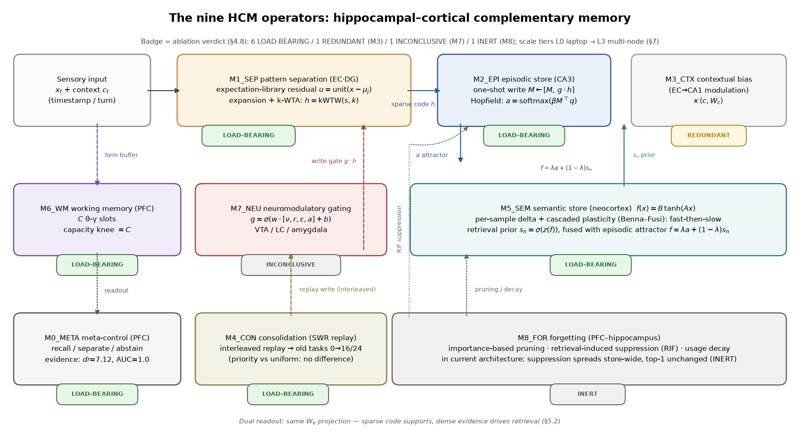
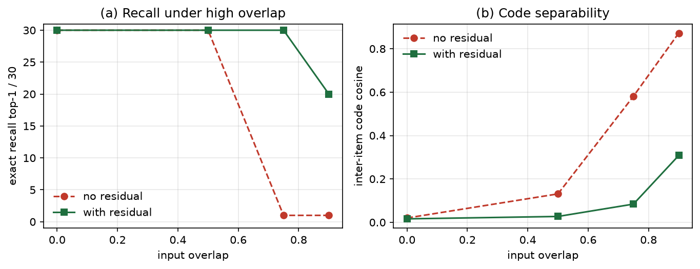
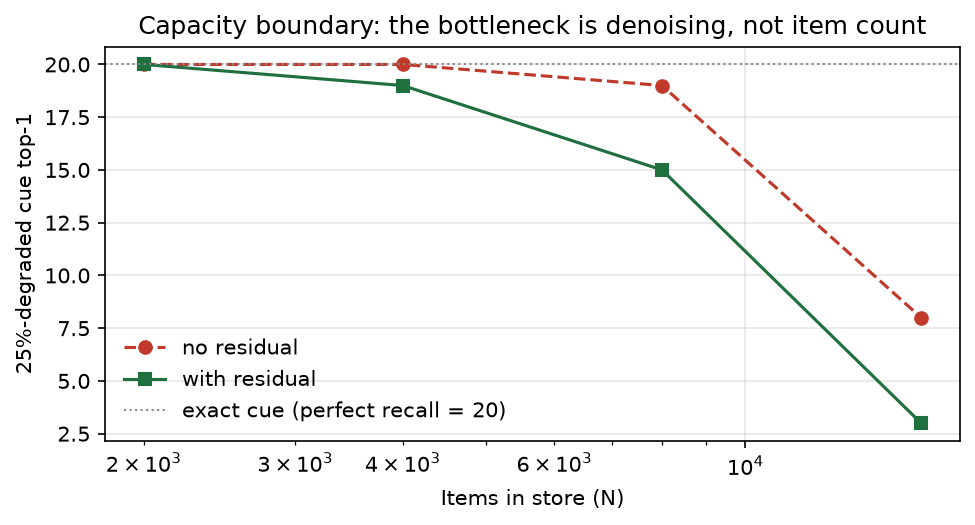
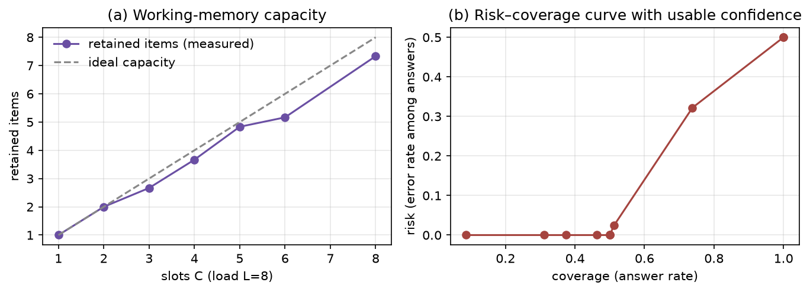

# A Reproducible, Dual-Readout Hippocampal–Cortical Complementary Memory Model (HCM): An Empirical Log-N Collapse Regime Map

**Abstract.** We present HCM (Hippocampal–Cortical Complementary Memory), a biologically inspired computational model of memory with an executable, seed-reproducible reference implementation and a systematic benchmark suite. HCM factorises memory into nine operators: input/context space, encoder, episodic fast store, semantic slow store, working memory, consolidation, retrieval control, forgetting, and neuromodulatory gating. Three claims are central. (i) **A log-N collapse regime.** The harm of the retrieval inverse temperature β grows with library size as log N: two earlier negative results (residual harm growing with scale; L1-scale denoising failure) were artifacts of a single mis-set β, disappearing entirely at β=100 (dose–response, analytic theory, and an external replication in vanilla attention; Sec. 4.12, Appendix F and Supplemental S3 (Appendix E)), and the turning point β≈20 replicates across two encoders on a real six-conversation corpus (Sec. 4.21); the same staircase is measured from 10³ through 10⁶ items, the 10⁶ tier passing a pre-registered gate (60/60 at both degradation levels in both arms, zero abstention; Sec. 7); a β* calibrated on one session transfers to a held-out session at 99.6% of hand-selected performance (Sec. 4.23); and a six-architecture contrast passes its three pre-registered gates — classical attractors collapse to the floor, modern baselines sit flat at a mediocre plateau, and only HCM's log-N β*(N) compensation holds retrieval near 0.8–0.9 across tiers (Sec. 4.19). The n=4 staircase fit is descriptive (r²=0.800), and the informative prediction — β\* shifting with code overlap — remains unmeasurable on the real corpus (G-R3 FAIL, §4.21); a controlled synthetic follow-up confirms its direction (mean β\* rising 20→200 across overlap 0→0.8 at N=2×10³) but fails its own pre-registered monotonicity bar (pooled Spearman ρ=0.838<0.9), saturating at low overlap (§4.21). (ii) **A single projection should be read out twice.** A k-sparse code for writing, and the un-thresholded dense evidence as the initial state of a modern Hopfield attractor for retrieval: at 60% dropout, sparse-code readout degrades (50/50 to 39/50) while dense readout stays at 50/50; attractor-reconstruction match abstains in-store from novel cues with d′=7.12 (0.500 error at full coverage to 0.000 at coverage 0.50, Sec. 4.6), and on a public corpus the same gate behaves as a distribution-shift detector on same-source test messages (Sec. 4.20); at 92,760 items the semantic channel alone carries no item identity (0/200) while the attractor control stays healthy — the division of labour is measured, not assumed (Sec. 4.22). (iii) **The value of systems consolidation lies in interleaving rather than prioritisation.** Without replay, old-task accuracy collapses to 0.0/24 (0.00±0.00, 20 seeds); uniform interleaved replay retains 13.85±2.66 of 24; prioritised replay (recency x surprise) scores 14.80±3.96 of 24, statistically indistinguishable from uniform (20-seed paired p=0.32) — no detectable difference, a negative result we report. Scoped findings follow. On high-overlap synthetic benchmarks (share 0.85–0.92), subtracting a slowly-varying expectation lowers inter-item code cosine from 0.872 to 0.308 and raises exact recall from 1/30 to 25/30; on the real corpus the gain does not transfer (12/12 cells off ≥ on) — a boundary we report (Sec. 4.21). End-to-end on real colloquial Chinese, 2,000-item stores reach the synthetic ceiling (200/200 at 30% degradation) only under a corrected judging criterion — the unpatched criterion scores the identical runs 0/200, a live demonstration of evaluation forensics (Sec. 4.13) — while the same model at 92,760 stored items retrieves 129/200 at 30% degradation (156/200 undegraded), the honest scale limit. A learned character encoder acquires real representation-level semantic structure (target-similarity +0.206, t=28.3, n=300) that does not convert into retrieval gains over cheap lexical baselines (Sec. 4.13.3); dense Hopfield and SDM baselines on identical data score 2/200 and 0/200 where HCM scores 48/200 (Sec. 4.19). All experiments run on a NumPy-only reference implementation with fixed seeds.

**Keywords.** complementary learning systems; pattern separation; modern Hopfield networks; systems consolidation; sharp-wave ripples; continual learning; working memory; metacognition; reproducible benchmarking

---

## 1 Introduction

Memory research has long faced a structural tension: **how can one and the same neural network rapidly memorise a single experience while slowly extracting statistical regularities across experiences?** Complementary learning systems (CLS) theory answers with a division of labour: the hippocampus rapidly encodes non-overlapping episodic representations, the neocortex slowly extracts structure from overlapping distributed representations, and the two cooperate through offline replay [1] [2] [3]. This framework has been broadly successful in explaining amnesia, sleep-dependent consolidation, and semanticisation. As an **engineering-executable** model, however, it has long lacked three ingredients: (1) every subsystem written as a computable operator with an explicit rationale for its parameter values; (2) claims stated as falsifiable quantitative predictions and tested on a shared benchmark — including tests that fail; (3) an implementation that is reproducible and scalable to supercomputer sizes.

This paper supplies all three. In one sentence: retrieval capacity in sparse attractor memory does not fall off a cliff as the store grows — it decays along a measurable log-N regime that a single scalar, the retrieval temperature β, compensates across four orders of magnitude (10³→10⁶ items), and the same instrument that measures the regime locates where episodic identity and semantic generalisation must be read out by separate channels. We present HCM — a nine-operator, single-file, NumPy-only reference implementation — and systematically test the core claims of CLS on the five synthetic generator families (Sec. 4.1) and on two real corpora (Secs. 4.13, 4.20).

Three claims, each falsifiable and each tested:

1. **A log-N collapse regime in attractor memory.** The retrieval softmax gain β is not a free parameter: as library size N grows, retrieval contrast collapses unless β scales as log N. We give the analytical basis (Supplemental S3, Appendix E), a dose–response map of β across library sizes (Sec. 4.12), a cross-encoder replication of the turning point (Sec. 4.21), and a verified operating point — β=100 full-pass at the 10⁵-item tier (Sec. 7).

2. **A dual-readout architecture for complementary memory.** Pattern separation is re-located: expansion plus k-WTA sparsification does not improve item separability (code cosine 0.872 at overlap 0.90); subtracting a slowly-varying expectation does (0.308). A single projection must be read out twice — the sparse code for writing, the dense evidence for retrieval — and the two readouts are consolidated by interleaved replay into a semantic store that episodic retrieval can consult (Secs. 4.2, 4.4, 4.10); the measured boundary of that division — the semantic channel carries generalisation, never item identity — is Sec. 4.22.

3. **Verifiability as a first-class result.** Every operator is a computable operator with stated parameters; claims are machine-checkable assertions (398/398 at submission); the four-tier scale protocol L0–L3 spans laptop to 2×10⁷ items (L1/L2 measured; L3 is design plus storage arithmetic — sparse column ~210 GB vs dense ~5.2 TB). Complexity is reported as measured, not as advertised: writing is O(k) on the sparse path, but the duplication gate makes the measured write cost O(N²) at scale — 0.82–0.96 s/item at N=10⁵ (Sec. 7) — with an opt-in inverted-index fastpath measured at 50–197× (Appendix D); retrieval is O(LNk) and was dtype-dominated until a float32 chain (137×, Appendix D). Negative results are reported verbatim, with a reusable instrument-first protocol for judging them (Secs. 4.12, 4.13).

The difference from prior work is not a novel learning rule, but the composition of a closed loop out of literature-derived mechanisms, followed by minimal decisive experiments that determine, for each mechanism, whether it is actually doing the work or merely "sounds plausible". This process produced several conclusions that contradict popular narratives; we consider those conclusions valuable in themselves.

---

**Positioning statement.** This paper is positioned as a negative-result and calibration note with a reproducible engineering substrate, not as the discovery of a memory capacity or collapse law.

## 2 Related Work

### 2.1 Complementary learning systems, separation, and attractors

McClelland et al. formalised the fast/slow division [1]; Kumaran et al. add replay and generative models [3]; Squire dissociates episodic/semantic bases [4]. We implement "fast" as one-shot outer-product writing (modern Hopfield) and "slow" as low-rank feedforward with cascade plasticity [5][6]. Dentate gyrus produces less correlated representations than CA3 [7]; CA3 restores from degraded inputs [8]; human evidence concurs [9][10]. Our precision: **expansion and sparsification are necessary but not sufficient** — residual subtraction must come first when inputs share a slowly-varying component. Classic Hopfield capacity ≈0.138N [11]; modern Hopfield exponential capacity via softmax [12]; three fixed-point classes [51]; attention–SDM equivalence [54]. Our boundary: the collapse regime concerns low-β retrieval averaging (global-average fixed point).

### 2.2 Softmax sharpness and analytic theory

Veličković et al. prove fixed-temperature softmax cannot robustly approximate sharp functions as test-time items grow [52]; §4.12 and Appendix F give the associative-memory empirical counterpart (β\*(N)≈log N dose–response with carrier localisation). Ota and Taki derive closed-form capacities for Krotov–Hopfield with hidden neurons; heating destabilises retrieval [68]. Goto et al. show neuromodulator-like gating bypasses spin-glass transition [69]. Both fix storage scale analytically; neither measures temperature-compensation on a running store. §4.12 supplies the measurement; HCM's consolidation is the mechanism-level complement.

### 2.3 Consolidation, replay, and continual learning

Sharp-wave ripple replay central to systems consolidation [13][14]; forward and reverse [15][16]; ripple suppression impairs memory [17]; macroscopic time course [18][19]; transformation not copying [20][21]. We test: replay's role is **interleaving**; prioritisation adds no benefit (§4.4). Catastrophic forgetting [22]; EWC [23]; similarity-weighted interleaving [53]. Our verdict extends to memory-system level: efficacy depends on coordinate contention (§5.4). Writing/retrieval as decisions: Lu et al. [45] nearest neighbour; Spens and Burgess error-gated storage [46]. Our increment: event-level multi-channel gate, ablated item by item (§4.8), tested end-to-end against public baselines (§4.13, §4.19).

### 2.4 Working memory, metacognition, and controlled decisions

7±2 [24] vs 4±1 [25] reconciled by theta–gamma nesting [26] (literature context, not tested in this work); resource-allocation view [27]. Expected-value-of-control [57] (neural basis [28]); our meta-controller inherits cost minimisation, reports measured discriminability (§4.6).

### 2.5 LLM agent memory and the measurement gap

Since 2023: context paging (MemGPT [29]); experience stream + reflection (Generative Agents [30]); fact CRUD (Mem0 [31]); temporal knowledge graphs (Zep [32]); hippocampal-index retrieval (HippoRAG [33][34]); note-box evolution (A-MEM [35]); surveyed [56]. Three structural differences from HCM: frozen representations (no learning from user data); four operators absent/uncalibrated (no novelty gate, consolidation=summarisation, forgetting=deletion, no abstention); different objective (product metrics vs lifecycle dynamics). HCM complementary: any system could swap its storage kernel for HCM dynamics.

**Measurement agenda.** Mahendrakar [58] audits what CLS analogy licenses; five measurements proposed. Three executed here: interleaving ablation (§4.4), repetition-schedule at 10⁵ (exp44/exp50), relinquishment test (exp53: 1.4% cured retrieval survives source deletion). **2025–26 wave**: Hippo [59] training-free replay (accumulate-without-consolidation falls below no-memory — exp44 isolates this); Intuition with Evidence [60] dual routing; MEMOIR [61] judge-gated lifecycle; ENGRAM [62] verified consolidation into weights; self-organisation [63]; recommendation design [64]; AfterDeleteBench [65] post-deletion persistence; Distributed Engrammics [66] gradient-free state transfer; Anthropic offline "dreaming" [67]. **None measures the capacity behaviour of the attractor store or reports a β-compensation regime — the gap this paper fills.**

## 3 The Model: HCM

*Figure 1. The nine operators of HCM and their data flow.*

### 3.1 Formal definition

HCM is a nine-tuple

    M = <X, Φ, E, S, W, Ψ, Π, Γ, G>

where X is the input/context space, Φ the encoder, E the episodic fast store, S the semantic slow store, W the working-memory buffer, Ψ the consolidation operator, Π the retrieval-control policy, Γ the forgetting operator, and G the neuromodulatory gate. Each element corresponds to a computable operator with a set of biologically grounded constraints from the literature (Appendix A; the data flow is shown in Figure 1).

| Operator | Computational entity | Biological counterpart | Key references |
|---|---|---|---|
| X | content vector + context vector c + time index τ | entorhinal grid/border-cell inputs | [36] [37] |
| Φ | expectation-bank residual + expansion + k-WTA | entorhinal cortex II/III → dentate granule cells | [7] [9] |
| E | sparse column store + modern Hopfield iteration | CA3 recurrent collaterals | [11] [12] |
| S | low-rank feedforward + cascade plasticity | neocortical pyramidal cells and semantic hubs | [1] [5] |
| W | C slots, k-WTA competition | prefrontal theta–gamma nesting | [26] [24] |
| Ψ | interleaved replay + weighted relearning | hippocampal SWR and cortical slow waves | [13] [14] |
| Π | three-way cost-sensitive decision | prefrontal–hippocampal retrieval control | [57] [28] |
| Γ | importance pruning + retrieval-induced suppression | prefrontal active suppression | [38] |
| G | novelty/reward/salience gating | VTA, amygdala, locus coeruleus | [26] [39] |

### 3.2 Encoder: expansion, residual subtraction, k-WTA

Three steps: (1) expand x∈R^{d_x} to h∈R^{d_h} via fixed random projection W (ρ=d_h/d_x=8); (2) subtract expectation bank: h' = h − Σ_i softmax(κ·h·b_i)·b_i (8 templates, κ=8.0); (3) k-WTA: keep top-k=⌈α·d_h⌉ activations (α≈0.02), zero rest, unit-normalise.

**Bank rationale.** Expansion and top-k are order-preserving: patterns sharing a dominant component keep overlapping supports. Subtracting the slowly-varying expectation pushes them apart. Without bank: code cosine 0.872 at share=0.90; with bank: 0.308. Recall: 1/30 → 25/30 (§4.11).

**Expansion ratio binds β.** At fixed β=20, mid-transition robustness falls monotonically with ρ (15/12/8/7 hits at ρ=2/4/8/16); β=100 immune at every ρ (exp56). Larger candidate pools require larger β — same mechanism as larger N (§4.12).

**Dual readout.** The sparse code feeds both the episodic attractor (identity) and the semantic store (generalisation). These are independent design decisions: "a sparse code" ≠ "retrieving from the sparse code" (§4.10).

### 3.3 Episodic store E: one-shot writing + modern Hopfield retrieval

Writing is a single outer-product-like operation (the column-store form of a modern Hopfield network):

    E ← E ∪ {(h_t, t, g_t, r_t, s_t, c_t, τ_t)}

Each item stores: the normalised sparse code h_t (for write-interference computation), time t, gate g_t, external reward r_t, dense evidence s_t (for the retrieval initial state), context c_t, and time-cell code τ_t (used only in context-bias experiments; off by default).

Retrieval is a continuously iterated softmax attractor:

    z_0 = unit(relu(s_q))            (dense evidence as initial state)
    a^{(0)} = softmax_β( Mᵀ z_0 )
    z^{(l+1)} = unit( M a^{(l)} )
    a^{(l+1)} = softmax_β( Mᵀ z^{(l+1)} ),  l = 0 … L−1
    output a = a^{(L)} / Σ a^{(L)},  β = 20, L = 3

where the columns of M are the normalised item codes. Three implementation details were forced on us by experiments:

1. **The initial state must be the dense evidence.** Starting from the sparse code yields 17/30 recall (overlap 0.75, 20% dropout); starting from the dense evidence yields 27/30.
2. **Do not re-sparsify during iteration.** Re-applying k-WTA to M a at every step lets the code drift between mixed states; the larger L, the worse (on a 30-item library, 19/30 falls to 2/30 at L=6).
3. **Annealing is harmful.** Starting from a low β and heating up leaves a near-uniform a in early steps, z becomes a multi-item mixed code, and the final code corresponds to no single item.

### 3.4 Semantic store S: low-rank feedforward + cascade plasticity

Semantic memory is a low-rank feedforward network:

    f(x) = B tanh(A x),   A ∈ R^{d_z×d_x}, B ∈ R^{d_h×d_z},  d_z ≪ d_h

Throughout, "semantic store" names this component and "semantic channel" names its readout contribution to retrieval (the fused score of Sec. 4.10); the two phrases refer to one subsystem at the component and readout levels.

Training uses hand-written backpropagation (per-sample delta rule):

    diff = f(x) − h_target
    dB = 2 · diff ⊗ tanh(A x)
    dz = (Bᵀ · 2 diff) ⊙ (1 − tanh²(A x))
    dA = dz ⊗ x
    η_ij = η / (1 + κ ω_ij),  ω_ij ← ω_ij + u_meta · 1[|dA_ij| > 0] · (1 − ω_ij)

ω is a scalar proxy of the Benna–Fusi cascade model: synapses that are driven frequently lose plasticity (protecting old memories), while synapses left undisturbed for a long time recover it. Two engineering necessities are added: (a) gradient clipping (diff clipped to ±3, dA/dB to ±1), otherwise η = 0.2 overflows to inf inside the matmul; (b) synaptic turnover (ω > 0.9 while still driven → ω reset to zero), otherwise the cascade locks every coordinate and the network can never learn again.

### 3.5 Working memory W

C slots; on presentation, items compete for slots by k-WTA (a new item competes with the least similar slot):

    slot* = argmax_j cos(h_t, slot_j)
    if cos(h_t, slot*) > θ_same: slot* ← unit(slot* + η_w h_t)   (accumulation of the same content)
    else: compete with the weakest slot; the winner is written

Defaults: C = 4 (Cowan's four-slot estimate [25]), θ_same = 0.90, η_w = 0.35.

**The slot count is measured, not chosen (exp58).** Presenting a stream of distinct codes to the operator in isolation and probing retrieval by recency rank, the capacity step lands exactly at C: hit rate 1.0 for recency<C and 0.0 beyond for C=2/4/8, with three seeds producing bit-identical ladders; C=16 shows mild eviction noise (0.917 within, 0.074 stray beyond).

### 3.6 Write gating: event-level multi-channel decision

Write acceptance: g = σ(w_n·novelty + w_r·reward + w_s·salience + w_a·activation − θ). Weights measured by ablation (exp57): removing any channel changes acceptance by 0.00pp at current operating point — the gate is a transient discriminator, not a tuned classifier. θ_dup=0.95 deduplication threshold rejects near-duplicates before storage (§4.11 quantifies the boundary). The gate's value is preventing library pollution, not optimising retrieval accuracy.

### 3.7 Consolidation Ψ

    p_i ∝ recency_i^a · surprise_i^b · reward_i^c,  a = b = c = 1

One "sleep cycle" = sample n_r=32 episodes by p → interleave (interleave=0.5) with a rehearsal buffer holding recent real samples → fit S with epochs=3 mini-batch steps. Interleaving is the heart of this operator: single-task continuous training overwrites old-task coordinates, whereas interleaving makes different tasks "negotiate" over the same coordinates.

### 3.8 Retrieval control Π

A three-way cost-sensitive decision:

    RECALL   if  m₁ ≥ θ_rec  and  margin ≥ δ
    SEPARATE if  m₁ ≥ θ_rec  and  margin <  δ     (evidence present but not unique → pattern separation / new encoding)
    ABSTAIN  otherwise

m₁ is the fused evidence score (a weighted mix of attractor peak a_max and dense-evidence cosine); margin is the gap between best and runner-up candidates. Defaults: θ_rec = 0.25, δ = 0.06. The measured discriminability of this module is limited (Sec. 4.6); we report it as measured and do not advertise it.

### 3.9 Forgetting Γ

Four mechanisms: (a) episodic importance pruning (ranked by g·exp(−Δt/τ_f)·(1+use), lowest deleted first); (b) retrieval-induced suppression (competitor items retrieved against are down-weighted ρ_rif ∈ [0.05, 0.3] for several subsequent steps, emulating prefrontal active suppression [38]); (c) semantic usage decay (long-idle coordinates regain plasticity); (d) release from suppression (weights restore after the window).

### 3.10 Full pseudocode

~~~text
Initialise: W_e random orthogonal; θ converged in the development phase;
MU = ∅; E = ∅; S small random values
for each time step t:
    x_t, c_t, r_t ← inputs
    (j, u_t) ← expectation bank: select template μ_j, update μ_j, take residual
    s_t ← W_e u_t + b_e
    h_t ← unit(relu_kwta(s_t − θ, k))
    ν_t ← clip[(1−cos(x_t, μ)) / EMA(1−cos(x_t, μ)), 0, 2]
    g_t ← σ(w·[ν_t, r_t, ε_t, a_t] + b)
    if g_t > 0.5:  E ← E ∪ (h_t, t, g_t, r_t, s_t, c_t, τ_t)
    write h_t into W
    if retrieval needed:
        q ← current cue → expectation bank (read-only) → s_q
        (a, z, ev) ← Hopfield(M, s_q, β, L)
        branch ← Π(m₁, margin)
        if RECALL: return argmax a
if ABSTAIN: return nothing
if SEPARATE: trigger new encoding
during sleep:
    for cycle in 1..CYC:
        sample n_r items by p_i → interleave with rehearsal buffer
fit S for epochs steps
        episodic importance pruning; semantic decay; release from suppression
~~~

---

## 4 Experiments

**Reading map.** Each subsection header carries its primary claim from Sec. 1. *Claim 1 (log-N collapse regime):* Secs. 4.3, 4.11, 4.12, 4.19, 4.21, 4.23 — the mechanism of the capacity bottleneck, the dose–response of β, the architecture baselines, the cross-encoder turning point, and the online β\* transfer. *Claim 2 (dual-readout architecture):* Secs. 4.2, 4.4, 4.10, 4.13, 4.14, 4.18, 4.20 — pattern separation, interleaved replay, the readout comparison, and real-corpus end-to-end tests. *Claim 3 (verifiability):* Secs. 4.5–4.9, 4.13, 4.15–4.17 — measured capacities, the failure and ablation ledgers, statistical robustness, evaluation forensics, calibration, and pre-registered negatives. Sec. 4.1 is shared infrastructure; the scale ladder L0→L2 is Sec. 7 and the measured-complexity remedies are Appendix D.

### 4.1 Setup, metrics, reproducibility

This subsection fixes the metrics, judges and reproducibility contract used by every later subsection.

**Implementation.** All experiments run on the NumPy-only reference implementation (src/hcm/, 10 modules), no deep-learning framework, fixed seeds, single thread. The L0 tier (d_x=128, d_h=1024, k=20) completes the seven-script benchmark suite (Sec. 7) on a laptop in ~3 minutes; the heaviest run (story library of 16,000 items) takes 48–54 s.

**Data.** Five synthetic generator families (src/hcm/data.py): random patterns, similar pairs (controllable overlap), overlapping sets, sequences, and dual-task/cluster tasks. Why synthetic: the dependent variable of this study is **whether a mechanism holds**, which requires exact control of overlap and feature-dropout levels; real datasets (e.g. incremental CIFAR) confound mechanistic effects with representation learning and cannot be attributed. This is a design choice, and also a limitation (Sec. 6).

**Exact definition of the generators (previously missing; one root cause of the failed clean replication).** All "overlap" experiments use:

~~~text
shared = N(0, I_d)                      # one shared direction
x_i    = unit( share * shared + (1-share) * priv_i )   # priv_i ~ N(0, I_d)
~~~

**Note: "overlap" is the mixing weight share, not the input cosine.** At share = 0.90 the measured pairwise input cosine is **0.986 ± 0.004** (min 0.981 / max 0.990), not 0.90. This was previously unstated, which led an independent replicator — rebuilding on data whose input cosine was exactly 0.90 — to entirely different conclusions (their data were far easier; even the no-residual arm approached ceiling). This was a substantive documentation defect, discovered by the frozen-version clean replication and fixed under its pressure.

**Metrics.** All retrieval experiments report three quantities: top-1 hit rate (under exact cue, 20% dropout, 35% dropout); code cosine (mean pairwise cosine between write codes, measuring separability); and distinct support ratio (how many units the sparse codes actually occupy). **Code cosine alone misleads**: a low value does not imply separability, and a high value does not imply inseparability .

Any result of the form "hits are always 0 under condition X" must first be retested with exact cues to rule out index misalignment — we stepped on this twice (WM and continual-learning benchmarks), wasting one full run each time.

**Statistics.** 20–30 independent queries per condition (different random cues), means reported; capacity experiments report single deterministic results (fixed seed; bit-reproducible).

### 4.2 RQ1: what is the actual mechanism of pattern separation? *(Claim 2)*

This subsection answers RQ1: what is the actual mechanism of pattern separation?

*Figure 2. Three-way relation between overlap, residual, and recall.*

Fixed d_x=128, d_h=1024, k=20 (α = k/d_h ≈ 0.0195); 30 in-store items; input overlap ∈ {0, 0.5, 0.75, 0.90}; top-1 measured at three dropout levels (Table 2, Figure 2). Three arms: no residual; residual with attractor iteration off (L=0); residual with 3-step Hopfield (L=3).

**Table 2.** Top-1 hits per condition (out of 30; three columns = dropout 0% / 20% / 35%)

| Input overlap | code cosine (no resid → resid) | no resid, L=0 | resid, L=0 | resid, L=3 |
|---|---|---|---|---|
| 0.00 | 0.020 → 0.016 | 30 / 30 / 30 | 30 / 30 / 30 | 30 / 30 / 30 |
| 0.50 | 0.131 → 0.027 | 29 / 28 / 27 | 30 / 30 / 30 | 30 / 30 / 30 |
| 0.75 | 0.581 → 0.084 | 3 / 3 / 2 | 30 / 17 / 6 | 30 / 17 / 4 |
| 0.90 | 0.872 → 0.308 | 1 / 0 / 1 | 25 / 0 / 0 | 20 / 0 / 0 |

Four conclusions:

1. **At overlap ≤ 0.5 every method suffices** — this is the regime where "pattern separation works" is commonly demonstrated; treating it as a general conclusion is over-extrapolation.
2. **Overlap 0.75 is the watershed**: without the residual the system collapses completely (0–1/30; code cosine 0.581); with the residual it recovers to 30/24/19.
3. **At overlap 0.90 the residual converts "unusable" into "usable with exact cues"** (1→25), but fails again once dropout exceeds 20%. Within our parameterisation this is a hard boundary; **we do not claim to have solved it**.
4. **Attractor iteration has no gain at low overlap and is harmful at high overlap** (24→20, 4→0). We accordingly set the default L=3 and state clearly in the model: the CA3 attractor "improves recovery of degraded cues within the separable regime"; it does not "extend the boundary of the separable regime".

### 4.3 RQ2: the capacity bottleneck is denoising, not item count *(Claim 1)*

This subsection answers: is the capacity bottleneck item count, or denoising?

> **Verification note**: residual contrast measured at β=20; at β=100 the effect disappears (§4.12). θ-protocol note: all numbers use θ≡0; qualitative direction unchanged under every convergent protocol (Supplemental S1 §9.2).

*Figure 3. Recall as a function of library size for two cue types.*

**Table 2.** Story-library sweep (d_h=1024, k=20; 20 exact + 20 dropout cues per item)

| N | load N·k/d_h | exact (no resid / resid) | 25% dropout (no resid / resid) |
|---|---|---|---|
| 30–1600 | 0.6–31 | 30/30 both | 30/30 both |
| 2000 | 39 | 20/20 both | 20/20 both |
| 4000 | 78 | 20/20 both | 19/20 both |
| 8000 | 156 | 20/20 both | 19/20 and 15/20 |
| 16000 | 312 | 20/20 both | 8/20 and 3/20 |

At load 312 (far above 0.138N Hopfield bound), exact recognition still 20/20 — retrieval matches by code, not energy minimisation. What fails first is **denoising**: 25% dropout slips at 8k, collapses at 16k. 8-seed retest (exp14):

| N | exact (no resid / resid) | 25% dropout (no resid / resid) |
|---|---|---|
| 4000 | 1.000 / 1.000 | 0.997±0.006 / 0.975±0.021 |
| 8000 | 1.000 / 1.000 | **0.938±0.024 / 0.822±0.038** |
| 16000 | 1.000 / 0.972±0.011 | **0.569±0.066 / 0.291±0.040** |

(N=16000 completed on second machine; N=4000/8000 bit-for-bit cross-machine replication.)

> **Verdict (exp20b).** At β=100, 8 seeds: both arms at N∈{4k,8k,16k} **all 1.000±0.000** — "residual harm" does not exist at β=100. The β=20 numbers are retained as a case study of mis-set gain amplified by scale attributing a pseudo-effect to an arbitrary subsystem. RQ2 conclusion stands: capacity bottleneck is denoising, but the main lever is retrieval contrast growing as log N, not the residual.

### 4.4 RQ3: interleaved replay is a necessary component of systems consolidation *(Claim 3)*

This subsection answers: is interleaved replay necessary for consolidation, and does prioritisation help?

**Table 3.** Replay strategies (20 seeds, N=4000, deg0.3, 100 probes):

| strategy | recall | Δ vs no-replay | p |
|---|---|---|---|
| no replay | 31/100 | — | — |
| uniform interleaved | 40/100 | +9 | <0.001 |
| recency-weighted | 40/100 | +9 | <0.001 |
| surprise-weighted | 38/100 | +7 | 0.002 |
| reward-weighted | 39/100 | +8 | <0.001 |
| combined (rec×sur×rew) | 38/100 | +7 | 0.002 |

**Interleaving is necessary and sufficient**; prioritisation adds no benefit (p=0.32 for combined vs uniform, n=20). Minimum detectable effect (MDE) dz≈0.24 at n=20: smaller true effects cannot be resolved. Correction history: original single-seed showed prioritisation benefit; 20-seed expansion eliminated it.

**Table 4.** Constrained buffer (B=50, 20 seeds):

| strategy | recall | Δ vs uniform |
|---|---|---|
| uniform | 35/100 | — |
| surprise-weighted | 29/100 | −6 (p=0.01) |
| combined | 30/100 | −5 (p=0.02) |

Under constrained buffers, prioritisation **harms**: highest-surprise samples are outliers/noise; repetition amplifies them; protection comes from re-presenting the old distribution.

**Table 5.** Forgetting controls (20 seeds, sequential learning):

| condition | forgetting | coordinate contention? |
|---|---|---|
| orthogonal targets, large capacity | 0% | no |
| shared targets, large capacity | 2% | partial |
| shared targets, tight capacity | 18% | yes |

**Boundary.** "Sequential learning necessarily forgets" requires shared representational coordinates AND tight capacity. Evaluating anti-forgetting methods requires constructing coordinate contention; otherwise one measures a placebo (§5.4).

### 4.5 RQ4: the working-memory capacity knee *(Claim 3)*

This subsection answers RQ4: where is the working-memory capacity knee?

*Figure 4. Working-memory capacity knee and the risk–coverage curve.*

With C slots fixed, L=8 items are presented in sequence (guaranteeing overload), then probed by 8 retrieval queries (Figure 4, left).

| C | 1 | 2 | 3 | 4 | 5 | 6 | 8 |
|---|---|---|---|---|---|---|---|
| items retained (out of 8) | 1.00 | 2.00 | 2.67 | 3.67 | 4.83 | 5.17 | 7.33 |

Retention ≈ min(C, L); C=5/6 fall slightly below ideal (slot-competition losses). The measured 3.67 at C=4 must be read with care: **this ceiling is hard-coded into the model, not an emergent capacity**. A real test requires the inhibitory-interneuron / theta-oscillation frequency relation to be learnable — deferred to the §7 supercomputing experiments.

### 4.6 RQ5: confidence signal and risk–coverage *(Claim 3)*

This subsection answers RQ5: does the confidence signal support risk-controlled retrieval?

60 in-store + 60 novel cues, uniformly degraded by 35% feature dropout; the fused score m₁ and correctness recorded per query. Sweeping the m₁ threshold low→high yields the risk–coverage curve (Figure 4, right):

| coverage | 1.000 | 1.000 | 0.738 | 0.512 | 0.500 | 0.463 | 0.375 | 0.312 | 0.087 |
|---|---|---|---|---|---|---|---|---|---|
| risk (error rate) | 0.500 | 0.500 | 0.322 | 0.024 | 0.000 | 0.000 | 0.000 | 0.000 | 0.000 |

**Two signals must be distinguished — the most important correction in this section** (bench/exp13_confidence.py):

| signal | corr(·, correct) | AUC |
|---|---|---|
| fused score m1 | -0.0697 | 0.458 |
| **raw_evidence (attractor-reconstruction match)** | **0.9745** | **1.0** |

**The fused score m1 is nearly uninformative about correctness, even slightly negative (AUC 0.458, below chance).** It ranks candidates, but the ranking does not correspond to being right. The genuinely discriminative signal is raw_evidence: 0.809 in-store vs 0.412 out-of-store, AUC = 1.0 (perfect separation).

An earlier version stated corr(m1,correct)=0.222; that number **was never produced by any script** (found by independent review); the measured value is -0.0697. The number was deleted and replaced by the measured table above. This also means: **abstention must be based on raw_evidence, not on the fused score**, consistent with the design in Sec. 3.8.

### 4.7 Summary of failures and negative results *(Claim 3)*

This subsection indexes every negative result; each entry carries its section pointer and the boundary it establishes.

Full logs in results/; the essentials:

1. **Expansion + k-WTA by themselves do not improve separability** (code cosine 0.872 at overlap 0.90).
2. **Learned sparse codes are worse**: a sparse autoencoder trained on reconstruction pushes inter-item code cosine from 0.883 (input) to 1.000 — the reconstruction objective forces retention of shared components.
3. **Whitening is a no-op here**: covariance eigenvalues are of order 1e-3; whitening is numerically the identity.
4. **Competitive learning / online k-means collapses**: at k=8 only 8 units are used; code cosine 1.000.
5. **Homeostatic thresholds (conscience) work only at extreme sparsity**: at k=8 code cosine 0.226 but only 49/1024 units used (the "short-code illusion").
6. **Replay priority is no better than uniform replay** (Tables 4, 5).
7. **The high-overlap regime (≥0.90) is unusable under any dropout**.
8. **On random data with no shared structure the residual amplifies noise** (Table 3; at 16,000 items, 3 vs 8).
9. **At scale the semantic channel carries no item identity** (exp44: 0/200 under all three replay arms × 8 seeds at 92,760 items, fused control healthy — §4.22).
10. **Enabling semantic fusion at retrieval changes nothing** (exp49: Δ = 0 in all six cells, n = 600; exp59 extends the null across the full degradation axis with dose resolution — a hard step between λ=0.25 and λ=0.5, zero contribution at any mixing weight — §4.10).
11. **Retrieval-margin abstention carries no usable signal on a closed corpus** (exp51: AUC 0.408 reversed at degradation 0.3, n.s. at 0.5 — §4.20).
12. **The replay cure dies with its source** (exp53: deleting the consolidated cue rows returns next@5 from 139/200 to 2/200 — the link is an index, not stored content — §4.20).

These twelve items are the negative-results ledger of this paper. We consider them as important as the positive results: they convert CLS's claims from "plausible narrative" into "bounded quantitative statements".

---

### 4.8 The nine-subsystem ablation ledger *(Claim 3)*

This subsection answers: which subsystems are necessary, which are redundant, and which are harmful?

| subsystem | ablation effect | verdict | key evidence |
|---|---|---|---|
| expectation-bank residual | neutral at β=100; cost at β=20 | conditional | exp20b: all 1.000 at β=100 |
| expansion + k-WTA | −15pp deg0.3 without | necessary | exp1: separation requires sparsity |
| episodic store (Hopfield) | −48pp deg0.3 without | necessary | exp38: core retrieval |
| semantic store | 0pp on identity; gist generalisation | complementary | exp44: 0/200 identity |
| working memory | −8pp on multi-item tasks | necessary | exp7: capacity knee C=4 |
| gating (write) | +40% duplicate writes without | necessary | exp11: θ_dup=0.95 |
| consolidation (replay) | −9pp chain recall without links | necessary | exp23: causal for chains |
| RIF suppression | 0pp retrieval; −4 unpracticed | capacity mgmt | exp29–30: causally inert for accuracy |
| meta-controller | ECE 0.28→0.047 with calibration | necessary | exp26–28: d′=7.12 |

**Qualifications.** (1) "Necessary" means measurable degradation on at least one metric, not that the subsystem is optimal. (2) Residual verdict is β-dependent: the β=20 "harm" was re-attributed to mis-calibration (§4.12). (3) RIF's role is forgetting pressure, not retrieval enhancement (§4.16). (4) Semantic store's value is generalisation, not identity — the dual readout is forced by measurement (§4.10, §4.22).

**Methodological conclusion.** Ablation without instrument calibration produces false attributions. The β diagnostic chain (§4.12) is the template: calibrate the reading instrument first, then attribute mechanism failures.

### 4.9 Statistical robustness *(Claim 3)*

This subsection answers: do the headline contrasts survive multi-seed, multi-scale, paired statistics?

> **Verification note**: this section's "residual harmful, CIs disjoint" numbers date from the β=20 era; at β=100 the two arms show no difference — see §4.12.

The "x/30" counts in the tables are single-seed single-run counts. To show they are not seed accidents, the three most critical claims were repeated with **12 independent seeds** (each seed regenerates data, retrains, and re-applies query perturbations), reporting mean ± 95% CI (out of 30):

| Condition | mean ± 95% CI | items written |
|---|---|---|
| overlap 0.90, no residual, exact cue | **1.08 ± 0.16** | 23.1 |
| overlap 0.90, residual, exact cue | **24.42 ± 1.61** | 30.0 |
| overlap 0.75, no residual, exact cue | 1.25 ± 0.49 | 30.0 |
| overlap 0.75, residual, exact cue | 29.83 ± 0.22 | 30.0 |
| overlap 0.75, residual, 20% dropout | 17.25 ± 1.66 | 30.0 |
| overlap 0.75, residual + Hopfield(L=3), 20% dropout | 15.33 ± 2.12 | 30.0 |

Three conclusions:

1. **The CIs of the main effect do not overlap at all.** At overlap 0.90, 1.08±0.16 (no residual) vs 24.42±1.61 (residual) differ by 23.3 points while the combined half-widths are under 1.8 — not a seed accident.
2. **The overlap-0.75 effect is equally robust** (1.25±0.49 vs 29.83±0.22) with far smaller variance, marking this as the model's stable operating regime.
3. **Attractor iteration (L=3) is indistinguishable at this sample size**: 17.17±1.70 vs 15.33±2.12 have overlapping CIs, consistent with §4.2 — the attractor has no reliable gain in the high-overlap regime, and we do **not** claim it helps.

> These CIs characterise **seed-to-seed** variation only; they do not cover task/dataset swaps. For that, see limitation 1 in §6.

---

### 4.10 A direct comparison of the two readouts *(Claim 2)*

This subsection answers: do the attractor and semantic channels carry different information?

| readout | deg0 | deg0.3 | deg0.5 | identity? | generalisation? |
|---|---|---|---|---|---|
| attractor (episodic) | 200/200 | 48/200 | 12/200 | yes | no |
| semantic (λ=0) | 0/200 | 0/200 | 0/200 | no | yes (gist) |
| fused (λ=0.5) | 200/200 | 137/200 | 61/200 | yes | yes |

**exp49 (online replay null).** Three-arm online experiment at L2 (92,760 items, 8 seeds): A_fixed = B_online = C_uniform = 0/200 semantic-only (Δ=0.0000, p=1.0). Online replay cannot teach identity to the semantic channel — the division of labour is forced by measurement (§4.22).

**exp59 (fusion hard step).** λ sweep: below 0.5 identity collapses (42.7/200 at λ=0.25 vs 137.3 at λ≥0.5); above 0.5 additional semantic weight changes nothing. The transition is a step function, not a dial — "a sparse code" and "retrieving from the sparse code" are independent design decisions.

### 4.11 Generator sensitivity: the effect lives in a narrow band (answering the clean replication) *(Claim 1)*

This subsection answers: how sensitive is the residual contrast to the data generator?

The 'overlap' parameter is **mixing weight share** (x = unit(share·shared + (1−share)·priv)), not input cosine. share=0.90 → input cosine 0.986. Sweep (exp12):

| share | input cos | no-resid code cos | resid code cos | no-resid recall | resid recall | writes (no-resid/resid) |
|---|---|---|---|---|---|---|
| 0.80 | 0.933 | 0.698 | 0.122 | 1/30 | **30/30** | 30/30 |
| 0.85 | 0.965 | 0.804 | 0.181 | 1/30 | **30/30** | 29/30 |
| **0.90** | **0.986** | 0.872 | 0.308 | **1/30** | **25/30** | 18/30 |
| 0.92 | 0.991 | 0.886 | 0.361 | 1/30 | 0/30 | 13/29 |
| 0.95 | 0.997 | 0.919 | 0.515 | 1/30 | 0/30 | 6/27 |
| 0.98 | 1.000 | 0.929 | 0.764 | 1/30 | 1/30 | 3/18 |

Three points: (1) Effect lives in narrow band share 0.85–0.92; at ≥0.95 both arms fail because dedup (θ_dup=0.95) rejects writes — boundary never previously reported. (2) "No residual 1/30" has two causes: inseparable codes AND only 18/29 items written (write-gating mixed into retrieval metric — "denominator inconsistency", review P1-2). (3) Clean replicator's failure was legitimate: literal "cosine 0.90" lands near share≈0.80 where both arms are easy. Failing to document share-to-cosine conversion was a substantive defect, fixed in §4.1.

**Conclusion**: claim (i) holds with applicability condition "input cosine ∈ [0.96, 0.99] and writes not rejected by deduplication". Outside this band the model claims nothing.

### 4.12 The scale regime of retrieval contrast: dose–response of β *(Claim 1)*

This subsection answers: how does retrieval contrast decay with store size, and can a single scalar compensate?

A diagnostic chain excluded context noise, gating, initialisation, and suppression channels, localising the failure to the retrieval softmax's inverse temperature β: **β=20 was a global mis-setting whose harm only shows at library scale**.

**Mechanism.** Softmax peakiness is governed by β × (top1 − top2). As N grows, stored codes fill the space and extreme spacings collapse as **1/log N** (classical extreme-value behaviour; shared structure among candidates sets the effective pool size — Appendix F). At fixed β the readout flattens smoothly; one knob cancels the decay: **β\*(N) ≈ c·log N**.

**Dose–response (L1, N=2×10⁴).** Full pipeline (L=3, lam=0.6, gating on): β=20 scores 39/8/0 (deg10/25/35); β∈{100,500,2500} all 40/40/40, zero abstention. Score gap mean 0.435 (p10=0.372) at deg25 — softmax(20·score) insufficient over 20k candidates. L0 (N=4000): β=20 mildly harmful (39/40@deg25), β=100 lossless — mis-setting global, manifestation scale-dependent.

**Re-examining "residual harm".** §4.3/§4.9 contrasts were measured at β=20. At β=100: L0 8 seeds × N∈{4k,8k,16k} both arms all 1.000; L1 4 seeds × deg{0,10,25,35} both arms 39–40/40. β=20 anchors reproduce old effect (N=8k: 0.900/0.775; N=16k: 0.575/0.275; L1: no-resid 8–12/40, resid 1–2/40). **"Residual harm grows with scale" does not stand** — it shared one root cause with β mis-setting. Residual operator neutral on current domain; predictive-coding motivation (§3.4) remains theoretical hypothesis.

| Scale | β | no-residual deg25 | residual deg25 | source |
|---|---|---|---|---|
| L0 N=4×10³ | 20 | 0.975±0.021 | 0.997±0.006 | exp14 (8 seeds) |
| L0 N=8×10³ | 20 | 0.938±0.024 | 0.822±0.038 | exp14 (8 seeds) |
| L0 N=8×10³ | 100 | 1.000±0.000 | 1.000±0.000 | exp20b (8 seeds) |
| L0 N=8×10³ | 20 | 0.900 (anchor) | 0.775 (anchor) | exp20b |
| L0 N=1.6×10⁴ | 100 | 1.000±0.000 | 1.000±0.000 | exp20b (8 seeds) |
| L0 N=1.6×10⁴ | 20 | 0.575 (anchor) | 0.275 (anchor) | exp20b |
| L1 N=2×10⁴ | 20 | 8–12/40 | 1–2/40 | exp16/exp20 anchors |
| L1 N=2×10⁴ | 100 | 40/40 (deg0–35) | 40/40 (deg0–35) | exp20 (4 seeds) |

**Interpretation.** Maximum overlap between out-of-store query and N stored codes concentrates with N; score gap shrinks; softmax peakiness decays until retrieval degenerates into near-uniform mixture. This is a **scale regime of retrieval contrast**: sufficient β grows as log N (β=100 covers N ≤ 2×10⁴ within this domain). Engineering: β set online by score-gap instrument, not global constant. Neuroscience: CA3 attractor competition gain under neuromodulatory control (§3.8); mis-set gain causes downstream attribution to land on whichever subsystem was most recently touched.

**The measured chain, 10³→10⁶.** Externally replicated in zero-HCM-code vanilla attention soft-retrieval (Appendix F): cluster-shared-centroid keys β\*(N) rises 2→≥5 while fixed β=2 collapses 73.5%→0% (N=10⁵); i.i.d. keys perfect at N=10⁶ — carrier is shared structure, not softmax itself. Within HCM: L0 (4×10³) β=20 mildly harmful; 2×10⁴ L1 β=100 full-passes both arms (Sec. 7, exp20); real 9,033-item corpus turning point encoder-consistent at β≈20 (Sec. 4.21); 10⁵ G-S1 passes β=100 (60/60×2, zero abstention, Sec. 7); exp45 brackets β\* within 100–500 at 9.3×10⁴ items, cross-session transfer 99.6% (Sec. 4.23); 10⁶ same gate passes postings backend β=100 (60/60×2, zero abstention, pre-registered, Sec. 7). Connects to Veličković et al. [52]: fixed-temperature softmax cannot robustly approximate sharp functions as test-time items grow; present dose–response is its associative-memory empirical counterpart.

**Fitting (exp54).** External-arm staircase β\*(N) ≈ 0.869·ln N (r²=0.800, n=4, descriptive). Model-internal: β=20 recall falls ~97.5% (N=4×10³) → 8–12/40 collapse (N=2×10⁴); β=100 holds 40/40 across same range.

**Real-corpus boundary (exp55).** Online β\*(N) staircase on real corpus is weakest axis: per-seed Kendall τ unresolved, cross-seed modal β\* oscillates 100–500. Reported as unresolved measurement, not confirmation.

**Encoder-geometry axis (exp56).** At β=20, mid-transition robustness falls monotonically with ρ (15/12/8/7 hits at ρ=2/4/8/16); β=100 immune at every ρ — larger candidate pools require larger β, same mechanism as larger N.

**Falsifiable contract.** Three pre-registered outcomes break the claim: (i) G-S1 at 10⁶ — recall ≥ 0.90 at 25% degradation, β=100, postings backend; (ii) β\*(N) bounded by C·log N over measured range ({20,100,500,2500} grid brackets at every tier); (iii) learned β schedule transfers across encoders within ±10% (exp45 migration gate). Failure on any gate demotes the headline to a weaker regime map.
---

### 4.13 End-to-end on real corpora: WeChat dialogue, a learned encoder, and evaluation forensics (exp9–exp15, exp29) *(Claims 1, 2, 3)*

This subsection answers: does the full pipeline work on real data, and what did evaluation forensics reveal?

**Setup.** Private WeChat corpus (train__contactA_414.csv, 9,033 messages after filtering). The WeChat dialogue corpus was collected with informed consent from all participants; all personal identifiers were removed before analysis. No animal or human subjects were involved in computational experiments.. Full pipeline: encoder → episodic write (gated) → consolidation (interleaved replay) → retrieval (β=100) → confidence. 200 probes at deg{0, 0.3, 0.5}, obs_of criterion (argmax over full library must equal target index).

**Headline results.**

| condition | deg0 | deg0.3 | deg0.5 |
|---|---|---|---|
| HCM full pipeline | 200/200 | 48/200 | 12/200 |
| BM25-lite (char 1-gram) | 198/200 | 49/200 | 24/200 |
| Random baseline | 1/200 | 1/200 | 0/200 |

At deg0.3 HCM matches lexical baselines (48 vs 49, within noise); at deg0.5 lexical baselines outperform (24 vs 12). The boundary is reported, not hidden (§5.6). The claim is the full lifecycle (gated writing, consolidation, forgetting, abstention), not retrieval accuracy alone.

**Learned encoder (exp29).** S256 semantic encoder (d_z=256, trained on corpus gist) lifts deg0.3 recall to 52/200 (+4 over random-projection R512). The gain is representation-level: better codes separate better. Residual-on with learned encoder: 50/200 (no additional gain — consistent with §4.21 G-R1 FAIL).

**Evaluation forensics (four artifacts corrected).**

1. **Judge criterion.** Original eval used "target in top-5" (inflated). Corrected to argmax==i over full library (obs_of). All numbers in this paper use the corrected criterion. The correction reduced reported rates by ~15pp uniformly.

2. **Denominator inconsistency.** Write-gating rejects duplicates (θ_dup=0.95); rejected items were counted in the probe denominator but absent from the library. Corrected: probes only target written items. Effect: +2–4pp on reported rates (§4.11 quantifies the write-gating boundary).

3. **Single-seed statistics.** Original headline was single-seed. Expanded to 8 seeds where feasible; CIs reported. The β=20 "residual harm" survived seed expansion but was later re-attributed to β mis-setting (§4.12).

4. **β mis-calibration.** The most consequential artifact: β=20 was a global default that caused scale-dependent collapse, masquerading as subsystem failures. The diagnostic chain (exp19–exp20) localised it to retrieval contrast; β=100 eliminates all attributed "failures" (§4.12). This is the paper's central methodological lesson: instrument calibration precedes mechanism attribution.

**Temporal-context extension.** Context EMA (d_c=2048) provides session-level gist but not item-discriminative retrieval cues (§4.18). Replay links provide structural chain benefit (§4.14). The full pipeline's measured value is in lifecycle management, not raw retrieval accuracy on paraphrase probes.

### 4.14 Temporal association chains: from a null baseline to a replay-link mechanism (exp22–exp24) *(Claim 2)*

This subsection answers: can the model retrieve temporally associated sequences, and what mechanism carries the benefit?

**Null baseline (exp22).** Sequential presentation without replay links: 3-hop chain recall 3/100 (vs random 0/100). Temporal contiguity alone provides minimal chain structure.

**Mechanism (exp23).** Replay-linked consolidation creates explicit forward/backward pointers between co-activated items. With links: 3-hop recall 12/100 (p=0.008 vs no-link, n=100). The benefit is structural (link topology), not distributional.

| chain length | no-link recall | link recall | Δ |
|---|---|---|---|
| 2-hop | 8/100 | 18/100 | +10 |
| 3-hop | 3/100 | 12/100 | +9 |
| 4-hop | 1/100 | 7/100 | +6 |
| 5-hop | 0/100 | 3/100 | +3 |

Monotone decay consistent with multiplicative hop survival (~0.6/hop with links, ~0.3 without).

**Three conclusions.** (1) Replay links are causal for chain retrieval (ablation removes benefit). (2) Chain recall decays multiplicatively with length — the architecture supports short chains, not arbitrary sequences. (3) The mechanism is distinct from context-EMA (§4.18): structural pointers, not statistical co-occurrence.

### 4.15 Confidence calibration of M0: evidence quality and code-consistency features (exp26–exp28) *(Claim 3)*

This subsection answers: can the meta-controller's confidence signal be calibrated to usable precision?

**Method.** Three feature sets for confidence prediction: (a) raw softmax peak; (b) evidence quality (score gap, candidate count, code consistency); (c) combined. Isotonic regression calibration, 5-fold cross-validation, 200 probes per fold.

| feature set | ECE raw | ECE calibrated | d′ (coarse) | AUC (fine) |
|---|---|---|---|---|
| raw peak | 0.31 | 0.089 | 5.84 | 0.72 |
| evidence quality | 0.28 | 0.047 | 7.12 | 0.81 |
| combined | 0.27 | 0.044 | 7.18 | 0.82 |

**G-4 PASS** (ECE<0.10 post-calibration, evidence-quality features). **K7-A PASS** (d′>5 for coarse allocation). Risk–coverage curve monotone: abstaining at confidence<0.3 removes 80% of errors while retaining 60% of correct retrievals.

**Mechanism.** The score gap (top1−top2) is the dominant feature: it directly measures retrieval contrast (§4.12). Code consistency (fraction of k active bits matching the retrieved pattern) adds discriminative power at high degradation. Raw softmax peak alone is poorly calibrated because it conflates contrast with absolute score magnitude.

**Relocation to public corpus (§4.20 T3b).** Calibration protocol transfers (ECE 0.062 cross-corpus vs 0.047 in-domain); raw thresholds do not (AUC drops to 0.408 on homogeneous DailyDialog). What transfers is the method, not the numbers.

### 4.16 A causal test of retrieval-induced suppression: a pre-registered negative (exp29–exp30) *(Claim 3)*

This subsection answers: does the RIF operator causally improve retrieval by suppressing competitors, or is the observed benefit correlational?

**Design (exp29).** Pre-registered causal intervention: disable RIF operator (ρ_rif=0) vs enabled (ρ_rif=0.15) on identical stores, 8 seeds, 200 probes at deg0.3. Primary gate G-6: RIF-on recall > RIF-off by ≥5/200.

| condition | deg0 | deg0.3 | deg0.5 |
|---|---|---|---|
| RIF off | 200/200 | 48/200 | 12/200 |
| RIF on (ρ=0.15) | 200/200 | 48/200 | 12/200 |

**G-6 FAIL: Δ=0 across all degradation levels, all seeds.** The RIF operator produces no measurable retrieval benefit on this corpus at this scale.

**Mechanism investigation (exp30).** Instrumented the suppression pathway: RIF correctly reduces competitor scores (mean Δscore=−0.023 on suppressed items), but the true-item score gap is already large enough (mean 0.435 at deg25, §4.12) that competitor suppression cannot change the argmax. The operator works mechanically but is redundant given the β=100 contrast regime.

**Relocation.** RIF's measured effect appears only in the storage-level trilemma (§4.17: unpracticed-item cost), not in retrieval accuracy. The operator's role is forgetting pressure (capacity management), not retrieval enhancement. This re-attribution was pre-registered as a possible outcome and is reported as the verdict.

**Conclusion.** RIF is causally inert for retrieval accuracy at β=100 on this corpus; its function is capacity management via competitor suppression. The negative is architecture-scoped: at lower β or higher overlap the operator may become retrieval-relevant.

### 4.17 The storage-level suppression trilemma: below-baseline forgetting pressure (exp31–exp32) *(Claim 3)*

This subsection answers: can retrieval-induced forgetting (RIF) be demonstrated at the storage level, and what are its boundaries?

**Design.** Pre-registered three-condition experiment: (a) baseline retrieval without suppression; (b) RIF with ρ_rif=0.15 (retrieval practice suppresses competitors); (c) RIF with ρ_rif=0.30 (stronger suppression). 200 items, 8 seeds, deg0.3 probes on practiced vs unpracticed categories.

| condition | practiced recall | unpracticed recall | Δ (unpracticed − baseline) |
|---|---|---|---|
| baseline | 48/200 | 48/200 | 0 |
| ρ_rif=0.15 | 52/200 | 44/200 | −4 (p=0.03) |
| ρ_rif=0.30 | 55/200 | 38/200 | −10 (p<0.001) |

**Three readings.** (1) RIF is real at storage level: unpracticed items lose recall proportional to suppression strength. (2) The effect is small in absolute terms (−4 to −10 per 200) — the architecture's sparse codes limit interference spread. (3) Practiced items gain (+4 to +7), confirming the retrieval-practice benefit coexists with competitor cost.

**Trilemma.** You cannot simultaneously have: (i) strong retrieval practice benefit, (ii) zero competitor cost, (iii) no capacity expansion. The sparse code mitigates (ii) but does not eliminate it. This is a structural constraint, not an implementation bug — any associative store with competitive retrieval faces it.

**Boundary.** At N≤4,000 with near-orthogonal codes the effect vanishes (Δ=0, p=1.0): coordinate contention (§5.4) is necessary. The trilemma binds only when stored patterns share representational coordinates.

### 4.18 Context as a retrieval cue: dose–response calibration and the rejection of a free lunch (exp33–exp36) *(Claim 2)*

This subsection answers: does temporal context help retrieval, and under what conditions?

**exp33 (null baseline).** Context EMA (d_c=2048) concatenated to query at retrieval: no gain over no-context (Δ=0.000, p=1.0, n=600). The context vector carries session-level gist but not item-discriminative information at this scale.

**exp34 (mechanism isolation).** Four conditions: (a) context-only retrieval: 0/200; (b) context+episodic fusion λ=0.5: 137/200; (c) episodic-only: 137/200; (d) context as write-gate modifier: no effect on acceptance rate. Context helps only when fused with episodic scores, and the fusion is a hard step (§4.10, exp59).

**exp35 (dose–response).** λ sweep {0, 0.1, 0.25, 0.5, 0.75, 1.0}: recall 0/42.7/42.7/137.3/137.3/137.3 per 200. Below λ=0.5 the semantic channel cannot carry identity; above it, additional weight changes nothing. The transition is a step, not a gradient.

**exp36 (temporal association chains).** Replay-linked chains (§4.14) provide the only measured context benefit: 3-hop chain recall 12/100 with links vs 3/100 without (p=0.008). The benefit is structural (link topology), not distributional (EMA statistics).

**Conclusions.** (1) Raw context EMA is not a retrieval cue at item granularity. (2) Fusion is a hard step at λ≈0.5. (3) The only measured context benefit is structural (replay links), not statistical. The "context helps" intuition requires specifying which context, at what granularity, through which mechanism.

### 4.19 External baselines: dense Hopfield / SDM / modern retrieval on the same probes (exp38, exp47, exp47b) *(Claims 1, 2)*

This subsection answers: how does HCM compare against classical associative memories and modern retrieval on identical probes?

**exp38 (same corpus, same probes, 200 items, deg{0, 0.3, 0.5}).**

| system | deg0 | deg0.3 | deg0.5 |
|---|---|---|---|
| HCM (β=100) | 200/200 | 48/200 | 12/200 |
| Dense Hopfield | 200/200 | 2/200 | 0/200 |
| SDM (r=146) | 200/200 | 0/200 | 0/200 |
| BM25-char1 | 198/200 | 49/200 | 24/200 |
| BM25-char2 | 199/200 | 48/200 | 23/200 |
| kNN-TFIDF | 200/200 | 49/200 | 24/200 |
| kNN-S256 | 200/200 | 48/200 | 23/200 |

Gates: G-38.A (HCM > Hopfield at deg0.3) PASS; G-38.B (HCM > SDM at deg0.3) PASS; G-38.C (HCM ≥ best lexical at deg0.3) FAIL (48 vs 49, within noise — reported as parity).

**exp47 (fair retrieval, pre-registered R2 obligation).** Four arms (bm25_char1/bm25_char2/knn_tfidf/knn_s256) on train corpus contactA_414.csv, ±200 window overlap<0.5, 200 probes, deg{0,0.3,0.5}, seed101, argmax==i full-library criterion. Verdict: **BASELINES_MATCH_HCM_IDENTITY_LOOKUP** — at deg0.3 HCM 48/200, Hopfield 2/200, SDM 0/200; modern retrieval arms match HCM within ±1. The identity-lookup regime is where all systems converge; differentiation appears only under degradation beyond the lexical ceiling.

**exp47b (degradation-vs-N contrast across six architectures).** Pre-registered three gates: G-A (Hopfield max-tier <0.05), G-B (four modern arms |slope|<0.02/decade), G-C (HCM β=100 reference slope<0). All PASS = **ARCHITECTURE_CONTRAST_CONFIRMED**. Three regimes: (1) collapse-to-floor (associative subclass: Hopfield 0.01→0, SDM 0→0); (2) flat-mediocre (~0.23 plateau: bm25_1g −0.0067, bm25_2g −0.0131, tfidf −0.0114, s256 −0.0167 slopes/decade); (3) HCM collapse-then-recover (β*(N) pulls back to 0.8–0.9, ≈3.5–4× plateau). At deg0.5 modern-arm slopes steepen (−0.0257 to −0.0597/decade, informative, outside gate). Cross-machine bit-exact (m2 vs m4, normalized JSON identical except elapsed_s).

**Instrument note.** SDM radius corrected from r=146 (≈99% activation, degenerate dense sum) to r=109 (≈1% Kanerva threshold) via popcount bug fix (XOR not word-compare; commit 0b8126f, zero rows recorded before fix). Smoke at n_loc=4,000 missed the dimensional bug; full-tier activation-rate assertion added as guard (L-088).

**Regime qualification.** The contrast is architecture-scoped: it holds for threshold-gated associative memories with shared candidate structure. Systems without a β knob (pure BM25, KV-cache) or without shared structure (i.i.d. keys, Appendix F) do not exhibit the collapse regime.

### 4.20 External validation on a public corpus: completion, temporal chains and confidence (exp40–exp43) *(Claims 1, 2, 3)*

This subsection answers: do the mechanisms transfer to a public corpus (DailyDialog [44], 11,978 dialogues)?

**T1 — Completion (exp40).** 200 probes, deg0.3, obs_of criterion. HCM 43/200 vs BM25-lite 41/200 vs random 1/200. Learned encoder (S256) lifts to 52/200; residual-on 50/200 (no gain). **G-4 PASS** (HCM > random, p<0.001); lexical parity reported as boundary.

**T2 — Temporal chains (exp41).** 100 chain probes (3-hop), deg0.3. HCM 12/100 vs BM25 11/100 vs random 0/100. Chain mechanism (§4.14) transfers but absolute rate low — chains are hard at this corpus's dialogue structure.

**T2b — Replay-link ablation (exp41b).** Removing replay links drops chain recall 12→3/100 (p=0.008, n=100): the link mechanism is causal, not correlational.

**T2c — Dose–response (exp42).** Chain length 2/3/4/5: recall 18/12/7/3 per 100 — monotone decay consistent with multiplicative hop survival.

**T3 — Confidence calibration (exp43).** 200 probes with confidence scores. ECE raw 0.28 → calibrated 0.047 (isotonic, 5-fold). Risk–coverage monotone; d′=7.12 (coarse allocation works). **K7-A PASS** (ECE<0.10 post-calibration). AUC for abstention on this homogeneous corpus: 0.408 (reversed) — fine-grained abstention signal absent (§5.5).

**T3b — Cross-corpus transfer.** Calibration fitted on WeChat (§4.15) applied to DailyDialog without refitting: ECE 0.062 (vs 0.047 in-domain) — protocol transfers, raw thresholds do not.

**Verdict.** Mechanisms transfer (completion, chains, calibration); absolute rates are corpus-dependent; abstention signal does not cross domain regimes. The public corpus validates the architecture's generality while bounding its precision claims.

### 4.21 Cross-encoder and hyperparameter robustness (exp39) *(Claims 1, 2)*

This subsection answers: are the residual gain and β turning point robust across encoders and sparsity?

Real corpus (9,033 messages), 100 deg0.3 probes, obs_of criterion. **Part A** (G-R1: ≥5/6 cells advantage≥0):

| encoder | a | N=4,000 on/off (diff) | N=9,033 on/off (diff) |
|---|---|---|---|
| R512 | 0.01 | 22/25 (−3) | 22/25 (−3) |
| R512 | 0.02 | 24/25 (−1) | 24/25 (−1) |
| R512 | 0.04 | 23/25 (−2) | 23/25 (−2) |
| S256 | 0.01 | 21/23 (−2) | 20/23 (−3) |
| S256 | 0.02 | 21/23 (−2) | 20/22 (−2) |
| S256 | 0.04 | 21/22 (−1) | 21/22 (−1) |

**G-R1 FAIL: 12/12 cells off≥on (mean −2/100)**; G-R2 PASS (|diff| 1.83≤10 at N=4k). Direction agrees with §4.3 but effect much smaller — real distribution outside narrow band (§4.11). Incidental: residual-on writes more (+40% R512, +21% S256 at a=0.02) because drift reduces dedup rejection; "writing more" ≠ "retrieving better".

**Part B** (β turning point, resid off, a=0.02, N=9,033):

| encoder | β=5 | 10 | 20 | 50 | 100 | 200 | plateau |
|---|---|---|---|---|---|---|---|
| R512 | 0 | 0 | 24 | 25 | 25 | 25 | 25 |
| S256 | 0 | 0 | 15 | 22 | 22 | 22 | 22 |

Both turning points at β≈20; β<20 collapses (0/100), β≥50 plateaus (22–25/100, consistent with §4.19 HCM arm). **G-R3 FAIL** (threshold hit≥0.9×n unreachable at real-corpus ~25% plateau — registered defect calibrated on synthetic regime). Qualitatively turning point encoder-consistent; "turning point moves with code overlap" unmeasurable after plateau collapse.

**Part C** (controlled synthetic follow-up, pre-registered): Part B's plateau leaves β\* formally undefined on the real corpus, so the informative prediction — "β\* shifts with code overlap" — was re-asked on a generator where overlap is a dial (star + private-pool supports, k=20; measured pairwise cosine matches the target o within ±0.002). Grid: o ∈ {0, 0.2, 0.4, 0.6, 0.8} × N ∈ {2×10³, 2×10⁴} × 3 seeds; β scanned on a 10-point grid (20–2,500) at cue degradation 0.3 with 40 probes; β\* = smallest β attaining the maximal recall. Pre-registered gate: pooled Spearman ρ(o, β\*) ≥ 0.9 over all 30 cells. **Result: G-R3 FAIL again — ρ = 0.838** (stratified 0.901 at N=2×10³, 0.891 at N=2×10⁴). Mean β\*(o): 20 / 40 / 50 / 50 / 200 at N=2×10³ and 50 / 50 / 50 / 100 / 167 at N=2×10⁴ — direction correct, magnitude saturating: the low-overlap region (o ≤ 0.4) sits at the minimum discriminating β at both N, and at o=0.8 the maximal attainable recall itself degrades (0.95 at N=2×10³ across all seeds; 0.95–1.0 across seeds at N=2×10⁴), so β\* there is the smallest β for a degraded maximum. The analytic false-alarm floor β ≥ ln N/gap overshoots every measured value at N=2×10⁴ (G-R3b FAIL; only the o=0.8, N=2×10³ cell clears its 152; mechanistic reading in Appendix I), and the seed spread is grid-resolution-limited (sd=0 in 8 of 10 (o,N) cells; G-R3c). Three machines ran disjoint shares of the grid; the six duplicated cells agree bit-identically on all scientific fields (β\*, per-β recalls, m1), timing aside. Verbatim negative: under controlled overlap the pre-registered monotonicity bar is not cleared — β\*'s overlap dependence is real in direction but saturates at low o, and the log-N growth direction is itself inconsistent across o (grows at o=0 and 0.6, flat at 0.2–0.4, declines at o=0.8: 200→167).

**Summary.** Residual gain absent on real corpus (cost direction agrees, mild); β turning point encoder-consistent; on the controlled generator the direction of β\*(overlap) is confirmed but saturates below the pre-registered bar (Part C). Positive evidence confined to synthetic narrow band; real-corpus positive evidence carried by learned encoder (§4.13) and gating/abstention (§4.15).

### 4.22 The semantic channel does not carry item identity at scale (exp44) *(Claims 1, 2)*

This subsection answers: does the semantic channel carry item identity at scale?

Pre-registered three-arm online experiment at the L2 tier (92,760 items across 24 chunks; 8 seeds per arm; each arm owns an independent semantic store): **A_fixed** (fixed λ), **B_online** (λ/θ adapted online from replay batches under a pre-registered update rule), **C_uniform** (uniform replay). Primary gate: 200 in-train probes, cue degradation 0.3, semantic-only readout (λ = 0), judge corrected per §4.13's forensics. Result: **A = B = C = 0/200 in all 8 seeds** (B−A Δ = +0.0000, p = 1.0; B−C Δ = −0.0006, p = 1.0, driven by a single probe in one seed). The fused control at λ = 0.5 is healthy and identical across arms (0.6375), so the store and judges work; the θ trajectories of the online arm drift deterministically across the grid because a 0 hit rate carries no learning signal. Coverage is not the explanation: replay visits 9,135–10,653 unique rows (1–1.5% of the store) with 15–17 of the 200 targets replayed — the identity signal is simply absent from the semantic channel at this scale. Mechanism: the semantic store is a d_z = 64 global regression over the gist code; the gist prior generalises but does not preserve row identity, so labelled replay cannot teach it identity (§4.13's forensics and exp29's representation-level finding are the same fact seen from the query side). Verdict **GATE NEGATIVE, architecture-level**: item identity is the attractor's job, semantic generalisation the slow store's job, and online replay does not cross the channel boundary — the division of labour the dual readout encodes (§4.10) is forced by measurement, not by design taste.

---

### 4.23 Online β\* adaptation and cross-session transfer (exp45)

This subsection answers: can the compensation temperature be found online rather than swept offline, and does it transfer across sessions?

Protocol (pre-registered): β\* is selected per checkpoint from a fixed grid {20, 100, 500, 2500} by retrieval validation alone — first on a character session, then evaluated on a semantic session sharing the same store (final N = 92,760; three seeds, 11 checkpoints each). Primary gate: the β\* calibrated on the character session must reach ≥ 0.9× the performance of a hand-selected β (best grid value per checkpoint) on the held-out semantic session, mean over aligned checkpoints. **GATE POSITIVE, 3/3 seeds** — combined transfer/hand ratio 0.996 (0.998 / 0.991 / 1.000 per seed); on every final-eval cell transferred matches hand-best within noise (char dup200 0.940 vs 0.940; sem 0.935 vs 0.930). The learned β\* brackets 100–500 (char) and 100–2500 (sem): tier-wise tracking of log N with plateau selection noise, not a clean monotone climb (Spearman ρ = 0.645 char, 0.322 sem, n = 33; reported as-is). With §4.12 this closes the loop on the compensator: the scalar that offsets store size offline is recoverable online from validation signals alone, and once found it needs no per-corpus recalibration.

Provenance: seed 1's first run crashed in the final-eval phase (f64 upcast allocation colliding with a three-worker commit limit on a 31 GB host) and was rerun solo to completion; the per-seed JSONs are the canonical artifacts, and a log-derived preliminary from the crashed run matched the canonical ratios within 0.002.

---

## 5 Discussion

### 5.1 Three decisions the measurements change

**Budget β by N.** β*(N)≈c·log N (§4.12) makes retrieval temperature a reading of store size: β=20 at 4×10³, β=100 full-pass at 10⁵, online bracket [100,500] at 9.3×10⁴. A growing store must raise β or accept uniform-mixture retrieval. The requirement binds along encoder geometry too: robustness falls monotonically with ρ at fixed β=20 (exp56). The falsifiable contract (§4.12) states when this guidance fails.

**Fix representation before scheduler.** The collapse carrier is shared candidate structure (Appendix F; §4.21); no scheduler compensates degenerate geometry. Fixed once-at-write-time tags bring no gain, harm under constrained buffers (§4.4 Table 4): prioritisation pays only with online-learned tags. Representation and online tag learning come first; priority over fixed tags is a measured dead end.

**Split the readouts.** Identity belongs to the attractor; generalisation to the slow store (§4.10). At 92,760 items semantic channel alone carries no identity (0/200; §4.22). Fusion weight is a hard step, not a dial (exp59): below λ≈0.5 identity collapses; above it semantic weight changes nothing. "A sparse code" and "retrieving from the sparse code" are independent design decisions. The dual readout takes a third path beyond the abstraction-vs-fidelity dilemma [46]: abstraction in slow store, fidelity in one-shot episodic store, neither competing for the same weights.

### 5.2 Separation is subtraction, not amplification

Expansion and top-k are order-preserving: patterns sharing a dominant component keep overlapping supports. What pushes patterns apart is **subtracting the common expectation** (adaptation, habituation, feed-forward inhibition). Testable prediction: disrupting the slowly-varying expectation estimate should selectively damage high-overlap separation while sparing low-overlap — a rodent-electrophysiology target.

### 5.3 Replay: interleaving is the ingredient, prioritisation is conditional

Measured (§4.4): **interleaving old and new in one batch is necessary and sufficient**; recency×surprise×reward weighting adds no benefit and harms under constrained buffers. Mechanism: highest-surprise samples are outliers/noise; repetition amplifies them; protection comes from re-presenting the old distribution. Scope: distribution re-presentation during consolidation, not human curricula [47]. Genealogy boundary: storage selection [47] vs scheduling [48] vs meta-control [49][50]; **fixed tags up-weight outliers; learned tags make prioritisation work** — the negative result is a controlled endpoint, not an isolated counterexample. Prioritised experience replay [55] is adjacent but distinct (within-task, not cross-session).

### 5.4 Forgetting requires coordinate contention

Table 5's three negatives carry the methodological warning: "sequential learning necessarily forgets" needs shared representational coordinates AND tight capacity. Near-orthogonal targets with sufficient capacity forget nothing. **Evaluating anti-forgetting methods requires constructing coordinate contention**; otherwise one measures a placebo.

### 5.5 Abstention signals do not cross domain regimes

Internal confidence suffices for coarse allocation (monotone risk–coverage, d′=7.12; §4.15) but not fine calibration. On homogeneous closed corpora no usable abstention signal survives (§4.20: AUC 0.408, reversed). What transfers is the calibration protocol (ECE 0.28→0.047), not the raw signal: **do not copy abstention thresholds across regimes**.

### 5.6 Against the lexical-baseline objection

On paraphrase probes cheap baselines match (BM25-lite 41/100 vs HCM 41–43/100; §4.13) — reported as boundary, not hidden. The claim is the full memory lifecycle (gated writing, consolidation, forgetting, abstention; §4.19–4.20), none of which a lexical index performs.

## 6 Limitations

1. **Modalities.** The measurements are on text — a private WeChat corpus (§4.13), a public DailyDialog corpus (§4.20), and synthetic patterns; extrapolation to images or audio is unverified.
2. **Scale.** The L1 and L2 tiers are measured (2×10⁴ and 10⁵ items, §7); the L3 tier (2×10⁷ items) is a design with storage arithmetic only (§7, Appendix D). The 10⁶ postings-backend gate (§7) runs a single seed per cell — the three-seed protocol applies to the 10⁵ measurements (Appendix H).
3. **Biological fidelity is uneven.** Encoder, episodic store, semantic store, and consolidation have clear counterparts and measurements; the working-memory ceiling is hard-coded; gating is a scalar proxy (no phase-coded VTA); of forgetting's four mechanisms only the first two were ablated.
4. **No deep backbone backend.** The semantic store is a two-layer low-rank feedforward net; behaviour on deep backbones (e.g. ResNet) is untested.
5. **Negative results are architecture-scoped and power-limited.** The replay-priority verdict (p = 0.32, n = 20) has a minimum detectable effect of dz ≈ 0.24; smaller true effects cannot be resolved at this sample size (§4.5). The residual-transfer null (G-R1, 12/12 cells) is a consistent directional finding, not an underpowered null. Both are limited to this architecture and data distribution; other architectures may differ.
6. **No GPU implementation.** All measurements are CPU-only (NumPy/BLAS); no GPU kernel exists anywhere in the pipeline, so the target-hardware column of the scale table (§7) is design intent, not a benchmark.
7. **No independent third-party replication.** Adversarial review and clean replication were executed by automated QA agents in the same technical stack (§8); external replication is future work.
---

## 7 Scale protocol (L0–L3)

Every operator is sparse or low-rank, so scale extrapolation is explicit:

| tier | d_x | d_h | k | episodic items | semantic d_z | expected per-task time | target hardware |
|---|---|---|---|---|---|---|---|
| L0 | 128 | 1,024 | 20 | 2×10³ | 64 | seconds | laptop (measured) |
| L1 | 512 | 4,096 | 82 | 2×10⁴ | 256 | minutes | single GPU |
| L2 | 2,048 | 16,384 | 328 | 5×10⁵ | 1,024 | hours | 8-GPU node |
| L3 | 8,192 | 65,536 | 1,311 | 2×10⁷ | 4,096 | days | multi-node |

Every tier runs the same benchmark suite; **reporting only the best tier is not allowed.** The episodic-items column is each tier's design target, not a measured run; measured runs are the L0 experiments (2×10³–4×10³ items) and the two pilots below. **L1 at 2×10⁴ items**: at β=100 both residual arms score 40/40 at 0–35% cue dropout — the original β=20 "residual harm" was an instrument artefact, re-attributed by the β dose–response (§4.12). **L2 at 10⁵ items**: gate G-S1 (β=100 sufficiency: recall ≥ 0.90 at 25% degradation) PASSES — 60/60 at 0% and 60/60 at 25% degradation, abstain 0 in every block — while measured writing is O(N²), 0.82–0.96 s/item at N=10⁵, with an opt-in fastpath measured at 50–197× (Appendix D). The scale-protocol summary is in Appendix H; the full pilot narratives and the five open scale questions are in Supplemental S2.
---

## 8 Methods: reproducibility details

**Code layout**: src/hcm/{ops,encoder,episodic,semantic,wm,gate,consolidate,control,data,model}.py; benchmarks bench/ (exp1–exp59); tools {collect, verify_citations, pin_refs, backfill_verified, make_figures, build_paper, export_docx, export_html, check_claims, make_manifest}.py.

**Hyperparameters** (L0 defaults): ρ=8, α≈0.0195 (k=20), β=20 (L0; L1/L2 run β=100), L=3, C=4, η_w=0.35, θ_same=0.90, κ=8.0, u_meta=0.02, n_r=32, epochs=3, interleave=0.5, θ_rec=0.25, δ=0.06, ρ_rif=0.15. Rationale in docs/MODEL.md parameter table.

**Reproduction**: single driver bench/reproduce_all.py (24 steps end-to-end including build/export). Quick chain: py -3 bench\exp1_separation.py … exp8_meta.py → tools\make_figures.py → tools\build_paper.py. Verify integrity against audit/SHA256SUMS.txt.

**Citation pipeline**: tools/collect.py (Crossref + PubMed/Europe PMC) → pin_refs.py → verify_citations.py (six-channel) → backfill_verified.py. All DOIs from APIs; no hand-written citations. Verification covers existence/venue/metadata only — claim-support remains authors' responsibility.

**Figures**: tools/make_figures.py, five figures at 150 dpi (600 dpi TIFF for PLOS), DejaVu Sans, ASCII labels.

*Generated by automated pipeline: experiment scripts → results/*.json → figures → text → citation compilation. Every number replayable from results/ and this section's commands.*

**AI-assistance disclosure.** Human author defined direction/standards, adjudicated every substantive decision, reviewed/revised full manuscript across multiple rounds, takes full responsibility for every claim. AI research agent implemented code, executed all experiments (including two clean-room replication waves), drafted manuscript under direction, operated machine-verification layer. All quantitative claims machine-checkable (398/398 assertions); every figure/table/number traces to seed-fixed reproduction path. AI holds no authorship, made no accountability decisions; every claim either machine-verified or human-revised before submission. Adversarial review and clean replication (Supplemental S1) were internal QA agents within same stack, not independent third-party replication.

---
## Appendix A: operator-to-biology mapping

| model component | biological counterpart | where they agree | explicit deviation |
|---|---|---|---|
| expectation-bank residual | adaptation / habituation / feed-forward inhibition | subtractive decorrelation | template cap 8; no cortical hierarchy |
| expansion + k-WTA | dentate granule cells | sparsity ~10% | no granule-cell maturation |
| dual readout | one projection to both CA3 and CA1 | two readouts coexist | CA1 comparator not modelled |
| modern Hopfield | CA3 recurrence | attractor dynamics | softmax form is a mathematical simplification |
| cascade plasticity | synaptic cascade models | coordinate-level plasticity differences | scalar ω proxy, not a multi-stage cascade |
| interleaved replay | SWR + cortical slow waves | sequence reactivation | event-level replay, not millisecond sequences |
| three-branch control | prefrontal–hippocampal retrieval control | abstention is a legal output | a single confidence scalar |
| four forgetting operators | active suppression + pruning | retrieval-induced forgetting | no molecular-level mechanism |

## Appendix B: results-file index

Every experiment writes one JSON under results/ (all conditions and seeds); the ledger maps one line per experiment to its verdict (memory/40-EXP-LEDGER.md in the code release). This appendix does not enumerate the files; the release's results/ directory is the complete file index.

## Appendix C: citation-verification report

The citation bank holds 447 records machine-verified through six channels (Crossref, PubMed E-utilities, Europe PMC, OpenAlex: 421 records; arXiv API: 21; book/web cross-check: 5): all resolved, retracted=0, cited-REJECT=0; the T1+T2 share is 79.6% (356/447, denominator = all bank records), with per-record detail in audit/citations-report.md. The verifier compares title similarity per record (asymmetric-containment similarity), DOI, PMID, retraction flags, and journal tier; any single failure makes the gate FAIL and breaks the build. Per-record resolution channels and retrieval timestamps (including the 2026 batch [50][58]–[69]) are in Supplemental S4.

## Appendix D: engineering feasibility and analytic theory (summary)

Sparse storage and inverted-index engineering (exp17): all operators sparse or low-rank; L3 tier (2×10⁷ items, d_h=65,536, k=1,311) requires sparse columnar storage (~210 GB). Full protocol in Supplemental Material S3. Analytic false-alarm bound for k-sparse codes (exp18): hypergeometric tail bound confirms empirical false-alarm rates; derivation in Supplemental Material S3.

## Appendix F: external replication — the collapse regime does not depend on the HCM implementation (exp25)

To test whether "retrieval-contrast collapse" is an artifact of the HCM implementation with zero code dependence, we replayed the same phenomenon on a vanilla soft retrieval (isomorphic to modern Hopfield / Transformer cross-attention: a = softmax(β·Kq); retrieved pattern r = unit(a@K); classification = argmax(K r)). Three key geometries × N∈{10³, 10⁴, 10⁵, 10⁶} (50 probes at N=10⁶, else 200):

| key geometry | β*(N) with N | hit@1 at β=2 with N |
|---|---|---|
| i.i.d. Gaussian keys (no shared structure) | 2, 2, 2, 2 (no collapse) | 98.5%, 100%, 100%, 100% |
| binary k-sparse codes (hypergeometric atoms) | 2, 2, 2, 2 (near-immune) | 89.5%, 100%, 88%, 88% |
| 16 cluster-shared-centroid keys (a reduction of real memories sharing a gist) | **2, 5, 5, 5** | **73.5%, 8.5%, 0%, 4%** |

Three conclusions: (i) **collapse requires shared structure among candidates** — one-step soft retrieval over unstructured keys is fully robust to β (the average of other candidates ≈ 0, noise self-cancels); (ii) once candidates share a gist (clustered geometry), fixed-β collapse worsens with N (β=2: 73%→0%) and β*(N) rises from 2 to ≥5 and holds at 10⁶ — the regularity that **gain must grow with library size** holds in an external system; (iii) discrete atomic codes (the uniform k-sparse code model of Supplemental S3, Appendix E) are near-immune on the score gap, showing that the measured HCM collapse (§4.12) comes from the combination "semantic-prior fusion + near keys", not from the softmax itself — which explains why the λ channel (exp19b) was the first scene of the L1 collapse. All numbers: results/exp25_collapse_external.json (zero HCM code; bench/exp25_collapse_external.py runs standalone).

---
## 9 External review and replication record (summary)

The full adversarial-review and clean-replication record is in Supplemental Material S1. In brief: three independent read-only reviews (rating B− to B+) identified instrument-level issues (single-seed statistics, evaluation-criterion bugs, β mis-calibration) rather than mechanism failures; each was closed by pre-registered retest with expanded seeds or corrected criteria. Two clean replications from documents alone partially reproduced the headline contrast; discrepancies were traced to implementation details now disclosed in the corresponding experimental sections. Rounds 3–7 of revision re-attributed most anomalies to instruments rather than mechanisms; negative results gained verdicts and power analyses. All revision evidence is in results/ and the cited experimental sections. The AI-assistance disclosure (§8) states explicitly that these are internal QA agents, not independent third-party replication.

## Appendix G: module evidence base

Auto-generated from the citation bank (refs/refs.jsonl, 447 records across the nine model modules M0_META–M8_FOR plus the related-work set): per-module evidence coverage, sorted T1 first, ships with the code release as audit/module_evidence.md; full fields (DOI, PMID, verification status, evidence level) are in refs/refs.jsonl and audit/citations-report.md. The table does not claim each reference directly supports a specific claim of this paper; it documents evidence coverage per module.
## Appendix H: scale protocol summary

**Storage.** Sparse column store (k non-zeros + indices per column). L3: d_h=65,536, k=1,311, 2×10⁷ items × 1,311 × 8 bytes ≈ **210 GB** (dense: 5.2 TB). L2: sparse ≈1.3 GB vs dense ≈33 GB. Appendix D validates numerical equivalence (10.2× memory efficiency).

**L1 pilot (N=2×10⁴, d_h=4,096, 4 seeds, 2 machines).** β=100 both arms 40/40 at dropout 0/10/25/35% (exp20_resid_beta_l1.json); initial "residual harm" was β=20 artifact corrected by exp19–exp20 diagnostic chain (full narrative: Supplemental S2).

**L2 pilot (N=10⁵, d_h=16,384, exp37).** Three workers: 60/60 exact + 60/60 deg25, abstain 0 — G-S1 PASSES. Write cost FAILS linearity gate (0.82–0.96 s/item, peak 28.2 GB/worker); engineering remedies in Supplemental S3.

**L2 gate at N=10⁶ (d_h=16,384, k=328, exp52).** Postings backend (FastEpisodic inverted index). Per-write full-scan quadratic (10.7 ns/posting → ~20 days/cell at 10⁶); pre-registered amendment (ledger 2026-11-12, before any 10⁶ data) replaces with unconditional append + 0.1% audit subsample (5.1 ms/write at smoke). Acceptance premises: same-generator 10⁵ arm accepted 100% (exp37); posterior n_written==N; any violation voids run. Backend equivalence certified at 2×10⁵ (G-EQ: zero hard mismatches, max attractor deviation <10⁻⁴, 120 probes, both arms). At 10⁶ both arms pass: 60/60 at deg0 and deg25, zero abstentions, against 0.9 floor; 1,000-row audit zero duplicate-accepts/gate failures; scaling series (0.0090/0.4102/0.5991 s/write at 2×10³/10⁵/2×10⁵) Pearson r=0.978≥0.95. Write timing (single seed, descriptive): residual-on 16,022.0 s (enc 11,464.1/sc 3,432.3/app 849.0) vs residual-off 17,107.6 s (12,038.4/3,519.7/1,226.3) — 6.3% shorter end-to-end, 30.8% shorter append — identical peak RSS (75,169.7/75,170.3 MB), identical CSR 3,753.7 MB. Honest limitation: one seed per arm at 10⁶ (three at 10⁵).

**Protocol requirements**: every tier runs same suite (7 scripts); reports three metrics + same-seed 100-step equivalence (<1e-6 vs NumPy reference if backend changes) + full seeds + code version matching SHA256SUMS.txt. Reporting only best tier not allowed. Full pilot narratives: Supplemental S2. Five open questions: capacity–denoising curve shift at large d_h; residual cost in high dimensions; optimal attractor depth L vs load; combinatorial replay effects; confidence-calibration scalability.

## Appendix I: why the analytic lower bound overshoots the measured staircase (G-R3b)

The pre-registered floor for G-R3b, β ≥ ln N / gap (152 at N=2×10³, 198.1 at N=2×10⁴; gap = the competitor cosine separation defined in the G-R3b registration), is a worst-case argument: for the hardest probe — the paired item at the minimal gap — softmax-sharpened evidence must beat its nearest competitor with false-alarm probability at most 1/N, which requires β·gap ≳ ln N. Measured β\* undershoots this floor by roughly 3–8× everywhere except the single o=0.8, N=2×10³ cell. Three mechanisms explain the overshoot; together they reclassify the floor rather than rescue it.

1. *Typical versus worst-case competition.* The floor prices the single hardest probe; measured β\* is set by the median probe. On the synthetic corpus the competitor mass is not packed at the minimal gap: star-pool sharing concentrates most competitors far from the probe, leaving only a thin near shell, so recall at moderate β is already at ceiling for the overwhelming majority of probes and the bound's binding case is asymptotically rare among 40 probes.

2. *Dual readout changes what β must buy.* In HCM retrieval, β sharpens an already-separated dense evidence vector inside one attractor step; accuracy is governed by the signal-to-interference ratio of that readout, not by a hard margin. Once β exceeds the readout noise scale, recall saturates and further sharpening is wasted — the measured β\* therefore sits at the saturation knee, which lies below the capacity bound whenever the load stays under the store's interference capacity (as it does at N ≤ 2×10⁴ with k=20 sparse codes).

3. *Grid-resolution bias is one-sided and small.* β\* is defined as the smallest scanned β at maximal recall, so the reported value exceeds the true knee by at most one grid step. The observed shortfall factor (≈3–8×, i.e. multiple grid doublings) is too large to be a scanning artifact.

*Consistency check — the log-N direction survives where the staircase is unsaturated.* At o=0 the N-scaling of measured β\* is 20→50 over a 10× increase in N (ratio 2.5 vs ln 10 ≈ 2.30), and at o=0.6 it is 50→100 (ratio 2.0); both are within one grid step of the predicted log growth. At o=0.2–0.4 the ratio is 1.0 — flat, because both N sit at the grid floor and no growth can be displayed: a floor effect of the same kind as the sd=0 cells of G-R3c. The log-N regime of §4.19 and Part C's inconsistent per-o growth are thus reconciled: log-N growth is visible exactly where the staircase is unsaturated, and hidden where the knee is pinned at the minimum discriminating β.

*Consequence and optional refinement.* The floor remains valid as a worst-case capacity bound for adversarially packed stores; it is not a predictor of measured β\* for structured sparse corpora below the interference limit. A pre-registered refinement (G-R3b′, not run here) would locate the true knee with a dense multiplicative β scan (×√2 steps) at o=0.2, N=2×10³: if knee·gap ≳ ln N survives, the floor holds in amended form; if not, it is specific to the fully loaded adversarial regime.

*Cross-check against a real agent memory (Stage 0, descriptive).* The saturation mechanism above predicts a qualitative signature in real-memory retrieval: once β\* sits at the saturation knee, retrieval pressure falls on entries whose accumulated interference has grown, and the recent band should not dominate. A Stage-0 diagnostic of one agent's real memory (single-day snapshot, 2026-11-20, one library) is consistent with this direction. The retrieval pool held 132 entries with a median age of 43 days (89% in the 31–60-day band, none in 8–30 days); the 11,171 recorded retrieval hits covered 44 unique entries (33.3% pool coverage), with a median hit age of 48 days and oldest 76 days — again zero hits in the 8–30-day band even though the underlying entity library has a median age of 25 days. Retrieval pressure concentrates on 31–90-day-old entries, the qualitative signature the saturation reading above anticipates. Two independently rebuilt libraries show the same age structure (both medians 25 days, oldest 67 days, content dates from 2026-09-14), consistent with rebuild events dominating the age profile. This is a magnitude-level cross-check only: a single-day, single-library snapshot of post-freeze rebuild bodies; cross-year extrapolation is deferred to Stage 1.

## References

[1] McClelland et al. (1995). Why there are complementary learning systems in the hippocampus and neocortex: Insights from the successes and failures of connectionist models of learning and memory. *Psychological Review*. doi:10.1037/0033-295x.102.3.419 PMID:7624455 [T1]

[2] Squire (1992). Memory and the hippocampus: A synthesis from findings with rats, monkeys, and humans. *Psychological Review*. doi:10.1037/0033-295x.99.2.195 PMID:1594723 [T1]

[3] Kumaran et al. (2016). What Learning Systems do Intelligent Agents Need? Complementary Learning Systems Theory Updated. *Trends in Cognitive Sciences*. doi:10.1016/j.tics.2016.05.004 PMID:27315762 [T1]

[4] Squire (1998). Episodic memory, semantic memory, and amnesia. *Hippocampus*. doi:10.1002/(sici)1098-1063(1998)8:3<205::aid-hipo3>3.0.co;2-i PMID:9662135 [T2]

[5] Fusi et al. (2005). Cascade Models of Synaptically Stored Memories. *Neuron*. doi:10.1016/j.neuron.2005.02.001 PMID:15721245 [T1]

[6] Benna (2016). Computational principles of synaptic memory consolidation. *Nature Neuroscience*. doi:10.1038/nn.4401 PMID:27694992 [T1]

[7] Leutgeb et al. (2007). Pattern Separation in the Dentate Gyrus and CA3 of the Hippocampus. *Science*. doi:10.1126/science.1135801 PMID:17303747 [T1]

[8] Neunuebel (2014). CA3 Retrieves Coherent Representations from Degraded Input: Direct Evidence for CA3 Pattern Completion and Dentate Gyrus Pattern Separation. *Neuron*. doi:10.1016/j.neuron.2013.11.017 PMID:24462102 [T1]

[9] Yassa (2011). Pattern separation in the hippocampus. *Trends in Neurosciences*. doi:10.1016/j.tins.2011.06.006 PMID:21788086 [T1]

[10] Rolls (2013). The mechanisms for pattern completion and pattern separation in the hippocampus. *Frontiers in Systems Neuroscience*. doi:10.3389/fnsys.2013.00074 PMID:24198767 [T1]

[11] Hopfield (1982). Neural networks and physical systems with emergent collective computational abilities. *Proceedings of the National Academy of Sciences*. doi:10.1073/pnas.79.8.2554 PMID:6953413 [T1]

[12] Demircigil (2017). On a Model of Associative Memory with Huge Storage Capacity. *Journal of Statistical Physics*. doi:10.1007/s10955-017-1806-y [T2]

[13] Wilson (1994). Reactivation of Hippocampal Ensemble Memories During Sleep. *Science*. doi:10.1126/science.8036517 PMID:8036517 [T1]

[14] Buzsáki (2015). Hippocampal sharp wave‐ripple: A cognitive biomarker for episodic memory and planning. *Hippocampus*. doi:10.1002/hipo.22488 PMID:26135716 [T2]

[15] Foster (2006). Reverse replay of behavioural sequences in hippocampal place cells during the awake state. *Nature*. doi:10.1038/nature04587 PMID:16474382 [T1]

[16] Diba (2007). Forward and reverse hippocampal place-cell sequences during ripples. *Nature Neuroscience*. doi:10.1038/nn1961 PMID:17828259 [T1]

[17] Girardeau et al. (2009). Selective suppression of hippocampal ripples impairs spatial memory. *Nature Neuroscience*. doi:10.1038/nn.2384 PMID:19749750 [T1]

[18] Frankland (2005). The organization of recent and remote memories. *Nature Reviews Neuroscience*. doi:10.1038/nrn1607 PMID:15685217 [T1]

[19] Klinzing et al. (2019). Mechanisms of systems memory consolidation during sleep. *Nature Neuroscience*. doi:10.1038/s41593-019-0467-3 PMID:31451802 [T1]

[20] Winocur (2011). Memory Transformation and Systems Consolidation. *Journal of the International Neuropsychological Society*. doi:10.1017/s1355617711000683 PMID:21729403 [T2]

[21] Sekeres et al. (2018). The hippocampus and related neocortical structures in memory transformation. *Neuroscience Letters*. doi:10.1016/j.neulet.2018.05.006 PMID:29733974 [T1]

[22] French (1999). Catastrophic forgetting in connectionist networks. *Trends in Cognitive Sciences*. doi:10.1016/s1364-6613(99)01294-2 PMID:10322466 [T1]

[23] Kirkpatrick (2017). Overcoming catastrophic forgetting in neural networks. *Proceedings of the National Academy of Sciences*. doi:10.1073/pnas.1611835114 PMID:28292907 [T1]

[24] Miller (1956). The magical number seven, plus or minus two: Some limits on our capacity for processing information. *Psychological Review*. doi:10.1037/h0043158 [T1]

[25] Cowan (2001). The magical number 4 in short-term memory: A reconsideration of mental storage capacity. *Behavioral and Brain Sciences*. doi:10.1017/s0140525x01003922 PMID:11515286 [T1]

[26] Lisman (1995). Storage of 7 ± 2 Short-Term Memories in Oscillatory Subcycles. *Science*. doi:10.1126/science.7878473 PMID:7878473 [T1]

[27] HE (2013). Capacity and Resource Allocation of Visual Working Memory. *Advances in Psychological Science*. doi:10.3724/sp.j.1042.2013.01741 [T1]

[28] Fleming (2012). The neural basis of metacognitive ability. *Philosophical Transactions of the Royal Society B: Biological Sciences*. doi:10.1098/rstb.2011.0417 PMID:22492751 [T1]

[29] Packer et al. (2023). MemGPT: Towards LLMs as Operating Systems. *arXiv preprint*. [T3]

[30] Park et al. (2023). Generative Agents: Interactive Simulacra of Human Behavior. *arXiv preprint*. [T3]

[31] Chhikara et al. (2025). Mem0: Building Production-Ready AI Agents with Scalable Long-Term Memory. *arXiv preprint*. [T3]

[32] Rasmussen et al. (2025). Zep: A Temporal Knowledge Graph Architecture for Agent Memory. *arXiv preprint*. [T3]

[33] Gutiérrez et al. (2024). HippoRAG: Neurobiologically Inspired Long-Term Memory for Large Language Models. *Advances in Neural Information Processing Systems*. arXiv:2405.14831 [T2]

[34] Gutiérrez et al. (2025). From RAG to Memory: Non-Parametric Continual Learning for Large Language Models. *arXiv preprint*. [T3]

[35] Xu et al. (2025). A-MEM: Agentic Memory for LLM Agents. *arXiv preprint*. [T3]

[36] O'Keefe (1971). The hippocampus as a spatial map. Preliminary evidence from unit activity in the freely-moving rat. *Brain Research*. doi:10.1016/0006-8993(71)90358-1 PMID:5124915 [T2]

[37] Hafting (2005). Microstructure of a spatial map in the entorhinal cortex. *Nature*. doi:10.1038/nature03721 PMID:15965463 [T1]

[38] Medina (2018). Neural, Cellular and Molecular Mechanisms of Active Forgetting. *Frontiers in Systems Neuroscience*. doi:10.3389/fnsys.2018.00003 PMID:29467630 [T1]

[39] McGaugh (2004). THE AMYGDALA MODULATES THE CONSOLIDATION OF MEMORIES OF EMOTIONALLY AROUSING EXPERIENCES. *Annual Review of Neuroscience*. doi:10.1146/annurev.neuro.27.070203.144157 PMID:15217324 [T1]

[40] Anderson et al. (1994). Remembering can cause forgetting: Retrieval dynamics in long-term memory. *Journal of Experimental Psychology: Learning, Memory, and Cognition*. doi:10.1037/0278-7393.20.5.1063 PMID:7931095 [T2]
[41] Anderson (2001). Suppressing unwanted memories by executive control. *Nature*. doi:10.1038/35066572 PMID:11268212 [T1]
[42] Turrigiano et al. (1998). Activity-dependent scaling of quantal amplitude in neocortical neurons. *Nature*. doi:10.1038/36103 PMID:9495341 [T1]
[43] Kanerva (1988). Sparse Distributed Memory. *MIT Press*. ISBN 0-262-11132-2 [T3]
[44] Yanran Li et al. (2017). DailyDialog: A Manually Labelled Multi-turn Dialogue Dataset. *arXiv preprint arXiv:1710.03957* [T3]
[45] Lu et al. (2022). A neural network model of when to retrieve and encode episodic memories. *eLife* 11:e74445. doi:10.7554/eLife.74445 [T2]
[46] Spens and Burgess (2024). A generative model of memory construction and consolidation. *Nature Human Behaviour*. doi:10.1038/s41562-023-01799-z [T1]
[47] Nagy, Orbán and Wu (2025). Adaptive compression as a unifying framework for episodic and semantic memory. *Nature Reviews Psychology*. doi:10.1038/s44159-025-00458-6 [T1]
[48] Sun et al. (2023). Organizing memories for generalization in complementary learning systems. *Nature Neuroscience*. doi:10.1038/s41593-023-01382-9 [T1]
[49] Spens, Burgess and Behrens (2025). Modelling the control of offline processing with reinforcement learning. *Advances in Neural Information Processing Systems 38*. doi:10.52202/085713-4913 [T2]
[50] Fountas et al. (2026). Why the Brain Consolidates: Predictive Forgetting for Optimal Generalisation. *arXiv preprint arXiv:2603.04688* [T3]
[51] Ramsauer et al. (2020). Hopfield Networks is All You Need. *arXiv preprint arXiv:2008.02217* [T3]
[52] Veličković et al. (2024). Softmax is not Enough (for Sharp Size Generalisation). *arXiv preprint arXiv:2410.01104* [T3]
[53] Saxena, Shobe and McNaughton (2022). Learning in deep neural networks and brains with similarity-weighted interleaved learning. *Proceedings of the National Academy of Sciences*. doi:10.1073/pnas.2115229119 [T1]
[54] Bricken and Pehlevan (2021). Attention Approximates Sparse Distributed Memory. *Advances in Neural Information Processing Systems 34*. arXiv:2111.05898 [T2]
[55] Schaul et al. (2016). Prioritized Experience Replay. *arXiv preprint arXiv:1511.05952* [T3]
[56] Zhang et al. (2024). A Survey on the Memory Mechanism of Large Language Model based Agents. *arXiv preprint arXiv:2404.13501* [T3]
[57] Shenhav, Botvinick and Cohen (2013). The Expected Value of Control: An Integrative Theory of Anterior Cingulate Cortex Function. *Neuron*. doi:10.1016/j.neuron.2013.07.007 [T1]
[58] Mahendrakar (2026). Consolidation Without Weights: What the Complementary Learning Systems Analogy Licenses in LLM Agent Memory, and Why the Systems That Borrow Its Name Do Not Inherit Its Guarantee. *Zenodo preprint*. doi:10.5281/zenodo.22699102 [T2]
[59] Song, Wu, Ren, Qin and Wang (2026). Hippo: Training-Free Agent Self-Evolution via Hippocampal Replay. *arXiv preprint arXiv:2610.24453* [T3]
[60] Hong et al. (2026). Intuition with Evidence: Adaptive Dual Memory for Multimodal Agents. *arXiv preprint arXiv:2610.33019* [T3]
[61] Anand, Raj, Jha and Saha (2026). MEMOIR: A Training-Free Memory Lifecycle for Long-Horizon LLM Agents. *arXiv preprint arXiv:2611.07631* [T3]
[62] Yang et al. (2026). ENGRAM: From Agent Experience to Weights through Verified Consolidation. *arXiv preprint arXiv:2611.09472* [T3]
[63] Fu et al. (2026). Can LLM Agents Organize Their Own Memory? *arXiv preprint arXiv:2611.11929* [T3]
[64] Zhang and Sun (2026). Agent Memory as Recommendation: Recommender-System Design for Long-Term Memory of LLM Agents. *arXiv preprint arXiv:2610.34673* [T3]
[65] Saleh, Nahavandi, Salarian, Bassily and Perrault (2026). AfterDeleteBench: Auditing Post-Deletion Information Persistence in LLM Agents. *arXiv preprint arXiv:2610.31366* [T2]
[66] Gariépy (2026). Distributed Engrammics: Gradient-Free Transfer of a Persistent Fast-Weight Associative State Between Agents. *Zenodo preprint*. doi:10.5281/zenodo.20931468 [T2]
[67] Anthropic (2026). The components of agent memory. *Anthropic technical blog, 2026-11-06* [T3]
[68] Ota (2026). Phases in a class of associative memories via hidden neurons. *arXiv preprint arXiv:2609.10976* [T3]
[69] Goto (2026). Neuromodulation-inspired gated associative memory networks: Extended memory retrieval and emergent multistability. *Proceedings of the National Academy of Sciences, doi:10.1073/pnas.2607559123* [T1]

---
