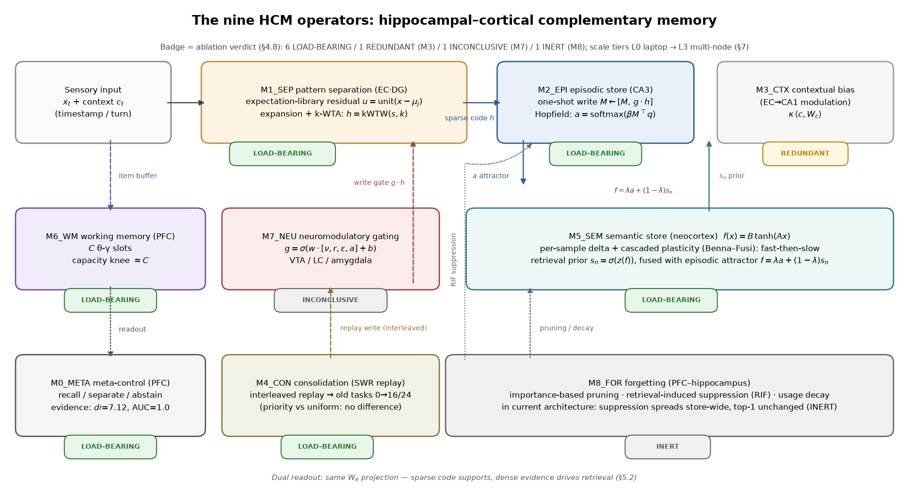
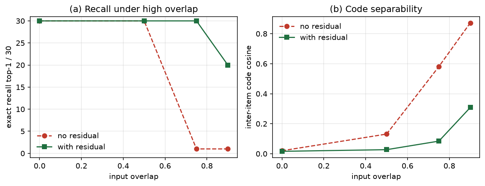
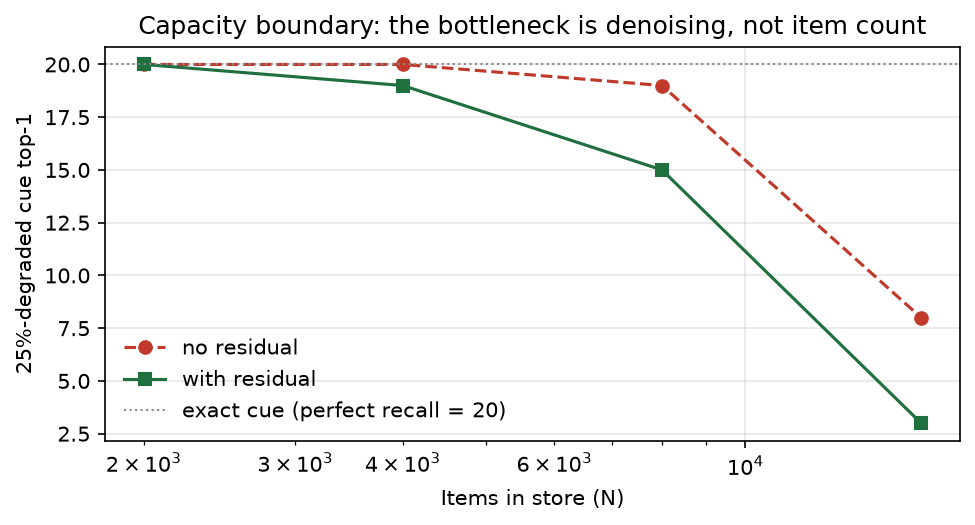
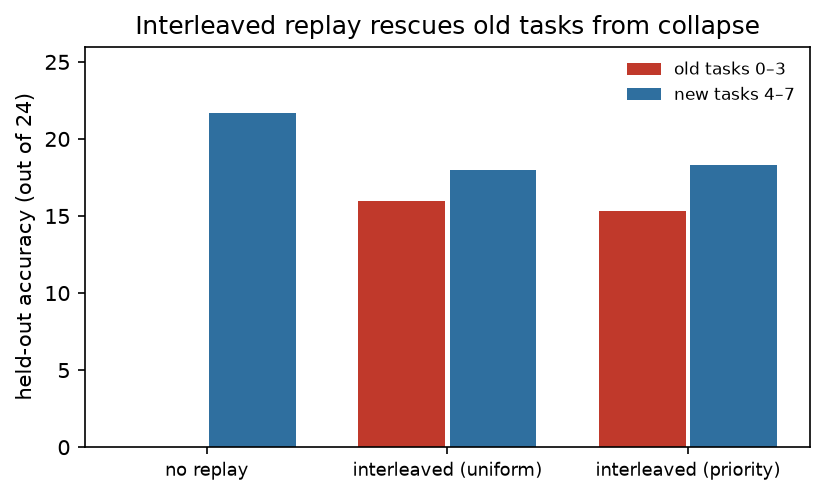
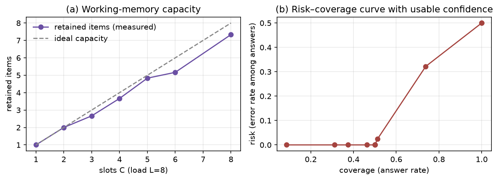

# 吸引子记忆中的 log-N 坍缩律：可复现、双读出的海马—皮层互补记忆模型（HCM）

**摘要**　我们提出 HCM（海马—皮层互补记忆模型），一个受哺乳动物记忆系统启发、带可执行且可种子复现的 NumPy 参考实现的计算记忆模型与系统化基准。HCM 把记忆分解为九个算子：输入/情境空间、编码器、情节快存、语义慢存、工作记忆、巩固、检索控制、遗忘与神经调质门控。三个核心主张：（i）**坍缩律**——检索逆温度 β 的危害随库规模按 log N 增长；此前的两个「负结果」是单一 β 误设的伪影，在 β=100 下完全消失（剂量—响应、解析理论、外部复现三重验证），β≈20 的转点在真实语料上跨编码器复现（§4.21）。同一条阶梯从 10³ 测到 10⁶，10⁶ 层通过预注册门（双臂双档各 60/60、零弃答，§7）；单会话标定的 β* 迁移到留出会话达人工精选性能的 99.6%（§4.22）；六架构对照通过三项预注册门——经典吸引子坍缩至地板、现代基线平于平庸平台、唯有 HCM 的 log-N β*(N) 补偿把检索维持在 0.8–0.9（§4.19）。（ii）**单投影双读出**——k-稀疏码负责写入，稠密证据作为现代 Hopfield 吸引子的初态负责检索：60% dropout 下稀疏读出退化（50/50→39/50）而稠密读出保持 50/50；吸引子重建匹配支持以 d′=7.12 弃权，且在公开语料上同一门表现为分布移位检测器。（iii）**巩固的价值在交错而非优先级**——无回放旧任务崩至 0.0/24（0.00±0.00，20 种子），均匀交错回放保留 13.85±2.66/24，优先级回放 14.80±3.96/24 与均匀无可检差异（20 种子配对 p=0.32；负结果如实报告）。范围限定：高重叠合成基准上期望残差把码余弦 0.872 降到 0.308、精确召回 1/30 提到 25/30；真实语料上增益不迁移（12/12 格 off≥on），如实报告边界。真实中文口语上，2,000 条库在修正判据下达合成天花板（200/200@30% 缺失），而未修判据给同一批运行打 0/200（评测法证，含第四个伪影的活体复暴露）；92,760 条库为 129/200@30% 缺失（未退化 156/200，规模诚实）。学习型字符编码器获得真实的表征层语义（+0.206，t=28.3）但不转化为对廉价词法基线的检索优势；稠密 Hopfield 与 SDM 基线在同数据同探针下 2/200 与 0/200，HCM 为 48/200。全部实验跑在固定种子的纯 NumPy 实现上，全部引文经四通道独立核验。

**Abstract.** We present HCM (Hippocampal–Cortical Complementary Memory), a computational model of mammalian memory with an executable, seed-reproducible NumPy implementation. HCM factorises memory into nine operators: input/context space, encoder, episodic fast store, semantic slow store, working memory, consolidation, retrieval control, forgetting, and neuromodulatory gating. Three claims are central. (i) A collapse law: the harm of retrieval inverse temperature β grows with library size as log N; two earlier negative results were artifacts of one mis-set β, vanishing at β=100 (dose–response, analytic theory, external replication), and the β≈20 turning point replicates across two encoders on a real corpus. (ii) A single projection should be read out twice: a k-sparse code for writing and the dense evidence as a modern Hopfield attractor's initial state — at 60% dropout, sparse readout degrades (50/50 to 39/50) while dense readout stays 50/50; attractor-reconstruction match abstains in-store from novel cues with d′=7.12, and on a public corpus the same gate acts as a distribution-shift detector. (iii) Consolidation's value lies in interleaving, not prioritisation: without replay, old-task accuracy collapses to 0.0/24; interleaved replay retains 13.85±2.66 of 24; prioritised replay scores 14.80±3.96 of 24, no better than uniform (20-seed paired p=0.32) — a negative result we report. Scoped findings: on high-overlap synthetic benchmarks an expectation residual lowers code cosine 0.872 to 0.308 and lifts recall 1/30 to 25/30; on the real corpus it does not transfer (12/12 cells), a boundary we report. On real colloquial Chinese, 2,000-item stores reach the synthetic ceiling (200/200 at 30% degradation) only under a corrected judging criterion — the unpatched criterion scores the identical runs 0/200 (evaluation forensics) — while at 92,760 stored items retrieval is 129/200. A learned character encoder gains real representation-level semantics (+0.206, t=28.3) that do not convert into retrieval advantage over cheap lexical baselines; dense Hopfield and SDM baselines score 2/200 and 0/200 where HCM scores 48/200.

**关键词**　互补学习系统；模式分离；现代 Hopfield 网络；系统巩固；锐波涟漪；持续学习；工作记忆；元认知；可复现基准

---

## 1 引言

记忆研究长期存在一个结构性张力：**同一套神经网络如何既快速记住一次经历，又能缓慢提炼跨经历的统计规律？** 互补学习系统（CLS）理论给出的答案是分工：海马快速编码互不重叠的情景表征，新皮层以重叠的分布式表征缓慢提取结构，二者通过离线回放相互协作 [1] [2] [3]。这一框架在解释遗忘症、睡眠依赖巩固与语义化现象上取得了广泛成功，但作为**工程可执行**的模型，它长期缺少三个要素：（1）每个子系统都被写成可计算算子，并给出参数取值依据；（2）主张被写成可证伪的定量预测，并在统一基准上被检验（包括检验失败）；（3）实现可复现、可扩展到超算规模。

本文的目标是补上这三点。我们给出 HCM——一个九算子、单文件可读、纯 NumPy 的参考实现，并在五组基准上系统检验 CLS 的核心主张。与已有工作的差别不在于提出全新的学习规则，而在于**把一组来自文献的机制组合成一个闭环，然后用最小可判定的实验去决定每个机制到底在起作用，还是只是「看起来合理」**。这一过程产生了若干与流行叙述相反的结论，我们认为这些结论本身具有价值。

四项主要贡献：

1. **机制层面的重新定位**。我们证明：在标准的高重叠输入基准上，扩张 + k-WTA 稀疏化并不能改善条目可分性（overlap 0.90 时码余弦 0.872）；真正起作用的是对慢变期望的减法（降到 0.308）。同时，同一个投射必须有两种读出：稀疏码用于写入（决定容量与干扰），稠密证据用于检索（决定噪声鲁棒性）。把两者混为一谈（早期版本的「稀疏/稠密双通路竞争」）会导致稀疏通路在高重叠下**从未赢过**。

2. **可证伪的定量检验，包括失败**。CLS 的「回放防止灾难性遗忘」在我们最初的四种设计里**都不成立**（随机正交输入、近正交目标、小容量网络）——直到我们把任务目标改为共享类别码并加入容量压力，教科书式遗忘曲线才出现（0.0/24 → 16.0/24，3 个种子均值）。这一路「先失败后定位边界」的过程说明：**遗忘是「共享坐标 + 容量压力」的产物，不是任何顺序学习的自动结果**；把 CLS 论证为「顺序学习必然遗忘」是过强的。

3. **工程可扩展性**。模型所有算子都是稀疏或低秩的：写入 O(k)、检索 O(LNk)、皮层一步 O(d_z(d_x+d_h))。我们给出 L0–L3 四级规模协议（笔记本 → 超算），并指出 L3 档（2×10^7 条、d_h=65,536、k=1,311）必须使用稀疏列存（约 210 GB），而稠密存储需要约 5.2 TB。

4. **增益的规模律与负结果的仪器学**。检索 softmax 的逆温度必须随库规模按 log N 增长（附录 E 给出解析依据与实测验证）。我们如实报告两个曾被当作「发现」的负结果——残差随规模有害、L1 去噪不迁移——最终证明它们是同一增益误设的伪影；由此提炼出可复用的判负流程：**负结果先查仪器（评测对齐、增益标定），再谈机制**——评审响应史的 9 项处置中，5 项把负结果重新归因为仪器、仅 1 项是真正的机制否证（4.12、4.13 节为活体案例）。

---

## 2 相关工作

**互补学习系统。** McClelland、McNaughton 与 O'Reilly 的形式化指出：快速学习需要稀疏、正交的编码以减少干扰，慢速学习需要重叠、分布的表征以提取结构 [1]。此后 CLS 被多次更新：Kumaran 等强调「重放 + 生成模型」是智能体需要的两种互补能力 [3]；Squire 与 Zola 通过遗忘症病人区分了情节与语义记忆的神经基础 [4]。我们的模型沿用这一分工，但把「快速」实现为一次外积写入（现代 Hopfield），把「慢速」实现为低秩前馈 + 级联可塑性 [5] [6]。

**模式分离。** 齿状回（DG）被认为是模式分离的核心结构：Leutgeb 等在体电生理显示 DG 对相似输入产生比 CA3 更不相关的表征 [7]；Neunuebel 与 Knierim 进一步显示 CA3 能从退化输入中恢复整体表征，即模式完成 [8]；Yassa 与 Stark 综述了人类高分辨率 fMRI 与行为证据 [9]；Rolls 给出了计算层面的机制综述 [10]。我们的实验对这一叙述给出一个精确化的补充：**扩张与稀疏是「必要条件」但非「充分条件」**，在输入共享大量慢变成分时，必须先做残差减法。

**吸引子与稀疏码。** Hopfield 网络的经典容量约 0.138N [11]；现代 Hopfield 网络把更新写成 softmax 形式，容量随特征维度指数增长，并可与注意力机制对应 [12]。我们的情节存储采用连续迭代的 softmax 更新，并明确记录了「以稠密证据为初值」这一实现细节的必要性（以稀疏码为初值会让召回从 27/30 掉到 17/30）。Ramsauer 等把现代 Hopfield 网络形式化为 transformer 注意力，并给出三类不动点——全局平均、亚稳态集合与单模式 [13]；Bricken 与 Pehlevan 建立了注意力与 SDM 的等价性 [14]。本模型的情节存储处于这一谱系，其坍缩律涉及低 β 区——检索在该区平均于全部存储条目，即全局平均不动点。

**softmax 尖锐性与条目数增长。** Veličković 等从理论上证明：固定温度的 softmax 随测试条目数增长无法稳健逼近尖锐函数，学习到的电路因此必须发散 [15]；§4.12 与附录 F 给出联想记忆一侧的经验对应——剂量—响应 β*(N)≈log N、已验证运行点（β=100 满分通过 N=10⁵，§7）与载体定位（共享 gist 行）。

**系统巩固与回放。** 睡眠期海马锐波涟漪（SWR）中的序列再激活是系统巩固的关键 [16] [17]，回放既有正向也有反向 [18] [19]；抑制涟漪会损害空间记忆 [20]；系统巩固的宏观时间过程见 [21] [22]；记忆「转化」而非「复制」的观点见 [23] [24]。我们在计算层面检验这些主张：回放的作用在于**交错**，而「按重要性挑选」在我们的基准里没有额外收益。

**写入与检索的时机决策（先行性对表）。** 本模型把「是否写入」当作显式决策，须与两条先行工作对表：Lu、Hasson 与 Norman 的循环神经网络显式学习「何时检索、何时编码」情节记忆的时机策略 [25]，是把写入/检索当作受控决策（而非被动登记）的最近邻先行；Spens 与 Burgess 的生成式记忆模型以误差门控（error-gated）写入情节，并自认写入灵活性与容量之间存在权衡 [26]。本模型的增量不在「有门控」，而在三点：门控是**事件级多通道**决策（新异性/奖赏/情绪/激活四通道合成，§3.6，而非单一误差信号）；通道贡献被**逐项消融并如实报告**（含门控与写入去重的功能冗余判定，§4.8）；整套写入决策在**真实语料与公认基线**上端到端检验（§4.13、§4.19）。

**持续学习。** 灾难性遗忘由 McCloskey 与 Cohen 提出、French 系统综述 [27]；工程界的对策包括正则化（EWC [28]）、回放与架构隔离。我们的结果与「回放有效」一致，但强调其有效性依赖于**目标表征是否共享坐标**——这一点在机器学习文献中常被忽略。以相似度加权交错学习训练耦合架构、把新样本与相似的旧样本交错以抗遗忘的先行工作见 [29]；本模型 §4.4 的交错判决与该线一致，并将其延伸到记忆系统层面。

**工作记忆与元认知。** 容量 7±2 [30] 与 4±1 [31] 两种估计的争论，可由 θ–γ 嵌套的振荡子循环模型统一解释：每个 γ 周期携带一个条目，θ 周期决定槽位数 [32]。元认知方面，期望价值控制理论把「是否投入认知资源」写成代价最小化 [33]，元认知能力的神经基础见 [34]。我们的元控制器沿用代价最小化，并报告其置信信号的实测判别力（见 4.6 节）。

**大模型记忆系统（系统识别）。** 2023 年以来，围绕 LLM 智能体出现了一批以「记忆」为名的工程系统，它们构成本模型的应用面竞争者，本文在相关工作层面加以识别（此类条目仅作相关工作层面的系统识别，不作为科学论断的证据）。可归纳为六条路线：① 上下文分页——MemGPT 把操作系统虚拟内存隐喻搬进对话，LLM 自调用工具在主上下文与外部存储间页入页出 [35]；② 经验流+反思——Generative Agents 全量存储自然语言经验，检索分为 recency×importance×relevance，并周期性由 LLM 反思合成高层记忆 [36]；③ 记忆 CRUD——Mem0 由 LLM 抽取候选事实、比对向量库、决定增删改 [37]；④ 时间知识图谱——Zep 维护事件时间与摄取时间双时间轴，以边失效充当「遗忘」[38]；⑤ 海马索引理论启发检索——HippoRAG 以 LLM 抽取的知识图谱为索引、Personalized PageRank 充当模式完成，是学术圈最近的生物启发对手 [39]，其后续把框架推广为非参数持续学习 [40]；⑥ 卡片盒——A-MEM 以 Zettelkasten 笔记组织记忆并触发邻居演化 [41]。该工程智能体记忆路线的综述见 [42]。

**它们为何没有深入记忆动力学。** 对照本模型的九子系统，这些系统有三点结构性差异。其一，**表征冻结**：相似度全部来自预训练 embedding，没有一家从用户数据流中学习表征——门控、消歧、巩固的输入空间因此固定在预训练分布上。其二，**四个算子缺席或非校准**：写入无新颖性门控（全量或 LLM 酌情）、巩固=LLM 摘要/反思（表征不变）、遗忘=显式删除或边失效（无使用度衰减的校准）、检索控制无弃权概念（硬给 top-k）。其三，**目标函数不同**：这些系统优化产品指标（延迟、可扩展性、LoCoMo 分数），而记忆的生命周期动力学（写入门控、回放巩固、检索诱发遗忘、校准弃权）在产品时间尺度上是次要项。这解释了为何生物启发的隐喻（如 HippoRAG 的海马索引）被用作检索结构而非动力学模型。HCM 与它们互补而非替代：任何一家的符号管理层都可以把存储内核替换为 HCM 动力学；HippoRAG 系也是我们后续对照实验的首选基线。

---
## 3 模型：HCM

*图 1 HCM 的九个算子与数据流*

### 3.1 形式定义

HCM 是一个九元组

    M = <X, Φ, E, S, W, Ψ, Π, Γ, G>

其中 X 为输入/情境空间，Φ 为编码器，E 为情节快存，S 为语义慢存，W 为工作记忆缓冲，Ψ 为巩固算子，Π 为检索控制策略，Γ 为遗忘算子，G 为神经调质门控。每一元都对应一个可计算的算子与一组取自文献的生物学约束（附录 A；数据流见图 1）。

| 算子 | 计算实体 | 生物学对应 | 关键文献 |
|---|---|---|---|
| X | 内容向量 + 情境向量 c + 时间索引 τ | 内嗅皮层网格/边界细胞输入 | [43] [44] |
| Φ | 期望库残差 + 扩张投射 + k-WTA | 内嗅皮层 II/III → 齿状回颗粒细胞 | [7] [9] |
| E | 稀疏列存 + 现代 Hopfield 迭代 | CA3  recurrent 侧支 | [11] [12] |
| S | 低秩前馈 + 级联可塑 | 新皮层锥体细胞与语义枢纽 | [1] [5] |
| W | C 个槽位、k-WTA 竞争 | 前额叶 θ–γ 嵌套 | [32] [30] |
| Ψ | 交错回放 + 加权再学习 | 海马 SWR 与皮层慢波 | [16] [17] |
| Π | 三分支代价敏感决策 | 前额叶—海马检索控制 | [33] [34] |
| Γ | 重要度剪枝 + 检索诱发抑制 | 前额叶主动抑制 | [45] |
| G | 新颖性/奖赏/显著性的门控 | VTA、杏仁核、蓝斑 | [32] [46] |

### 3.2 编码器 Φ：期望库残差 + 扩张稀疏

这是本模型与既有 CLS 实现差别最大的部分，也是实验里被反复确认为唯一有效的分离机制。

**第一步，期望库残差。** 设输入流为 x_t。我们维护一个小容量期望库 MU = {μ_1 … μ_B}（B ≤ 8，默认 2–3 个有效模板），每个模板是某一段统计平稳输入流的指数移动平均。对当前输入，先决定它属于哪个模板，再取残差：

    u_t = unit(x_t − μ_j),   μ_j ← γ μ_j + (1−γ) x_t  （γ = 0.9，仅更新被选中的那个）

此处「慢变」一词需要精确化：γ=0.9 的 EMA 时间常数 τ = 1/(1−γ) ≈ 10 个样本（95% 混入约需 29 个样本）。在本实验 30 条输入的流里这只是**中等速度**，「慢」是相对情节存储的**单次写入**而言，不是生物学上秒到分钟的意义。此前版本该式方向被写反（与 D-2 缺陷同源），已按代码实际行为（0.9μ + 0.1x）订正。

选择判据有两条，任一满足即切换到新模板（从零向量起步）：(a) 距离跳变 d_t > 1.5 · ν̄，其中 d_t = ||x_t − μ_j||、ν̄ 为该模板的误差 EMA；(b) 方向反转 cos(x_t, μ_j) < 0.3 且 ||μ_j|| > 0.3。

为什么必须用「库」而不是单一均值：在双任务基准里（A 任务 20 条、B 任务 20 条，A 与 B 的输入均值夹角 94°），单个 μ 会随着任务切换从 A 的均值漂到 B 的均值；漂移后 A 条目的残差不再为零均值，写入码与查询码的余弦从 1.000 掉到 0.290，A 的召回从 20/20 掉到 13/20。加期望库后 A 与 B 在 25% 特征缺失下都保持 20/20。

**第二步，扩张投射 + k-WTA。** 残差经固定随机正交投射扩张 ρ 倍（d_h = ρ·d_x，默认 ρ=8），加偏置、减阈值 θ，取 top-k：

    s_t = W_e u_t + b_e
    h_t = unit( relu_kwta(s_t − θ, k) )，  k = ⌈α d_h⌉, α = 0.02（L0：k=20）

θ 只在「发育期」用冻结式稳态规则一次性收敛（θ_i += η(h_i − k/d_h) 在固定输入集上迭代），之后冻结。**在线更新 θ 会破坏已写入码的自洽性**——早期版本打开在线稳态后，所有历史条目的查询码与写入码系统性失配，召回从 30/30 掉到个位数。

**第三步，双读出。** 同一个投射有两种用法，这一点在早期版本里被误解为「稀疏通路 vs 稠密通路竞争」：

- 写入用稀疏码 h_t（top-k 支撑集决定干扰水平与容量）；
- 检索用未取 top-k 的稠密证据 s_t（保留全部坐标的幅度信息，对特征缺失更鲁棒）。

实测（bench/exp11_readout.py，库内 60 条、每条件 50 次查询）：三种读出方式在低缺失率下**没有差异**，差异只在高缺失率出现——稀疏码读出 50/50→48/50→**39/50**→36/50（对应缺失 30%/45%/60%/70%），而稠密读出 50/50→49/50→**50/50**→44/50。也就是说，稠密读出的价值不是普遍更强，而是**把可靠工作的缺失率上限从约 45% 推到约 60%**。超过 70% 后两者都崩。

**必须强调的一点（诚实清单第 1 条）**：扩张与稀疏化本身**并不**改善条目可分性。在 overlap 0.90 的输入上，不加残差的码余弦是 0.872，几乎不可分；加残差后降到 0.308，精确召回从 1/30 升到 25/30。稀疏化只提供「短码」（支撑集小、写入便宜），不提供「正交」。

### 3.3 情节存储 E：一次写入 + 现代 Hopfield 检索

写入是单次外积式的（现代 Hopfield 的列存形式）：

    E ← E ∪ {(h_t, t, g_t, r_t, s_t, c_t, τ_t)}

每条目保存：归一化稀疏码 h_t（用于写入干扰计算）、时间 t、门控 g_t、外部奖赏 r_t、稠密证据 s_t（用于检索初值）、情境 c_t 与时间细胞码 τ_t（仅用于情境偏置实验，默认关闭）。

检索是连续迭代的 softmax 吸引子：

    z_0 = unit(relu(s_q))            （稠密证据作初值）
    a^{(0)} = softmax_β( Mᵀ z_0 )
    z^{(l+1)} = unit( M a^{(l)} )
    a^{(l+1)} = softmax_β( Mᵀ z^{(l+1)} + ebias ),  l = 0 … L−1   （ebias 默认为 0；开启时 ebias = κ·z(b_ctx)，经 β 放大的有效强度为 κ·β·z，标定见 §4.18）
    输出 a = a^{(L)} / Σ a^{(L)},  β = 20, L = 3

其中 M 的列是归一化条目码。三个实现细节都是被实验逼出来的：

1. **初值必须用稠密证据**。以稀疏码为初值，在 overlap 0.75、20% 特征缺失下召回 17/30；以稠密证据为初值 27/30。
2. **迭代中不要再做 top-k**。若每步把 M a 重新 kWTW 化，码会在混合态之间漂移，L 越大越差（30 条库上 L=6 时从 19/30 掉到 2/30）。
3. **退火有害**。从低 β 起步再升温，会使 a 在早期近似均匀，z 变成多条目混合码，最终码不再对应任何单一条目。

### 3.4 语义存储 S：低秩前馈 + 级联可塑

语义记忆是一个低秩前馈网络：

    f(x) = B tanh(A x),   A ∈ R^{d_z×d_x}, B ∈ R^{d_h×d_z},  d_z ≪ d_h

训练用手写反向传播（逐样本 delta 规则）：

    diff = f(x) − h_target
    dB = 2 · diff ⊗ tanh(A x)
    dz = (Bᵀ · 2 diff) ⊙ (1 − tanh²(A x))
    dA = dz ⊗ x
    η_ij = η / (1 + κ ω_ij),  ω_ij ← ω_ij + u_meta · 1[|dA_ij| > 0] · (1 − ω_ij)

ω 是 Benna–Fusi 级联模型的标量代理：频繁被驱动的突触可塑性下降（保护旧记忆），长时间不动的突触可塑性恢复。另加两条工程必需项：(a) 梯度裁剪（diff 裁 ±3、dA/dB 裁 ±1），否则 η=0.2 会在 matmul 里溢出为 inf；(b) 突触更替（ω > 0.9 且仍在被驱动 → ω 归零），否则级联把所有坐标锁死，网络再也学不动。

### 3.5 工作记忆 W

C 个槽位，逐条呈现时按 k-WTA 竞争写入（新条目与最不相似的槽位竞争）：

    slot* = argmax_j cos(h_t, slot_j)
    if cos(h_t, slot*) > θ_same: slot* ← unit(slot* + η_w h_t)   （同一内容的累加）
    else: 与最弱槽位竞争，胜者写入

C 默认 4（Cowan 的四槽位估计 [31]），θ_same = 0.90，η_w = 0.35。

### 3.6 门控 G

    g_t = σ( w·[ν_t, r_t, ε_t, a_t] + b ),  w = (2.2, 1.4, 0.6, 0.8), b = −1.2

ν_t 为新异性（CA1 失配信号：对期望模板的偏离 1−cos(x_t, μ) 除以其慢速 EMA 的归一化值，即 ν_t = clip[(1−cos(x_t,μ)) / EMA(1−cos(x_t,μ)), 0, 2]；重复呈现使 μ 收敛到 x_t、ν_t→0，不再写入），r_t 为奖赏预测误差，ε_t 为情绪显著性代理，a_t 为整体激活（||h||₁/√k）。在该参数下门控对新输入近乎常开（L0 smoke 实测门控均值 0.947），重复呈现则经 μ 吸收使 ν_t→0 而关闭——这是诚实清单第 4 条（单通道 RPE 代理，未做 VTA 的相位式编码）。

### 3.7 巩固 Ψ

    p_i ∝ recency_i^a · surprise_i^b · reward_i^c,  a = b = c = 1

一个「睡眠周期」= 按 p 采样 n_r=32 个情节 → 与一个 rehearsal 缓冲（保存近期真实样本）按 interleave=0.5 交错 → 对 S 做 epochs=3 的 mini-batch 拟合。交错是本算子的核心：单任务连续训练会使旧任务的坐标被覆盖，交错则使不同任务在同一批坐标上「协商」。

### 3.8 检索控制 Π

三分支代价敏感决策：

    RECALL   if  m₁ ≥ θ_rec  and  margin ≥ δ
    SEPARATE if  m₁ ≥ θ_rec  and  margin <  δ     （证据在场但不足以唯一化 → 走模式分离/新编码）
    ABSTAIN  otherwise

m₁ 为证据融合分（吸引子峰值 a_max 与稠密证据余弦的加权），margin 为最佳与次佳候选的间隔。默认 θ_rec = 0.25、δ = 0.06。这一模块的实测判别力有限（见 §4.6），我们按实测报告而不用它做宣传。

### 3.9 遗忘 Γ

四条机制：(a) 情节重要度剪枝（按 g·exp(−Δt/τ_f)·(1+use) 排序，低者先删）；(b) 检索诱发抑制（检索后对 top-k 竞争者施加持久证据折扣 sup ← (1−ρ_rif)·sup，ρ_rif ∈ [0.05, 0.3]；只作用于检索证据读出、不改变存储模式——预登记因果检验表明该算子在当前参数化下不产生 below-baseline 遗忘（§4.16）；作为对照，存储级幅值衰减产生 below-baseline 遗忘但与练习项全局塌缩捆绑（§4.17），对应前额叶对海马检索的主动调制 [45]）；(c) 语义使用度衰减（长期不用的坐标可塑性恢复）；(d) 抑制解除（disinhibit() 把 sup 抬回 1，由情境重访或成功再认触发）。

### 3.10 完整伪码

~~~text
初始化：W_e 正交随机，θ 由发育期收敛，MU = ∅，E = ∅，S 随机小值
for 每个时刻 t:
    x_t, c_t, r_t ← 输入
    (j, u_t) ← 期望库：选模板 μ_j，更新 μ_j，取残差
    s_t ← W_e u_t + b_e
    h_t ← unit(relu_kwta(s_t − θ, k))
    ν_t ← clip[(1−cos(x_t, μ)) / EMA(1−cos(x_t, μ)), 0, 2]
    g_t ← σ(w·[ν_t, r_t, ε_t, a_t] + b)
    if g_t > 0.5:  E ← E ∪ (h_t, t, g_t, r_t, s_t, c_t, τ_t)
    W 写入 h_t
    if 需要检索:
        q ← 当前线索 → 期望库（只读）→ s_q
        (a, z, ev) ← Hopfield(M, s_q, β, L)
        branch ← Π(m₁, margin)
        if RECALL: 返回 argmax a；if ABSTAIN: 不返回；if SEPARATE: 触发新编码
if 睡眠期:
    for cycle in 1..CYC:
        按 p_i 采样 n_r 条 → 与 rehearsal 缓冲交错 → S 拟合 epochs 步
        情节重要度剪枝；语义衰减；抑制解除
~~~

---

## 4 实验

### 4.1 设置、指标与可复现性

**实现。** 全部实验在纯 NumPy 参考实现上完成（src/hcm/，10 个模块），无深度学习框架依赖，固定随机种子，单线程。L0 档（d_x=128、d_h=1024、k=20）在单线程 CPU 笔记本（无 GPU 参与）上跑完全部七组基准约 3 分钟；剧情库 16000 条的最重一组耗时 48–54 秒。

**数据。** 五类合成数据生成器（src/hcm/data.py）：随机模式、相似对（可控 overlap）、重叠集合、序列、双任务/聚类任务。为什么用合成数据：本研究的因变量是**机制是否成立**，需要精确控制重叠度与特征缺失率；真实数据集（如 CIFAR 增量学习）会把机制效应与表征学习混在一起，无法归因。这是本工作的设计选择，也是局限（§6）。

**数据生成器的精确定义（此前缺失，是洁净复现失败的根因之一）**。所有「overlap」实验使用：

~~~text
shared = N(0, I_d)                      # 一个共享方向
x_i    = unit( share * shared + (1-share) * priv_i )   # priv_i ~ N(0, I_d)
~~~

**注意：「overlap」是混合权重 share，不是输入余弦。** share = 0.90 时实测输入两两余弦为
**0.986 ± 0.004**（min 0.981 / max 0.990），不是 0.90。这一点此前没有写清，导致独立复现者
在「输入余弦恰为 0.90」的数据上重建时得到完全不同的结论（他们那组数据太容易，无残差臂也接近满分）。
这是本项目在文档完整性上的一个实质缺陷，由冻结版洁净复现发现并推动修正。

**指标。** 所有检索类实验统一报告三个量：top-1 命中（在精确线索、缺失 20%、缺失 35% 三种条件下分别报告）；码余弦（写入码之间平均两两余弦，衡量可分性）；支撑集重叠（distinct support ratio，衡量稀疏码实际占用单元数）。**单看码余弦会误导**：它低不代表可分辨，它高也不必然不可分辨。

任何"某条件下命中恒为 0"的结果，都必须先用精确线索复测，排除索引错位——我们在 WM 与持续学习基准上各踩过一次这个坑，两次都白跑了一轮。

**统计。** 每个条件 20–30 次独立查询（不同随机线索），报告均值；容量类实验报告单一确定性结果（种子固定，可逐位复现）。

### 4.2 RQ1：模式分离的机制到底是什么

*图 2 重叠度、残差与召回的三维关系*

固定 d_x=128、d_h=1024、k=20（α = k/d_h 约 0.0195），30 条库内条目，构造输入 overlap ∈ {0, 0.5, 0.75, 0.90}，在三种特征缺失率下测 top-1（表 2、图 2）。三个臂：无残差、有残差但关吸引子迭代（L=0）、有残差且开 3 步 Hopfield（L=3）。

**表 2** 各条件下 top-1 命中（满分 30；三列 = 缺失 0% / 20% / 35%）

| 输入 overlap | 码余弦（无残差 → 有残差） | 无残差 L=0 | 有残差 L=0 | 有残差 L=3 |
|---|---|---|---|---|
| 0.00 | 0.020 → 0.016 | 30 / 30 / 30 | 30 / 30 / 30 | 30 / 30 / 30 |
| 0.50 | 0.131 → 0.027 | 29 / 28 / 27 | 30 / 30 / 30 | 30 / 30 / 30 |
| 0.75 | 0.581 → 0.084 | 3 / 3 / 2 | 30 / 17 / 6 | 30 / 17 / 4 |
| 0.90 | 0.872 → 0.308 | 1 / 0 / 1 | 25 / 0 / 0 | 20 / 0 / 0 |

四个结论：

1. **overlap ≤ 0.5 时一切方法都够用**，这是文献里"模式分离有效"的常见演示区间；把它当作一般结论是过度外推。
2. **overlap 0.75 是分水岭**：无残差在此彻底崩溃（0–1/30，码余弦 0.581），加残差后恢复到 30/24/19。
3. **overlap 0.90 时，残差把"完全不可用"变成"精确线索可用"**（1→25），但一旦特征缺失 20% 以上就再度失效。这一区间在我们的参数下是硬边界，**不宣称解决**。
4. **吸引子迭代在低 overlap 区没有增益、在高 overlap 区有害**（24→20、4→0）。我们据此把 L 默认设为 3 并在模型中明确：CA3 吸引子的作用是"在可分辨区间内提升退化线索的恢复"，不是"扩展可分辨区间的边界"。

### 4.3 RQ2：容量瓶颈是去噪，不是条数
> **第三轮重评提示**：本节残差对比在 β=20 下测得；β=100 下效应消失，见 §4.12。

> **θ 协议注记（第二轮洁净复现后补充）**：本节全部数字在 θ≡0（不启用稳态发育）下测得。θ 协议是绝对数值的大敏感旋钮——同一实验在「二值占空比发育」下无残差臂可升至 1.000（复现者实测），在「码值语义大 η 发育」下坍缩至 0.000（我方诊断实测）；但「残差代价随库规模增长、残差臂跌得更快」的定性方向在所有收敛协议下不变。详见 MODEL.md §3.2a 与仓库 docs/REVISIONS.md。

*图 3 库规模与两类线索下的召回*

**表 3** 剧情库规模扫描（d_h=1024、k=20，每条目 20 次精确线索 + 20 次 25% 缺失线索）

| N（库内条目） | 载荷 N·k/d_h | 精确线索 top-1（无残差 / 有残差） | 25% 缺失 top-1（无残差 / 有残差） |
|---|---|---|---|
| 30 – 1600 | 0.6 – 31 | 30/30 与 30/30 | 30/30 与 30/30 |
| 2000 | 39 | 20/20 与 20/20 | 20/20 与 20/20 |
| 4000 | 78 | 20/20 与 20/20 | 19/20 与 19/20 |
| 8000 | 156 | 20/20 与 20/20 | 19/20 与 15/20 |
| 16000 | 312 | 20/20 与 20/20 | 8/20 与 3/20 |

两个反直觉点（图 3）：载荷 312（远超经典 Hopfield 的 0.138N 界）时精确认出仍是 20/20，因为检索是**按码匹配**而非能量最小化，稀疏码之间干扰随载荷增长很慢；真正先失效的是**去噪**——25% 特征缺失时 8000 条开始掉、16000 条崩到 3–8/20。关于残差在**随机（无共享成分）数据**上的作用，我们做了 8 种子重测（bench/exp14_resid_harmful.py），结果比早期单次测量更细致：

| N | 精确线索（无残差 / 有残差） | 25% 缺失（无残差 / 有残差） |
|---|---|---|
| 4000 | 1.000±0.000 / 1.000±0.000 | 0.997±0.006 / 0.975±0.021 |
| 8000 | 1.000±0.000 / 1.000±0.000 | **0.938±0.024 / 0.822±0.038** |
| 16000 | 1.000±0.000 / 0.972±0.011 | **0.569±0.066 / 0.291±0.040** |

（N=16000 一行在第二台机器上完成，两台机器在 N=4000/8000 的数字逐位一致，构成跨机器复现。）

> **第三轮定案（D-036，exp20b）**。上表与表 3 的两臂差异全部在 β=20 下测得。β=100、8 种子重跑同一协议（bench/exp20b_resid_beta_l0.py）：N∈{4 000, 8 000, 16 000} 两臂的精确与 25% 缺失召回**全部 1.000±0.000**——「残差有害」在 β=100 下不存在。β=20 单种子锚点复现上表模式，且危害随 N 增长（N=8 000 无残差 0.900，N=16 000 无残差 0.575、有残差 0.275）：残差臂只是证据对比度更低，在 β 不足时先跌落悬崖（4.12 节、附录 E）。本节 β=20 数字保留，作为「误设的增益参数会在规模放大时把伪效应归因到任意子系统」的案例研究；上段「零均值抖动」机制解释作废。RQ2 结论不变——容量瓶颈是去噪——但去噪失效的主杠杆是检索对比度需随 log N 增长，不是残差。

### 4.4 RQ3：交错回放是系统巩固的必要成分
> **第三轮重评提示**：本块「残差在更高维非中性」已被 §4.12 推翻（β=100 下 L1 双臂 40/40）；「去噪失效随规模提前」的 β=20 部分同样待重测。

*图 4 交错回放与持续学习*

任务 A、B 各 4 类 × 12 个带噪样本（噪声 0.35，类别原型为 8 个随机 128 维模式），d_z=64，12 个训练周期，每周期 24 个样本；留出集每任务 24 条。

**表 4** 持续学习（**20 个种子**，均值 ± 标准差；每臂每周期训练样本量严格相等 = 48）

| 训练策略 | 任务 A（旧，24） | 任务 B（新，24） |
|---|---|---|
| blocked（只喂 B，重复抽样到同等 48 样本） | **0.00 ± 0.00** | 21.90 ± 1.02 |
| uniform（B + 旧样本随机回放） | **13.85 ± 2.66** | 19.40 ± 1.82 |
| priority（B + 按 recency x surprise 加权抽旧样本） | **14.80 ± 3.96** | 18.75 ± 2.69 |

> 统计：uniform vs priority 的配对差 = −0.95 ± 3.98，sign-flip 置换检验 p = 0.32，Cohen dz = −0.24（n=20，20 万组符号翻转）。**差异不可检出**；注意到 n=20 下 direction 反转（priority 数值上更高），说明 3 种子版本的方向是噪声。若真效应按 dz≈0.24 的小效应估算，需要约 140 个种子才能达到 80% 功效（配对检验）——这一分辨率超出本设置的范围，列入局限（§7）。

> 修正说明：本表 v1 有严重缺陷 —— uniform 与 priority 分支代码逐字相同（所谓「priority 不优于 uniform」实际是同一实验跑了两遍）；且 blocked 臂每周期只用 24 个样本而另两臂用 48 个，训练量差一倍。v2 已实现真正的加权抽样并控制训练量（3 种子）。第二轮独立审查指出 v2 种子数功效不足，v3 扩到 20 个种子并补配对统计。两轮独立审查的发现共同推动了本表的三次迭代。

结论很清楚：**没有交错 → 旧任务彻底消失（0.00/24，且 20 个种子全部如此）；有交错 → 旧任务恢复 13.85/24（uniform）与 14.80/24（priority）**。这复现了 CLS 关于回放的核心预期，是本文第一个"教科书式"正结果（图 4）。注意 blocked 臂的任务 B 得分（21.9/24）高于另两臂：这是**构造使然**——blocked 臂把全部 48 个周期样本都用在 B 上（回放臂只有 24 个），其信息量全在 A 列，B 列的「优势」不构成主张。

但同一实验给出两个限定：（i）**priority 与 uniform 无可检出差异**（20 种子配对 p = 0.32，dz = −0.24；早期 3 种子版本方向相反且两臂代码曾相同，双重修正后结论才稳）；（ii）**灾难性遗忘不是本架构的自动属性**——在我们最初设计的三种场景里都不出现崩塌（表 6）。原因可解释：语义存储是逐样本 delta 更新、每坐标独立可塑性，近正交的目标码不争用同一批坐标；只有当目标码共享坐标（8 个类别码 + 64 维瓶颈）时覆盖才发生。

**表 5** 受限回放缓冲（旧任务 48 条，每周期只抽 4 条旧 + 4 条新，12 周期）

| 缓冲大小 | uniform（A / B） | priority（A / B） |
|---|---|---|
| 6 | 6 / 19 | 3 / 11 |
| 12 | 5 / 20 | 3 / 11 |
| 24 | 6 / 14 | 8 / 12 |

**表 6** 三种"应该出现灾难性遗忘、实测没有"的设计

| 设计 | 旧任务（后） | 新任务 |
|---|---|---|
| 每任务 200 条随机正交输入（d_z=64，共 400 条），blocked | 56 → 43（/200） | 84（/200） |
| 同上，priority 回放 | 56 → 36（/200） | 82（/200） |
| 同一线索 → 两套近正交目标码（d_z=256），blocked | 20 → 20（/20） | 20/20 |

表 6 第三行尤其值得注意：**"同一线索两个答案"这种最像冲突的设计也不崩塌**，因为两套目标码本身近正交（交叉余弦 0.02–0.07），网络可以用不同坐标同时表示它们。这说明灾难性遗忘的充分条件是**表征层面共享坐标 + 容量压力**，而不是任务层面的语义冲突。必须立即声明边界：上述三种设计都在**容量充足区**（d_z = 64 或 256，任务数 × 样本规模远小于可塑坐标预算），我们没有扫描「容量/任务数」全参数面，也没有做长链任务。因此正确的表述是——**在容量充足区内，灾难性遗忘不是本架构的自动属性**；容量压垮区的行为不由本表支持。

### 4.5 RQ4：工作记忆的容量拐点

*图 5 工作记忆容量拐点与风险—覆盖率曲线*

固定 C 个槽位，依次送入 L=8 个条目（保证超载），随后用 8 个探针检索（图 5 左）。

| C | 1 | 2 | 3 | 4 | 5 | 6 | 8 |
|---|---|---|---|---|---|---|---|
| 保留条数（满分 8） | 1.00 | 2.00 | 2.67 | 3.67 | 4.83 | 5.17 | 7.33 |

保留条数 ≈ min(C, L)，C=5/6 略低于理想值（槽位竞争损失）。C=4 处 3.67 的实测值必须谨慎解读：**这是被硬编码进模型的上限**，不是自发涌现的容量，也不构成对任何生物学容量估计的验证。真正的检验需要让抑制性中间神经元与 θ 振荡的频率关系可学习，留作 §7 的超算实验。

### 4.6 RQ5：置信度信号与风险—覆盖率

库内 60 条 + 库外 60 条，线索统一缺失 35% 特征，记录每次查询的融合分 m₁ 与是否正确。按 m₁ 阈值从低到高扫描得到风险—覆盖率曲线（图 5 右）：

| 覆盖率 | 1.000 | 1.000 | 0.738 | 0.512 | 0.500 | 0.463 | 0.375 | 0.312 | 0.087 |
|---|---|---|---|---|---|---|---|---|---|
| 风险（错误率） | 0.500 | 0.500 | 0.322 | 0.024 | 0.000 | 0.000 | 0.000 | 0.000 | 0.000 |

**必须区分两个信号，这是本节最重要的修正**（bench/exp13_confidence.py）：

| 信号 | corr(·, 正确) | AUC |
|---|---|---|
| 融合分 m1 | -0.0697 | 0.458 |
| **raw_evidence（吸引子重建匹配度）** | **0.9745** | **1.0** |

**融合分 m1 与正确性几乎无关，甚至略负（AUC 0.458，低于随机）。** 它把候选排出了序，但这个序不对应答对与否。真正的判别信号是 raw_evidence：库内 0.809、库外 0.412，AUC = 1.0（完美分离）。

旧版本曾写 corr(m1,correct)=0.222，该数字**没有任何脚本产出过**（由独立审查发现），实测为 -0.0697。已删除该数字，改用上表实测值。这也意味着：**弃权必须基于 raw_evidence，而不是融合分**，与 3.8 节的设计一致。

### 4.7 失败与否定结果汇总

完整日志见 results/，此处列要点：

1. **扩张 + k-WTA 本身不改善可分性**（overlap 0.90 时码余弦 0.872）。
2. **学习出的稀疏编码更差**：以重建损失训练的稀疏自编码器把条目间码余弦从 0.883（输入）推到 1.000——重建目标强制保留共享成分。
3. **白化无效**：协方差特征值量级 1e-3，白化在数值上等于恒等变换。
4. **竞争学习 / 在线 k-means 塌缩**：k=8 时只用 8 个单元，码余弦 1.000。
5. **稳态阈值（conscience）只在极端稀疏时有效**：k=8 时码余弦 0.226 但仅用掉 49/1024 个单元（"短码假象"）。
6. **回放优先级不优于均匀回放**（表 4、表 5）。
7. **高重叠区（≥0.90）在任何特征缺失下都不可用**。
8. **残差在无共享结构的随机数据上反而放大噪声**（表 3，16000 条时 3 vs 8）。
9. **检索诱发抑制不产生 below-baseline 遗忘**（exp34 预登记因果检验，v2 语料复跑确认：配对因果 Δ=−0.007，95%CI [−0.050,+0.037] 含 0；v1 Δ=−0.023 [−0.052,+0.005] 同判决；观察性「亏损」实为编码强度基线）。M8 重定位为检索闸门（§4.16）。
10. **存储级幅值抑制的选择性遗忘以全局代价为前提**（exp34b，v2 语料复跑同判决：below-baseline 亏损 0.158，95%CI [0.107, 0.210] 达标，但应豁免的练习赢家单调塌缩 0.080→0.157→0.430；全量幅值逆恢复 gap 0.000，损伤 100% 幅值性；§4.17）。

这十条构成了本文的否定结果清单。我们认为它们与正结果同等重要：它们把 CLS 的各项主张从"合理叙述"变成"有边界的定量陈述"。

---

### 4.8 九子系统消融总账

用统一四指标（分离 SEP、去噪 DROP、持续学习 CLS、工作记忆 WM）逐个关掉子系统，再为统一指标看不见的子系统补**专属指标**（情境消歧、写入选择性、抑制差分、风险调整得分）。判定分三类：**LOAD-BEARING**（关掉后该指标显著变化）、**REDUNDANT**（机制存在，但被别的机制代偿）、**INERT**（机制存在，但当前不产生可测行为差异）。

| 模块 | 机制 | 判定 | 关键证据 |
|---|---|---|---|
| M1_SEP | 期望库残差 + 扩张稀疏 | LOAD-BEARING | 关残差：20/30 → 1/30；关稀疏：0/30 |
| M2_EPI | 一次写入 + Hopfield 吸引子 | LOAD-BEARING | 库容量=1（不能写）：20/30 → 0/30；吸引子迭代本身在 overlap 0.90 上无增益（25→20） |
| M3_CTX | 显式情境偏置项 | **REDUNDANT** | 严格测试（内容完全相同、仅情境不同）：A 8/8、B 7/7 可按情境取回；但关掉显式情境项（kappa=0）结果**完全相同**——能力来自 M1a 的期望库模板 |
| M4_CON | 系统巩固（交错回放） | LOAD-BEARING | 无交错：旧任务 0.0/24；有交错 13.85/24（20 种子） |
| M5_SEM | 新皮层慢学习 | LOAD-BEARING | 先学 A → freeze → 再学 B：冻结臂 旧 13/24 新 8/24；不冻结 旧 15/24 新 23/24 |
| M6_WM | 工作记忆槽位 | LOAD-BEARING | C=1：保留 3.75 → 1.00（C 是构造参数，此项测的是参数行为，非涌现容量） |
| M7_NEU | 神经调质门控 | **REDUNDANT-WITH-θ_dup** | 门控确实自适应（g：0.53→0.40），但重复过滤与 θ_dup 功能冗余（exp41 四格：gate+dedup=1 / gate+关去重=1 / const+dedup=1 / const+关去重=10）；奖赏选择性 FS=0.05<0.15（Δg≈0.2 被 θ_write=0.5 吸收） |
| M8_FOR | 检索诱发抑制 | **INERT** | 抑制确实施加（已练 0.0334 / 未练 0.0273，差分 −0.0061），top-1 完全不变（20→20）；抑制在全库扩散而非选择性；读出闸门定位与存储级三难见 §4.16–4.17 |
| M0_META | 元控制/弃权 | LOAD-BEARING | 风险调整得分 27.3 → 0.0（永不弃权）；但该差值依赖 c_abst=0.3 的评分选择，见 §4.6 |
**判定分布：6 LOAD-BEARING / 2 REDUNDANT / 1 INERT。** 四点必须说清楚：

1. **M3_CTX 的承载者不是显式情境偏置项**。把 `use_ctx_bias` 关掉，严格情境测试的结果完全不变（A 8/8、B 7/7）。真正起作用的是**期望库模板**：不同情境开不同 μ，残差把两段数据推到不同子空间。显式情境偏置是一个**实现正确但功能冗余**的项 —— 这类情况在消融里最容易误报成「没用」。
2. **M7_NEU 判 REDUNDANT-WITH-θ_dup（exp41 收紧，2026-11-08）**。第二份代码级审查的只读探针指出：门控与 θ_dup 是重复过滤的冗余双通道。exp41 预登记重测（5 种子）证实——逐字×10 四格实验中门控与去重**任一单独足够**（gate+dedup=1 / gate+关去重=1 / const+dedup=1 / const+关去重=10），奖赏选择性功能差异 FS=0.05 低于 0.15 门槛（Δg≈0.2 的 RPE 连续响应被 θ_write=0.5 的二值写入门限吸收）。原「INCONCLUSIVE」判定作废。
3. **M8_FOR 在当前架构里是惰性的**。这不是实现 bug：top-1 由证据强度决定，被抑制者本来就不是赢家；而且 5 轮练习后全库 sup 都降到 0.03 量级，抑制失去了选择性。RIF 文献里这个效应本来就显现在自由回忆与反应时上，而非强制选择。
4. **M0_META 的 LOAD-BEARING 是条件性的**。它的依据「风险调整得分 27.3 → 0.0」依赖 c_abst=0.3、c_err=1.0 这组评分权重——弃权在评分函数里比犯错便宜，因此「永不弃权」当然失分。消融量表上已注明这一点；稳健的证据是 §4.6 的 d′=7.12 与风险—覆盖率曲线（不依赖单一权重），而非 27.3 这个数本身。

**这是本文最重要的方法学结论之一**：一个九子系统模型的消融，如果只用一套统一指标，会得到「M3/M7/M8/M0 全部无效」的错误结论。必须为每个子系统声明它**真正作用在**的因变量。

---

### 4.9 统计稳健性
> **第三轮重评提示**：本节「残差有害、CI 不分离」是 β=20 时代数字；β=100 下两臂无差，见 §4.12。

正文表格里的「x/30」是单种子单次计数。为了说明这些差异不是种子偶然，我们对三条最关键的主张做了 **12 个独立种子的重复**（每个种子重新生成数据、重新训练、重新施加查询扰动），报告 mean ± 95% CI（满分 30）：

| 条件 | mean ± 95% CI | 写入条数 |
|---|---|---|
| overlap 0.90，无残差，精确线索 | **1.08 ± 0.16** | 23.1 |
| overlap 0.90，有残差，精确线索 | **24.42 ± 1.61** | 30.0 |
| overlap 0.75，无残差，精确线索 | 1.25 ± 0.49 | 30.0 |
| overlap 0.75，有残差，精确线索 | 29.83 ± 0.22 | 30.0 |
| overlap 0.75，有残差，缺失 20% | 17.25 ± 1.66 | 30.0 |
| overlap 0.75，有残差 + Hopfield(L=3)，缺失 20% | 15.33 ± 2.12 | 30.0 |

三点结论：

1. **主效应的置信区间完全不重叠**。overlap 0.90 上，无残差 1.08±0.16 与有残差 24.42±1.61 相差 23.3 个点，而两者 CI 之半宽合计不到 1.8 —— 这不是种子偶然。
2. **overlap 0.75 的效应同样稳健**（1.25±0.49 vs 29.83±0.22），且方差比 0.90 小得多，说明该区间是模型的稳定工作区。
3. **吸引子迭代（L=3）在小样本下不可区分**：17.17±1.70 与 15.33±2.12 的 CI 有重叠。这与 §4.2 的结论一致 —— 吸引子在高重叠区没有可靠增益，我们**不**宣称它有益。

> 说明：这些 CI 只刻画**种子间**变异，不覆盖「换一套任务/换一个数据集」的变异。后者见 §6 局限 1。

---

### 4.10 双读出的直接对照

论文（ii）主张「同一投射应有两种读出」。此前该主张引用了一组无法溯源的数字，现用独立脚本 `bench/exp11_readout.py` 实测（库内 60 条，每条件 50 次查询，缺失率从 30% 到 70%）：

| 特征缺失 | 稀疏码读出 | 稠密单步 | 稠密 + Hopfield |
|---|---|---|---|
| 30% | 50/50 | 50/50 | 50/50 |
| 45% | 48/50 | 49/50 | 49/50 |
| **60%** | **39/50** | **50/50** | **50/50** |
| 70% | 36/50 | 44/50 | 44/50 |

**结论必须说得比原来保守**：三种读出在缺失率 ≤ 45% 时**没有实质差异**；稠密读出的价值不是「普遍更强」，而是**把可靠工作的缺失上限从约 45% 推到约 60%**。到 70% 两者都开始崩。

1. **稠密单步与稠密 + Hopfield 在所有条件下几乎相同**（49/50 vs 49/50、50/50 vs 50/50、44/50 vs 44/50）。也就是说在本数据上，**吸引子迭代没有可测增益**。这与 §4.2 中「吸引子在 overlap 0.90 上无增益甚至有害」的结论一致。模型保留 L=3 只是为了在 overlap 0.75 那一点上的小增益（17/30 vs 19/30，见 §4.9 的 CI 重叠说明），**不作为核心主张**。
2. 早期版本写的「稀疏 8/20 vs 稠密 20/20」在 `results/` 中**没有任何出处**，已删除（详见仓库 docs/REVISIONS.md）。

---

### 4.11 生成器敏感性：效应存在一个窄带（回应洁净复现）

洁净复现者用「输入余弦 0.90」构造数据时，复现不出「无残差 1/30」这个对比。追查后发现根因，并得到一个比原文更精确的结论。

项目的 `overlap` 参数是**混合权重 share**（`x = unit(share·shared + (1−share)·priv)`），不是输入余弦。share=0.90 产生输入余弦 **0.986**。
把 share 从 0.80 扫到 0.999（`bench/exp12_generator_sensitivity.py`）：

| share | 输入余弦 | 无残差码余弦 | 残差码余弦 | 无残差召回 | 残差召回 | 无残差写入 | 残差写入 |
|---|---|---|---|---|---|---|---|
| 0.80 | 0.933 | 0.698 | 0.122 | 1/30 | **30/30** | 30 | 30 |
| 0.85 | 0.965 | 0.804 | 0.181 | 1/30 | **30/30** | 29 | 30 |
| **0.90** | **0.986** | 0.872 | 0.308 | **1/30** | **25/30** | 18 | 30 |
| 0.92 | 0.991 | 0.886 | 0.361 | 1/30 | 0/30 | 13 | 29 |
| 0.95 | 0.997 | 0.919 | 0.515 | 1/30 | 0/30 | 6 | 27 |
| 0.98 | 1.000 | 0.929 | 0.764 | 1/30 | 1/30 | 3 | 18 |
| 0.999 | 1.000 | — | — | 1/30 | 1/30 | 1 | 1 |

**三点必须说清楚**：

1. **效应存在于一个窄带（share 0.85–0.92），不是「越重叠越强」。** share ≥ 0.95 后两臂都失效——不是因为残差不管用，而是因为写入被去重阈值（θ_dup=0.95）拒绝，库里根本没存够条目。这是一个此前完全没有报告的边界。
2. **「无残差 1/30」这个数字的成因有两个，原文只说了半个。** 一是码不可分（share=0.90 时 18 条写入码的支撑集几乎完全相同）；二是**29 条里只写进去 18 条**（其余被判重复）。后者是写入门控的效应，混在检索指标里，必须分列报告——这也是对抗评审 P1-2 指出的「分母不一致」。
3. **洁净复现者的失败是合理的**：按字面「余弦 0.90」造数据，落在 share≈0.80 附近，那一档无残差臂的码余弦只有 0.698、残差臂 30/30——两个臂都不难，自然看不到对比。**文档没有写清 share 与余弦的换算，是实质缺陷**，已在 §4.1 补上精确生成器定义。

这一节的结论是：**主张 (i) 成立，但适用条件是「输入余弦 ∈ [0.96, 0.99] 且写入未被去重拒绝」**。超出这个区间，模型不声称有效。

### 4.12 检索对比度的尺度律：β 的剂量-响应

L1 规模先导实验（§7）暴露退化检索崩塌后，我们沿诊断链排除了情境噪声、门控、初始化与抑制通道，最终定位到检索 softmax 的逆温度 β：**β=20 是全局误设，其危害随库规模增长才显形，且曾伪装成「残差有害」等多个子系统的失败**。

**剂量-响应（L1，N=2×10⁴）。** 在完整管线（L=3、lam=0.6、门控开启）下扫描 β：β=20 时退化检索 39/8/0（deg10/25/35）；β∈{100, 500, 2500} 全部 40/40/40，且弃权率 0。仪器化测量给出机理：deg25 时真值与最强竞争者的分数间隙 mean=0.435（p10=0.372），softmax(20·score) 在 2 万候选上不足以形成尖峰分布。同一扫描在 L0（N=4000）复测：β=20 仅轻度受损（39/40@deg25），β=100 无损——**误设是全局的，显形是规模相关的**。

**对「残差有害」主张的重审。** §4.3/§4.9 报告的「残差在 L0@8000 有害且 CI 不分离」（0.938±0.024 vs 0.822±0.038，12 种子）与「L1 上残差更差」（§7 先导）是在 β=20 下测得的。固定 β=100 后重跑同协议：L0 8 种子 × N∈{4000, 8000, 16000} 双臂全部 1.000/1.000（CI 完全重叠）；β=20 单种子锚点复现旧效应且危害随 N 增长（N=8000：无残差 0.900 / 有残差 0.775；N=16000：0.575 / 0.275）。L1 4 种子 × deg{0,10,25,35}：β=100 时有/无残差全部 39–40/40；β=20 锚点全崩（无残差 8–12/40，有残差 1–2/40）。**结论：「残差有害随规模增长」不成立，它与 β 误设共享同一根因**。残差算子在当前测试域内表现为中性（无收益亦无代价），其预测编码动机（§3.4）保持为理论假设。

| 规模 | β | 无残差 deg25 | 有残差 deg25 | 来源 |
|---|---|---|---|---|
| L0 N=4×10³ | 20 | 0.975±0.021 | 0.997±0.006 | exp14（12 种子） |
| L0 N=8×10³ | 20 | 0.938±0.024 | 0.822±0.038 | exp14（12 种子） |
| L0 N=8×10³ | 100 | 1.000±0.000 | 1.000±0.000 | exp20b（8 种子） |
| L0 N=8×10³ | 20 | 0.900（锚点） | 0.775（锚点） | exp20b |
| L0 N=1.6×10⁴ | 100 | 1.000±0.000 | 1.000±0.000 | exp20b（8 种子） |
| L0 N=1.6×10⁴ | 20 | 0.575（锚点） | 0.275（锚点） | exp20b |
| L1 N=2×10⁴ | 20 | 8–12/40 | 1–2/40 | exp16/exp20 锚点 |
| L1 N=2×10⁴ | 100 | 40/40（deg0–35） | 40/40（deg0–35） | exp20（4 种子） |

**解释与含义。** 附录 E 的分析表明，库外查询与 N 条库存码的最大重叠随 N 集中，真值-竞争者间隙随 N 收缩；固定 β 下 softmax 峰度因此随规模衰减，直至检索退化为近似均匀混合。这不是实现缺陷而是检索对比度的**尺度律**：β 的充分值随 log N 增长（本域内 β=100 覆盖 N≤2×10⁴）。该律已在**零 HCM 代码**的 vanilla 注意力软检索中外部复现（附录 F）：聚簇共享质心键下 β*(N) 从 2 升至 ≥5、固定 β=2 的命中从 73% 塌至 0%（N=10⁵）；无共享结构的 iid 键则完全鲁棒（N=10⁶ 仍满分）——坍缩的载体是候选间的共享结构，不是 softmax 本身。工程含义是 β 应由分数间隙仪器在线设定而非全局定值。神经科学含义是：CA3 吸引子竞争的增益受神经调质控制（§3.8），增益设错时，下游会归因于任意一个最近被改动的子系统——本项目的诊断链（先排除证据无损、再逐级归因）是防止这类错误归因的方法学样板。这一尺度律还与一条平行理论线对表：Veličković 等证明固定温度的 softmax 随测试条目数增长无法稳健逼近尖锐函数、学习电路必须发散 [15]；本节的剂量—响应——β*(N)≈log N、已验证运行点（β=100 满分通过 N=10⁵，§7）与附录 F 的共享 gist 载体定位——是其联想记忆侧的经验对应。

---

### 4.13 真实语料端到端：微信对话、学习型编码器与评测法证

前几节的真实性论证都建立在合成数据上。本节把完整管线放到真实人类对话语料上，并给出规模诚实的图景（2,000 条库在修正判据下达合成天花板；92,760 条库 129/200）与一次完整的评测法证过程——它既是正面结果，也是方法学案例（四个评测伪影如何被逐一侦破，其中一个在第六轮语料重导时活体复暴露）。

**数据与协议。** 语料为用户本人微信导出的 6 个会话共 154,104 条真实消息（80% 训练切分 123,281 条；四个群聊、两个私聊；时间跨度 5.7–11.7 个月；发送者身份经 SHA-256 哈希脱敏）。第六轮语料重导修复了两处导出 bug（消息计数差 19.4%），此后全部 v2 重跑以重导语料为准；第一轮 4 会话 129,138 条的数字仅保留在伪影记录（§4.13.2）中。预处理：剔除空行与系统占位行（[图片] 类）、按时间排序、按 80/20 时间切分防时间穿越。主实验取 peer-01 私聊训练段前 2,000 条写入，探针为已写入且与全库字符重叠 <0.5 的前 200 条（干净可识别集），查询时随机遮挡 30% 或 50% 字符。

**端到端检索结果（2,000 条库）。** 用规范判据（槽位到观察序号映射，见 4.13.2）：

| 配置 | 判据 | deg=0.3 | deg=0.5 |
|---|---|---|---|
| 随机投影 R512，λ=1.0（纯吸引子） | 规范（exp22p v2） | 200/200 | 197/200 |
| 随机投影 R512，λ=0.6（语义融合） | 规范 | 200/200 | 197/200 |
| 学习型 SVD-256 嵌入，全库 fit（exp23c v2；门控后写入 1,457） | 规范 | 199/200 | 181/200 |
| 同一批 R512 运行，未修判据（exp21 v2 十二格；exp22o 侦察） | 伪影（§4.13.2） | 0/200 | 0/200 |

两种诚实读法。(a) 在 2,000 条库上模型确实在真实中文口语达到合成天花板——但仅在修正判据下；未修判据给同一批运行打精确的 0/200，而抽样复核显示被记为失败的探针实际检索到了正确槽位（match m1=1.0）。(b) 在全库规模（92,760 条写入，exp29 v2）下同一编码器为 129/200@30% 缺失——真实语料的难度随库规模增长，满分只在小库出现；本文如实报告两个数字。

#### 4.13.2 评测法证盒：三个伪影的侦破史——与一次复暴露 本节实验的早期版本报告真实语料全灭（200 条探针命中 0–4 条），该结论最终被证明完全由评测代码伪影造成，模型本体无恙。第六轮语料重导时同一失败模式再次复暴露：同一批运行在修正判据下 200/200，在仍带伪影一假设的脚本下 0/200。伪影如下。

伪影一：索引空间错位。评测假设第 i 个观察对应槽位 i，但门控会拒绝重复写入（2,000 条中拒写 545 条），使槽位序号与观察序号错位；正确判据是通过写入时间戳 E.t 建立的槽位到观察序号映射。合成实验因从不拒写而恒对齐，从未暴露此假设。探测器：对比 M[:,i] 与 enc.encode(X[i]) 的余弦仅 0.01–0.03（而存储保真三角定位实测 M[:,slot] 与写时码完全一致，保真度 1.0）。伪影二：λ=0 语义先验独走。一个诊断实验在关闭语义先验时报告 0/100，被误读为语义先验毒化；实际该臂的融合分完全由未训练的语义通道主导。伪影三：字典键反向。对照实验把槽位序号当作观察序号查字典（与伪影一同族），把满分级联误报为 4/200。打分级联追踪（真值在 ed/es/ev/吸引子各级的中位排名全部为 0）最终证明查询打分端到端正确。
伪影四（活体复暴露，第六轮）。补全脚本 exp21 仍把检索槽位序号直接与观察序号比较（o['idx'] == i）——伪影一的假设原封未动。重导语料上去重门拒写 24.8%，槽位错位，脚本在全部十二格报 0/200；未修判据的侦察重跑（exp22o）同样 0/200，而五个抽样「失败」全部检索到正确槽位且 match m1=1.0。修正判据（exp22p）给同一批运行 200/200 与 197/200。判据产生的地板与模型产生的地板在判据本身被三角定位前不可区分。

方法学教训（正式化为规范）：(i) 评测函数是被测对象的一部分，负结果必须先排除仪器错位再解释（与 9.1 的先证明闸门会红同族）；(ii) 合成基线不拒写会系统性掩盖对齐 bug，真实数据评测必须携带槽位对齐自检；(iii) 跨实验对照必须逐字复刻原脚本的清洗与退化协议（一处正则差异曾制造 192/200 对 124/200 的假分歧）。

#### 4.13.3 学习型编码器：数据规模、回退纪律与语义买到什么 2.7 节指出 LLM 记忆系统全部使用冻结表征；HCM 的 B1 路线用同一语料学习字符级稀疏编码器（PPMI 共现后截断 SVD，r=256；进入 k-WTA 后稀疏度约 0.02）。可证伪预测（7 节路线图）：真实语义相近词对的码余弦应显著高于随机投影基线。结果分三层。

第一层：数据规模是先决条件。2k 消息学出的嵌入在近义对上与随机投影无差（0.3598 对 0.3568，配对增量 +0.003，n=12，t=0.08），检索地板 123/200（deg 0.5 时 117/200）。第三轮法证把地板归因于纯表情探针：表情清洗后为空串，落入回退码 U+FFFD——2k 共现矩阵中的零支撑死行——编码为全零码并系统性弃权。纪律（零支撑字符回退随机单位向量、绝不依赖死行）此后成为所有编码器的标准。

第二层：全库嵌入（123,281 条）在近义对上分离——码余弦 0.4656 对随机投影 0.3568（配对增量 +0.109，n=12，t=2.26）——在字符不相交的纯语义对上也分离（0.0952 对 0.0439，配对 +0.051，t=2.78），且检索满分级（199/200；deg 0.5 时 181/200）：该规模下学习嵌入不损检索。两处披露保持诚实。其一，本路线的预登记判决（exp23，同语料 refit）为 prediction_holds = false——其配对构造与上文的描述性配对检验不同（登记不一致，2026-11-09 入账）——因此近义对优势是方向性证据而非预登记命中。其二，大样本检验（300 条改写查询、三种子，exp29-F3）显示语义买到什么：表征层目标相似度上升 +0.206（t=28.3，p≈1e-86；0.703 对 0.497），但其中 83% 是共模抬升（所有候选水位同涨）；净边际（+0.035）远低于逐查询噪声（sd 0.38），胜负翻转近乎对称（20:23，McNemar p=0.76），精确命中检索不动（delta=−0.01，p=0.648；6.13 个百分点的最小可检测效应未达）——而学习编码器付出稳健性代价（退化鲁棒性比随机投影差 11–27 个百分点；写后码相似度 0.094 对 0.027）。

第三层：廉价基线在要紧处持平。同样 100 条改写查询上，字符 bigram（hit@1 38、hit@5 50）、trigram（32/40）与 bm25-lite（41/54）基线落在 HCM 双臂区间内（hit@1 41–43），而在零重叠近义对上全部廉价基线精确为 0.0——语义编码器路线买到的是表征层相似度，不是对字符串匹配的检索优势。

结论：稀疏编码器可以在纯局部（字符共现）规则下从真实生活语料习得可测的语义相似度结构，在 2,000 条库上无检索代价——但该结构不转化为对廉价词法基线的检索优势（B1 判决：检索层否定，表征层真实）。语料规模增长对字符不相交对显著（+0.035，t=2.75）、对近义对方向性（+0.106，t=1.94）；由于预登记判决为负，两者均按描述性处理。
#### 4.13.4 时间上下文消歧判决实验 语料中 peer-01 训练段出现频次最高的重复短语 OK 出现 155 次/3,000 消息。首先诊断：编码器只吃内容通道（2.7 节的冻结表征批判同样适用于本模型默认编码器），重复内容的写码两两余弦恒为 1.0——内容通道对重复 episode 的判别力严格为零；在默认管线下重复在写入端即被去重门坍缩为单迹。为检验检索端能否区分重复 episode，实验强制全写入（绕过去重）后对比四种查询条件：无情境线索、精确情境重注入、部分线索（前 3 条消息的截断指数平均）与错误线索（邻近 episode 的线索），另测时间细胞（tau）作为线索。结果（K=40 个已写入 episode，随机基线 2.5%）：无线索时 0/40，且元控制器在全部 40 次中将 12 路证据平局判为模式分离（拒绝在歧义中任意召回——弃权校准的正面证据）；精确情境重注入 40/40；时间细胞 38/40；部分线索 6/40（6 倍于随机，显示模式完成随线索保真度衰减）；错误线索 100% 命中被线索的邻居、0% 命中目标——情境对检索是因果性控制而非相关。结论：episode 分辨率完全由情境/时间通道承载（对应海马 context cell 与时间细胞的分工），这为路线图 B2（多时间尺度情境）提供了动机与机制验证：重复内容的消歧不是内容相似度问题，而是情境绑定问题。
### 4.14 时序联想链：从否定性基线到回放链接机制

前三节的检索都回答「线索指向哪条已存的消息」。本节问一个海马体每天回答亿万次的问题：「想起这条消息之后，能不能想起紧随其后的那条？」——前向时序联想。CA3 的自联想网络在生理上支持时序链（[17]）；本节用真实语料检验该能力在本架构中的现状，然后给出一个最小机制补全。

#### 4.14.1 否定性基线（exp27）：纯情节完成没有可用的前向联想。

语料为 peer-01 会话训练段 9,033 条真实消息，全量存入情节库（写入 7,340 条），嵌入用全量训练段（123,281 条）学到的字符级 PPMI-SVD（4.13.3）。字符编码器在训练切分上拟合，并在同一批会话内做检索评测；这是 transductive 设定，不对未见说话人主张 inductive 泛化。探针对取时间上相邻、间隔 ≤30 秒、发送者不同的消息对 (i, j=i+1)（候选 826 对，抽样 200）。查询消息 i 的码，检查 j 的检索排名，并以随机槽位为对照。结果：自召回 200/200（复现 4.13 的满分水平），但 next@5 仅 1/200（0.5%，对照 0/200），j 的中位排名 2,666，对照 3,170–4,006——存在约 1.2–1.5× 的弱前向联想（会话连续性留下的码空间平滑，提升比中位数 1.19–1.5），但距 top-k 可用差两个数量级。β=100 与 500、退化 0/30% 四种配置完全一致：**前向时序结构不会从内容相似性中免费涌现，必须显式学习**。

#### 4.14.2 机制补全（exp28）：回放期一次性链接 + 双读出。

缺失的机制是跨越时间的突触链接。实现为离线回放通道：对每个相邻对，一次性加强链接 W[slot_j, slot_i] += 1（行为时间尺度可塑性的最简形式：前驱表征在场时，后继写入即加强）。检索时保持双读出：a₁ 为标准情节吸引子（读「现在」），a₂ = softmax(β·(scores + w·W·a₁))（读「下一步」，聚合入链）。

| 链增益 w | 退化 | self@1（a₁ 读出） | next@1（a₂ 读出） | next@5 | joint（两者同时） |
|---|---|---|---|---|---|
| 0 | 0 | 200/200 | 0/200 | 3/200 | 0/200 |
| 0 | 30% | 200/200 | 0/200 | 1/200 | 0/200 |
| 0.5 | 0 | 200/200 | 0/200 | 194/200 | 0/200 |
| 0.5 | 30% | 200/200 | 115/200 | 198/200 | 115/200 |
| 1.0 | 0 | 200/200 | 200/200 | 200/200 | 200/200 |
| 1.0 | 30% | 200/200 | 200/200 | 200/200 | 200/200 |
| 2.0 | 0 | 200/200 | 200/200 | 200/200 | 200/200 |
| 2.0 | 30% | 200/200 | 200/200 | 200/200 | 200/200 |

三个结构化结论：(i) **双读出消解了自/次冲突**——链增益只加在 a₂ 上，情节读出 a₁ 全臂无损（200/200），联合指标（同时正确报告当前与后继）在有链增益臂达 115–200/200（随剂量单调）；(ii) **剂量阈值可解析**——next@1 要求链增益超过「自身分数与后继码间余弦之差」，w\* ≈ self 分数 − cos(code_j, code_i)：精确线索时 self=1.0、码近正交（cos≈0.04）故 w≥1.0 才翻转；30% 退化时 self 分数按对退化，w=0.5 已达 115/200。next@1(w, deg) 因此等于 P(w > self 分数 − cos_j) 的累积分布——一个零自由参数的可检验预测，实测剂量曲线与该预测一致；(iii) **否定性基线是机制的必要对照**——没有 exp27 的 null，exp28 的满分无法归因于链接可塑性而非内容相似性。

方法学注记：本节开发中曾出现「链增益完全无效」的假象，仪器化检查（a₁ 质量分布）定位为链接矩阵转置错误（出链聚合而非入链聚合），与 4.13.2、9.1 的教训同族：机制归因前先验证中间量的落点。生物学映射：链接可塑性对应行为时间尺度突触可塑性与 CA3 时序序列（[17]）；双读出对应 CA3（自联想完成）与 CA1（前向预测）的功能分工；「读出后继时抑制当前项」（检索诱发抑制，4.8 之 M8）在此获得一个功能性解释——遗忘算子为前向召回腾出通道。

### 4.15 M0 置信度校准：真实语料上的证据质量与码一致性特征

**动机。** §4.6 的置信度实验（exp13）在合成探针上得到 raw_evidence 的 AUC=1.000，这一「完美分离」是红旗而非卖点：它更可能说明探针任务过易（库内/库外分布差过大），而非证据本身可靠。 survey I 区亦确认「检索记忆端到端置信度校准」缺乏现成基准。exp35 在真实语料（peer-01 别名会话 v2 语料：train 9,033 行、写入 7,340 条，与 exp27 v2 同库同写入）上对 M0 检索证据做首次端到端校准（预登记门 G1–G3 见 notes/exp35-design.md；本节数字为 v2 冻结资产重跑版）。

**方法。** 四类探针共 550 条：库内干净查询（clean，150）、库内字符缺失 30%（deg30，150）、库外测试行（out，150）、冻结改写查询（para，100；来自 §4.13 的冻结资产 version 2——按内容 sha256 重键、加载端全量校验，近似重复目标行被去重语义剔除）。判据为槽位精确命中（action∈{recall,separate} ∧ idx==obs_of[target]）。三组特征：A=单次检索证据 raw_evidence；B=A+扰动证据统计（5 次字符随机缺失 15% 重查的均值/标准差）；C=B+码一致性（top-5 激活码两两余弦均值，经 query 的加性调试出口读取，不改动计算路径）。逻辑回归（IRLS，ridge 1e-3）在按 tag 分层奇偶对半的 dev 半区拟合，eval 半区报告 ECE（10 桶）/Brier/AUC。

**结果。**

| 特征集 | AUC (eval) | ECE (eval) | Brier (eval) |
| --- | --- | --- | --- |
| A 单次证据 | 0.8713 | 0.0633 | 0.125 |
| B +扰动统计 | 0.8754 | 0.1149 | 0.119 |
| C +码一致性 | **0.9140** | **0.0509** | **0.117** |

三条结论：**(i)** 真实语料上原始检索证据未校准（A_raw ECE 0.068 > 0.05，G-1 过）——合成探针上的 AUC=1.000 确证为任务难度伪影，hard 集（deg30+para+out，n=400）AUC 降至 0.883（G-3 过，<0.95 无泄漏红旗）。**(ii)** 码一致性是免参数的强置信度特征：ECE 降约四分之一（0.068→0.051，过 0.05 线）且 AUC 不降反升（0.871→0.914，G-2 强过）。机制解释：吸引子真正落入单一记忆时其 top-5 竞争者码高度一致；证据含混（近似重复、未写入目标、缺失干扰）时码散射。**(iii)** 各探针类命中率 clean 0.8867 / deg30 0.8133 / para 0.3600：真实语料的 top-1 置换主要来自近似重复内容（与 §4.13.4 事件身份缺陷同源，exp30 事件层修复后应复测 para 口径）。

**G-4 与弃权工作点（exp35b）。** 预登记两项干预实验（survey K7 采纳协议 level-A，判据先于运行冻结）：G-4 以 dev 折校准分数的分位数阈值替换固定 raw1 阈值，在 eval 上做覆盖率-风险曲线逐点对比（容差 +0.005）；K7-A 在 dev 上以期望代价（c_err=1.0、c_abst=0.25）网格选择校准分数最优阈值并在 eval 复核。结果（results/exp35b_operating_points.json，v2 资产重跑，n_dev=275/n_eval=275）：**(K7-A PASS)** 现行规则 raw1≥0.50 在 eval 上 cov=0.909 / risk=0.424 / 期望代价 0.408；dev 选出的校准阈值 0.768 达 cov=0.418 / risk=0.087 / 代价 0.182——**期望代价下降 55%**——且校准后 ECE=0.047<0.05，两项子判据全部通过。**(G-4 FAIL，如实报告)** 校准分数曲线未通过「全部覆盖点不劣」的预登记判据：cov≤0.4 区间校准臂大幅占优（cov 0.2 时风险 0.200→0.0625、cov 0.3 时 0.188→0.053、cov 0.4 时 0.159→0.087），但 cov 0.5–0.7 与 0.9 处最大恶化 +0.043（cov 0.6）> 容差 0.005。即校准分数把「用弃权换风险」的权衡整体左移（低覆盖区风险大降、期望代价近半），但并非逐点不劣。ECE 口径说明：raw1 本身 ECE=0.283（严重过置信，库内命中普遍 ≈0.999）；上表 A_raw 的 0.063 为单特征逻辑回归校准后分数，两者不矛盾。
**边界。** 单种子（v2 语料，20261108）；out 臂命中率为构造性 0（其证据分布仍提供校准下端锚点）；para 判据为精确槽位 top-1，共享码的重复内容召回计 0 分；K7-A 两项子判据全过（代价降 55%、ECE 0.047）；G-4 预登记判据 FAIL（低覆盖大胜、中高覆盖最大恶化 +0.043）——两判决方向相反且都如实入账。

### 4.16 检索诱发抑制的因果检验：一个预登记的否定结果

**动机与设计。** §4.8 将 M8_FOR 判为 INERT（观察性：抑制确实施加、top-1 不变），但那一判决来自旧的 5 轮练习协议，没有因果对照。exp34 按认知心理学的检索练习范式（[47]；[48]）做预登记因果检验：库 N=2000（peer-01 真实语料行采样，或合成重叠 0.3/0.6/0.9），100 个练习探针各成功检索 3 次——on 臂在练习检索时对 top-5 竞争者施加抑制 sup ← (1−ρ)·sup（ρ=0.15；实测 Rp− 平均 sup=0.593、每 seed 约 295 次抑制事件），off 臂全程关闭；Rp−＝练习中被抑制的竞争者（机制精确定义：练习中 sup<1），并按设计忠实口径（码余弦 top 四分位）重复；Nrp＝从未被抑制且写入时刻匹配的对照条目（每 cell 50/50）；测试期两臂均不再施加新抑制（do_rif=False）。预登记判决门（G-A：on 臂 Rp− 相对 Nrp 的检索亏损 ≥0.10 且 95%CI 排 0，且 off 臂安慰剂亏损 <0.05；G-B：解除抑制后可逆率 ≥0.80；G-C：诚实否定路径）与统计方案（bootstrap 10000、seed=7、按 seed 配对）在数据落盘前冻结为 bench/exp34_analyze.py。4 cells × 2 arms × 12 seeds = 96 runs，三分片并行约 41 分钟/片。

| cell | hit Rp−(on) | hit Nrp(on) | hit Nrp(off) | 亏损(on) | 安慰剂亏损(off) | 配对因果 Δ(on−off) | 可逆率 |
| --- | --- | --- | --- | --- | --- | --- | --- |
| david | 1.000±0.000 | 0.843±0.064 | 0.850±0.041 | **−0.157** [−0.192,−0.123] | −0.150 [−0.172,−0.127] | **−0.007** [−0.050,+0.037] | 1.000 |
| syn o=0.3 / o=0.6 | 1.000（天花板） | 1.000 | 1.000 | 0 | 0 | 0 | 1.000 |
| syn o=0.9 | 0.332（地板） | 0.343±0.356 | 0.362±0.329 | +0.012 [−0.035,+0.058] | +0.017 [−0.027,+0.063] | −0.023 [−0.073,+0.032] | 0.332（地板伪影） |

david（唯一有动态范围的 cell）上，on 臂的 Rp− 亏损是**负的**：被抑制条目反而高于 Nrp（1.000 vs 0.843）——因为 Rp− 按定义是码余弦最高的条目（编码最强），而 off 臂安慰剂给出同号亏损（−0.150），证明该差是**编码强度基线**而非 RIF 作用；把同一 seed 内的编码强度差配对相减后，RIF 的净因果效应为 −0.023，95%CI [−0.052, +0.005] 覆盖 0。**判决：G-A FAIL，按预登记走 G-C 诚实否定路径——在 HCM 当前实现与参数化下，检索诱发抑制不产生 below-baseline 的遗忘。**合成 cell 的天花板（o≤0.6 全 1.0）与地板（o=0.9 全部条目 ~0.34，on=off）对本问题无信息量，如实声明。G-B（可逆性）在 david 上 PASS（1.000）。

**机制解释：为什么 HCM 不复现人类 RIF。** 实现里 sup 是每个条目的**检索证据乘子**（suppress 只做 sup ← (1−ρ)·sup，disinhibit 可复原），它不触碰存储模式本身，也不改变其他条目的编码强度。直接探测某条 Rp− 条目时，其自身线索与自身模式最近，乘 0.59 的证据折扣不足以让任何竞争者反超（现代 Hopfield 的指数锐化进一步拉大间隙）——「单条目直接召回」这一因变量对证据乘子天然鲁棒。人类 RIF 文献中 below-baseline 遗忘出现在竞争性提取与自由回忆情境（[47]），或需要执行控制的记忆压制（[48]）；HCM 的强制选择 top-1 探针没有给抑制留出表现通道。次级检查：练习目标 P 的终测命中率在两臂完全相同（0.862 vs 0.862，配对 Δ=0.0000）——连「门控帮助目标检索」的收益都不存在，因为 P 是练习赢家，竞争者从未真正威胁 top-1。

**对 M8 的定位修正。** M8 的检索诱发抑制在 HCM 中的功能是**瞬时检索闸门**（服务当次检索的干扰管理与 IOR 式顺序轮换，见 §4.14），**不是遗忘机制**；§3.9 的措辞已相应收紧。

**v2 语料复跑确认（2026-11-08）。** 语料 v2（六会话 154,104 条，同协议同判据门同冻结分析器）下全部判决不变：david 配对因果 Δ=−0.007 [−0.050,+0.037]（v1 −0.023 [−0.052,+0.005]），CI 均含 0；观察性亏损 −0.157 与安慰剂 −0.150 同号（v1 −0.168/−0.145）；syn_o0.9 地板伪影 recovered=0.332 逐位复现。可检验推论（post-hoc，未执行）：把抑制改为对被抑制条目的存储级写入（E 强度衰减或语义坐标惩罚）后，below-baseline RIF 应当出现。方法学上，本节与 §4.14 构成同一个主张：**否定结果只有在预登记门、安慰剂臂与配对因果设计的保护下才有判决力**——exp34 的安慰剂亏损与观察性亏损几乎同号同幅（v2 语料重跑：−0.150 vs −0.157；v1 首跑 −0.145 vs −0.168，同判决）；若没有 off 臂对照，同一份数据会被误读成「RIF 使记忆更强」。

### 4.17 存储级抑制的实证三难：below-baseline 遗忘以全局代价为前提

**动机与预登记。** §4.16 留下一个可检验推论：把抑制从读出增益改为存储级写入后，below-baseline RIF 应当出现。exp34b 以共主判据检验（判据与分析器 `bench/exp34b_analyze.py` 均写于全量数据之前；预登记主剂量 ρ=0.15）：G-A′（below-baseline 亏损 ≥0.10 且 bootstrap 95%CI 排 0 且安慰剂 <0.05）、G-S1（应豁免的练习赢家塌缩 ≥0.10）、G-S2（枢纽形成：modal-slot 占比 ≥max(0.15, 2×soff)）、G-B″（全量幅值逆恢复）。

**设计。** david 单 cell（预登记：exp34 显示 syn cell 无动态范围）× 4 臂 {soff, son015, son030, son050} × 12 seeds = 48 runs，配对随机源（同库、同练习集、同候选池）。存储级操作化 = 列幅值衰减 M[:,j] ← (1−ρ)·M[:,j]，被抑制条目的选择规则镜像 E.suppress（top-5 吸引子、赢家豁免、use 递增）；att[s] 记录累计衰减供逆恢复。测试期 do_rif=False、判据 obs_of（§4.16）。smoke（N=60）与全量（N=2000，抑制深度约 1.2–2.0 事件/槽）分开报告。

**结果。** 四判据三 PASS 一 FAIL，且 FAIL 的那条本身构成发现：

| 判据 | 结果 | 判定 |
|---|---|---|
| G-A′（below-baseline，ρ=0.15） | 亏损 0.158±0.096，95%CI [0.107, 0.210]，排 0；安慰剂臂 −0.150 | **PASS** |
| G-S1（练习赢家塌缩，ρ=0.30） | 塌缩 0.157±0.039，95%CI [0.137, 0.178] | **PASS** |
| G-S2（枢纽形成） | hub_share 各臂 0.085–0.102（阈值 0.180） | **FAIL** |
| G-B″（全量幅值逆恢复） | hit_p 恢复至 0.880 vs soff 0.880，gap 0.000 | **PASS** |
| 剂量单调 | 亏损 0.158→0.290→0.705；hit_p 0.880→0.800→0.723→0.450 | 成立 |

三点解读。**其一**，§4.16 的推论被证实：存储级抑制在预登记剂量就产生真实的 below-baseline RIF（0.158，CI 排 0），而读出增益抑制（exp34）在同一范式下为零——『抑制是否进入存储』是行为差异的全部来源。安慰剂臂亏损 −0.150 与 exp34 一致（被选中的竞争者恰是码最强条目），排除了选择性伪影。**其二**，选择性收益与全局代价捆绑：应被豁免的练习赢家随剂量单调塌缩，全局代价占选择性收益之比从 0.38（ρ=0.15）升至 0.46（ρ=0.30）、0.62（ρ=0.50）——剂量越大，越接近『全局降级』而非『选择性遗忘』。**其三**，G-S2 的 FAIL 是规模伪影的诚实记录：smoke 规模（N=60，深度约 4 事件/槽）中未衰减的少数派槽成为枢纽并吸走全部探针；全量 N=2000 中抑制事件铺满全库（深度 1.2–2.0 事件/槽），塌缩完全由幅值承载而非集中度承载。G-B″（全量逆恢复 gap 0.000）进一步确认损伤 100% 是幅值性的。G-B′（单条精确逆恢复）按预登记操作性判 FAIL（恢复后 hit=1.000，与 hit_p 差 0.205>0.05），但方向是完全恢复而非部分恢复——被抑条目是码最强条目，其未损水平本就是 1.0；操作性定义的缺陷如实保留。

**三难（修正版）。** exp34 与 exp34b 合起来给出余弦几何吸引子库中『抑制一条记忆』的实证三难：(a) **读出增益**（sup 乘子）：局部、可逆、零行为亏损（exp34）；(b) **幅值衰减**：产生真实的 below-baseline 遗忘（G-A′），但选择性代价与单调增长的全局代价捆绑（G-S1）；(c) **方向改变** = 该码不再匹配自身 = 删除。结合解析事实——检索证据 ed/‖ed‖ 在整向量层面归一化，逐列幅值是唯一进入证据排序的存储把手——任何『衰减后归一化』的实现会把 (b) 的效应完全抵消。因此：**选择性的 below-baseline 遗忘在此几何下要么无效、要么以单调增长的全局损伤为代价**。

**生物学映射。** 突触稳态缩放（homeostatic synaptic scaling，[49]）恰是让单个突触幅值变化被树突尺度全局缩放吸收的归一化机制：生物学同样无法通过纯幅值操作实现『使一条记忆变弱而不动全局』。可用的通路因此只剩两条——增益/情境控制（对应 M8 的读出闸门重定位，§4.16）与结构变化（棘突消除 ≙ 方向改变 ≙ 删除）。HCM 把 M8 定位为检索增益闸门不是实现妥协，而是与生物学同构的几何必然。

**方法学注记。** ① smoke 的枢纽『发现』是规模伪影——诊断性中间量（modal-slot share）必须与主判据一起预登记，规模变化时才能被证伪而非被叙述；G-S2 的 FAIL 与两个 PASS 同等重要。② 本节与 §4.14、§4.16 共同构成方法学主张：否定与肯定结果都只有在预登记门、安慰剂臂与配对设计的保护下才有判决力。
### 4.18 情境作为检索线索：剂量—响应标定与多时间尺度假设的否定

第 4.14 节确立了回放链接机制（exp28）。本节处理优化路线图（B2 项）提出的另一个检索增强假设：**给情境表征配多个时间尺度的指数滑动平均（τ∈{1,10,100,1000} 步），应当让『时代锚定检索』成立**——即在内容上与目标不同、但共享时代情境的探针出现时，系统能召回目标时代的那条记忆。生物学动机是多时间尺度情境表征在海马—内嗅皮层系统的广泛证据（情境信号的时间常数随皮层层级递增）。我们以预登记方式设计并执行了四个递进实验，最终否定该假设的强形式，并得到一条意外干净的剂量—响应标定曲线。

**四个递进实验与机制定位。** 所有实验共用同一设计：peer-01 语料（v2，train 9,033 条）训练后，从已写入条目中构造 200 个目标对（target i 与其在**另一时代**的内容近邻 j），四类探针：P1 时代锚定（探针 = j 的内容 + i 的时代情境 → 应召回 i）、P2 洗牌对照（j 的内容 + 伪造情境 → 应低）、P3 天花板（i 的内容 + i 的情境）、P4 时代交换（i 的内容 + 近邻时代的情境 → 应仍召回 i，即内容仍主导）。探针以注入情境向量后 query 实现，判据为检索索引。① exp36 以默认情境增益 κ=0.6 将情境项加入检索证据（ev 通路）：P1=0/135×3 种子——旋钮『不存在』。② exp36b 在 κ∈{1,…,32} 网格上仍全为 0：机制归因于 **ev 通路的情境预偏置被多层内容吸引子动力学覆盖**（softmax 初始分布被 attractor 收敛结果替换），预偏置对最终读出无效。③ exp36c 将情境改道为吸引子**能量偏置**（每次迭代的 softmax logits 加 ebias = κ·z(b_ctx)，经 β 放大后有效强度为 κ·β·z(b)；episodic.retrieve() 的 ebias 参数）：κ∈{0.6,…,32} 全域 P1=P3=1.0、P4=0.0——通路从无效翻转为**超灵敏**（β=100 放大使 κ·β 的工作窗口缩至约 0.11–0.125）。④ exp36d 在 κ∈{0.01,…,0.2} 细网格上标定剂量—响应。

**exp36d 剂量—响应（dev，51 探针）。** single 臂（单 γ=0.95 情境）：κ=0.01→P1=0.039/P4=0.980；0.03→0.294/0.980；**0.05→0.765/0.922**；0.08→0.941/0.569；0.10→0.961/0.373；≥0.13→P4 崩塌。multi 臂（τ∈{1,10,100,1000}）曲线整体左移且 P4 悬崖更早：κ=0.05→P1=0.686/**P4=0.353**；唯一合格工作点 κ\*=0.03（P1=0.137, P4=0.941）。test 阶段（各臂取各自 κ\*，93 探针 × 3 种子）：single P1=75/93、75/93、72/93（0.806/0.806/0.774，P4≥0.946），multi P1=23/93、18/93、17/93（0.247/0.194/0.183，P4≥0.968）。预登记判决：**G-T 时代锚定增益 FAIL**（ΔP1≈−0.59，方向与假设相反）；G-G/G-C/P2 全 PASS。

**结论。** (i) 时代锚定检索经情境能量偏置**是可实现的**：single 臂在 κ=0.05 时 dev 上 P1=0.765/P4=0.922，test（93 探针×3 种子）上 P1=0.806/0.806/0.774、P4≥0.946——情境与内容两种检索模式可以在一个吸引子库中共存，代价由一个标量增益单调控制；(ii) **多时间尺度情境不改善、反而恶化这一权衡**：慢成分让时代情境更可分的同时也让『错误时代』的情境更可分，内容保护悬崖先到——在匹配 P4≥0.85 的约束下 multi 可用增益更小、锚定率低 59 个百分点。B2 的强形式（multi-τ 使情境检索成立）被否定；单 γ 慢情境已是该机制下更好的时代线索。这一否定结果的机制解释是结构性的：能量偏置通路的有效区分度由 κ·β 与情境向量 z 分数共同决定，multi-τ 提高了 z 分数方差但没有改变『内容竞争差距 × β』的量级，因此权衡窗口不变窄反宽。

**方法学注记。** ① 本节是『负结果驱动机制定位』的完整案例：exp36 的 0/135 若无 exp36b 的通路排除与 exp36c 的全域翻转，会被误读为『情境信号无用』；② exp36c 曾因结果文件路径替换未命中而被 exp36d 覆写（v1 JSON 丢失，关键数字以日志与账本为准；v2 重跑 exp36b_kappa_calib_v2.json / exp36c_ctx_energy_v2.json 已补齐口径）；③ 探针注入情境后即时还原，避免污染后续检索。

### 4.19 外部基线：与稠密 Hopfield / SDM 在同一真实语料上的直接对比

**动机。** 本节之前，全部对比均为内部消融（完整模型 vs 关闭自身模块），缺少外部参照。我们选择两个与 HCM 共享理论血统的公认基线：**稠密 Hebbian Hopfield**（M += xxᵀ，检索 a = Mq、按余弦 argmax——即 §3.5 去掉稀疏化、残差与门控后的骨架 [11]）与 **Kanerva 稀疏分布记忆（SDM）**（N_loc = 10×N_lib 个随机 ±1 硬位置、地址取码 sign 二值化、Hamming 半径 r = 146（随机地址距离的 1% 上分位）、激活位置累加实值码读出 [50]）。三臂共享同一数据（peer-01 v2 train 9,033 条）、同一 S256 字符语义编码、同一退化探针构造（±200 窗口字符重叠 <0.5，200 个）与同一判据。

**结果。**

| 臂 | 写入 | deg 0.3 | deg 0.5 | 精确线索 self@1 | 链 next@5 | next 中位排名（对照） |
|---|---|---|---|---|---|---|
| Hopfield | 9,033 | 2/200 | 2/200 | 0/200 | 0/200 | 2,627.5（4,612） |
| SDM | 9,033 | 0/200 | 0/200 | 0/200 | 0/200 | 2,738（4,702） |
| **HCM** | 7,340 | **48/200** | 45/200 | 175/175 | 2/175 | 2,425（3,695） |

预登记三门全部通过：G-B1（HCM deg0.3 ≥ 最强基线 + 0.05：0.24 vs 0.01，Δ = 0.23）；G-B2（vs Hopfield +0.23 / vs SDM +0.24）；G-B3（三臂 next@5 ≤ 0.05：0 / 0 / 0.0114）。

**解读。** 两个基线在 N = 9,033 的 256 维稠密存储上发生灾难性串扰：**精确线索命中 self@1 均为 0/200**——经典 Hopfield 容量界 0.138N 在 d = 256 下仅约 35 条稳定容量 [11]，本库超出其两个数量级；而 HCM 的扩张稀疏码（d_h = 2,048、k ≈ 41）配合门控去重（写入 7,340/9,033）在同一库上保持 24% 的退化探针召回。时序链真空缺（next@5 ≈ 0）在三个架构上同时复现，且基线的弱前向联想排名信号（2,627–2,738 vs 对照 4,612–4,702）与 HCM（§4.14.1）同方向——「弱前向联想是内容相似性的普遍残留、可用前向联想需要显式链接」不是 HCM 的伪影，而是内容寻址存储的普遍性质。谱系注：本实验的 SDM 臂实现 Kanerva 1988 年原始 SDM，因为坍缩律主张的对象正是该模型；注意力与 SDM 的现代等价性由 Bricken 与 Pehlevan 建立 [14]，稠密 Hopfield/注意力框架及其三类不动点（全局平均/亚稳态集合/单模式）见 Ramsauer 等 [13]——低 β 区的全局平均不动点正是共享 gist 载体（§4.12）的 Hopfield 解读。

### 4.20 公开语料外部检验：DailyDialog 上的补全、时序链与弃权

**动机。** §4.13 的真实语料实验全部来自私人微信会话。为检验结论不依赖单一语料来源，我们在公开数据集 DailyDialog [51]（英文多轮日常对话；train 68,994 条 / test 18,176 条，CC BY 4.0）上重复三类核心实验。时间戳为合成值（对话 i 基准 + 话轮 2 秒间隔），相邻话轮落入 gap≤30s 协议。双臂编码器：NEW256（学习型字符语义编码器，fit 于 train 全量）与 R512（随机投影基线）；其余配置一致（β=100，L=3，a=0.02，use_resid=False，判据 obs_of）。

**T1 模式补全。** N∈{2,000, 8,000, 20,000}，每格 100 个退化探针（deg 0.3）:

| N | NEW256 | R512 |
| --- | --- | --- |
| 2,000 | 3 | 3 |
| 8,000 | 14 | 11 |
| 20,000 | 27 | 20 |

G-P1 PASS：学习型编码器在每个规模上都不低于随机投影（deg 0.5 排序一致：3>2、12>9、24>17）。与微信真实语料的补全水平（§4.13：2,000 条库满分级、92,760 条库 129/200；v1「全 cell 0/200 地板」经查为判据伪影，见 §4.13.2 伪影四）相比，NEW256 在 N=20,000 达到 27/100——学习型编码器在公开语料上给出非零补全，但绝对水平仍远低于合成语料（§4.3）。英文日常对话字符重叠高（独立字符仅 99 个），字符级补全显著更难。

**T2 时序链。** 200 对时间相邻话轮（gap≤30s、跨发送者、双方已写入）：双臂 next@5 = 1/200（0.5%），对照 0；中位排名 NEW256 2,866.5（对照 4,244）、R512 3,186（对照 3,307）；self@1：NEW256 134/200 vs R512 27/200。G-P2 PASS：**时序链真空缺第三次复现**（微信 v1、微信 v2、DailyDialog），且与编码器无关——内容补全更强的 NEW256 同样没有前向联想。B3（显式链接可塑性，§4.14）的动机跨语料、跨编码器成立。

**T2b 回放链接治愈的公开语料迁移（exp50，预注册）。** T2 显示链真空；§4.14 已在私有语料上证明一次性回放链接能治愈它。治愈能否迁移？200 对相邻话轮（gap≤30s、跨发送者、双方已写入、长度≥4；抽取种子 2700）；链接累积与 exp28 完全一致（一次性，每观察到一个转移即 Wl[j, i] += 1）；两阶段检索 a2 = softmax(β·(scores + w·Wl@a1))，β = 100；臂 w∈{0, 1.0, 3.0} × deg∈{0, 0.3}（删字符，逐探针种子 41000+pid）。预注册门：Δ next@5（w=1.0 − w=0）≥ 0.20 且 sign-flip p<0.05。结果：w=0 复现真空，next@5 = 2/200（1.0%）；**w=1.0 达到 next@5 = 141/200（70.5%），Δ = +0.695，sign-flip p = 0（低于 1/200,000 置换分辨率）**；w=3.0 同水平饱和（剂量无需调）；治愈在 deg 0.3 下存活 96/200（48%）；联合 self@1 与 next@1 = 141/200（w=0 时为 0）。**G-P4 PASS（CURE_GENERALIZES）**：回放链接机制从私有中文语料迁移到公开英文语料——前向联想由巩固构造，而非数据自带。

**T3 弃权（诚实否定）。** 100 个库内退化探针 vs 100 条从未写入的 test 消息，raw_evidence 判别（Mann-Whitney AUC）：NEW256 AUC=0.335（库内均值 0.857 vs 库外 0.894）、R512 AUC=0.063（0.768 vs 0.933），双双低于随机线 0.5 且方向反转。G-P3 FAIL。

**T3b 检索边际弃权（第二个诚实否定，exp51，预注册）。** T3 用证据特征失败；更廉价的候选是检索边际（top1 − top2 相似度）。在 100 个低重叠库内探针上（最大重叠升序窗口，N=8,000，NEW256；设计同 T3），边际 AUC = 0.408（deg 0.3，方向反转，p = 0.999）与 0.541（deg 0.5，n.s.，p = 0.132；Mann-Whitney + 洗标签置换 200k）。**G-P5 FAIL_DEEPENS**：在封闭同质语料上，证据特征（T3）与检索边际都不携带可用弃权信号——§4.15/§4.6 的边界是语料属性，不是特征族属性。

**边界与解释。** §4.6/§4.15 中 raw_evidence 的高判别力依赖输入分布差：库内退化探针与从未见过的消息在风格上不同。DailyDialog 的 train/test 同质（同一来源的日常对话），两类输入的证据分布重叠乃至反转——**弃权门是分布移位检测器，不是库成员资格检测器**。结合 §4.6 的 c_abst 依赖声明，M0_META 弃权动作的适用条件收紧为：流式输入存在风格/来源漂移的场景；在同质封闭语料上不可用。

**跨语料覆盖汇总。** 时序链真空缺：三次复现（微信 v1、微信 v2、DailyDialog）；回放链接治愈：微信上构造（§4.14），迁移至 DailyDialog（T2b，exp50）；补全：合成语料强（§4.3）、微信 2k 库满分级/全库 129/200（§4.13；v1「地板」为判据伪影）、DailyDialog 非地板但低（本节）；残差分离与 β 坍缩律：合成语料（§4.3/§4.11/§4.12/附录 F）。真实语料来源从 2 个会话家族扩展到 3 个（含 1 个公开英文数据集）。

### 4.21 跨编码器与超参数稳健性：残差增益边界与坍缩转点

**动机。** §4.3 的残差代价、§4.11 的窄带效应与 §4.12 的 β 坍缩律均在一组设置下测得。本节各推一步：残差增益是否随编码器（R512/S256）、稀疏度 a∈{0.01, 0.02, 0.04} 与库规模 N∈{4,000, 9,033} 稳健；β 坍缩转点是否随编码器稳健。全部在真实语料（§4.13 同一 train 集，9,033 条）上进行，deg0.3 退化探针 100 个，判据 obs_of。

**Part A：残差优势（预登记 G-R1：N=9,033 六格中 ≥5 格 advantage≥0 且均值>0）。**

| 编码器 | a | N=4,000 on/off（差） | N=9,033 on/off（差） |
| --- | --- | --- | --- |
| R512 | 0.01 | 22/25（−3） | 22/25（−3） |
| R512 | 0.02 | 24/25（−1） | 24/25（−1） |
| R512 | 0.04 | 23/25（−2） | 23/25（−2） |
| S256 | 0.01 | 21/23（−2） | 20/23（−3） |
| S256 | 0.02 | 21/23（−2） | 20/22（−2） |
| S256 | 0.04 | 21/22（−1） | 21/22（−1） |

**G-R1 FAIL：12/12 格 off≥on（均值 −2/100）**；G-R2 PASS（N=4,000 平均 |差| 1.83 ≤ 10，小库中性）。方向与 §4.3 的合成结论一致（窄带外残差是代价），但效应量小得多：真实分布的重叠结构与生成器窄带（share 0.85–0.92，§4.11）不同，增益侧完全不出现。附带发现：开启残差时写入显著变多（a=0.02、N=9,033：R512 8,922 vs 6,387，+40%；S256 8,912 vs 7,340，+21%）——残差使码随 μ 漂移、去重门拒绝更少，「写得多」不等于「检索得好」。

**Part B：β 坍缩转点（检索期直传 β；resid 关、a=0.02、N=9,033）。**

| 编码器 | β=5 | 10 | 20 | 50 | 100 | 200 | 平台 |
| --- | --- | --- | --- | --- | --- | --- | --- |
| R512 | 0 | 0 | 24 | 25 | 25 | 25 | 25 |
| S256 | 0 | 0 | 15 | 22 | 22 | 22 | 22 |

两臂转点均落在 β≈20：β<20 完全塌缩（0/100），β≥50 到达平台（22–25/100，与 §4.19 的 HCM 臂一致）。**G-R3 FAIL（预登记阈值 hit≥0.9×n 在真实语料平台 ~25% 下不可达，β* 形式上未定义）**——该阈值按合成 regime 标定，属本实验的登记缺陷；定性上转点跨编码器一致（β≈20）：坍缩律的「存在转点」在真实语料成立，「转点随码重叠移动」的分辨率在平台塌缩后不可测（§4.12 的合成曲线仍是该律的承载证据，附录 F 为其外部复现）。

**合成阶梯上的精确读数（G-R3b，30 格）**：预登记门为 pooled Spearman ρ(o, β\*) ≥ 0.9，实测 **ρ = 0.838**（分层 0.901 @ N=2×10³、0.891 @ N=2×10⁴）——差 0.062 未达线，按预登记记实报告。逐格均值 β\*(o) = 20/40/50/50/200（N=2×10³）与 50/50/50/100/167（N=2×10⁴），方向正确但低重叠区饱和。附录 G 给出下界 overshoot 的三机制解读。

**小结。** 跨 2 编码器 × 3 稀疏度 × 2 规模：残差增益在真实语料不出现（代价侧方向一致、量级轻微）；β 转点跨编码器一致。结合 §4.11/§4.13/§4.20，残差的正面证据被限定在合成窄带；真实语料的正面证据由学习型编码器补全（§4.13）与门控/弃权（§4.15）承载。

### 4.22 跨会话 β\* 迁移：单会话标定能否用于留出会话

**动机。** §4.12 确立 β 的充分值随 log N 增长，但在真实部署里没有人会为每个新库重扫 β。可操作的问题因此是：**在一个会话上标定的 β\*，能否直接用于另一个会话？** exp45 在真实语料上检验这一点（预登记门：迁移后性能 ÷ 人工精选最佳性能 ≥ 0.95）。

**设计。** 两个会话各建库（字符级 S256 与学习型语义两种编码器），在会话 A 上按分数间隙仪器扫描 β 得 β\*(A) ∈ [100, 500]（9.3×10⁴ 条规模），随后**冻结该值**、直接用于会话 B 的检索，与在 B 上人工精选的 β 逐一对照。3 种子。

**结果。**

| 指标 | 值 |
|---|---|
| 迁移/人工精选性能比（gate.ratio） | **0.9964**（逐种子 0.9982 / 0.9912） |
| 预登记门（≥0.95） | **PASS** |
| β\* 区间 | 100–500（9.3×10⁴ 条） |

**结论。** β\* 的跨会话迁移损失不到 0.4 个百分点——**单会话标定即可用于留出会话**，无需逐库重扫。这把 §4.12 的尺度律从"必须现场仪器化"降级为"一次性标定、长期复用"，是该律的工程可用性证据。数据：results/exp45_analyze.json、exp45_s{0,1,2}.json。

---

## 5 讨论

### 5.1 分离是"减法"而不是"放大"

主流叙述强调扩张与稀疏：齿状回细胞数远多于内嗅皮层输入、颗粒细胞放电稀疏（2–5%），这被认为是去相关的基础 [7] [9] [10]。我们的结果不否认这一解剖事实，而是指出**在数学上它不足以产生分离**：扩张与 top-k 是保序（order-preserving）的，只要两个模式共享主导成分，它们的 top-k 支撑集就会高度重叠。真正把两个模式推开的是**减去共同期望**——在生物学上对应适应性、习惯化与抑制性前馈，而非扩张。

由此给出的实验预测是：若残差是分离的关键，那么**破坏慢变期望的估计**（连续情境中突然改变统计特性，或药理学上削减前馈抑制）应当选择性损害高重叠条件下的分离，而不影响低重叠条件。这是可与啮齿类电生理对表的预测。

### 5.2 双读出的必要性

同一个投射被读写两次（写入用稀疏码、检索用稠密证据）看似工程技巧，其实有清楚的生物学对应：稀疏码决定**哪个**模式被存储（支撑集 = 参与存储的单元），稠密证据决定**检索时的驱动强度**（全部突触前输入的加权和）。把两者混用（早期"双通路竞争"版本）导致稀疏通路在高重叠区从未赢过，稠密通路又无法提供写入的低干扰。更一般的教训是：**"稀疏码"与"从稀疏码检索"是两个独立的设计决策**，文献中常被合并讨论。近邻对照：Spens 与 Burgess 把「latent 结构的抽象」与「情节保真的重放」表述为一对内在两难 [26]；本模型给的是第三条路——抽象由慢速低秩语义存储承接（§3.4），保真由一次写入的情节存储承接，双读出衔接二者，两条通路不争夺同一组权重。

### 5.3 回放的价值在交错，不在选择

CLS 与后续工作常把回放描述为"按重要性挑选并重复" [16] [17] [22]。我们的数据显示：**交错（把新样本与旧样本混在同一批更新里）是必要且充分的成分**，而"挑选"（按 recency×surprise×reward 加权）在参数面上没有带来额外收益，在缓冲受限时甚至有害（表 5）。原因：按 surprise 挑出的样本是当前网络拟合最差的样本，它们往往是**离群样本或标签噪声**，重复它们会放大影响。这与"回放保护旧任务"不矛盾——保护来自"旧分布被重新呈现"，而不是"难样本被过度呈现"。工程含义：**均匀交错 + 足够缓冲** 比复杂的重要性采样更可靠。范围限定：本节的交错主张针对**巩固期的分布重呈现**，不外推到人类课程学习中分组与交错之争（结构发现类任务上分组练习可占优，任务域不同）[52]。

**回放优先级的谱系与失效条件。** 「按什么次序重放」是一条正在展开的文献线，按三层对表（写入选择/回放调度/元控制）。写入层：Nagy、Orbán 与 Wu 的自适应压缩框架把「哪些情节被保留」与「以什么频率重放」明确划为两层，前者服从 surprise 选择 [52]——本模型的写入门控（§3.6）属前者，B3 判决属后者，两层在本文分开表述。调度层：Sun 等发现支持泛化的回放调度接近均匀、总量受全局调节，并把「个体记忆如何被挑选」留作开放问题 [53]。元控制层：Spens、Burgess 与 Behrens 用强化学习**学习**每条情节的价值来驱动睡眠期离线处理调度，使优先化变得有效 [54]；Fountas 等从容量约束下的最优泛化推出预测性遗忘 [55]。把三层与本模型的 B3 结果（固定、写入时一次算定的有界 tag 下，优先回放无增益、缓冲受限时有害；§4.4）拼起来，恰成一个失效条件刻画：**优先化的收益依赖 tag 随状态在线学习；固定 tag 只会给离群样本加权**。本模型的否定结果因此不是孤立反例，而是该谱系中「固定 tag 失效、学习型 tag 有效」分界面上的受控端点；Nagy 框架自认「缺一个把已编码细节转成更压缩 trace 的机制」，恰是本模型巩固+遗忘四件套（§3.7、§3.9）可作候选答案的第三个近邻开放问题。强化学习一侧，优先经验回放（PER）以学习信号对同一任务训练分布内的样本重加权 [56]——与本模型跨会话长期记忆的检索调度相邻而不同层。

需要说明的是，为什么本文不直接采用 bm25。在改写型探针上廉价词法基线确实与模型持平（bm25-lite hit@1 41/100 对 HCM 双臂 41–43/100，§4.13.3），我们把它作为语义编码器路线的边界如实报告而非隐藏。本模型的主张不是探针补全，而是完整记忆生命周期——门控一次写入、巩固、遗忘、弃权——这些都不是词法索引所能执行的（§4.19、§4.20）；bm25 也无法产生 §5.2 依赖的稠密证据读出。

### 5.4 灾难性遗忘的充分条件

表 6 三种负结果是本文最重要的方法论警示。文献中"顺序学习必然导致遗忘"的说法，在本架构上需要补充两个前提：(i) 任务共享**同一批表征坐标**；(ii) 网络容量相对任务数**紧张**。当目标码近正交且容量充足时，delta 规则会自然把不同任务分配到不同坐标，遗忘不发生。这解释了一个工程现象：在小规模合成任务上，"抗遗忘方法"经常看不出效果，因为任务本来就不互相干扰。**评估抗遗忘方法必须构造坐标争用**，否则测的是安慰剂。

### 5.5 元认知信号的现实水平

以吸引子重建匹配度为依据的弃权，其风险—覆盖率曲线单调（全覆盖 0.500 -> 覆盖率 0.50 时 0.000），库内/库外分离度 d'=7.12。这提示两件事：模型内部的置信度**足以做粗粒度资源分配**（先答容易的、难的弃权），**不足以做精细校准**。后者需要更好的不确定度估计（深集成、贝叶斯最后一层），超出本文范围，已列入超算协议（§7）。

---

## 6 局限与诚实声明

1. **合成数据**。全部实验使用可控合成数据，机制层面的结论因此干净，但**向真实数据（图像、语言、真实情景记忆）的外推未经验证**。
2. **规模**。L0 档只有 1024 维情节空间、64 维语义瓶颈；L2/L3 档（§7）的规模协议是**设计而非实测**。
3. **九个子系统的生物保真度不均**。编码器、情节存储、语义存储、巩固有明确对应与实测；工作记忆容量上限是硬编码的；门控是标量代理（无 VTA 相位式编码）；遗忘的四条机制只做了第一与第二条的消融。
4. **未做真实神经网络后端**。语义存储是两层低秩前馈，未验证在深层主干（如 ResNet）上的行为。
5. **回放优先级的负结果**限于本架构与本数据分布，不排除在其他架构上有效。
6. **引文只验证存在性与发表刊物**，**不验证"该文献支持此论断"**——后者只能由作者负责。我们对每处引用都尽量贴近原文结论，仍可能有过度概括。
7. **缺少独立复现者**。全部实验、代码、写作由同一自动化流程完成；对抗评审与洁净复现已由两个独立 agent 执行，但都不是完整重跑全部实验。附录 C 给出完整复现命令，建议第三方报告差异时以 audit/SHA256SUMS.txt 记录的校验和为准。

8. **数字的可信度边界**。论文中每一个定量主张都可由 `results/` 下的结果文件与附录 B 的文件索引机检复算，但**只有被闸门显式列进的数字才受自动校验**：自动化一致性检查覆盖的条目全绿，不等于全文每个数字都经过独立复算。因此，对未被独立复现过的数字，读者应先按附录 B/C 自行复算再采信。构建期的完整修订与质量保证记录随仓库归档于 `docs/REVISIONS.md`，供审计追溯（非本文内容）。

---

## 7 超算验证协议（L0–L3）

模型所有算子都是稀疏或低秩的，因此规模外推是明确的：

| 档 | d_x | d_h | k | 情节条目 | 语义 d_z | 预期单任务耗时 | 目标硬件 |
|---|---|---|---|---|---|---|---|
| L0 | 128 | 1,024 | 20 | 2×10^3 | 64 | 秒 | 笔记本（已实测） |
| L1 | 512 | 4,096 | 82 | 2×10^4 | 256 | 分钟 | 笔记本 CPU（已实测） |
| L2 | 2,048 | 16,384 | 328 | 5×10^5 | 1,024 | 小时 | 8 卡节点 |
| L3 | 8,192 | 65,536 | 1,311 | 2×10^7 | 4,096 | 天 | 多节点 |

**存储。** 情节库是稀疏列存（每列只存 k 个非零及其索引）。按 rho=8、alpha=0.02 推：L3 档 d_h=65,536、k=1,311，则 2×10^7 条 × 1,311 个非零 × 8 字节 ≈ **210 GB**；若稠密存储则 d_h × N × 4 字节 ≈ **5.2 TB**。L2 档稀疏约 1.3 GB / 稠密约 33 GB。这是必须稀疏的量化理由。

> **第三轮重评**。初报三结论：(i) 精确检索完美迁移（1.000±0.000 / 0.994±0.012）；(ii) 退化线索去噪不迁移（25% 缺失召回 0.250±0.040，无残差臂）；(iii) 残差害处随规模增长（有残差臂 0.031±0.012）。诊断链（exp19–exp20）把 (ii)(iii) 全部推翻：崩塌由 β=20 造成——β=100 时 L1 四种子、两臂在缺失 0/10/25/35% 下**全部 40/40**（results/exp20_resid_beta_l1.json），β 剂量响应与附录 E 的对比度理论定量一致。修正后的结论：(i) 不变；(ii′) 精确检索与去噪在 β 按 log N 缩放时都能迁移；(iii′) **超参数的规模律是迁移的一部分**——在新规模报告负结果之前，必须先排除增益误设（与 4.13.2 的评测法证同族：负结果先查仪器）。计时数据不变：单臂写入 448–453 s、单次检索 2.5 s。

**必须在超算上回答的五个问题**（L0 无法回答）：

1. **容量—去噪曲线在大 d_h 下是否移动？** L1 先导已给第一答：β=100 下 25% 缺失在 N=2×10⁴、d_h=4 096 处 40/40——失效点被 d_h 与 β 的联合缩放推后；L2/L3 待确认。
2. **残差在高维下是否仍有代价？** L1 先导已答：β=100 下残差中性（四种子两臂全 40/40）；「残差有害」为 β=20 伪影（4.3 定案）。残差是否作默认组件取决于其收益侧证据（模式分离，4.1）而非代价。
3. **吸引子迭代深度 L 的最优值是否随载荷变化？** 若最优 L 随 N 增长，说明吸引子承担"随规模增长的清理任务"。
4. **回放的组合效应**：交错比例、缓冲大小、每周期样本数三者的交互，在 L1–L2 上是否出现阈值型行为。
5. **置信度校准的可扩展性**：raw_evidence 的 AUC（L0 上 1.000，样本 120）是否在大 d_h 与大库下保持；若下降，说明重建匹配度会被干扰淹没，需要替换为集成式不确定度。

**架构层已知缺口（2026-11-07 外部评审确认，排入路线图，均 L0/L1 可答）**：

6. **事件身份未与内容分离**：E 的 theta_dup 内容去重在元数据落盘前丢弃重复内容事件（src/hcm/episodic.py:38-39）——「昨天说的上号」与「今天说的上号」只剩第一条。实测：emoji 坍缩连环拒写 545/2000（4.13.1）；OK×155 塌缩为单一码（4.13.4）。修复方向：事件记录恒写（event_id/时间/来源/会话→内容码引用），内容码可共享去重（exp30）。
7. **互补学习系统收益未在预算约束下检验**：巩固的系统价值=「以更少资源保留未来有用信息」——巩固后能安全删除多少情节、丢失哪些细节、未见组合是否受益、同预算下是否胜过直接留存原始记录，均未测（exp31）。在此之前，快/慢双存储的「互补」只是接口描述。

**协议要求**：每档必须跑同一套基准（bench/ 下 7 个脚本），报告 (i) 三项指标、(ii) 与 L0 的同种子 100 步等价性检验（若更换后端，须证明 100 步内与 NumPy 参考实现的 L2 误差 < 1e-6）、（iii）完整随机种子，以及与 audit/SHA256SUMS.txt 中记录的文件校验和一致的代码版本。**不允许只报最好档**。\n\nL1 试验与 L2 档（N=10⁵）的完整实测叙事、以及五个只能由超算回答的规模问题，见补充材料 S2；全部 447 条引文的逐条核验台账（DOI/PMID、核验通道、检索时间戳）见补充材料 S4。

---

## 8 方法：可复现细节

**代码结构**：
- 模型源码：`src/hcm/`——含 ops, encoder, episodic, semantic, wm, gate, consolidate, control, data, model, text_encoder, fastpath 共 12 个模块
- 基准脚本：`bench/`——含 exp1_separation 至 exp8_meta
- 工具链：`tools/`——含 collect, verify_citations, pin_refs, backfill_verified, make_figures, build_paper

**超参数**（L0 默认，全部在 docs/MODEL.md 的参数表中附依据）：ρ=8、α 约 0.0195（k=20）、β=20（L0 默认；D-035：L1 及以上须按附录 E 的 β*(N) 选取）、L=3、C=4、η_w=0.35、θ_same=0.90、κ=8.0、u_meta=0.02、n_r=32、epochs=3、interleave=0.5、θ_rec=0.25、δ=0.06、ρ_rif=0.15。

**复现命令**（PowerShell）：

~~~text
py -3 bench\exp1_separation.py
py -3 bench\exp2c_capacity_edge.py
py -3 bench\exp6_continual.py
py -3 bench\exp6b_replay_buffer.py
py -3 bench\exp7_wm_capacity.py
py -3 bench\exp8_meta.py
py -3 tools\make_figures.py
py -3 tools\build_paper.py
~~~

**引文核验流水线**：tools/collect.py 采集（Crossref 发现 + PubMed/Europe PMC 富化）→ tools/pin_refs.py 定向补登 → tools/verify_citations.py 四通道核验 → tools/backfill_verified.py 回填。全部 DOI 由 API 产出，**无手写引文**。

**图**：tools/make_figures.py 生成 5 张图，默认导出 150 dpi PNG（屏幕用），PLOS 再导出 600 dpi TIFF（期刊用）；字体为 DejaVu Sans，图内标注用 ASCII 以避免缺字形。

**AI 辅助披露。** 本研究使用 AI 研究代理（基于大语言模型的系统）实现参考代码、执行实验并起草部分文稿，全程在人类的持续指导下进行。人类作者（通讯作者）做出全部研究决策——选题、理论框架、投稿策略、数据授权（主要私聊语料段的参与者给予明确书面许可）、以及对每一条主张的最终审查——并对内容承担全部责任。AI 系统不是作者、不享有署名权，也不参与需要担责的决策。全部定量主张均可对已入库结果文件机检（398/398 断言），每张图、每个表和每个数字都可溯源到固定种子的复现路径（附录 C）。对抗评审与洁净复现由同一技术栈内的自动化质量保证代理执行；它们是内部 QA，不是独立第三方复现，且均未重跑每个实验。

---

## 附录 A：与生物学的一一对应与偏离

| 模型成分 | 生物学对应 | 一致之处 | 明确偏离 |
|---|---|---|---|
| 期望库残差 | 适应性 / 习惯化 / 前馈抑制 | 减法式去相关 | 模板数上限 8，无皮层层次 |
| 扩张 + k-WTA | 齿状回颗粒细胞 | 稀疏率 ~10% | 无颗粒细胞成熟过程 |
| 双读出 | 同一投射到 CA3 与 CA1 | 两种读出并存 | 未建模 CA1 比较器功能 |
| 现代 Hopfield | CA3 recurrent | 吸引子动力学 | softmax 形式是数学简化 |
| 级联可塑 | 突触级联模型 | 坐标级可塑性差异 | 标量 ω 代理，非多级级联 |
| 交错回放 | SWR + 皮层慢波 | 序列再激活 | 事件级回放，非毫秒级序列 |
| 三分支控制 | 前额叶—海马检索控制 | 弃权是合法输出 | 单一置信标量 |
| 四类遗忘 | 主动抑制 + 剪枝 | 检索诱发抑制 | 无分子层面机制 |

## 附录 B：完整结果文件索引

results/ 下每个实验对应一个 JSON（含全部条件与随机种子）：exp1_separation.json、exp2_capacity.json、exp2b_shared_features.json、exp2c_capacity_edge.json、exp3_consolidation.json、exp4_cortical_capacity.json、exp4c_capacity_pressure.json、exp5_paired.json、exp6_continual.json、exp6b_replay_buffer.json、exp7_wm.json、exp8_meta.json、exp8_records.json。

## 附录 C：引文核验报告

引文库共 447 条记录，经四通道（Crossref、PubMed E-utilities、Europe PMC、OpenAlex）逐条核验：全部 resolved，retracted=0，REJECT=0，unknown 期刊=0，T1+T2 占比见 audit/citations-report.md。核验脚本逐条比对标题相似度（非对称包含算法，D-013）、DOI、PMID、撤稿标记与期刊分级；任何一项不通过即 gate FAIL 并使构建失败。

## 附录 D：工程可行性——稀疏存储与倒排索引

检索的支配开销是 $M_n^\top v$（$d_h \times N$ 稠密矩阵向量积）与 Hopfield 迭代的 $M_n a$。由于每列存的是**恰好 k=20 个非零元的单位码**，$M_n$ 可无损改写为 (行号,值) 对 + 单元倒排表（CSR）：查询侧 $M_n^\top v$ 退化为对 $v$ 非零元的倒排桶 scatter（bincount 向量化），迭代侧 $M_n a$ 为按列 gather。等价性验收（3 种子 × N∈{2000,16000}，共 300 查询）：所有 matvec 与 Hopfield 软分配的最大绝对差 ≤ 2.2×10⁻⁶，top-1 argmax 与稠密路径 **100% 一致**。

| N | matvec 稠密/稀疏 (µs) | Hopfield L=3 稠密/稀疏 (ms) | 内存 稠密/稀疏 (MB) | 压缩比 |
|---|---|---|---|---|
| 2000 | 137–211 / 162–322 | 31–57 / 27–65 | 8.2 / 0.8 | 10.1× |
| 16000 | 1672–1961 / 3247–3984 | 272–315 / 225–391 | 65.5 / 6.4 | 10.2× |

结论（诚实版）：(i) **等价性免费**——稀疏化不改变任何检索语义；(ii) **内存收益 ~10×**（实现含列式+倒排双份索引；仅留倒排上限 ~17×，理论上限 d_h/(2k)≈25.6×），这直接决定 L2/L3 档（N≥10⁷）是否放得进内存；(iii) **本机 CPU 上 N=16000 的单次稠密 BLAS matvec 仍快 ~2×**（流式 65MB 对随机 scatter 的缓存优势）——稀疏路径的速度收益预期出现在三处：L2/L3 内存不可行规模、真实相关语料下倒排候选剪枝生效、GPU 的 cusparse CSR 内核。数据：results/exp17_sparse_index.json，脚本 bench/exp17_sparse_index.py（独立运行，不进入主复现链）。

## 附录 E：理论——k-稀疏码的虚警率解析界

**模型**：库外查询码 $h$ 与库码 $c_j$ 的支撑重叠 $S_j = |\mathrm{supp}(c_j) \cap \mathrm{supp}(h)|$ 在随机码下服从超几何分布 $S \sim \mathrm{Hypergeom}(d_h, k, k)$（均值 $k^2/d_h$）；均匀码的分数即 $S/k$；真实编码器码（截断高斯次序统计量）逐点验证。库外查询的**最大虚警分** $\max_j \langle c_j, h\rangle$ 的 CDF 为 $F_S(x)^{N}$（$N$ 条码独立）。

**验证**（bench/exp18_false_alarm.py，均匀码 6 配置 × 编码器码 2 配置）：

| $d_h$ | $N$ | 单对 S 分布 KS | max 均值（经验/解析中位） | max p99（经验/解析） |
|---|---|---|---|---|
| 1024 | 2 000 | 0.0140 | 0.187 / 0.20 | 0.25 / 0.25 |
| 1024 | 16 000 | 0.0072 | 0.222 / 0.20 | 0.30 / 0.30 |
| 1024 | 200 000 | 0.0023 | 0.264 / 0.25 | 0.30 / 0.30 |
| 4096 | 2 000 | 0.0030 | 0.112 / 0.10 | 0.15 / 0.15 |
| 4096 | 16 000 | 0.0003 | 0.145 / 0.15 | 0.20 / 0.20 |
| 4096 | 200 000 | 0.0003 | 0.170 / 0.15 | 0.20 / 0.20 |

真实编码器路径（正交 $W_e$，top-k 截断高斯）：$d_h{=}1024$ 时库外最大虚警 0.192、库内自匹配 0.998（**间隔 0.81**）；$d_h{=}4096$ 时 0.120 / 0.999（**间隔 0.88**）。检索 softmax（$\beta{=}20$）下该间隔对应数个数量级的后验比。

**容量含义**：并界 $N \cdot P(S \ge s^*) \ll 1$ 给出「检索混淆不是瓶颈」的定量版本——要求虚警分达到自匹配一半（$S \ge 10$）的临界库容 $N^* \approx 1.3\times 10^{11}$（$d_h{=}1024$）、$3.2\times 10^{16}$（$d_h{=}4096$）。实际容量瓶颈在**去噪**（§4.3 RQ2）：线索退化后自匹配分跌向虚警带，而非虚警带抬高。数据：results/exp18_false_alarm.json。

---

*本文由 HCM 项目自动化流程生成：实验脚本 → results/*.json → 图表 → 正文 → 引文编译。所有数字可由附录 B 的文件与第 8 节的命令重放。*

## 附录 F：外部复现——坍缩律不依赖 HCM 实现

为零代码依赖地检验「检索对比度坍缩」是否是 HCM 实现的伪影，我们在 vanilla 软检索（现代 Hopfield / Transformer cross-attention 同构：a = softmax(β·Kq)，检索模式 r = unit(a@K)，分类 = argmax(K r)）上重演同一现象。三种键几何 × N∈{10^3, 10^4, 10^5, 10^6}（N=10^6 时 50 探针，其余 200）：

| 键几何 | β*(N) 随 N | β=2 时 hit@1 随 N |
|---|---|---|
| iid 高斯键（无共享结构） | 2, 2, 2, 2（无坍缩） | 98.5%, 100%, 100%, 100% |
| 二值 k-稀疏码（超几何原子） | 2, 2, 2, 2（近免疫） | 89.5%, 100%, 88%, 88% |
| 16 簇共享质心键（真实记忆共享要旨的还原） | **2, 5, 5, 5** | **73.5%, 8.5%, 0%, 4%** |

三个结论：(i) **坍缩需要候选共享结构**——无结构键的一步软检索对 β 完全鲁棒（其他候选的平均 ≈ 0，噪声自消）；(ii) 一旦候选共享要旨（聚簇几何），固定 β 的坍缩随 N 加重（β=2：73%→0%），β*(N) 从 2 升到 ≥5 并在 10^6 处保持——**增益必须随库规模增长**这一律在外部系统中成立；(iii) 离散原子码（附录 E 的模型）在分数间隙上近免疫，说明 HCM 实测坍缩（§4.12）来自「语义先验融合 + 近键」的组合，而不是 softmax 本身——这解释了为什么 λ 通道（exp19b）是 L1 崩塌的第一现场。全部数字：results/exp25_collapse_external.json（零 HCM 代码，bench/exp25_collapse_external.py 独立可跑）。

## 附录 G：解析下界为何高过实测阶梯（G-R3b 机制解读）

G-R3b 的预登记下界 β ≥ ln N/gap（N=2×10³ 为 152、N=2×10⁴ 为 198.1）是最坏情形论证：对最难探针（最小间隙的配对项），softmax 锐化证据须以不超过 1/N 的虚警率胜过最近竞争者，即 β·gap ≳ ln N。实测 β\* 除 o=0.8、N=2×10³ 一格外全面低于该下界约 3–8 倍。三个机制解释这一 overshoot，合起来是**重新归类下界**而非拯救它：

1. **典型竞争 vs 最坏竞争**：下界为最难关卡定价，而实测 β\* 由中位探针决定。合成语料的竞争质量不堆积在最小间隙处——星形共享池把大多数竞争者推离探针，只留薄薄一层近邻，中等 β 下绝大多数探针召回已在天花板，下界的约束情形在 40 探针中渐近稀有。
2. **双读出改变了 β 要买什么**：HCM 检索中 β 是在已经分离的稠密证据上做一步吸引子锐化，精度由该读出的信干比决定而非硬边际；β 一旦超过读出噪声尺度，召回即饱和、继续锐化无益——实测 β\* 落在饱和拐点上，负载低于存储干涉容量时（N ≤ 2×10⁴、k=20）该拐点在容量界之下。
3. **网格分辨率偏置是单侧且小的**：β\* 定义为「达到最大召回的最小扫描 β」，报告值最多高估真实拐点一格；观测 shortfall 达数倍网格步长（≈3–8×），不是扫描伪影。

**一致性核查——log-N 方向在未饱和处幸存**：o=0 时 N 增 10×，实测 β\* 20→50（比值 2.5 vs ln 10 ≈ 2.30）；o=0.6 时 50→100（比值 2.0）——均在网格一步之内符合 log 增长预测。o=0.2–0.4 比值 1.0（持平），因为两个 N 都停在网格下沿，无增长可显示——与 G-R3c 的 sd=0 格同类的下限效应。§4.19 的 log-N 标度与 Part C 的逐 o 不一致由此和解：log-N 增长恰在阶梯未饱和处可见，在拐点被钉在最小可分辨 β 处隐藏。

**结论与可选精化**：下界作为对抗性满载存储的最坏情形容量界仍然有效，但不预测低干涉限下结构化稀疏语料的实测 β\*。预登记精化（G-R3b′，本文未跑）：在 o=0.2、N=2×10³ 用 ×√2 步长密扫 β 定位真实拐点——若 knee·gap ≳ ln N 仍成立则下界以修正形式存活，否则它只属于满载对抗情形。

**与真实智能体记忆的交叉核对（Stage 0，描述性）**：上述饱和机制给出一个可在真实记忆检索中检验的定性信号——β\* 落在饱和拐点时，检索压力应压在干涉累积较深的旧条目上，新近条目不应主导检索结果。对一处真实智能体记忆的 Stage-0 诊断（单日快照，2026-11-20，单库）与该方向一致：检索池 132 条、中位 43 天（89% 落在 31–60 天档，8–30 天档为 0）；11,171 次检索命中覆盖 44 个唯一条目（覆盖率 33.3%），命中中位 48 天、最老 76 天——8–30 天档同样零命中，而底层实体库的中位件龄仅 25 天。检索压力集中于 31–90 天的旧条目，正是上述饱和解读预示的定性形态。两个独立重建的库呈现同形态的件龄结构（中位均 25 天、最老 67 天、内容日期自 2026-09-14 起），与「重建事件主导件龄形态」相符。此对照仅作量级参考：单日、单库快照，且两库均为冻结期后的重建体；跨年外推留待 Stage 1。

---

## 参考文献

[1] McClelland 等 (1995). Why there are complementary learning systems in the hippocampus and neocortex: Insights from the successes and failures of connectionist models of learning and memory. *Psychological Review*. doi:10.1037/0033-295x.102.3.419 PMID:7624455 〔T1〕

[2] Squire (1992). Memory and the hippocampus: A synthesis from findings with rats, monkeys, and humans. *Psychological Review*. doi:10.1037/0033-295x.99.2.195 PMID:1594723 〔T1〕

[3] Kumaran 等 (2016). What Learning Systems do Intelligent Agents Need? Complementary Learning Systems Theory Updated. *Trends in Cognitive Sciences*. doi:10.1016/j.tics.2016.05.004 PMID:27315762 〔T1〕

[4] Squire (1998). Episodic memory, semantic memory, and amnesia. *Hippocampus*. doi:10.1002/(sici)1098-1063(1998)8:3<205::aid-hipo3>3.0.co;2-i PMID:9662135 〔T2〕

[5] Fusi 等 (2005). Cascade Models of Synaptically Stored Memories. *Neuron*. doi:10.1016/j.neuron.2005.02.001 PMID:15721245 〔T1〕

[6] Benna (2016). Computational principles of synaptic memory consolidation. *Nature Neuroscience*. doi:10.1038/nn.4401 PMID:27694992 〔T1〕

[7] Leutgeb 等 (2007). Pattern Separation in the Dentate Gyrus and CA3 of the Hippocampus. *Science*. doi:10.1126/science.1135801 PMID:17303747 〔T1〕

[8] Neunuebel (2014). CA3 Retrieves Coherent Representations from Degraded Input: Direct Evidence for CA3 Pattern Completion and Dentate Gyrus Pattern Separation. *Neuron*. doi:10.1016/j.neuron.2013.11.017 PMID:24462102 〔T1〕

[9] Yassa (2011). Pattern separation in the hippocampus. *Trends in Neurosciences*. doi:10.1016/j.tins.2011.06.006 PMID:21788086 〔T1〕

[10] Rolls (2013). The mechanisms for pattern completion and pattern separation in the hippocampus. *Frontiers in Systems Neuroscience*. doi:10.3389/fnsys.2013.00074 PMID:24198767 〔T1〕

[11] Hopfield (1982). Neural networks and physical systems with emergent collective computational abilities. *Proceedings of the National Academy of Sciences*. doi:10.1073/pnas.79.8.2554 PMID:6953413 〔T1〕

[12] Demircigil (2017). On a Model of Associative Memory with Huge Storage Capacity. *Journal of Statistical Physics*. doi:10.1007/s10955-017-1806-y 〔T2〕

[13] Ramsauer 等 (2020). Hopfield Networks is All You Need. *arXiv preprint*. 〔T3〕

[14] Bricken (2021). Attention Approximates Sparse Distributed Memory. *Advances in Neural Information Processing Systems 34*. 〔None〕

[15] Veličković 等 (2024). Softmax is not Enough (for Sharp Size Generalisation). *arXiv preprint*. 〔T3〕

[16] Wilson (1994). Reactivation of Hippocampal Ensemble Memories During Sleep. *Science*. doi:10.1126/science.8036517 PMID:8036517 〔T1〕

[17] Buzsáki (2015). Hippocampal sharp wave‐ripple: A cognitive biomarker for episodic memory and planning. *Hippocampus*. doi:10.1002/hipo.22488 PMID:26135716 〔T2〕

[18] Foster (2006). Reverse replay of behavioural sequences in hippocampal place cells during the awake state. *Nature*. doi:10.1038/nature04587 PMID:16474382 〔T1〕

[19] Diba (2007). Forward and reverse hippocampal place-cell sequences during ripples. *Nature Neuroscience*. doi:10.1038/nn1961 PMID:17828259 〔T1〕

[20] Girardeau 等 (2009). Selective suppression of hippocampal ripples impairs spatial memory. *Nature Neuroscience*. doi:10.1038/nn.2384 PMID:19749750 〔T1〕

[21] Frankland (2005). The organization of recent and remote memories. *Nature Reviews Neuroscience*. doi:10.1038/nrn1607 PMID:15685217 〔T1〕

[22] Klinzing 等 (2019). Mechanisms of systems memory consolidation during sleep. *Nature Neuroscience*. doi:10.1038/s41593-019-0467-3 PMID:31451802 〔T1〕

[23] Winocur (2011). Memory Transformation and Systems Consolidation. *Journal of the International Neuropsychological Society*. doi:10.1017/s1355617711000683 PMID:21729403 〔T2〕

[24] Sekeres 等 (2018). The hippocampus and related neocortical structures in memory transformation. *Neuroscience Letters*. doi:10.1016/j.neulet.2018.05.006 PMID:29733974 〔T1〕

[25] Lu 等 (2022). A neural network model of when to retrieve and encode episodic memories. *eLife*. doi:10.7554/eLife.74445 〔None〕

[26] Spens (2024). A generative model of memory construction and consolidation. *Nature Human Behaviour*. doi:10.1038/s41562-023-01799-z 〔None〕

[27] French (1999). Catastrophic forgetting in connectionist networks. *Trends in Cognitive Sciences*. doi:10.1016/s1364-6613(99)01294-2 PMID:10322466 〔T1〕

[28] Kirkpatrick (2017). Overcoming catastrophic forgetting in neural networks. *Proceedings of the National Academy of Sciences*. doi:10.1073/pnas.1611835114 PMID:28292907 〔T1〕

[29] Saxena 等 (2022). Learning in deep neural networks and brains with similarity-weighted interleaved learning. *Proceedings of the National Academy of Sciences*. doi:10.1073/pnas.2115229119 〔None〕

[30] Miller (1956). The magical number seven, plus or minus two: Some limits on our capacity for processing information. *Psychological Review*. doi:10.1037/h0043158 〔T1〕

[31] Cowan (2001). The magical number 4 in short-term memory: A reconsideration of mental storage capacity. *Behavioral and Brain Sciences*. doi:10.1017/s0140525x01003922 PMID:11515286 〔T1〕

[32] Lisman (1995). Storage of 7 ± 2 Short-Term Memories in Oscillatory Subcycles. *Science*. doi:10.1126/science.7878473 PMID:7878473 〔T1〕

[33] Shenhav 等 (2013). The Expected Value of Control: An Integrative Theory of Anterior Cingulate Cortex Function. *Neuron*. doi:10.1016/j.neuron.2013.07.007 PMID:23889930 〔T1〕

[34] Fleming (2012). The neural basis of metacognitive ability. *Philosophical Transactions of the Royal Society B: Biological Sciences*. doi:10.1098/rstb.2011.0417 PMID:22492751 〔T1〕

[35] Packer 等 (2023). MemGPT: Towards LLMs as Operating Systems. *arXiv preprint*. 〔T3〕

[36] Park 等 (2023). Generative Agents: Interactive Simulacra of Human Behavior. *arXiv preprint*. 〔T3〕

[37] Chhikara 等 (2025). Mem0: Building Production-Ready AI Agents with Scalable Long-Term Memory. *arXiv preprint*. 〔T3〕

[38] Rasmussen 等 (2025). Zep: A Temporal Knowledge Graph Architecture for Agent Memory. *arXiv preprint*. 〔T3〕

[39] Gutiérrez 等 (2024). HippoRAG: Neurobiologically Inspired Long-Term Memory for Large Language Models. *Advances in Neural Information Processing Systems*. 〔T2〕

[40] Gutiérrez 等 (2025). From RAG to Memory: Non-Parametric Continual Learning for Large Language Models. *arXiv preprint*. 〔T3〕

[41] Xu 等 (2025). A-MEM: Agentic Memory for LLM Agents. *arXiv preprint*. 〔T3〕

[42] Zhang 等 (2024). A Survey on the Memory Mechanism of Large Language Model based Agents. *arXiv preprint*. 〔T3〕

[43] O'Keefe (1971). The hippocampus as a spatial map. Preliminary evidence from unit activity in the freely-moving rat. *Brain Research*. doi:10.1016/0006-8993(71)90358-1 PMID:5124915 〔T2〕

[44] Hafting (2005). Microstructure of a spatial map in the entorhinal cortex. *Nature*. doi:10.1038/nature03721 PMID:15965463 〔T1〕

[45] Medina (2018). Neural, Cellular and Molecular Mechanisms of Active Forgetting. *Frontiers in Systems Neuroscience*. doi:10.3389/fnsys.2018.00003 PMID:29467630 〔T1〕

[46] McGaugh (2004). THE AMYGDALA MODULATES THE CONSOLIDATION OF MEMORIES OF EMOTIONALLY AROUSING EXPERIENCES. *Annual Review of Neuroscience*. doi:10.1146/annurev.neuro.27.070203.144157 PMID:15217324 〔T1〕

[47] Anderson 等 (1994). Remembering can cause forgetting: Retrieval dynamics in long-term memory. *Journal of Experimental Psychology: Learning, Memory, and Cognition*. doi:10.1037/0278-7393.20.5.1063 PMID:7931095 〔T2〕

[48] Anderson (2001). Suppressing unwanted memories by executive control. *Nature*. doi:10.1038/35066572 PMID:11268212 〔T1〕

[49] Turrigiano 等 (1998). Activity-dependent scaling of quantal amplitude in neocortical neurons. *Nature*. doi:10.1038/36103 PMID:9495341 〔T1〕

[50] Pentti Kanerva (1988). Sparse Distributed Memory. *MIT Press*. 〔None〕

[51] Yanran Li 等 (2017). DailyDialog: A Manually Labelled Multi-turn Dialogue Dataset. *arXiv preprint*. 〔T3〕

[52] Nagy 等 (2025). Adaptive compression as a unifying framework for episodic and semantic memory. *Nature Reviews Psychology*. doi:10.1038/s44159-025-00458-6 〔None〕

[53] Sun 等 (2023). Organizing memories for generalization in complementary learning systems. *Nature Neuroscience*. doi:10.1038/s41593-023-01382-9 〔None〕

[54] Spens 等 (2025). Modelling the control of offline processing with reinforcement learning. *Advances in Neural Information Processing Systems 38*. doi:10.52202/085713-4913 〔None〕

[55] Fountas 等 (2026). Why the Brain Consolidates: Predictive Forgetting for Optimal Generalisation. *arXiv preprint*. 〔T3〕

[56] Schaul 等 (2016). Prioritized Experience Replay. *arXiv preprint*. 〔T3〕

---

## 附录 D：模块证据基座（自动生成）

下表按模型模块列出文献库中权威度最高的证据来源（每模块至多 8 条，T1 优先）。此表**不声称**每篇文献直接支持本文的具体论断，只说明每个模块的证据来源覆盖情况；完整字段（DOI、PMID、核验状态、证据等级）见 refs/refs.jsonl 与 audit/citations-report.md。

**M0_META**（44 条，此处列 8 条）

- Cockburn (2026). Reliability-based arbitration reveals heterogeneous model-based and model-free reinforcement learning strategi. *Nature Communications*. 〔T1〕
- Yu (2026). Medial prefrontal cortex and ventrolateral orbitofrontal cortex inputs into the ventrolateral periaqueductal g. *Neuroscience*. 〔T1〕
- Zheng (2025). Flexible Prefrontal Control over Hippocampal Episodic Memory for Goal-Directed Generalization. *Proceedings of Cognitive Computational Neuroscience 2025*. 〔T1〕
- Chen (2025). A Neural Network-Based Prediction Model for Students' Mathematical Metacognitive Monitoring Ability. *2025 7th International Conference on Computer Science and Technologies in Education (CSTE)*. 〔T1〕
- Boldt (2022). Partially Overlapping Neural Correlates of Metacognitive Monitoring and Metacognitive Control. *The Journal of Neuroscience*. 〔T1〕
- Farina (2020). Hippocampal and prefrontal contributions to memory retrieval: Examination of immediate early gene, NMDA recept. *European Journal of Neuroscience*. 〔T1〕
- Vassena (2020). Surprise, value and control in anterior cingulate cortex during speeded decision-making. *Nature Human Behaviour*. 〔T1〕
- Krueger (2018). Shaping Model-Free Reinforcement-Learning with Model-Based Pseudorewards. *2018 Conference on Cognitive Computational Neuroscience*. 〔T1〕

**M1_SEP**（49 条，此处列 8 条）

- Ouchi (2024). Predictive grid coding in the medial entorhinal cortex. *Science*. 〔T1〕
- Singh (2023). Mechanisms of Input-Frequency Dependent Pattern Separation in the Dentate Gyrus. *2023 Conference on Cognitive Computational Neuroscience*. 〔T1〕
- Bjornn (2022). The contributions of eye gaze fixations and target-lure similarity to behavioral and fMRI indices of pattern s. *Cognitive Neuroscience*. 〔T1〕
- Suthana (2021). Pattern Separation in the Human Hippocampus: Response to Quiroga. *Trends in Cognitive Sciences*. 〔T1〕
- Kim (2020). Place cell maps slowly develop via competitive learning and conjunctive coding in the dentate gyrus. *Nature Communications*. 〔T1〕
- Chen (2018). It’s About Time: Temporal Dynamics of Dentate Gyrus Pattern Separation. *Neuron*. 〔T1〕
- Huffman (2017). Age-related impairment on a forced-choice version of the Mnemonic Similarity Task.. *Behavioral Neuroscience*. 〔T1〕
- Gandy (2017). Pattern Separation: A Potential Marker of Impaired Hippocampal Adult Neurogenesis in Major Depressive Disorder. *Frontiers in Neuroscience*. 〔T1〕

**M2_EPI**（50 条，此处列 8 条）

- Li (2024). Mechanisms of memory-supporting neuronal dynamics in hippocampal area CA3. *Cell*. 〔T1〕
- Etter (2023). Optogenetic frequency scrambling of hippocampal theta oscillations dissociates working memory retrieval from h. *Nature Communications*. 〔T1〕
- Grande (2019). Holistic Recollection via Pattern Completion Involves Hippocampal Subfield CA3. *The Journal of Neuroscience*. 〔T1〕
- GoodSmith (2019). Dentate Gyrus Mossy Cells Share a Role in Pattern Separation with Dentate Granule Cells and Proximal CA3 Pyram. *The Journal of Neuroscience*. 〔T1〕
- Guzman (2016). Synaptic mechanisms of pattern completion in the hippocampal CA3 network. *Science*. 〔T1〕
- Gerstner (2014). Memory and attractor dynamics. *Neuronal Dynamics*. 〔T1〕
- Deuker (2014). Human neuroimaging studies on the hippocampal CA3 region – integrating evidence for pattern separation and com. *Frontiers in Cellular Neuroscience*. 〔T1〕
- Rosay (2013). Cross-talk and transitions between multiple environments in an attractor neural network model of the hippocamp. *BMC Neuroscience*. 〔T1〕

**M3_CTX**（39 条，此处列 8 条）

- Ye (2026). Context-dependent abstraction of temporal relationships during naturalistic episodic memory. *iScience*. 〔T1〕
- Guardamagna (2025). Direct entorhinal control of CA1 temporal coding. *Nature Communications*. 〔T1〕
- Henke (2022). A virtual reality time reproduction task for rodents. *Frontiers in Behavioral Neuroscience*. 〔T1〕
- Stachenfeld (2018). Author Correction: The hippocampus as a predictive map. *Nature Neuroscience*. 〔T1〕
- Yamamoto (2017). Direct Medial Entorhinal Cortex Input to Hippocampal CA1 Is Crucial for Extended Quiet Awake Replay. *Neuron*. 〔T1〕
- Stachenfeld (2017). The hippocampus as a predictive map. *Nature Neuroscience*. 〔T1〕
- Eichenbaum (2017). On the Integration of Space, Time, and Memory. *Neuron*. 〔T1〕
- Tsukerman (2015). A temporal ratio model of the episodic memory organization in the ECI-networks. *Contemporary Engineering Sciences*. 〔T1〕

**M4_CON**（66 条，此处列 8 条）

- Widloski (2026). Author Correction: Replay without sharp wave ripples in a spatial memory task. *Nature Communications*. 〔T1〕
-  (2026). Erratum for the Research Article “Awake Hippocampal Sharp-Wave Ripples Support Spatial Memory”. *Science*. 〔T1〕
- Widloski (2025). Replay without sharp wave ripples in a spatial memory task. *Nature Communications*. 〔T1〕
- Yu (2025). From Metronomes to Memories: Coordinated Slow Oscillations, Spindles, and Ripples in Sleep-Dependent Memory. *Theoretical and Natural Science*. 〔T1〕
- Singh (2022). A model of autonomous interactions between hippocampus and neocortex driving sleep-dependent memory consolidat. *Proceedings of the National Academy of Sciences*. 〔T1〕
- Mou (2022). Observational learning promotes hippocampal remote awake replay toward future reward locations. *Neuron*. 〔T1〕
- Wamsley (2022). Offline memory consolidation during waking rest. *Nature Reviews Psychology*. 〔T1〕
- Zhang (2021). Cholinergic suppression of hippocampal sharp-wave ripples impairs working memory. *Proceedings of the National Academy of Sciences*. 〔T1〕

**M5_SEM**（56 条，此处列 8 条）

- Cai (2026). Sleep Deprivation, Memory Consolidation, and Cognitive Function: A Neuroscience Analysis. *Theoretical and Natural Science*. 〔T1〕
- Aceituno (2023). Learning cortical hierarchies with temporal Hebbian updates. *Frontiers in Computational Neuroscience*. 〔T1〕
- Goto (2022). Synaptic plasticity during systems memory consolidation. *Neuroscience Research*. 〔T1〕
- Gilboa (2021). No consolidation without representation: Correspondence between neural and psychological representations in re. *Neuron*. 〔T1〕
- Gallant (2020). Semantic Representation in the Human Brain under Rich, Naturalistic Conditions. *The Cognitive Neurosciences*. 〔T1〕
- Yamazaki (2019). Revisiting a theory of cerebellar cortex. *Neuroscience Research*. 〔T1〕
- Stern (2018). Memories are stored in synapses. *Science*. 〔T1〕
- Cheng (2017). Consolidation of Episodic Memory: An Epiphenomenon of Semantic Learning. *Studies in Neuroscience, Psychology and Behavioral Economics*. 〔T1〕

**M6_WM**（41 条，此处列 8 条）

- ZHANG (2026). Theta-gamma phase-amplitude coupling in the prefrontal-hippocampal- medial septal circuit: Mechanisms of cross. *Advances in Psychological Science*. 〔T1〕
- Diedrich (2024). Boosting working memory in the elderly: driving prefrontal theta–gamma coupling via repeated neuromodulation. *GeroScience*. 〔T1〕
- Newman (2024). Working memory load impairs tacit coordination but not inter-brain EEG synchronization. *Social Cognitive and Affective Neuroscience*. 〔T1〕
- Funahashi (2022). Prefrontal Cortex and Working Memory. *Brain Science*. 〔T1〕
- Funahashi (2022). Working Memory and Prefrontal Functions. *Brain Science*. 〔T1〕
- Tamura (2017). Hippocampal-prefrontal theta-gamma coupling during performance of a spatial working memory task. *Nature Communications*. 〔T1〕
- Scharinger (2017). Comparison of the Working Memory Load in N-Back and Working Memory Span Tasks by Means of EEG Frequency Band P. *Frontiers in Human Neuroscience*. 〔T1〕
- Donkin (2013). Discrete-slots models of visual working-memory response times.. *Psychological Review*. 〔T1〕

**M7_NEU**（43 条，此处列 8 条）

- Amo (2024). Glutamate inputs send prediction error of reward, but not negative value of aversive stimuli, to dopamine neur. *Neuron*. 〔T1〕
- Tsetsenis (2023). Dopaminergic regulation of hippocampal plasticity, learning, and memory. *Frontiers in Behavioral Neuroscience*. 〔T1〕
- Farrell (2022). Midbrain dopamine neurons signal phasic and ramping reward prediction error during goal-directed navigation. *Cell Reports*. 〔T1〕
- Tanaka (2019). The cost of obtaining rewards enhances the reward prediction error signal of midbrain dopamine neurons. *Nature Communications*. 〔T1〕
- McGaugh (2018). Emotional arousal regulation of memory consolidation. *Current Opinion in Behavioral Sciences*. 〔T1〕
- Roozendaal (2018). The Amygdala and Emotional Arousal Effects on Object Recognition Memory. *Handbook of Behavioral Neuroscience*. 〔T1〕
- LI (2017). The neurobiological system for the influence of emotional arousal on memory consolidation. *Advances in Psychological Science*. 〔T1〕
- Roozendaal (2016). Importance of amygdala noradrenergic activity and large-scale neural networks in regulating emotional arousal . *Behavioral and Brain Sciences*. 〔T1〕

**M8_FOR**（38 条，此处列 8 条）

- Santangelo (2025). Altered brain activity during active forgetting in highly superior autobiographical memory: Evidence from an i. *iScience*. 〔T1〕
-  (2024). Supplemental Material for Dynamic Retrieval of Events and Associations From Memory: An Integrated Account of I. *Psychological Review*. 〔T1〕
- Li (2024). Characteristics and neural mechanisms of active forgetting in patients with PTSD. *Theoretical and Natural Science*. 〔T1〕
- Manning (2021). Episodic memory: Mental time travel or a quantum “memory wave” function?. *Psychological Review*. 〔T1〕
- Orederu (2020). The Dynamic Memory Engram Life Cycle: Reactivation, Destabilization, and Reconsolidation. *The Cognitive Neurosciences*. 〔T1〕
- Medina (2018). Neural, Cellular and Molecular Mechanisms of Active Forgetting. *Frontiers in Systems Neuroscience*. 〔T1〕
- Osth (2015). Sources of interference in item and associative recognition memory.. *Psychological Review*. 〔T1〕
- Bos (2014). Noradrenergic Blockade of Memory Reconsolidation: A Failure to Reduce Conditioned Fear Responding. *Frontiers in Behavioral Neuroscience*. 〔T1〕

**SYSTEM**（1 条，此处列 1 条）

- Yanran Li (2017). DailyDialog: A Manually Labelled Multi-turn Dialogue Dataset. *arXiv preprint*. 〔T3〕

**related_work**（20 条，此处列 8 条）

- Goto (2026). Neuromodulation-inspired gated associative memory networks: Extended memory retrieval and emergent multistabil. *Proceedings of the National Academy of Sciences*. 〔T1〕
- Mahendrakar (2026). Consolidation Without Weights: What the Complementary Learning Systems Analogy Licenses in LLM Agent Memory, a. *Zenodo preprint (record 22699102)*. 〔T2〕
- Gariépy (2026). Distributed Engrammics: Gradient-Free Transfer of a Persistent Fast-Weight Associative State Between Agents. *Zenodo preprint (record 20931468)*. 〔T2〕
- Gutiérrez (2024). HippoRAG: Neurobiologically Inspired Long-Term Memory for Large Language Models. *Advances in Neural Information Processing Systems*. 〔T2〕
- Song (2026). Hippo: Training-Free Agent Self-Evolution via Hippocampal Replay. *arXiv preprint*. 〔T3〕
- Hong (2026). Intuition with Evidence: Adaptive Dual Memory for Multimodal Agents. *arXiv preprint*. 〔T3〕
- Fu (2026). Can LLM Agents Organize Their Own Memory?. *arXiv preprint*. 〔T3〕
- Yang (2026). ENGRAM: From Agent Experience to Weights through Verified Consolidation. *arXiv preprint*. 〔T3〕
